# ARPES viewer — User Guide

*[中文版 / Chinese version](USER_GUIDE_zh.md) · [Version française](USER_GUIDE_fr.md)*

*Last updated: 13 November 2026 — for ARPES viewer v1.3.4*

The version and its date are in the main window's title bar and on its last
line. Bug reports, questions and the latest version:
<https://github.com/DingPei1995/ARPES-viewer> (please give the version
number when reporting a bug).

The guide follows the program as it appears on screen:

- **Part 1** gets you started: installing, the demo data, the files the
  program reads, setting up an AI agent, and how the code is organised.
- **Part 2** is the main panel: the list of datasets and what is around it.
- **Part 3** is the data viewers: cuts, maps, kz maps, k-maps, curves, spin
  and spatially resolved scans.
- **Parts 4, 5 and 6** are the three tabs of the tool panel (**Basic**,
  **Advanced**, **Figure**). Part 6 ends with an example that goes from
  loading data to a finished figure.
- **Part 7** is AI agents: how they drive the program, how to start and
  watch one, and an example from set-up to figure.
- **Part 8** is housekeeping: autosave and recovery, saving work, error
  logs, versions, and troubleshooting.

Every screenshot was taken from the running program on the synthetic data
of `devtools/demo_data.py`, so you can follow along without a beamtime
([§1.3](#13-trying-it-with-demo-data)). **These are not real experimental
data.** The technical background of each step (formulas, tests, design
choices) is in the references beside the code:
[reading data](../arpes_viewer/loader/README.md),
[the windows](../arpes_viewer/ui/README.md),
[analysis](../arpes_viewer/tools/README.md), and the
[CHANGELOG](../CHANGELOG.md).

## Contents

**[Part 1 — Getting started](#part-1--getting-started)**

- [1.1 What ARPES viewer is](#11-what-arpes-viewer-is)
- [1.2 Installing and starting](#12-installing-and-starting)
- [1.3 Trying it with demo data](#13-trying-it-with-demo-data)
- [1.4 Facilities and file formats](#14-facilities-and-file-formats)
- [1.5 Data kinds](#15-data-kinds)
- [1.6 Setting up an AI agent](#16-setting-up-an-ai-agent)
- [1.7 How the code is organised](#17-how-the-code-is-organised)
- [1.8 Where the program keeps its files](#18-where-the-program-keeps-its-files)

**[Part 2 — The main panel](#part-2--the-main-panel)**

- [2.1 The main window at a glance](#21-the-main-window-at-a-glance)
- [2.2 Loading data](#22-loading-data)
- [2.3 The experiment log](#23-the-experiment-log)
- [2.4 Combining datasets: stacking, joining and summing](#24-combining-datasets-stacking-joining-and-summing)
- [2.5 Step-by-step windows](#25-step-by-step-windows)

**[Part 3 — The data viewers](#part-3--the-data-viewers)**

- [3.1 What the viewers have in common](#31-what-the-viewers-have-in-common)
- [3.2 Maps: the contour and its two cuts](#32-maps-the-contour-and-its-two-cuts)
- [3.3 Arbitrary cuts](#33-arbitrary-cuts)
- [3.4 kz maps and k-maps](#34-kz-maps-and-k-maps)
- [3.5 Curves: EDCs, MDCs and the curve fit](#35-curves-edcs-mdcs-and-the-curve-fit)
- [3.6 Spin-resolved data](#36-spin-resolved-data)
- [3.7 Spatially resolved scans (nano-ARPES)](#37-spatially-resolved-scans-nano-arpes)
- [3.8 Exporting a panel and saving data](#38-exporting-a-panel-and-saving-data)

**[Part 4 — The tool panel: Basic tab](#part-4--the-tool-panel-basic-tab)**

- [4.1 How the tool buttons work](#41-how-the-tool-buttons-work)
- [4.2 Fermi edge fit](#42-fermi-edge-fit)
- [4.3 Fermi surface correction](#43-fermi-surface-correction)
- [4.4 Removing the detector grid](#44-removing-the-detector-grid)
- [4.5 Detector corrections](#45-detector-corrections)
- [4.6 Background subtraction](#46-background-subtraction)
- [4.7 Converting a cut to momentum](#47-converting-a-cut-to-momentum)
- [4.8 Core-level check](#48-core-level-check)
- [4.9 Converting a map to momentum](#49-converting-a-map-to-momentum)
- [4.10 Aligning the Fermi levels of a kz map](#410-aligning-the-fermi-levels-of-a-kz-map)
- [4.11 Converting a kz map to momentum](#411-converting-a-kz-map-to-momentum)
- [4.12 Brillouin zone](#412-brillouin-zone)

**[Part 5 — The tool panel: Advanced tab](#part-5--the-tool-panel-advanced-tab)**

- [5.1 Smoothing, derivatives, curvature and symmetrising](#51-smoothing-derivatives-curvature-and-symmetrising)
- [5.2 Ridge detection](#52-ridge-detection)
- [5.3 Stack plots](#53-stack-plots)
- [5.4 MDC fit and EDC fit](#54-mdc-fit-and-edc-fit)
- [5.5 Cut arithmetic: dichroism and reference division](#55-cut-arithmetic-dichroism-and-reference-division)
- [5.6 Slice series figure](#56-slice-series-figure)
- [5.7 The 3-D views](#57-the-3-d-views)
- [5.8 Fermi pocket (quasi-2D, under test)](#58-fermi-pocket-quasi-2d-under-test)

**[Part 6 — The tool panel: Figure tab](#part-6--the-tool-panel-figure-tab)**

- [6.1 The figure composer](#61-the-figure-composer)
- [6.2 Crystal structure](#62-crystal-structure)
- [6.3 3D BZ: the Brillouin zone in three dimensions](#63-3d-bz-the-brillouin-zone-in-three-dimensions)
- [6.4 Tight-binding fit](#64-tight-binding-fit)
- [6.5 Calculated bands](#65-calculated-bands)
- [6.6 Worked example: from loading data to a figure](#66-worked-example-from-loading-data-to-a-figure)
- [6.7 Worked example: two figures in the figure composer](#67-worked-example-two-figures-in-the-figure-composer)

**[Part 7 — AI agents](#part-7--ai-agents)**

- [7.1 How it works, and what leaves your computer](#71-how-it-works-and-what-leaves-your-computer)
- [7.2 Architecture: operations, reference, routes](#72-architecture-operations-reference-routes)
- [7.3 Starting from the AI assistant panel](#73-starting-from-the-ai-assistant-panel)
- [7.4 Watching and stepping in](#74-watching-and-stepping-in)
- [7.5 Other ways to start](#75-other-ways-to-start)
- [7.6 The working rules the agent follows](#76-the-working-rules-the-agent-follows)
- [7.7 Worked example: an agent from set-up to figure](#77-worked-example-an-agent-from-set-up-to-figure)
- [7.8 Limitations and good practice](#78-limitations-and-good-practice)

**[Part 8 — Housekeeping](#part-8--housekeeping)**

- [8.1 Autosave, memory and recovery](#81-autosave-memory-and-recovery)
- [8.2 Saving and reopening work](#82-saving-and-reopening-work)
- [8.3 Error logs and bug reports](#83-error-logs-and-bug-reports)
- [8.4 Versions and updates](#84-versions-and-updates)
- [8.5 Tips and troubleshooting](#85-tips-and-troubleshooting)

---

# Part 1 — Getting started

What the program is, how to install and start it, the demo data that every screenshot is made from, the files it reads, how to connect an AI agent, and where things are in the code and on disk.

## 1.1 What ARPES viewer is

ARPES viewer is a Python/PyQt5 program for angle-resolved photoemission
data. It browses the measurements of a beamtime, opens each in its own
window, converts to momentum, cuts, fits and processes, compares with
band-structure calculations, and lays the results out as a publication
figure. Every step is also plain Python that a script or an AI agent can
run.

It is free for **non-commercial use** (academic research and teaching), under
the PolyForm Noncommercial License 1.0.0. If you use it for a paper, please
cite it: Ding Pei, *ARPES viewer*, Zenodo,
<https://doi.org/10.5281/zenodo.23771647>.

It is not an acquisition program and does not change your data files: every
result is a new dataset in the list or a new file you choose.

## 1.2 Installing and starting

You need Python 3.9 or newer and five packages:

```bash
pip install PyQt5 pyqtgraph numpy h5py scipy
```

Then, from the `ARPES_viewer` folder:

```bash
python ARPES_viewer.py
```

**On Windows, double-click `ARPES viewer.pyw`** in the program's folder,
not `ARPES_viewer.py`: Windows runs a `.pyw` with `pythonw`, which opens no
black console window -- closing that window by mistake used to close the
program with it. (A `.py` double-clicked all the same now hides the console
it was given; one started from a command prompt keeps its console.) The
program's messages go to `~/.arpes_viewer/launcher.log`; if it stops with an
error, a message box shows the end of that log.

**Errors are kept as a text file.** Whatever the console would show when
something goes wrong -- the error and its traceback -- is saved by itself in
**`error_logs/errors_<date>_<time>.txt` in the program's folder** (in
`~/.arpes_viewer/error_logs` if that folder cannot be written), only when an
error happens. A message says so, and the program **keeps running** instead
of closing. With a bug report, **upload that file** (on GitHub Issues: drag
it into the text box) **or paste its text** — the main panel's foot has
**Copy the newest error log** (its text to the clipboard) and **Open the
error logs** (the folder).

**Long operations show a progress bar.** Anything that can take more than a
moment on a big dataset or a slow computer — reading a whole map, k
conversion, FS correction, arbitrary cuts, data operations, joining
datasets, saving, ridge detection, the fits, and in Calculated bands reading
a calculation, the plane's bands and the 3-D Fermi surface — shows a
progress window after 0.4 s: a bar that moves, the seconds taken, and Cancel
where the step can stop. The program is working, not frozen.

**On a Mac you do not need Terminal to start it:** double-click
**`ARPES viewer.app`** in the program's folder (drag it to the Dock to keep
it there). It finds the Python that has the packages above -- the same one
as `python3` in Terminal, conda environments included -- and remembers it.
If no Python has them, a dialog gives the `pip install` command (already
copied to the clipboard: paste it into Terminal once) or lets you choose
a Python yourself.

- If macOS says the app *cannot be opened because it is from an unidentified
  developer* (the program was downloaded as a ZIP): open **System Settings →
  Privacy & Security** and click **Open Anyway** (older macOS: right-click
  the app → **Open**). Only the first time.
- A copy of the app moved out of the program's folder (to Applications, say)
  asks once where the folder is.
- If the program stops with an error, the dialog shows the end of
  `~/.arpes_viewer/launcher.log`; please send that file with a bug report.

The files it reads are listed in [§1.4](#14-facilities-and-file-formats).

## 1.3 Trying it with demo data

```bash
python devtools/demo_data.py            # writes ./demo_data/
```

This writes synthetic data that opens exactly like measured data:

- the original set -- a Fermi-surface map, a pair of cuts in LH and LV
  polarisation, a photon-energy scan, a spin-resolved EDC, a small
  real-space scan and a map with a detector mesh printed on it -- from a toy
  band structure (a hexagonal electron pocket and a hole band at Γ, hole
  pockets at K);
- **a layered crystal in three dimensions** (`demo_bulk_bands.nxs`): maps at
  the photon energies of the Γ plane (59.3 eV) and of the zone top (77 eV),
  cuts along Γ-M (LH and LV) and Γ-K, and a photon-energy scan along Γ-M
  through a whole period of k_z. Two of its bands cross along a line through
  the zone, whose energy changes with k_z;
- **a calculation of that crystal**, as a theory group would send it: a
  Wannier90 Hamiltonian (`demo_calc_hr.dat` with `demo_calc.win`) and the
  same bands on a grid (`demo_calc.bxsf`). It is the crystal before
  renormalisation -- its bands 1/0.8 times wider and 50 meV higher -- which is
  what fitting it to the data recovers ([§6.5](#65-calculated-bands));
- two crystal structures as CIF files (`demo_crystal.cif`, a 1T layered
  hexagonal crystal; `demo_tetragonal_crystal.cif`, a ZrSiS-type one) and an
  EDS spectrum (`demo_eds.nxs`).

All come with a Fermi cut-off, the analyser resolution and Poisson noise.

To re-take every screenshot in this guide after changing a window:

```bash
python devtools/guide_screenshots.py    # writes docs/images/*.png
```

The two example figures of [§6.7](#67-worked-example-two-figures-in-the-figure-composer)
are rebuilt, from the demo data and with the program's own windows, by

```bash
python devtools/figure_tests.py docs/images [folder for the .afig files]
```

## 1.4 Facilities and file formats

The reader for a file is detected automatically ([§2.2](#22-loading-data)).

| Facility / beamline | Files | Data |
|---|---|---|
| SOLEIL **ANTARES** | NeXus `*.nxs` | cuts, deflector maps, photon-energy (PhD) scans, spatial scans |
| SOLEIL **CASSIOPEE** | Scienta text `*.txt` | single spectra; numbered folders assembled into a map or a photon-energy scan |
| CASSIOPEE **spin end station** (MBS A-1) | `*.krx`, `*.txt` | cuts, deflector maps, spin-resolved EDCs |
| ALS **MAESTRO** | `*.h5`, `*.hdf5` | cuts, maps, photon-energy and spatial scans |
| ALBA **LOREA** | `*.nxs` | cuts, maps |
| Diamond **I05** (HR-ARPES) and **I05-1** (nano-ARPES) | `*.nxs` | cuts, maps, photon-energy scans, spatial scans |
| MAX IV **Bloch** (and any Scienta SES file no other reader claims) | `*.ibw`, `*.zip`, `*.txt` | cuts, deflector maps, photon-energy and manipulator scans |
| Elettra **APE**, BESSY **One Cube / One Square**, SOLARIS **URANOS** | `*.ibw`, `*.zip`, `*.txt` | as SES writes them |
| ASTRID2 **SGM4** | `*.h5`, `*.hdf5` | cuts, maps, knife-edge scans |
| This program | its own `*.nxs` | anything it saved, several datasets per file |

Datasets are written back as the program's own `.nxs` (which it opens again)
or as Igor Pro text (`.itx`). How each facility's files are read, and the
assumptions their formats force, is in
[the loaders' reference](../arpes_viewer/loader/README.md); adding a
beamline is explained there too.

**A map whose scan was stopped before its end** -- by hand, a beam loss, a
crash of the control software -- opens as far as it went, from every
facility. The steps never measured (no counts, or no value of the scanned
axis) and a last step clearly weaker than the ones before it (below half
of them: stopped part-way through its sweeps) are left out; the status bar
and the Information panel (`incomplete.note`) say how many and why. Weak
steps in the middle of a scan are the sample and are never touched.

## 1.5 Data kinds

| Kind | Axes | What it is |
|---|---|---|
| `cut` | angle (or k) × E | one spectrum |
| `map` | angle × angle × E | a deflector or polar-angle scan |
| `k_map` | kx × ky × E | a map converted to momentum |
| `kz_map` | hν × angle × E | a photon-energy scan |
| `kz_map_k` | k_z × k∥ × E | that scan converted to momentum |
| `spem_4d`, `spem_1d` | x (× y) × angle × E | real-space scans |
| `edc`, `mdc`, `spin_edc` | E (or k) × channels | curves, with optional σ channels |

### Names of processed data

Every result is a new row named after its source, with one tag in square
brackets added per step, oldest first: `Map80eV [norm] [E-E_F] [k]` is
Map80eV, normalised, referred to E_F, then converted to momentum. The tags,
in the order a processing usually runs (`arpes_viewer/tools/runtime/naming.py`):

| Tag | Made by | What was done |
|---|---|---|
| `[combined …]` | Combine…, sum of repeated scans | datasets joined, stacked or summed into one |
| `[degrid] / [grid]` | Remove detector grid… | the detector's grid removed / the grid itself |
| `[det]` | Detector correction | keystone and region corrections |
| `[crop]` | Truncate…, `L.crop` | cut to a range of its axes |
| `[bin]` | Compress…, `L.bin` | points summed in blocks |
| `[despike]` | Smooth… (spike removal) | spikes removed |
| `[norm]` | Self-normalise…, `L.normalise` | each spectrum or plane divided by its own total or peak |
| `[bg]` | Background subtraction… | background subtracted |
| `[E-E_F]` | Fermi edge fit (offset), `L.shift_energy` | energy referred to the Fermi level |
| `[dFD]` | Fermi edge fit (divide) | divided by the Fermi–Dirac function |
| `[FS corr]` | Fermi surface correction…, `L.fs_correction` | bands straightened along the slit |
| `[sm]` | Smooth… | smoothed |
| `[symm]` | Symmetrise… | mirrored or rotated |
| `[k]` | k conversion (cut / map) | converted to momentum |
| `[kz]` | kz conversion | photon-energy scan converted to k_z |
| `[d2] / [grad] / [cur]` | Second derivative… / Minimum gradient… / Curvature… | second derivative, minimum gradient, curvature |
| `[ridge]` | Ridge detection | band positions |
| `[arb cut]` | Arbitrary cut in a map | a cut along a line of one's own |
| `[slice …]` | Save slice to list (a viewer) | a plane or cut taken out of a viewer |
| `[EDC …] / [MDC …]` | a viewer's EDC / MDC to the list | a curve taken out, with where |
| `[shifted] / [sigma]` | the curve viewer | a shifted curve / its Poisson uncertainty |
| `[fit]` | the curve fit | a fit result |
| `[LD] [CD] [diff] [asym] [ratio] [sum]` | Cut arithmetic… | two cuts combined |
| `[calc]` | Calculated bands | a calculation, not a measurement |

**Sorting.** Right-click the list → **Sort by data type** groups the rows by
their **last** tag -- what was done to them last -- in the order of this
table: measurements as read first, then `[crop]`, `[norm]`, `[E-E_F]`,
`[k]` ...; a tag not in the table comes after. Inside a group the rows are
ordered by kind (cut, map ...), then by name, numbers compared as numbers.
**Sort by name** ignores the tags' order. Names from older versions are
read the same way: `_s_nor` counts as `[norm]`, `_tk` as `[crop]`, `_comb`
as `[bin]`, `_sm`, `_d2`, `_cur` as `[sm]`, `[d2]`, `[cur]`, and `[E-Ef]`
as `[E-E_F]`. A row renamed by hand keeps its place only if it keeps its
tags. An AI agent follows the same rule, also for names of its own
([§7.6](#76-the-working-rules-the-agent-follows)); `L.naming()` gives it the table.

## 1.6 Setting up an AI agent

An AI agent can drive the program for you ([Part 7](#part-7--ai-agents)).
There is nothing extra to install for the usual route:

1. Have an AI app that can read and write files on your computer: the
   Claude desktop app, Claude Code, or a similar agent.
2. In ARPES viewer, press **AI assistant...** at the top of the tool panel,
   choose the data and results folders, and press **Copy the prompt and
   start** ([§7.3](#73-starting-from-the-ai-assistant-panel)).
3. Paste the prompt into the AI app and allow it to read the data folder
   and to read and write the results folder.

An app that uses MCP tools instead needs the program's MCP server added once;
the prompt says how ([§7.5](#75-other-ways-to-start)). Before you start,
read what leaves your computer ([§7.1](#71-how-it-works-and-what-leaves-your-computer)).

## 1.7 How the code is organised

| Folder | What is in it |
|---|---|
| `arpes_viewer/loader/` | the readers: one per facility (`beamlines/`), shared formats (`formats/`), the program's own `.nxs`, the session's autosave |
| `arpes_viewer/tools/` | the computations, without any window: spectra (Fermi edge, fits, core levels, spin), momentum (k and kz conversion), processing (smoothing, derivatives, cut arithmetic ...), crystal (lattices, Brillouin zones, calculated bands), output (figures, export) |
| `arpes_viewer/ui/` | the windows: the main panel (`launcher/`), the viewers (`viewers/`), the tool windows (`panels/`), shared pieces (`common/`), including the agent's operations `L` (`common/live.py`) |
| `arpes_viewer/agent/` | the MCP server, the agent bridge, and `API.md`, the agent's reference generated from the program |
| `agentic/` | examples and recipes for agents and scripts |
| `devtools/` | the demo data, the screenshots, the figure tests, the guide's build |
| `test/` | the tests (`python -m pytest`) |

Because the computations in `tools/` need no window, a script can call them
directly, for example `arpes_viewer.tools.momentum.kspace.convert_map(...)`.
Each folder has a README with the formulas and tests behind it; the layout
and conventions are in [the developer notes](DEVELOPER.md).

## 1.8 Where the program keeps its files

| Where | What |
|---|---|
| `~/.arpes_viewer/` | settings remembered between sessions, the launcher's log, the agent bridge's token while it runs, the AI assistant's last folders |
| `~/.arpes_viewer/sessions/` | the autosaved copies of computed datasets, one folder per session, and `operations.log` ([§8.1](#81-autosave-memory-and-recovery)) |
| `error_logs/` in the program's folder (else `~/.arpes_viewer/error_logs/`) | one text file per session in which an error happened ([§8.3](#83-error-logs-and-bug-reports)) |
| `<results>/_agent/` | an agent's command files, their output and pictures, when started from the AI assistant ([§7.3](#73-starting-from-the-ai-assistant-panel)) |

Your data folders are only read; the program writes into them only when you
save a file there yourself.

---

# Part 2 — The main panel

The main window is a browser of datasets. This part covers the list and everything around it except the tool panel (Parts 4–6) and the AI assistant (Part 7).

## 2.1 The main window at a glance

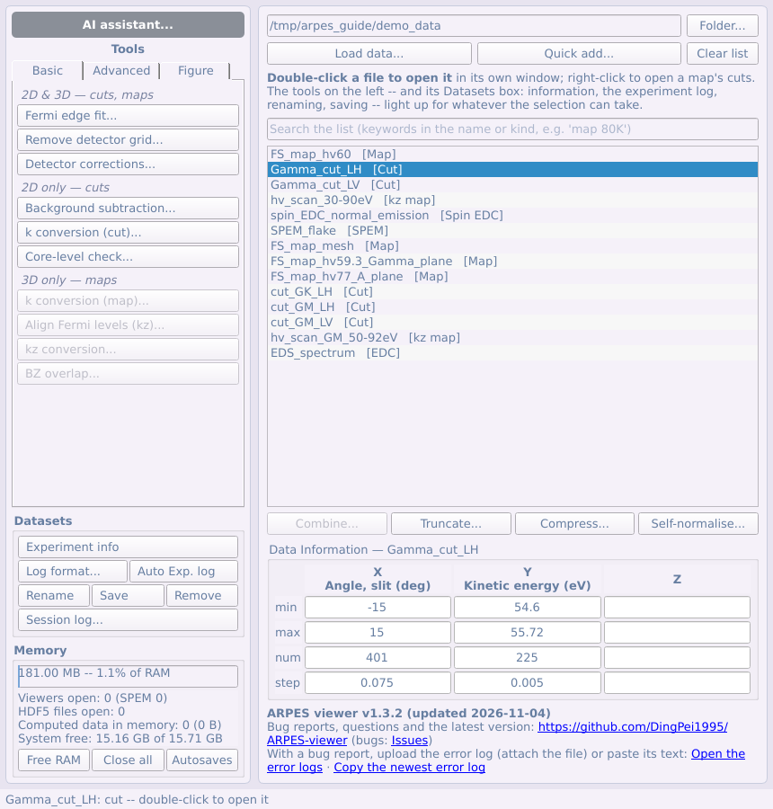

The main window is a **browser**: one row per *dataset*, not per file (one
`.nxs` file often holds several measurements, and each gets its own row). The
kind is written after the name: `[Cut]`, `[Map]`, `[kz map]`, `[k-map]`,
`[SPEM]`, `[EDC]`, `[Spin EDC]` …

It has three parts:

- **The tool panel** (left): the **AI assistant...** button at the top
  ([Part 7](#part-7--ai-agents)), then every analysis and processing tool as
  a button, in three tabs: **Basic**, **Advanced** and **Figure**
  ([Parts 4–6](#part-4--the-tool-panel-basic-tab)). Below the tabs, the
  **Datasets** box.
- **The list** (right), with its buttons.
- **The Memory box** (bottom left) and the version line (bottom right).

| Action | How |
|---|---|
| Open a dataset in its own window | **double-click** the row (or right-click → **Open**) |
| Run a tool on the selected rows | its button in the **tool panel** |
| Stack several cuts into one map, or join a map / kz map measured in segments | **Combine...** under the list |
| Crop to a range, bin points, normalise each spectrum to itself | **Truncate...**, **Compress...**, **Self-normalise...** under the list |
| Open a map's slit or scan-axis cut | **right-click** the row (or a selection of rows) |
| Read the metadata, write the experiment log, rename, save, remove | the **Datasets** box of the tool panel, above Memory |
| See and free memory, close every viewer, open the autosave folder | the **Memory** box, bottom left |
| See which version you are running, report a bug, get the latest version | the title bar and the last line of the window (link to GitHub) |

The four buttons under the list act on the rows selected above them, and each
makes new rows — the originals are never changed.

**The right-click menu** holds only the ways of opening the rows: **Open**,
**Open slit cut** and **Open scan-axis cut** (for a map). An entry that does
not fit the selection is greyed, with the reason in its tooltip.

**The Datasets box** (tool panel, between the tools and Memory) holds the
rest of what is done to the rows: **Experiment info**, **Log format...** and
**Auto Exp. log** side by side (see [the experiment log](#23-the-experiment-log)),
**Rename**, **Save** and **Remove** on one row, and **Session log...**. Its
buttons grey out when they do not fit the selection.

**Finding and ordering rows.** The **search box** above the list shows only
the rows whose name or kind holds every word typed (`map 80K`); clear it to
see them all. Hidden rows are deselected, so nothing out of sight is acted
on. Right-click the list → **Sort by name** (`Cut_9` before `Cut_10`) or
**Sort by data type** (grouped by the last processing tag of the name --
`[norm]`, `[E-E_F]`, `[k]` ... -- in processing order, then by kind and
name; see [§1.5](#15-data-kinds)).

## 2.2 Loading data

**Load data...** opens the loader. **Quick add...** skips it and adds the
chosen files with everything detected automatically.


1. **Files** — pick one or many (*Select file(s)...*). The file filter is built
   from what the installed readers can open.
2. **Reader** — detected automatically, and the result is shown
   (*Detected: 3 × This program's own format*). Override it only if a file is
   being misread.
3. **Datasets found** — what is inside each file, read from its *structure*
   only. This is instant even for a multi-GB scan; nothing is read until you
   open a row.
4. **Axes** — *Axis order* reorders the array's dimensions once, at the door.
   *First axis of a map is* says what was scanned: a deflector angle (the
   default), a **photon energy**, a temperature, a gate voltage, a delay… This
   keeps the right unit everywhere afterwards, and stops a k conversion being
   offered for an axis that is not an angle.

**CASSIOPEE folders.** Select any file of a numbered series
(`name_1_ROI1_.txt`, `name_2_ROI1_.txt`, …) and the whole folder is listed
once, as one assembled cube. Whether it becomes an angle map or a kz map is
read from the `_i` parameter files next to the spectra. The row is named
with the photon energy and polarisation read from those files —
`FineMap 117eV LH`, or `KzScan 40-120eV LH` for a photon-energy scan — so
repeats of the same scan at another energy or polarisation can be told
apart.

**ANTARES photon-energy (PhD) files.** A PhD `.nxs` file (one `Phd_NNNN`
entry per photon energy) is listed as one `kz map`: the frames are sorted by
photon energy and each kinetic-energy axis is referred to E_F with its own
hν (work function 4.5 eV, which the k_z conversion then uses). Each frame
still opens on its own as a cut.

## 2.3 The experiment log

Two buttons side by side in the **Datasets** box write the beamtime's log --
a CSV file, one row per measurement -- from the files' own metadata:
**Log format...** (left) sets it up once, **Auto Exp. log** (right) adds the
selected datasets to it with one click.

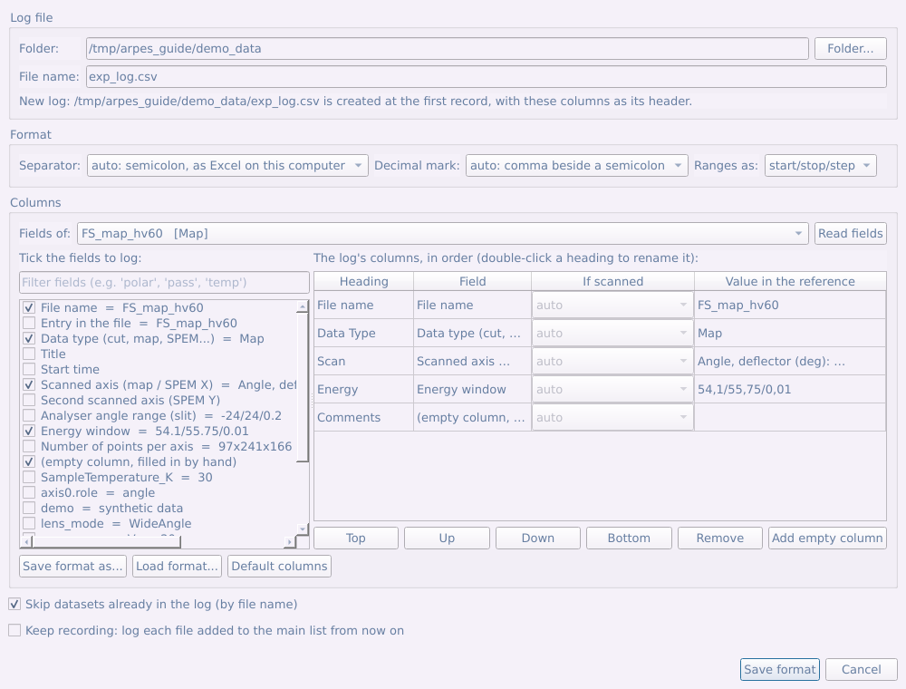

**Log format...**

1. **Log file.** Choose the folder and type the file name. If a log of that
   name already exists, the window shows **that log's own format**, ready
   to adjust.
2. **Format.** *Separator* and *Decimal mark* are by default what Excel
   uses on this computer. Excel splits a CSV at the system's list
   separator -- a **semicolon** wherever the decimal mark is a comma (French,
   German, Italian... settings) -- so a comma-separated file opens there
   with everything in the first column. Leave them on *auto* unless the log
   is for a computer set up differently. *Ranges as:* writes a range
   `start/stop/step` or `start:step:stop`.
3. **Columns.** *Fields of:* picks a dataset of the main list -- choose one
   of the kind you log most -- and **Read fields** lists everything it has,
   with its value: the file name, data type, start time and scanned ranges
   worked out from the data, then every metadata field and motor. **Tick**
   a field to add it as a column. In the table on the right, double-click a
   heading to rename it (`hν/Δ`, `Polar/Δ`, `Epass`...), and use **Top /
   Up / Down / Bottom** to put the columns in any order. **Add empty
   column** gives one to fill in by hand (comments). **Save format as...** /
   **Load format...** keep one format per beamline.
4. **If scanned.** What a position or angle column says depends on the
   measurement:
   - a **cut**: the sample stood still -- the motor's value;
   - a **SPEM** scan: the scanned stage axis as `start/stop/step`
     (choose *SPEM: scanned X* / *Y* for the stage columns);
   - a **map** taken with the manipulator rather than the deflector: the
     angle as `start/stop/step` (*map: scanned angle*), and a sample
     position the beamline corrected along with the angle as
     `first..last`;
   - a **kz map**: the photon energy range (*kz map: photon energy*).

   *auto* (the default) recognises the scanned motor by name, and a
   position that moved by its values. Any other measurement gets the
   field's own value.
5. **Save format.** If the log already holds records and you changed its
   format, it is **rewritten under the new header**: each record moves with
   its columns (renamed or moved columns are followed), new columns are
   empty for the old records, and columns you took out are named first,
   since what they hold goes. The header stays the only first row.

*Skip datasets already in the log* leaves out files whose name is already in
the log's file-name column. **Keep recording** logs every file you add to the
list from then on, until the program is closed: during a beamtime, add each
file as it is measured and the log keeps itself.

**Auto Exp. log** adds the selected rows to the log, after its last record,
without opening anything; the status bar says how many were added. The very
first time, it opens *Log format...* first.

If the log is open in Excel, Windows will not let it be written: close it
there and click again.

## 2.4 Combining datasets: stacking, joining and summing

**Combine...** (under the list) does two different things, and asks which:

- **Stack** — *cuts only*. Each cut becomes one slice of a new map, along an
  axis you name: a temperature series, a gate-voltage series, one cut per
  photon energy. The result is looked at like any map — sliced at constant
  energy, or along the new axis.
- **Join** — *cuts, maps, kz maps or k-maps, all of one kind*. The pieces of
  one measurement that was taken in segments are put back end to end along
  one of their own axes: a map whose deflector range was scanned in two
  parts, a kz map whose photon-energy range was split over several runs, a
  cut whose energy window was taken in two halves.

**Stacking cuts**

1. Select the cuts in the list (Ctrl/Shift-click) and press
   **Combine...**. Stacking needs one axis the same point for point (same
   number of points, same values, same units). If the **other** axis
   differs — typically energy windows a little apart between the cuts —
   the cuts are still stacked: that axis is **truncated** to the range all
   of them cover and each cut resampled onto the first cut's points there
   (the dialog says so, with the range). If both axes differ, or the ranges
   do not overlap, *Stack* is greyed with the reason, and *Join* is offered
   instead.
2. It asks whether to combine them **in the list's order**. *Yes* keeps that
   order; *No* lets you choose it.
3. Choose **Stack**, then set the new axis: **New axis is** (temperature,
   gate voltage, photon energy, delay, position, other — this fills in
   *Name* and *Unit*, which you can change), **Start** and **Step**. Each
   cut is listed with the value it gets. If you chose to reorder, **drag**
   the rows (or use **Move up** / **Move down** / **Reverse**). Press
   **Combine**.


A photon-energy series of angle cuts becomes a `kz map`, so *Align Fermi
levels (kz map)* and *Convert to momentum (kz, k∥)* take it (see
[§4.10](#410-aligning-the-fermi-levels-of-a-kz-map)); any other axis gives a `map` whose first
axis is marked as not an angle, so no k conversion is offered for it.

**Joining pieces of a measurement**

1. Select the pieces (all maps, or all kz maps, or all cuts …) and press
   **Combine...**. Maps and kz maps go straight to *Join*.
2. **Join along**: the axis the measurement was split along. It starts on
   the axis whose range differs between the pieces — a map's deflector
   axis, a kz map's photon energy, or the energy of cuts taken in two
   energy windows — so it is usually right already.
3. **Where pieces overlap**: *Average them*, or keep the earlier / later
   piece in the order shown (drag the rows to change it).
4. The dialog lists each piece's range and shows the **Result** — the joined
   range and the number of points — with notes on anything it had to do.
   Press **Combine**.


How the axes are handled:

- Pieces on one common grid (same step, ranges that meet or overlap by whole
  points — the usual case) are **copied as measured**, nothing
  interpolated.
- A piece with a different step or a half-step offset is **interpolated**
  onto the common axis (the first piece's step), and the dialog says so.
- If the **other axes** differ — an energy window a few meV different
  between runs, a different number of slit channels — every piece is
  resampled onto the range they **all** cover, and the dialog says so.
- A stretch that no piece covers is a **gap**, left at zero and reported.
- A joined kz map is still a `kz map`: run *Align Fermi levels (kz map)*
  on the joined result rather than on the pieces (per-photon-energy fit
  results of the pieces are not carried over).

### Summing repeated scans

For a fine cut or map taken as many short scans so that an ageing sample can
be caught. Select the scans (two or more of one kind) → **Combine...** →
**Sum repeated scans** → **Combine**, which opens the repeated-scans window:

1. **Are these repeats?** Each scan's grid and recorded conditions (photon
   energy, polarisation, angles, position, temperature, pass energy, lens
   mode); orange marks a value that differs from the first scan.
2. **Has the sample changed?** Press **Compare the scans**. Each scan is
   compared with the sum of the others: *χ² / point* is about the same for
   scans that differ only by counting noise and grows when the spectrum
   changed; scans well above the rest are marked **changed**. The energy
   shift of each scan's EDC and its count rate are listed; click a row to
   see its EDC against the rest.
3. **Sum.** Tick the scans to keep (changed ones start unticked), choose
   whether to undo the energy shifts, **Sum** or **Mean**, and **Sum to
   list**.

## 2.5 Step-by-step windows

The tools that take several decisions open as **numbered steps** (sum
repeated scans, detector corrections, tight-binding fit, crystal structure,
calculated bands): the title says *Step 2 of 4: …*, a blue box says what
the step is for and what to do, **Next →** stays greyed (with the reason
beside it) until the step is done, and **← Back** or the list of steps on
the left goes back.

---

# Part 3 — The data viewers

Each dataset opens in a viewer window of its own. This part covers what all viewers share, then each kind of data in turn.

## 3.1 What the viewers have in common

Each dataset opens in its own window, so you can put a map, its cuts and
another file side by side.


- **The top row**: the **Functions** menu (everything the window can do),
  **Plot tools** (guide lines and labels on this plot — see below), the
  colormap (per window) with **Flip**, and the view controls — axis ranges,
  **Auto**, **Inv** (invert), **Reset**, **Grid**.
- **Above each image**: the **Levels** bar (drag the two handles, or type
  **Min%/Max%** percentiles; **Clip** applies them) and **Gamma**. A min/max
  you set is kept while you move the slice (the energy of a contour, the
  angle of a cut, the cursor of a spatial map), so every position is on the
  same colour scale; drag the handles back to both ends, or set 0%–100%, to
  follow each frame's own range again.
- **Under each image**: **Smooth** (display only, does not change the data)
  and **Lock x/y** (aspect ratio).
- **Readout cursor** — right-click the image → *Readout cursor*. It reports
  the value under it and, on a cut, draws the **EDC** (right) and **MDC**
  (below) through that point. **EDC ±** / **MDC ±** integrate over a window,
  shown as a shaded band on the image. Type a position into the **Cursor**
  row and press Enter to put it exactly there.
- **EDC → list** / **MDC → list** put the curve on screen in the main list as
  a dataset of its own (see [§3.5](#35-curves-edcs-mdcs-and-the-curve-fit)).
- **Right-click the image → Export** saves what the panel shows — data
  (`.nxs`), an image, or vector axes (`.eps`); see [§6.1](#61-the-figure-composer).
- **Functions → Slice → Save slice to the main list / Freeze slice in a new
  window** keeps a copy of the slice on screen. The frozen window (and *Open
  this position in a new window* on a spatial map) opens with the panel's
  min/max and gamma, so the two can be compared directly. It has its own
  **Plot tools**, and a **Figure composer...** button to make a figure of it
  ([§6.1](#61-the-figure-composer)).

The **Functions** menu now holds only what works on the window itself —
the tools that take a dataset are in the launcher's tool panel
([§2.1](#21-the-main-window-at-a-glance)):

| Viewer | Functions |
|---|---|
| map / kz map / k-map (contour) | Arbitrary cut; Slice: save / freeze the slice |
| cut | Slice: save / freeze |
| a map's slit cut | Show the map |
| curve | Curve fit, Spin analysis; Crop, Bin, Normalise, Background, Shift axis, Add √N errors |

An entry that applies but cannot run yet is greyed, with the reason in its
tooltip.

**Brillouin zone tick box.** A k-map or converted kz map on which a zone has
been plotted ([§4.12](#412-brillouin-zone)) keeps it: its viewer has a
**Brillouin zone** tick box on the top row that shows or hides it.

### Plot tools: guide lines and labels on the plot

**Plot tools** on the top row of every viewer (cuts, maps, spatial scans,
curves, frozen slices) opens a small window that draws **on the plot in
front of you**:


|  | |
|---|---|

- **Type**: *Vertical line*, *Horizontal line*, *Line at an angle* (through a
  point; the angle is in the plot's own units, i.e. the slope is tan(angle)
  y-units per x-unit), or *Text label*.
- **Position** (x, y), **Angle**, an optional **Label** (shown on the line,
  e.g. `E_F`, `Γ`), a **Colour** (nine one-click colours, or **More...**),
  **Width**, **Style** (solid, dashed, dotted, dash-dot) and **Text size**.
- **Add** draws it at the position typed (**Centre of view** fills that in);
  **Place by clicking** draws one wherever you click on the plot.
- **Drag** a line on the plot to move it; the window follows. Select a guide
  in the list to **edit** it — every change shows at once — or **Remove** it;
  **New guide** stops editing; **Remove all** clears the plot.
- In a window with more than one panel, **Draw on** chooses which.
- Guides stay while the slice moves (an E_F line stays at E_F as you scroll
  through a map) and while the Plot tools window is closed. The panel's
  **Export → Image** draws them too (*Include the Plot tools guides*).

*Plot tools* are for looking at the data. To make a figure for a paper, use
the **figure composer** and its **Figure tools** ([§6.1](#61-the-figure-composer)).

## 3.2 Maps: the contour and its two cuts

A map opens on its **constant-energy contour**. The slider at the top picks
the energy (**Pos** in eV, or **Ind** as an index; **±** integrates over a
window, **mean** or **sum**). **Scan-axis cut** and **Slit cut** open the two
orthogonal cuts, each in its own window. (The scan axis is whatever was
scanned to make the map — usually the deflector angle, but a manipulator
rotation or, for a kz map, the photon energy — so the button is named for
that.)


| Slit cut (slit angle vs energy) | Scan-axis cut (deflector angle vs energy) |
|---|---|
|  |  |

**One cursor for all three windows.** Switching the readout cursor on in any
of them switches it on in the others, and moving it anywhere re-slices the
others through the new point. The axes keep one colour each everywhere:
**deflector red, slit green, energy blue**. A cursor line has the colour of
the axis it holds constant, and the EDC or MDC it feeds is drawn in the same
colour. Integration widths (the ± boxes) belong to each window and are never
shared.

From the list you can also open a map's cut straight away (right-click →
**Open slit cut** / **Open scan-axis cut**); the contour then stays hidden
until you ask for it (*Functions → Show the map*).

## 3.3 Arbitrary cuts

*Functions → Arbitrary cut...* on any contour: click up to six points (or type
them) and the cut runs through them in order — here Γ → M → K → Γ on the
k-map. **One dataset per segment** lists each leg separately.

| Path on the contour | Points |
|---|---|
| 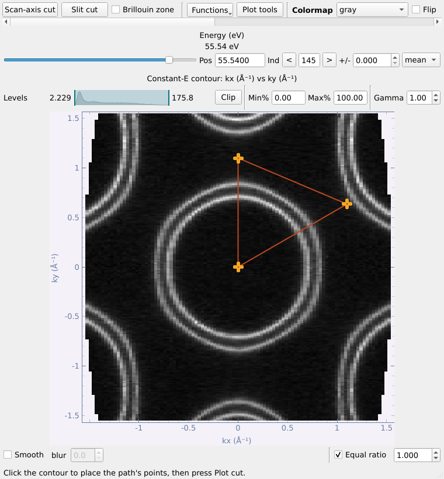 |  |

The result is a cut against the distance along the path; the corners of the
path are marked with dashed green lines, so a kink there is not mistaken for
physics.

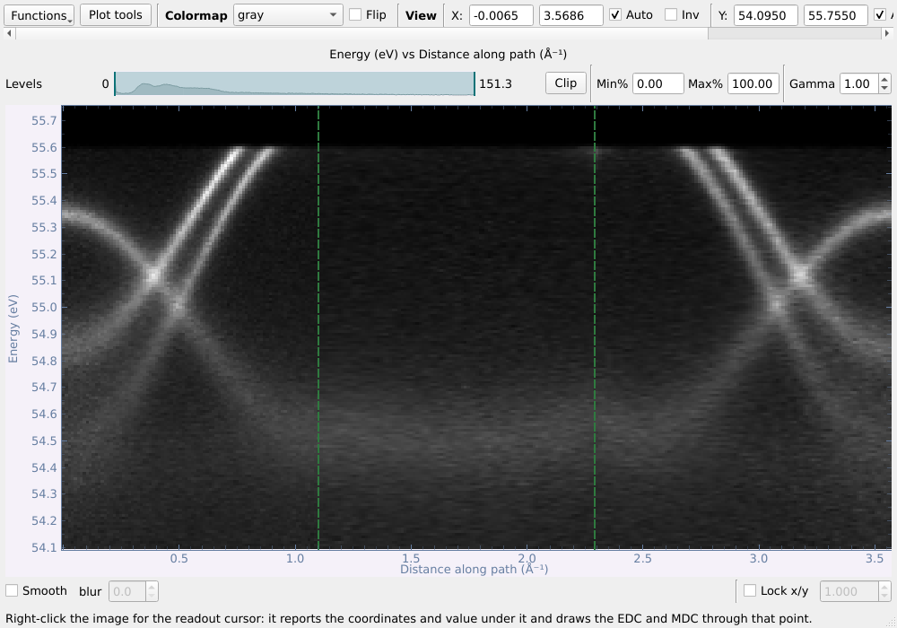

The Fermi-surface (FS) correction, which straightens a Fermi edge the
analyser bends, is a tool of the tool panel's Basic tab
([§4.3](#43-fermi-surface-correction)).

## 3.4 kz maps and k-maps

A **kz map** (photon-energy scan) opens like an angle map: its contour shows
photon energy against the analyser angle at the energy chosen by the slider,
and its two cuts are the spectrum at one photon energy and the
photon-energy dispersion at one angle. Align its Fermi levels and convert it
to (k_z, k∥) from the Basic tab ([§4.10](#410-aligning-the-fermi-levels-of-a-kz-map),
[§4.11](#411-converting-a-kz-map-to-momentum)).


A **k-map** (a map converted to momentum, [§4.9](#49-converting-a-map-to-momentum))
and a **converted kz map** open in the same contour viewer, on momentum axes.
When a Brillouin zone has been drawn on them ([§4.12](#412-brillouin-zone)),
they keep it, and a **Brillouin zone** tick box on the top row shows or hides
it. Slice series ([§5.6](#56-slice-series-figure)) and exports draw it too.


## 3.5 Curves: EDCs, MDCs and the curve fit

**EDC → list** / **MDC → list** under any image, or a spin-resolved file,
give a curve dataset, which opens in the **curve viewer**:


Channels can be hidden, offset into a waterfall (**Offset**), shown with
**Error bars** (from a σ channel), and **Range** marks an x window used by
the operations. *Functions → Transform* gives **Crop**, **Bin**,
**Normalise**, **Subtract a background** (constant, linear, Shirley),
**Shift the axis** and **Add counting errors (√N)**; each makes a new dataset
and propagates σ correctly.

### Curve fit

*Functions → Curve fit...*: **Peaks on a background** (Lorentzian, Gaussian
or Voigt peaks placed by clicking or **Find peaks**; none / constant /
linear / Shirley background; instrumental resolution; optional **× Fermi
edge**), or the **Fermi edge** itself. Weighting is the channel's own σ,
√N, or uniform. Every parameter comes with its error; the residual is shown
in units of σ.


**Fit to list** keeps data, fit, residual and components; **Copy results**
copies a tab-separated table. A Fermi-edge fit can **List a copy with
E_F = 0**.

## 3.6 Spin-resolved data

A spin EDC opens with one curve per spin channel:


*Functions → Spin analysis...*:


- The table reads each channel's label (manipulator setting, target
  magnetisation, axis and sign counted as "up"); **Axis** and **Counts as**
  can be overridden.
- **Cross ratio** (default when the channels allow it) cancels both the
  transmission and the target reflectivity exactly; **one pair** is available
  but carries the instrumental asymmetry, which is measured and reported (ε).
- **S_eff** (Sherman function, default 0.2), **Bin**, optional **Zero
  reference** window.
- Plots: raw channels, P with its error bars, and I↑ / I↓ with errors.
- **P to list**, **I↑ / I↓ to list**, **As a figure** (opens the figure composer).

## 3.7 Spatially resolved scans (nano-ARPES)

A real-space scan opens in **two windows**: the **spatial map** (the total
intensity at each position) and, beside it, the **E vs k spectrum at the
cursor** in the cut viewer — with the cut viewer's own tools (Functions, the
readout cursor with EDC/MDC, Export). On the map, the **readout cursor**
(on from the start) picks the point: drag it, or type a position in the
**Cursor** row under the map. Closing either window closes both.

**Selection box** — in the row above each picture. Tick it, drag the box
(or type its corners **x0 y0 x1 y1**), then press **Refresh** (or Enter);
nothing is computed until then, so a large scan is read only when you ask.
Unticking the box hides it but keeps its corners — tick it again and it is
back where it was — and keeps the **result**: the integration stays on
screen until you press **Reset** (beside Refresh).

- on the map, the spectrum window shows the spectra **summed over the box**.
  The spectrum stays the box's sum, ticked or not, until **Reset**; then it
  follows the cursor again;
- on the spectrum, the map shows the intensity of the chosen **(k, E)
  window** across the sample — how a domain or a flake edge is found.
  **Reset** gives the full map back.

**E vs position / k vs position** — two tick boxes on the row under the
selection box (one at a time). They draw, **beside and under the map**, the spectrum through the
cursor against each spatial axis: energy (or k) against position, sharing
the map's axes. Two **dashed lines** appear on the spectrum: the band of k
(for E vs position) or of energy (for k vs position) the picture is
integrated over. Drag the lines (the shaded band between them does not take
the mouse, so a selection box under it can still be dragged), or type
**from / to** in the **Band** boxes above the spectrum. The window grows to
make room for the pictures beside and under the map, so the map keeps its
size, and shrinks back when they go.

**Line cursor** — right-click the picture beside or under the map →
*Line cursor*. A line at one energy (or k) appears on that picture, and the
intensity along it is plotted against position **further right** (for the
picture beside the map) or **further down** (for the one under it). Drag the
line to move it; untick the entry to remove it.

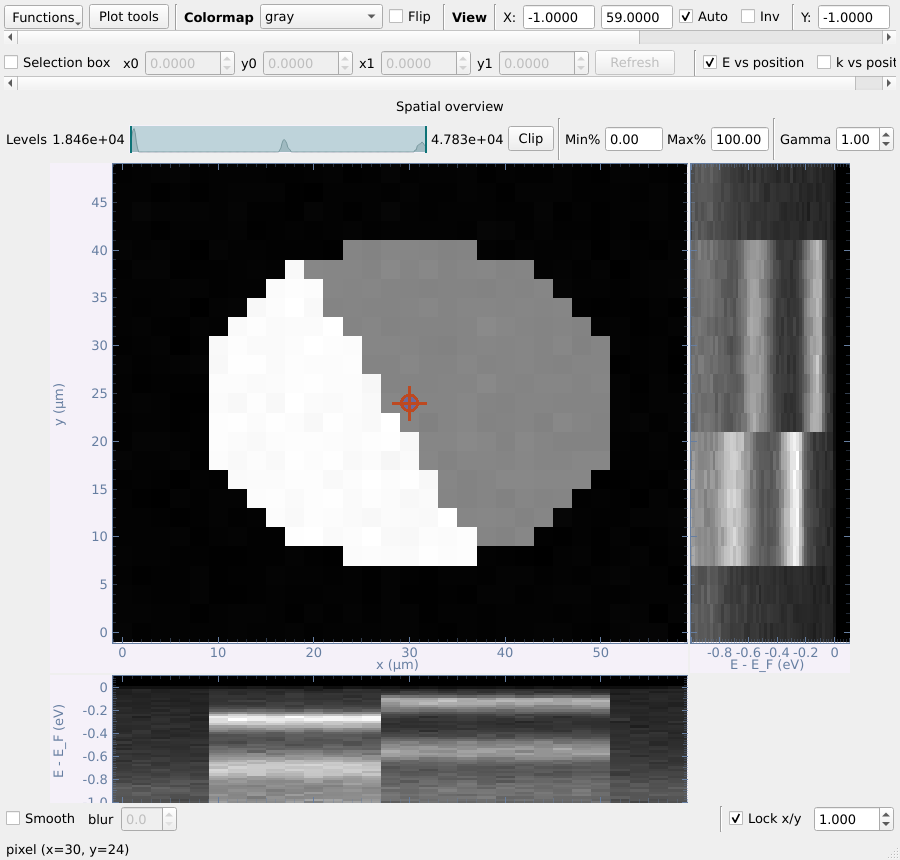

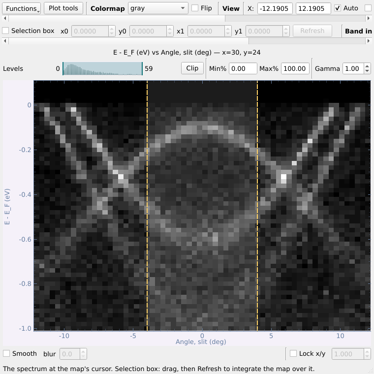

## 3.8 Exporting a panel and saving data

Right-click any image → **Export** → **Data (.nxs, Igor)...**, **Image...** or
**Axes only (.eps)...**. It always exports exactly what the panel shows
(range and all): the data as a dataset this program reads back, or for
Igor Pro (`.itx` text or `.ibw` binary wave, with the axes scaled, the units
set and the metadata in the wave note); an image
with the colormap applied (PNG, TIFF or JPEG, at a chosen size and dpi, with
or without the axes, with the Plot tools guides if there are any, and with
the Brillouin zone if the dataset has one); or the frame, ticks and labels as
vector PostScript to place the image in, in Illustrator (optionally with the
Brillouin zone drawn in the box — see [§4.12](#412-brillouin-zone)).

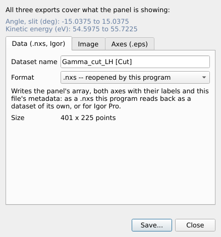

**Save** (tool panel, Datasets box) writes the selected datasets to a
`.nxs` file of your own -- several selected rows go into one file -- or, by
choosing the file type, for Igor Pro: one `.itx` holding them all, or one
`.ibw` per dataset. An Igor file is a copy; the rows stay as they were.

---

# Part 4 — The tool panel: Basic tab

The **Basic** tab holds the steps nearly every dataset goes through: the Fermi level, the detector, the background, the conversions to momentum, the core levels and the Brillouin zone.

## 4.1 How the tool buttons work

Each tab groups its tools by the data they take: *2D & 3D — cuts, maps*,
*2D only — cuts*, *3D only — maps*. **A button lights up only when the rows
selected in the list are what it takes**: a k conversion (cut) needs one
angle cut, cut arithmetic exactly two cuts, a 3-D view a map. Hover over a
greyed button to see why it is greyed.

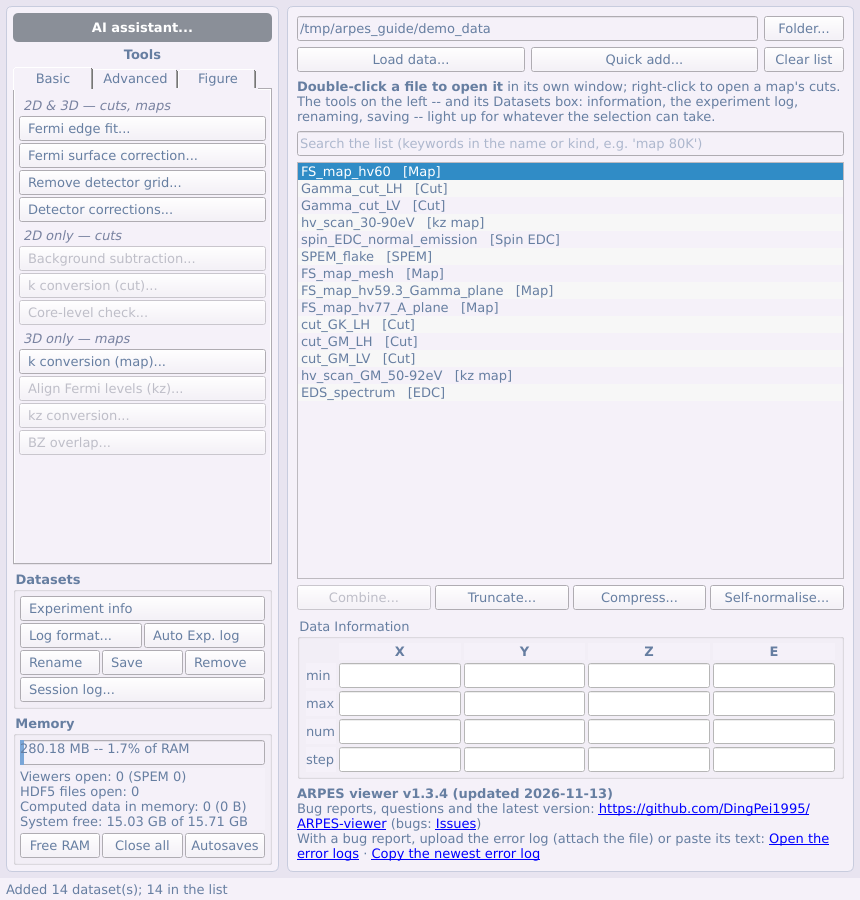

A tool never changes the rows it was given: its result is a new row in the
list, named after the original with what was done (`cut1 [k]`), and its
history records the step and its parameters (*Experiment info* shows it).
Tools that take several decisions open as numbered steps
([§2.5](#25-step-by-step-windows)).

## 4.2 Fermi edge fit

The usual order for a single cut is: **Fermi edge fit → offset the energy axis →
convert to momentum → MDC/EDC fit**. Each step is a button of the tool panel:
select the cut in the list and press it.

Tool panel → Basic → **Fermi edge fit...** fits a Fermi edge (Fermi–Dirac ×
linear DOS, convolved with a Gaussian resolution) to the EDC summed over a
box. It opens the cut's viewer together with the fit window; the two belong
together, and closing either closes the other. The window has two columns:
on the left everything that is set (the region, the parameters, the
buttons), on the right the fit — the EDC and the fitted curve, always shown
whole (the plot does not zoom or pan), and the summary under it.

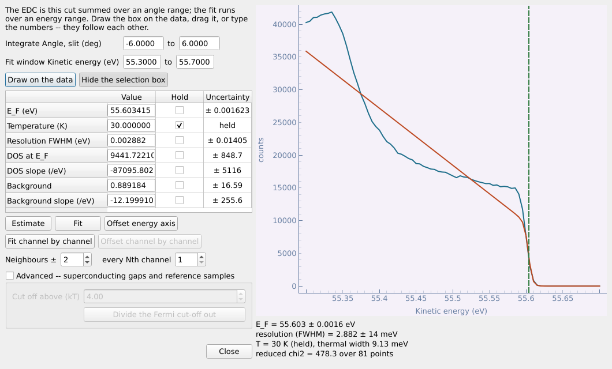

1. Set the region: press **Show the selection box** and drag the box on
   the cut — its width is the angle range summed, its height the energy
   window fitted — or type the ranges. The two follow each other.

   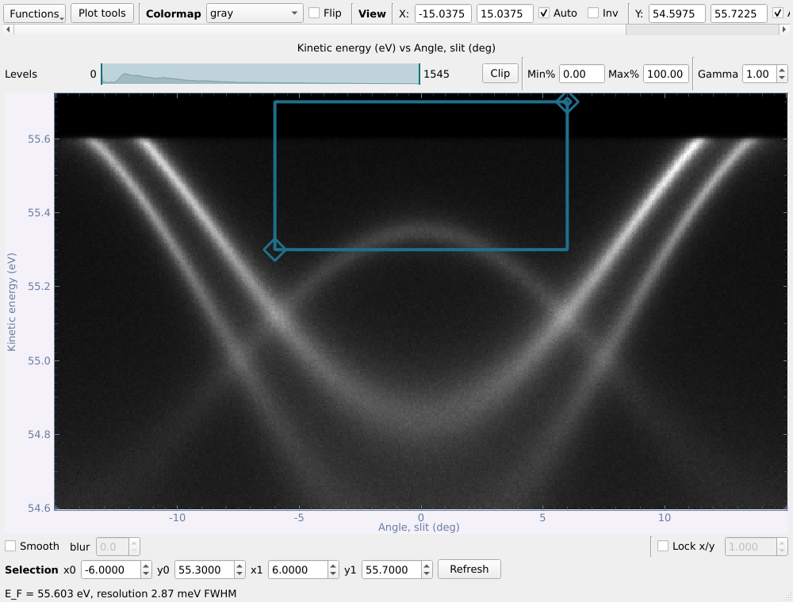

2. **Estimate**, then **Fit**. Tick **Hold** to keep a parameter fixed
   (the temperature is held at the recorded value by default). Every
   parameter is reported with its uncertainty.
3. **Offset energy axis** lists a copy of the cut on **E − E_F**.

**Channel by channel.** On the row under Fit, **Fit channel by channel**
fits the edge across the detector, over the fit window, and draws E_F
against angle on the cut — the curvature of the Fermi edge, measured. Its
settings are not fixed defaults; they are measured on the data:

1. The EDC summed over the selection box is fitted first (as **Fit** does):
   the **seed**, whose line shape every channel fit starts from. If the box
   holds too few counts to determine the resolution, you are asked to
   enlarge it.
2. A few quick trial fits at several widths measure how precisely one
   channel gives E_F, and from that **how many channels each fit has to
   sum** to reach a useful precision (10 meV, two energy steps or a tenth
   of the resolution, whichever is larger).
3. That number is compared with the channels measured. If fewer than ten
   independent fits would fit across the detector, the program says that
   **these data are not suited to a channel-by-channel fit**, with the
   numbers, and suggests one E_F (Fit, then Offset energy axis) or the
   Fermi surface correction instead. Otherwise it proposes the settings —
   channels per fit, a fit every N channels, keeping the seed's line shape
   (only E_F, the height and the background fitted per channel) — with the
   precision to expect, to accept or change.

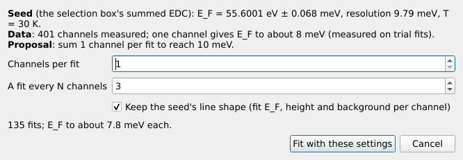

The fits run in the background: the window keeps responding, and
**Cancel** stops them at once, keeping the channels already fitted. Blank
channels at the two ends of the cut (no counts, or NaN, as some detectors
leave) are cut off, never fitted. **Offset channel by channel**, beside the
button, lists a copy with every channel on its own **E − E_F** (on a map's
slit cut: the whole map, along the slit), the blank borders cut off.

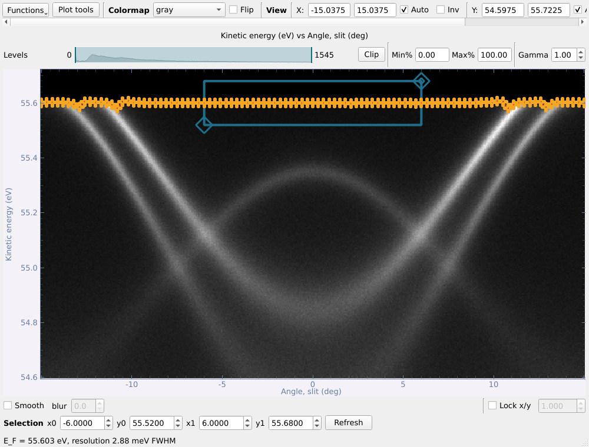

Both fits are kept with the dataset's row: that row is then a **reference**
for the Fermi surface correction ([§4.3](#43-fermi-surface-correction)).

The *Advanced* corner divides the Fermi cut-off out (for gaps and reference
samples).

**On a map.** Select a map (angle map or k-map) and press the same button:
the map's **slit cut** opens with the fit window, and the slit cut's slider
picks which cut is fitted. After a fit, **Offset energy axis** asks whether
to shift **the whole map by this cut's E_F** (*Yes*) or to fit **one E_F per
cut** (*No*). With one per cut, the **Fitted cuts** list on the right fills
as you go: move the slider, press **Fit**, repeat. A second fit at the same
place replaces the first, and every E_F in the list can be edited by hand.
Cuts between two fitted ones are shifted by a straight line between their
neighbours (beyond the first and the last, by the nearest fit), shown in the
plot under the list. **Offset energy axis by these fits** lists the
corrected map.


## 4.3 Fermi surface correction

The analyser bends the Fermi edge: at the ends of the slit it sits a few
tens of meV lower than in the middle, so a band that should be flat comes
out curved. Tool panel → Basic → **Fermi surface correction...** straightens
it: the curve of the Fermi edge is fitted with a polynomial, and every angle
column is shifted in energy so that it comes out flat. Correct it before a
k conversion.

Select a **cut**, or a **map** (or kz map) still in angle, and press the
button. A cut opens in its viewer; a map opens on its **slit cut**, and the
correction is applied to the whole cube. The viewer and the correction
window belong together: closing either closes the other. The window leads
through the steps (**Back** and **Next** move between them).

**Step 1 — how to find the Fermi edge.** Choose one:

- **By hand**: click the Fermi edge on the data viewer (three steps);
- **From a reference**: apply the Fermi edge fit of another cut or map of
  the main list (two steps). Only rows whose Fermi edge has been fitted
  with the Fermi edge fit ([§4.2](#42-fermi-edge-fit)) are offered; until
  there is one, this choice is greyed.

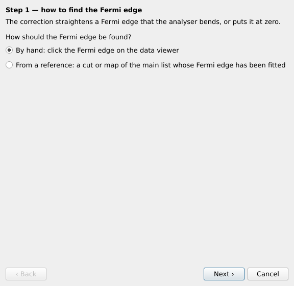

**Step 2, by hand — click the Fermi edge on the data viewer.** Click on the
picture in the data viewer where the Fermi edge is, at several angles
spread across the whole edge, ends included. Each click puts an orange
cross on the picture and a row in the table of points; the fitted curve is
drawn dashed as you go. A point placed badly can be retyped in the table,
or removed (**Remove selected**, **Clear**). Clicks count only while
picking by hand. **Back** to step 1 erases the points picked.

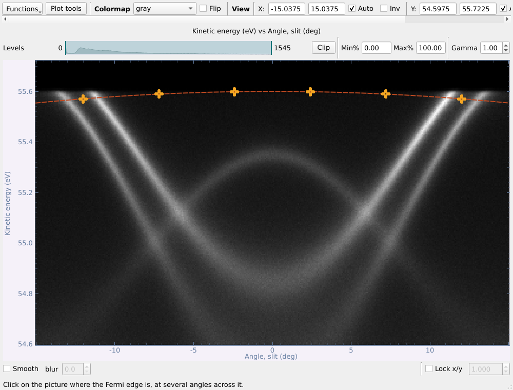

**Step 3, by hand — check the fit and correct.** The fitted curve is drawn
dashed over the data; check that it follows the Fermi edge and remove a
stray point if it does not. **Fit order** sets the polynomial (2, a
parabola, is what the analyser's curvature normally looks like; an order-n
fit needs n+1 points), **Name** the result's. **Correct** shifts every angle
column to flatten the curve and lists the result (`[FS corr]`); the energy
axis grows by the curve's span, and the bins no column reaches are left
empty.


**Step 2 of 2, from a reference — the reference, and how to apply it.**
**Reference** lists the other rows whose Fermi edge has been fitted (never
the data itself). Their fit parameters are read from them and shown —
nothing is fitted here. Then choose how the fit is applied, matching the
two ways of the Fermi edge fit:

- **One offset**: the whole data is shifted by the reference's E_F (its
  *Fit*, the whole edge). The result is on E − E_F, every channel alike.
- **Channel by channel**: every channel is shifted by the reference's E_F
  in that channel (its *Fit channel by channel*). Channels outside those
  the reference fitted — its blank borders included — are cut off, as are
  this data's own blank borders.

The reference's edge is drawn dashed on the data, to compare with the edge
seen there. **Correct** lists the result (`[E-E_F]`, or `[E-E_F ch]`
channel by channel).

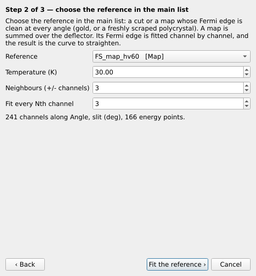

## 4.4 Removing the detector grid

MCP (hexagonal) and mesh (square) patterns print on every image. **Do it
first**: only data still on the detector's pixels can be de-gridded, so the
button refuses anything already converted, corrected or smoothed, and says
why.

Select a map (or kz map) or a cut and press tool panel → Basic → **Remove
detector grid...**. For a map, no reference is needed — the grid stays on the same pixels in
every slice while the photoemission moves. **Find and remove the grid**:


- **Before / After** a chosen slice on one colour scale (tick **Show
  −∂²I/∂E²** to make any grid obvious).
- **The grid found**, its **k-space regions** (in red), and the **contrast
  and shift** fitted for every slice.
- The power left in the grid regions (1 = no grid left).
- **Also list the grid pattern** keeps a `[grid]` dataset, which a cut taken
  later with the same lens mode and pass energy will find and use.

## 4.5 Detector corrections

On a cut, map or kz map as measured:

1. **Keystone** -- tick *Correct a trapezoidal image* and drag the four
   yellow corners onto the lit area; the right picture shows it made
   rectangular, each line's counts kept.
2. **Bad regions** -- **Add a region** and drag it over a dead or hot spot,
   or **Find bad pixels**; fill *smooth* (best for a spot) or *linear
   along* an axis (for a stripe).
3. **Apply** -- **Apply to list**. Do the grid removal, Fermi level and k
   conversion on the result.

## 4.6 Background subtraction

Tool panel → Basic → **Background subtraction...** (cuts) removes the
intensity that is not the bands: a **Shirley** or **Tougaard** inelastic
background, a floor common to every angle (a percentile of each energy
row), a smooth **polynomial** — or it divides out the **Fermi cut-off**
(Fermi–Dirac at the temperature and resolution the file records, starting
at the E_F it records or else at the steepest fall of the angle-integrated
EDC). The window is the same as the Advanced tab's processing windows —
source and result side by side, live preview, **Apply** lists the result —
described in [§5.1](#51-smoothing-derivatives-curvature-and-symmetrising).

## 4.7 Converting a cut to momentum

Tool panel → Basic → **k conversion (cut)...** converts the angle axis to k∥
(Å⁻¹). A **vertical line** is drawn on the cut: drag it to the slit angle of
Γ. The cut is then taken to run through Γ — not exact if it misses Γ, but
the only choice when only this cut was measured.


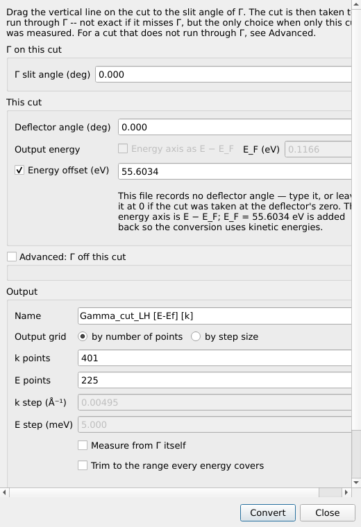

- **Advanced: Γ off this cut** is for a cut that does not run through Γ: type
  the deflector and slit angles of Γ, or **From a converted map...** to
  inherit them from a map of the same sample already converted.
- **Output energy — Energy axis as E − E_F** (off by default): tick it and
  type where E_F is on the cut's own energy axis; the result's energy axis
  is then E − E_F. The momenta do not change — the conversion still uses
  kinetic energies.
- **Energy offset** (a tick box, off by default) is *not* the Fermi level:
  ticked, its value is added to the energy axis before converting, for an
  axis that is not a true kinetic energy. If the cut is already on E − E_F,
  it is ticked and filled in with the E_F that was subtracted (the note
  under it says so): the conversion uses true kinetic energies, and the
  result stays on E − E_F.
- **Remembered settings.** The dialog starts from the last conversion of a
  cut of the same size (same number of points on each axis) — the usual case
  for a series of cuts of one sample. The map and kz conversions do the same.


## 4.8 Core-level check

A wide scan of the core levels is listed as a cut too. Select it and press
tool panel → Basic → **Core-level check...** to find out what its peaks are.

1. Type the sample's elements — `NbSCl` or `Nb, S, Cl` — and press **Next**.
   *Match within* (0.5 eV) is how close a peak must be to a tabulated level
   to count as the sample's.

   

2. Check the energy reference. E_F is fitted when the window holds the
   Fermi edge, otherwise put at hν − W. Change the photon energy, the work
   function or E_F if they are wrong (the green line can be dragged); a
   hν − E_F far from 4–5 eV means the photon energy is off. Press
   **Analyse**.

   

3. The results: the EDC on a binding-energy axis, each peak marked —
   green *sample* (orbital named), orange *uncertain* (a level of the
   sample within 2 eV: chemical shift or charging — your call), red *not
   the sample* (common elements that could explain it: contamination,
   higher-order light, Auger lines). Click a row for the full list of
   candidates. Type your own assignment in the *Assignment* column.

   

**Weak lines and peaks by hand.** Tick **Log counts** to see weak lines next
to a strong one; **Min height** (default 0.2 % of the strongest) sets how
small a found peak may be. To add a peak the search missed, press **Click to
add peak** and click the plot (a double-click always works), or type its
binding energy after *or at* and press **Add**: its position is refined by a
local fit, it is marked ◆, and it is named with every tabulated level within
±2 eV. **Remove selected** drops peaks; **Reset peaks** brings back the found
ones and forgets those added by hand. Assignments you typed survive a
**Re-analyse**.

**Peak table...** lists every tabulated level, filtered by element and
binding-energy range: look a peak up, show a level on the plot, or add it as
a peak with that level as its assignment. **Select range** shows a band you
drag over a region; **Zoom window...** opens it (or the current view) in a
window of its own with a cursor, a Gaussian fit at the cursor, and the
negative second derivative divided by the intensity — which shows a shoulder
or a weak line beside a strong one as clearly as the strong one.

If every peak is off by the same amount, the notes say so and **Apply
suggested shift** corrects it (a charged sample, or a wrong E_F). **Add EDC
to list** lists the EDC on the binding-energy scale; **Copy report** copies
the whole result as text. Measuring at a second photon energy settles what
stays doubtful: core levels stay put in binding energy, Auger lines and
higher-order light move.

## 4.9 Converting a map to momentum

Select an angle map and press tool panel → Basic → **k conversion (map)...**.
The map opens on a bare constant-energy contour — no cuts, no other
functions, just the picture — next to the conversion window; the two close
together. Drag the readout cursor to the point that should become
**k = (0, 0)** — the dialog follows it — then **Convert**. The result is a
new `k-map` row in the list.

| The contour for picking Γ | The conversion |
|---|---|
|  | 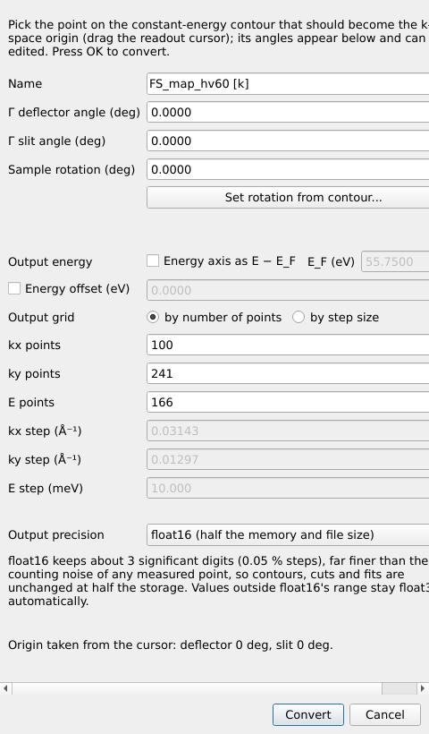 |

- **Γ deflector angle / Γ slit angle**: the angles of the point that becomes
  k = (0, 0), filled in from the cursor.
- **Sample rotation** turns the map about the surface normal; **Set rotation
  from contour...** reads it off a direction you click on the contour (two
  points along a mirror line, say).
- **Output grid**: number of points, or resolution (Å⁻¹, meV). The
  numbers of points start at the measured ones — as many kx points as
  deflector angles, ky points as slit angles, E points as energies.
- **Output energy — Energy axis as E − E_F** (off by default): tick it and
  type E_F as it is on the map's energy axis; the k-map then comes out on
  E − E_F. The momenta are the same either way.
- **Energy offset** (a tick box, off by default) is not the Fermi level:
  ticked, it is added to the energy axis before converting, for an axis
  that is not a true kinetic energy (ticked and filled in automatically for
  a map on E − E_F).
- The settings start from the last conversion of a map of the same size, so
  a second map of a series needs no retyping.

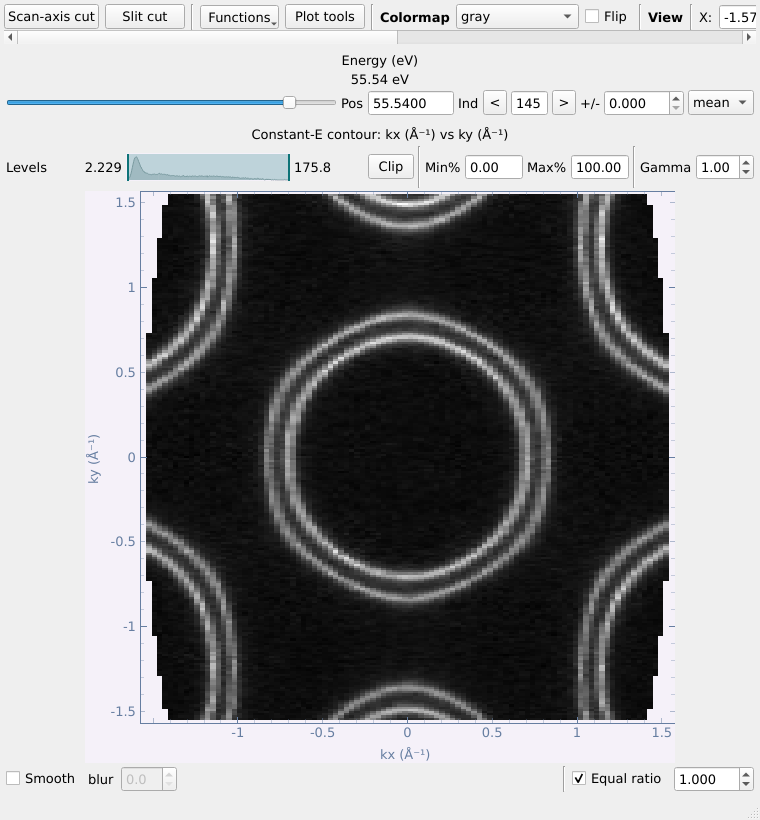

## 4.10 Aligning the Fermi levels of a kz map

A photon-energy scan is listed as a `kz map`; its contour is photon energy
against angle at one energy.


Nothing in the files says where each spectrum's Fermi level really is.
Tool panel → Basic → **Align Fermi levels (kz)...** measures it from the
spectra themselves; the kz map's slit cut opens with it, and the two close
together.

1. The slit cut opens with a box on it. Drag the box over a Fermi edge — the
   angle range sets the channels summed, the energy range the fit window.

   

2. **Fit and assemble**: the same box (by detector index) is used for every
   spectrum; each is shifted to put its own edge at zero; the cube is cropped
   to the range they all cover; and, by default, each spectrum is
   **normalised by its total intensity**, which divides out the photon flux.


E_F against photon energy is plotted. A smooth curve means the fits are
sound; points whose fit is not believed are marked and filled in from their
neighbours.

## 4.11 Converting a kz map to momentum

Tool panel → Basic → **kz conversion...** converts the scan to (k_z, k∥). It
starts from the last conversion of a scan of the same size.

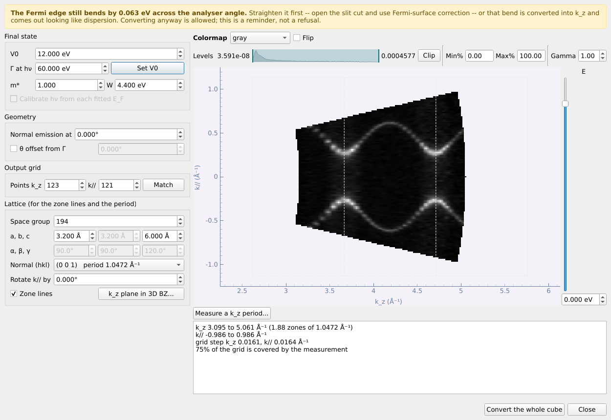

- **Inner potential V0** is the unknown: the preview reconverts one energy
  slice as you change it, in milliseconds. It may be negative (down to
  −30 eV; the report then says so). **Γ at hν → Set V0** gives the V0 that
  puts Γ at normal emission at the photon energy you name (the zone order
  nearest the present V0 is shown).
- **Manipulator theta** is off by default: a kz map is taken with the slit
  through Γ. Tick *Correct a manipulator theta offset from Γ* only to
  correct an offset, and type it **relative to normal emission** — the
  motor's absolute reading in the file is shown in the tooltip, not used.
- **Output grid**: by default k∥ gets one point per analyser angle channel
  and k_z the number that makes its step the same (*Match the measurement*
  sets it again); the steps are in the report.
- The energy of the preview is the **slider** beside it; above it are the
  data viewers' colour controls: colour map, *Flip*, and the level bar
  (levels, *Clip*, percentages, *Gamma*).
- **Calibrate hν from each fitted E_F** (optional, off by default): after the
  Fermi level has been fitted per photon energy (kz map → align E_F), uses
  hν − E_kin(E_F) measured at each photon energy instead of the single work
  function — for a monochromator whose hν is off. The default is the single
  work function, with E_F already flattened.
- With the **lattice** (space group, a, b, c), the **surface normal** and
  **Rotate k// by** (the slit direction as a turn about the normal from a*,
  or the first reciprocal axis not along the normal — any angle, since the
  slit need not run along a high-symmetry direction), the zone boundaries
  are drawn over the preview.
- **Measure a k_z period...**: click two points that are the same feature one
  zone apart; the matching reciprocal-lattice planes are listed.
- **Show the k_z plane in the 3D BZ...**: the BZ overlap tool's turnable
  cut-plane view, with the plane this map measures (surface normal and k∥
  direction, through Γ), the high-symmetry points it holds, and the measured
  k_z range in zone periods; it follows the settings as they change.
- The yellow banner warns when the Fermi edge still bends across the analyser
  angle — correct it first (Fermi surface correction, [§4.3](#43-fermi-surface-correction)).
  The bend is a parabola fitted through the edge of blocks of neighbouring
  channels, the weak channels at the slit ends left out, so one noisy
  channel or a band crossing E_F does not set it.
- **Convert the whole cube** lists a `kz map (k)`.

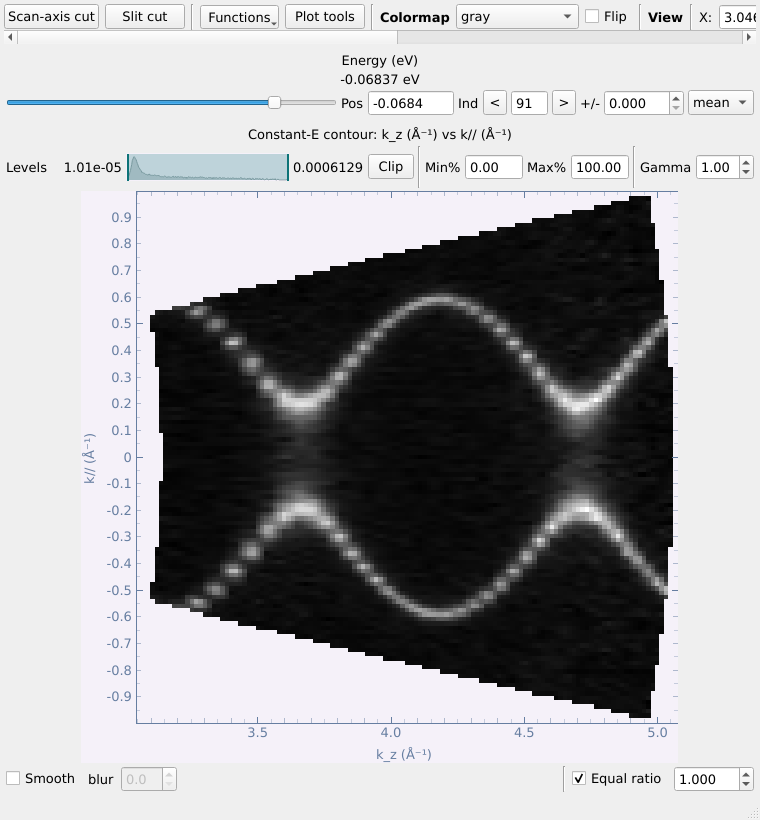

## 4.12 Brillouin zone

Select a k-map (or a converted kz map) and press tool panel → Basic →
**BZ overlap...**. Like the map conversion, it opens a contour of its
own with the zone window, and the two close together.


1. **Space group** first (1–230); the lattice parameters it fixes are greyed
   and follow the free ones. Or switch to **2D layer** for a surface lattice.
2. **Cut plane**: the surface normal (hkl) and an offset along it — the cut of
   the 3-D zone by that plane is drawn, for any surface, not only (001).
   **Through point** lists the offsets at which the plane passes through a
   high-symmetry point (Γ, Z, L, F ... for a rhombohedral crystal); choose
   one rather than working the number out. **Show cut plane in 3D...**
   previews it, with the named points marked and the ones in the plane
   ringed; **Label high-symmetry points** writes them on the contour, which
   is the quickest way to set the azimuth. The dialog opens on the last
   crystal you used, so a second map of the same sample needs no retyping.
3. **Conventional** or **Irreducible** zone; **Azimuth** (or **Pick
   direction from contour...**); **Repeat across the field of view**.
4. **Moiré** adds a second, twisted or mismatched layer and its moiré zone.
5. **Plot**.

The window is tall; it scrolls, and can be resized like every other window.

**The zone stays with the dataset.** Once plotted, it is a property of the
k-map: it is saved with it into a `.nxs` file, and its viewer shows it with
the **Brillouin zone** tick box on the top row. **Clear overlay** removes it.


Its exports can draw it too: **Export → Image...** has **Include the
Brillouin zone**, and **Axes only (.eps)...** has **Draw the Brillouin zone in
the box**, so the zone comes out as vector lines over the image in
Illustrator.

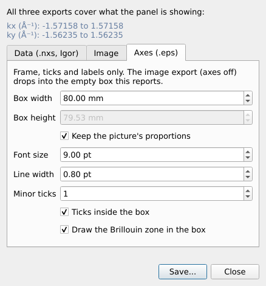

---

# Part 5 — The tool panel: Advanced tab

The **Advanced** tab holds the analysis that follows: band-sharpening filters and symmetrising, ridge detection, stack plots, MDC and EDC fits with the self-energy, cut arithmetic, the slice series figure, the 3-D views, and the Fermi-pocket analysis for quasi-two-dimensional samples (under test).

## 5.1 Smoothing, derivatives, curvature and symmetrising

Each filter has a window of its own, opened from the tool panel with one or
more cuts (or maps) selected:

| Tab | Button | What it does |
|---|---|---|
| Basic | **Background subtraction...** | removes the intensity that is not the bands: Shirley or Tougaard inelastic background, a floor common to every angle, a smooth polynomial — or divides out the Fermi cut-off |
| Advanced | **Smooth...** | Gaussian, Savitzky–Golay or moving average, with optional spike removal |
| Advanced | **Second derivative...** | −d²I/dE² or −d²I/dk² after a pre-smooth, to sharpen the bands |
| Advanced | **Curvature...** | 1-D or 2-D curvature (Zhang et al.), which follows the band better than a second derivative |
| Advanced | **Minimum gradient...** | I/\|∇I\|: bands as the valleys of the intensity's gradient — first derivatives only, so less noise; shoulders show |
| Advanced | **Symmetrise...** | mirror a cut about a line; for a map, mirror or rotate its constant-energy planes |

Every result is a new dataset carrying the steps that made it.


**Minimum gradient.** Along a band's crest the intensity is flat, so the
modulus of its gradient |∇I| is smallest there (He, Wang and Shen, Rev.
Sci. Instrum. 88, 073903 (2017)). The window shows that valley in one of
three ways: **I / |∇I|** (the one to use: an intensity that varies slowly
along the band cancels, and empty regions stay dark), **1 / |∇I|**, or
**|∇I|** itself (bands as dark lines; nothing is divided, so it is the
check on the other two). It needs first derivatives only, so it is less
noisy than a second derivative or the curvature; it favours neither axis,
so a band is followed through its turning point; and a shoulder shows.
**Floor** caps how bright a perfectly flat patch can get (lower it on
smoothed data for a sharper line). It marks *every* flat place — also the
floor between two bands — so read it beside the data, and take numbers
from a fit.

- **Source** and **Result** are shown side by side on the same scale, so you
  can see when a setting has eaten the band. They pan and zoom together.
- **Smooth first.** The second-derivative and curvature windows open with a
  tip: both amplify noise, so they usually work better on data smoothed
  first — run **Smooth...**, select its result in the list, and open the
  filter on that, or raise the pre-smooth widths in the window itself.
  A smoothed result carries the tag **‹smoothed›** in the list (and so does
  anything made from it); on such data the tip is replaced by a short
  "already smoothed" line and the pre-smooth widths start at 0.
- **Shape**: *Square pixels* (one data point is square — undistorted for an
  angle-vs-energy cut), *Equal axes* (one unit is the same length on both
  axes — right for angle-vs-angle or k-vs-k; chosen automatically when both
  axes have the same unit), or *Fill the box*.
- **Live preview** re-computes as you change a value; **Apply** lists the
  result.
- Starting values: **Symmetrise** mirrors about a vertical line through
  angle (or k) = 0, i.e. k → −k; the **Fermi cut-off** under *Background
  subtraction* starts at the E_F the file records, or else at the steepest
  fall of the angle-integrated EDC, with the file's temperature and
  resolution.

For a map the window works plane by plane, and asks **which planes** first —
constant-energy maps or dispersions — since the curvature of a contour and
the curvature of a cut are different quantities. **Preview at** picks the
plane shown; **Apply to the whole cube** runs it on every plane. The
operations and widths are named after the chosen plane's own axes
(*Second derivative along Kinetic energy*…), and the smoothing widths start
at 1/100 of each axis.


**Truncate...**, **Compress...** and **Self-normalise...** (under the list)
change the grid or the scale of one or several datasets at once — as long as
they have the same kind and the same number of points on every axis:
**Truncate** crops to a range, **Compress** bins points together,
**Self-normalise** divides each spectrum by its own total.

**Self-normalise** divides each piece of the data by its own total (or peak):

- **Normalise** picks the piece in ARPES terms, and starts on the usual
  one: *each EDC* for a cut, *each cut (slit × energy at one scan step)*
  for a map, k-map or kz map — this takes a flux or beam-current drift
  along the scan out. Other choices: each MDC, each EDC of a map, each
  constant-energy map, or *custom*.
- **Summed over** shows the axes this sums over; the ticks can be changed by
  hand, and the sentence under them says what the current ticks do ("Each
  plane over Angle, slit × Kinetic energy is divided by its own total — one
  factor for every Angle, deflector").
- **Sum only over** restricts the sum to a window on one of the summed axes
  — the energy by default — for example the energies of a core level.


## 5.2 Ridge detection

Tool panel → Advanced → **Ridge detection...** (cuts or maps) traces bands
as ridges of the intensity, each point to a fraction of a pixel, which is
sharper than a second derivative and draws no false double lines.

- **Smoothing** along each axis, in its own unit — about the band's width.
- **Threshold**: raise it until only the bands are left (yellow points on
  the source).
- **Result to list** — the ridge image (a map plane by plane, on the planes
  chosen); **Save ridge points...** — a CSV that the tight-binding fit
  ([§6.4](#64-tight-binding-fit)) reads.

## 5.3 Stack plots

**Stack plot (EDC / MDC)...** (tool panel → Advanced, with a cut selected): a
waterfall of EDCs or MDCs, with the number of curves, binning,
normalisation, offset, shear and colouring controls; **Send to figure
composer** makes it a figure panel.


## 5.4 MDC fit and EDC fit

Two tools of the tool panel's Advanced tab fit peaks line by line:

- **MDC fit (k-cut only)...** fits the momentum distribution curves and reads
  the band off the fitted centres: Fermi velocity, effective mass,
  self-energy. It only takes a cut whose axis is already in Å⁻¹ — a velocity
  in eV·deg would be meaningless — and its button is greyed otherwise.
- **EDC fit...** fits the energy distribution curves, on any cut, optionally
  with the Fermi cut-off in the model. v_F and m\* from the fitted band need a
  cut in momentum.


**Guided fit (step by step)**, at the top of the panel, walks through the
whole fit beside the controls, one step at a time, saying what each step is
for and outlining the part of the panel it uses: what an MDC (EDC) fit
does, the line shape, the range (*Start here* / *End here* at the blue
line), the bands, the seeds (the guide moves the line to five places in the
range — click the band's peak on the curve at each), one test line, the
series, and the result. *Next* waits until a step has what the fit needs.

The pictures and the controls share the window with a handle between them,
so the settings are always in sight; the mouse wheel over a picture scrolls
the window when it is too short for everything (Ctrl + wheel zooms the
picture).

By hand:

1. **Bands** tab: **Add band** for each branch; select a band, press **Place
   a seed** and click the peak on the curve (right). Four or five seeds down a
   band are enough; **Line at** moves the line being looked at.
2. **Try this line** shows the fit of the current line (dashed: the guess).
3. **Fit settings** tab: peak shape (Lorentzian, Gaussian, Voigt),
   background, step, then **Fit the series**. Fitted positions are drawn on
   the image, sized by amplitude.
4. **Dispersion...** fits the band: **v_F** (straight line), **m\*** (parabola)
   — and checks how far out the fit is stable. **Self-energy...** opens the
   window described below.

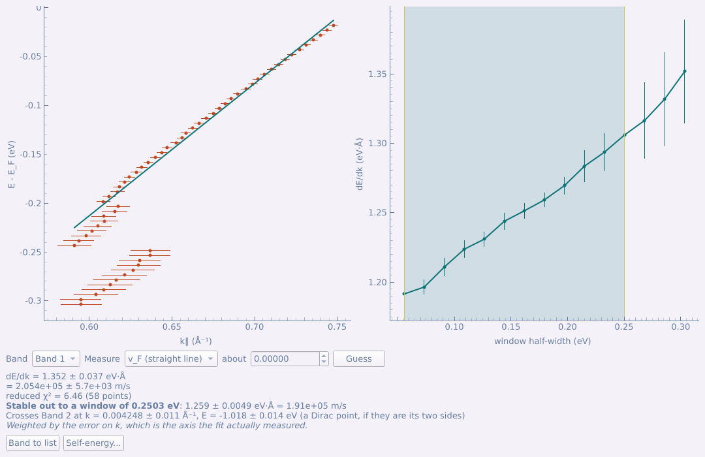

**Save table...** writes every fitted line; **Band to list** puts a band in
the main list.

**Where two straight branches cross.** In the **Dispersion...** window, with
*v_F* (a straight line) chosen, each other fitted band is fitted the same way
and the point where the two lines meet is given with its uncertainty
(propagated from both fits): the Dirac point of a cone fitted as its two
sides, or any crossing of two bands. A single fitted line whose error
collapsed (a peak fit that went to zero width) no longer takes the whole
weight of the dispersion fit: no point counts for more than ten typical
ones.

### Self-energy

**Self-energy...** (Dispersion window, MDC fits only) turns one fitted band
into **Re Σ** and **|Im Σ|** against energy: Re Σ is the distance of the
measured band from a *bare band*, and |Im Σ| half the fitted width times
the bare band's slope.

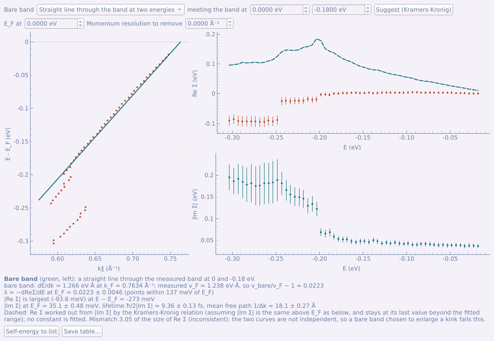

- **Bare band** — the one assumption everything rests on, so it is chosen
  here and written into the result: a **straight line through the band at
  two energies** (E_F and the deepest fitted energy to start with), a
  **straight line of a given velocity** through the measured k_F (from a
  calculation, say), or **the Dispersion window's fit**.
- **Suggest (Kramers-Kronig)** finds the bare velocity for which Re Σ and
  the Kramers-Kronig transform of |Im Σ| agree best. Both depend on that
  one number, so requiring them to be a pair fixes it without a
  calculation. Trust it only when the fitted range reaches well past the
  kink, to where |Im Σ| has levelled off.
- **E_F at** and **Momentum resolution to remove** (from the widths, in
  quadrature; leave 0 if the fit had the resolution in its line shape).
- **Dashed line**: Re Σ worked out from |Im Σ| by the Kramers-Kronig
  relation, taking |Im Σ| as the same above E_F as below and constant
  beyond the fitted range. No constant is fitted, so the comparison tests
  the bare band: one chosen to enlarge a kink fails it.
- **Under the plots**: the measured k_F and v_F, v_bare/v_F − 1, the
  coupling λ = −dRe Σ/dE at E_F, the energy where |Re Σ| is largest (the
  kink), |Im Σ| at E_F with the lifetime and the mean free path.
- **Self-energy to list** adds the curves to the main list; **Save
  table...** writes them as CSV with the bare band in the header.

## 5.5 Cut arithmetic: dichroism and reference division

Two cuts combined into a third: linear dichroism (LH − LV), circular
dichroism, dividing by a gold reference, or plain differences, ratios and
sums. Select two cuts in the list and press tool panel → Advanced → **Cut
arithmetic (two cuts)...** (the first selected is A; the window can swap
them). The button is greyed until exactly two cuts are selected.


- **The table at the top** compares what the two measurements recorded
  (polarisation, photon energy, angles, sample position, temperature, pass
  energy, lens mode). Rows in orange differ beyond a tolerance — a dichroism
  map between two spots on the sample is a map of *that* difference.
- **Purpose** presets: *Linear dichroism* (A − B, B scaled to the same total
  intensity), *Circular dichroism* ((A − B)/(A + B)), *Divide by a reference*,
  *Custom*. Warnings appear if the polarisations look swapped (**Swap A ↔ B**).
- **Scale B to A** by total intensity or by a region; **Hide where A+B below**
  blanks the background.
- A and B are drawn on one colour scale; the result on a red-white-blue scale
  symmetric about zero. With raw counts on both, the Poisson uncertainty is
  propagated and summarised under the plot.
- **Result to list**, **Uncertainty to list**, **All three as a figure**.

## 5.6 Slice series figure

Select a map → tool panel → Advanced → **Slice series figure...** lays out a
page of flat 2-D slices through the cube as one figure for a paper —
constant-energy contours at a series of energies, or cuts at a series of
angles or momenta — evenly spaced or at chosen values, with integration,
one shared colour scale, and labels on the outer edges only. (Not to be
confused with **3D slices**, which draws three planes in a 3-D view.)

- Panels are titled with the value asked for (−0.2 eV), not the recorded
  plane's own (−0.2022 eV); the plane used and the window are kept in each
  panel's information.
- The colour map, its inversion, the levels (as percentiles) and the gamma
  are set in the dialog, for every panel at once.
- **Draw the Brillouin zone, as on the map** puts the zone drawn with BZ
  overlap on every constant-energy panel, each edge once.
- From a script or an agent, `contour.slice_figure(values=[0, -0.1, -0.2],
  half_width=0.02)` (or `A.open_slice_series(values=...)` on the selected
  row) makes the figure without the dialog.

| Settings | Result |
|---|---|
| 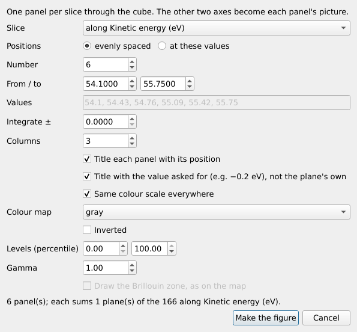 | 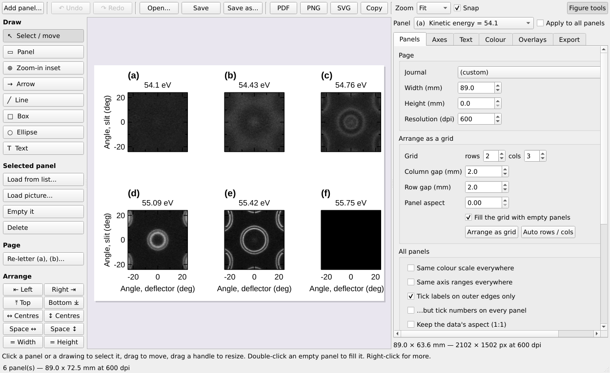 |

## 5.7 The 3-D views

Four tools of the Advanced tab show a map in 3-D, each in a window of its
own — drag the picture to turn it:

- **3D slices...** — the three orthogonal planes through the cube, each
  placed where you choose (tick box, slider or typed position per axis).
- For a **k-map**, the 3-D views start at the first k_x and k_y planes that
  are filled with data: the converted cube is the box around a light cone
  that narrows away from E_F, and its outermost planes drew as blank faces.
  *Change sampling... → Whole range* shows everything again.
- **Notched cube...** — the cube with one corner cut away: a constant-energy
  map and two dispersions in one picture.
- **Volume projection...** — the whole volume projected along the view:
  maximum intensity, sum, alpha composite, or a shaded isosurface.
- **Stacked slices...** — parallel slices stacked in 3-D (below).

| 3D slices | Notched cube |
|---|---|
| 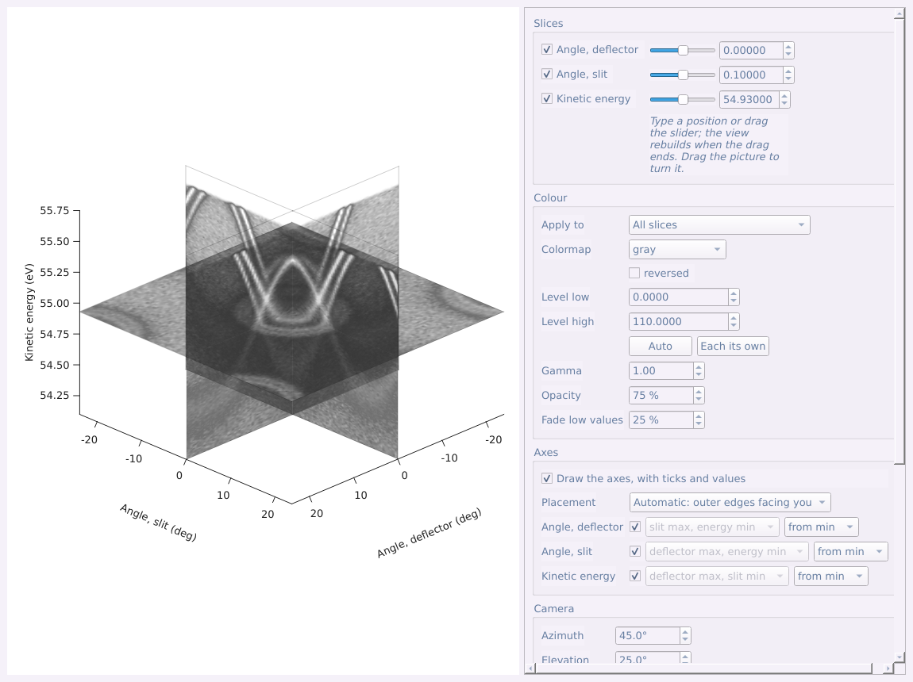 | 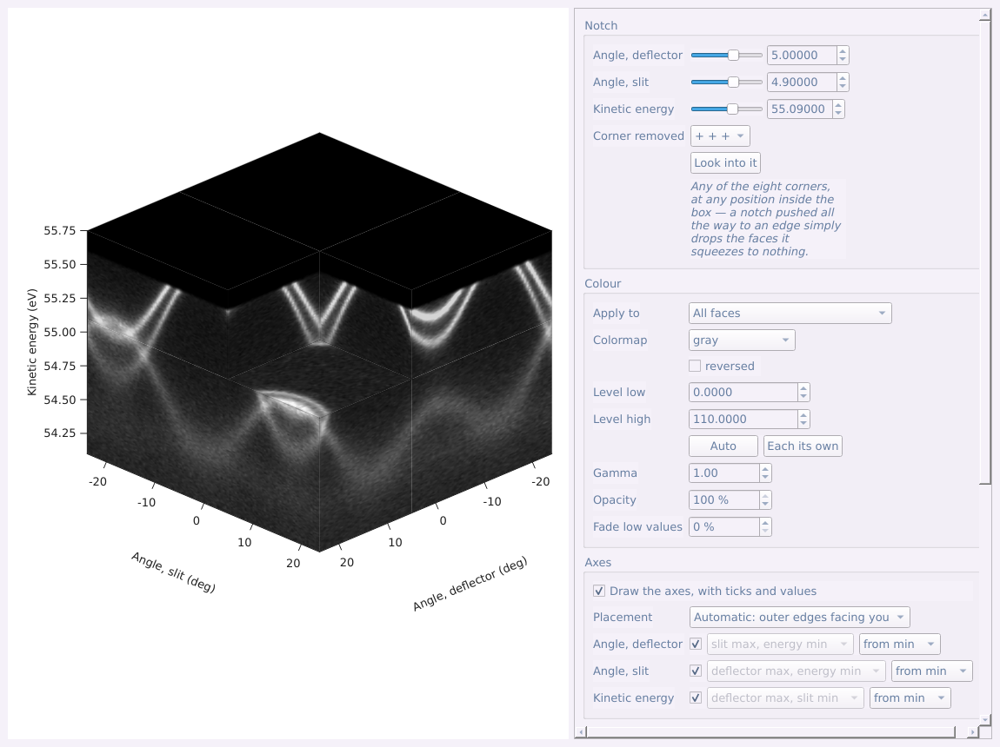 |

- **Sampling.** Every frame resamples the cube, so each window opens at
  *Balanced* sampling, which keeps up with the mouse. The current sampling is
  written under **Save the view...**; **Change sampling...** picks the region
  and *Fast*, *Balanced* or *Fine*, and redraws from the full cube.

  

- **Colour.** *Apply to* sets the colours of **all slices** at once or of
  one orientation (the energy plane in one colormap, the dispersions in
  another): colormap (and *reversed*), levels (**Auto**, or **Each its own**
  for one scale per slice), gamma, **Opacity** and **Fade low values**, which
  makes the weak intensity see-through so the planes behind show.
- **Axes.** **Draw the axes, with ticks and values**. *Placement* is
  automatic — on the outer edges facing you, following the view as it turns —
  or chosen: for each axis, the edge of the cube it runs along and whether it
  counts **from min** or **from max**.
- **Camera**: azimuth, elevation, depth aspect; **Look into it** faces a
  chosen plane. **Outline the faces** and an **Orientation tripod** are
  optional.
- **Save the view...** exports the picture through the same export window as
  any panel (PNG, TIFF, JPEG at a chosen size and dpi). **To figure
  composer...** adds the view as a panel of a figure.

### Stacked slices

**Stacked slices...** (tool panel → Advanced → 3D only) draws parallel
slices of the cube stacked in 3-D: constant-energy maps one above another
up the energy axis, or cuts one behind another along k_z (or the photon
energy) — the usual picture of how a band evolves.

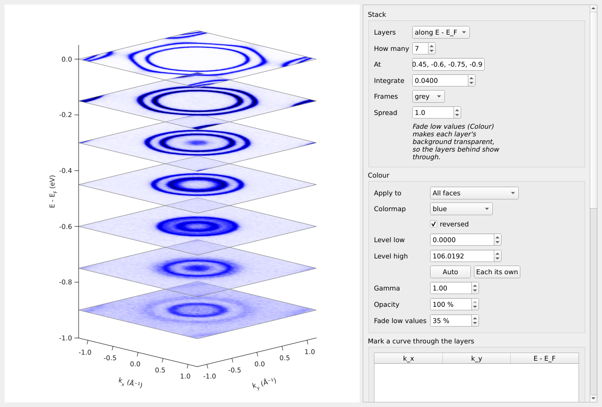

- **Layers** — the axis they are stacked along; **How many** spreads them
  evenly, or type the positions in **At** (comma-separated, in the axis's
  units); **Integrate** averages each layer over that width.
- **Frames** — an outline round every layer (grey, black or none).
- **Spread** stretches the box along the stacking axis, so that layers seen
  from an oblique view stand apart instead of covering one another: for a
  few cuts stacked along k_z, *Spread* 3 with the azimuth at about 40° shows
  each cut almost whole.
- **Fade low values** (*Colour*) starts at 35 % here: each layer's background
  is transparent, so the layers behind show through.
- **Mark a curve through the layers** — points in the data's own units (one
  per layer, say the crossing of two bands), joined by a red, black, blue…
  curve drawn over the stack, with an optional label at the first point.
- The axes of all 3-D views now fit the picture *and* its labels to the
  window or figure panel (no fixed margin), thin their ticks to the room
  each axis has, and write sub- and superscripts in the axis titles
  (`E - E_F`, `k_x`).

## 5.8 Fermi pocket (quasi-2D, under test)

> **Under test** (new in 1.3.3): check every number against the picture,
> and please report what looks wrong.
>
> **Quasi-two-dimensional samples only.** The area of a contour in a k-map
> is a property of the Fermi surface only when the bands do not disperse
> along k_z — a surface state, a single layer, a layered material whose
> Fermi surface is a cylinder. Then one map is the whole Fermi surface. For
> a three-dimensional Fermi surface the map is one curved sheet through it,
> at a k_z set by the photon energy and smeared by the escape depth: the
> contour is not an extremal orbit, and the numbers below mean nothing. The
> program cannot tell the two cases apart.

Select a map converted to momentum (a k-map, on E − E_F) and press tool
panel → Advanced → **Fermi pocket (quasi-2D)...**.

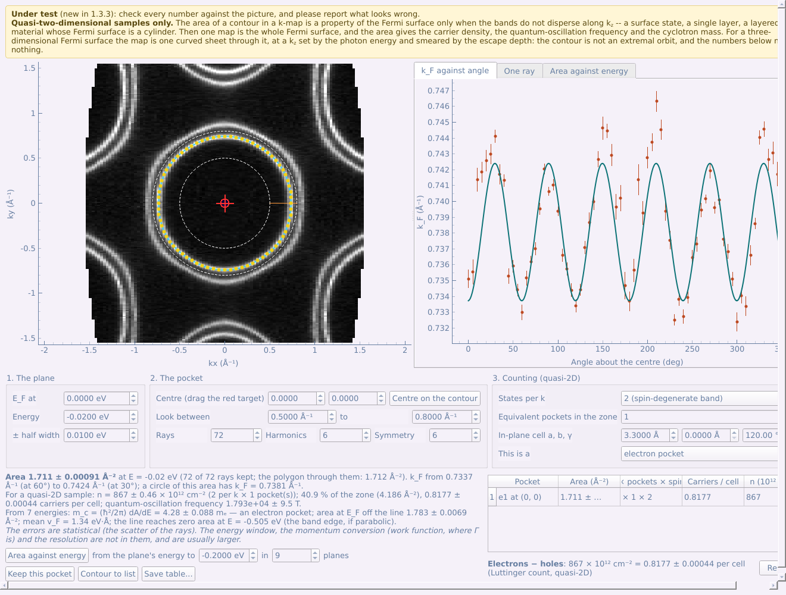

1. **The plane.** The energy the contour is traced on (E_F to start with)
   and the half width it is averaged over.
2. **The pocket.** Drag the red target to a point inside the pocket (or
   type it), and set **Look between** so that the two dashed circles hold
   this pocket's band and no other. A ray goes out from the centre at each
   of **Rays** angles, and a peak fitted along it gives k_F there (yellow
   points; red crosses are rays dropped, and the **One ray** tab shows any
   ray with its fit). The contour (blue) is a Fourier series of the radius
   against the angle, up to **Harmonics**; **Symmetry** keeps only the
   harmonics an n-fold axis through the centre allows, which also bridges
   gaps in the data. **Centre on the contour** moves the centre to the
   contour's middle; the area does not depend on the centre.
3. **Counting.** *States per k* (2 for a spin-degenerate band, 1 when each
   spin has its own contour), the number of *equivalent pockets in the
   zone*, the *in-plane cell* a, b, γ (for carriers per cell), and whether
   this is an electron or a hole pocket.

What comes out, under the pictures:

- the **area** with its error, the range of k_F round the contour, and the
  number of rays kept;
- for a quasi-2D sample: the **carrier density** n = g N A/(2π)², the
  fraction of the Brillouin zone and the **carriers per cell** (what
  Luttinger's theorem counts), and the **quantum-oscillation frequency**
  F = (ħ/2πe) A;
- **Area against energy** traces the same pocket at a range of energies and
  fits a line: the **cyclotron mass** m_c = (ħ²/2π) dA/dE — positive for an
  electron pocket, which grows with energy, negative for a hole pocket —
  the area at E_F read off the line (free of the bias the Fermi cut-off
  gives a plane taken at E_F itself), the mean Fermi velocity, and the
  energy at which the line reaches zero area.

**Keep this pocket** adds it to a table that counts several pockets
together, electrons minus holes. **Contour to list** adds k_F against angle
(and the area against energy) to the main list as curves; **Save table...**
writes everything as CSV.

The errors given are statistical (the scatter of the rays). The energy
window, the momentum conversion (work function, where Γ is) and the
resolution are not in them, and are usually larger.

---

# Part 6 — The tool panel: Figure tab

The **Figure** tab holds the figure composer and what is worked out rather than measured: the crystal, its Brillouin zone in 3-D, tight-binding fits and calculated band structures. It ends with an example from loading data to a finished figure.

## 6.1 The figure composer

Tool panel → Figure → **Figure composer...** (the top of the tab) with
**nothing selected**
opens a blank page, like a figure of a manuscript: four empty panels (a),
(b), (c), (d) at a journal's column width. With cuts (or curves) selected,
each becomes a panel (so does a frozen slice's **Figure composer...**
button; a stack plot or a 3-D view has its own **To figure composer**
button).

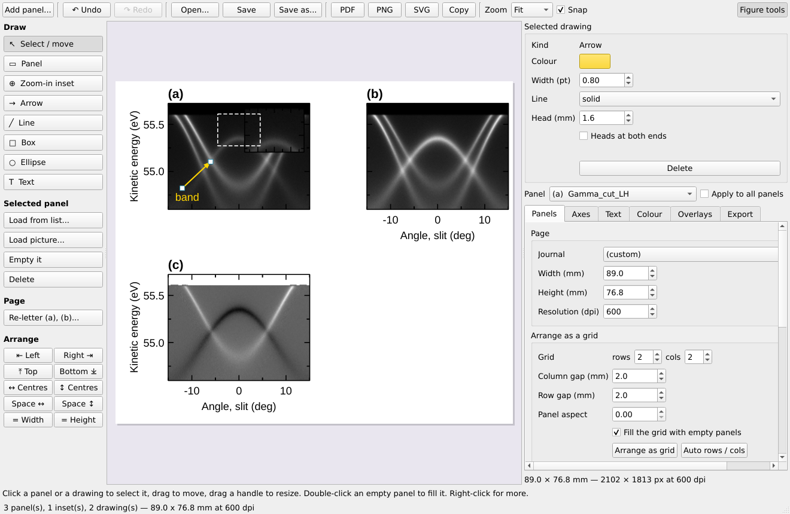

- **Lay out the page.** Click a panel to select it; drag it to move it and
  drag its handles to resize it (Shift on a corner keeps its shape). Panels
  snap to each other's edges and to a 0.5 mm grid (**Snap**); the arrow keys
  nudge by 0.5 mm (Shift: 5 mm). *Arrange as grid* (figure tools, Panels
  tab) puts them back on rows × columns; a panel can take several cells
  (*Grid cells (rows / cols)* of the selected panel — a schematic beside a
  row of data panels), and a picture keeps its own shape in them. The page
  height follows the panels when they are moved by hand. **Re-letter**
  names them (a), (b)… in reading order.
- **Fill a panel.** Double-click an empty panel, or use **Load from
  list...** / **Load picture...** on the left: a dataset from the main list,
  or a picture from a file (PNG, JPEG, TIFF… — a sketch or a figure made
  elsewhere; it keeps its shape and has no axes).
- **Insets.** **Zoom-in inset**: drag out a region of a panel — a small
  panel magnifying it appears in the corner and the region is outlined.
  **Panel** drawn inside another panel makes an inset to fill with another
  dataset. Insets take no letter and move with their panel.
- **Draw.** **Arrow**, **Line**, **Box**, **Ellipse**, **Text**: drag (or
  click, for text) on the page. A selected drawing can be moved, its ends
  or corners dragged, and its colour, width, line style, fill and text set
  above the figure tools. Double-click a text to edit it; Del removes the
  selection; right-click for more (bring to front, delete…).
- **Axes and fonts.** The figure tools beside the page act on the selected
  panel (or all of them): ranges, ticks, labels, which edges carry numbers,
  the panel's own font size, colour map, colour bar, reference lines. With
  *Tick labels on outer edges only*, *…but tick numbers on every panel*
  keeps the numbers on the inner panels and leaves only the axis names to
  the edges.
- **Undo / Redo** (Ctrl+Z / Ctrl+Y) cover every change. **PDF**, **PNG**,
  **SVG** export, **Copy** puts it on the clipboard; empty panels are never
  written. The composer's **Figure tools** are not a viewer's **Plot
  tools**, which draw guides on the live plot.

### Arranging panels

Click a panel, then **Ctrl+click** (or Shift+click) the others to select
several. The **Arrange** buttons on the left then:

| Button | What it does |
|---|---|
| ⇤ Left, Right ⇥, ⤒ Top, Bottom ⤓ | line up their left / right / top / bottom edges (at the outermost one) |
| ↔ Centres, ↕ Centres | put their centres on one vertical / horizontal line (the first-selected panel's) |
| Space ↔, Space ↕ | equal gaps between them, left to right / top to bottom (three or more) |
| = Width, = Height | the first-selected panel's width / height for all |

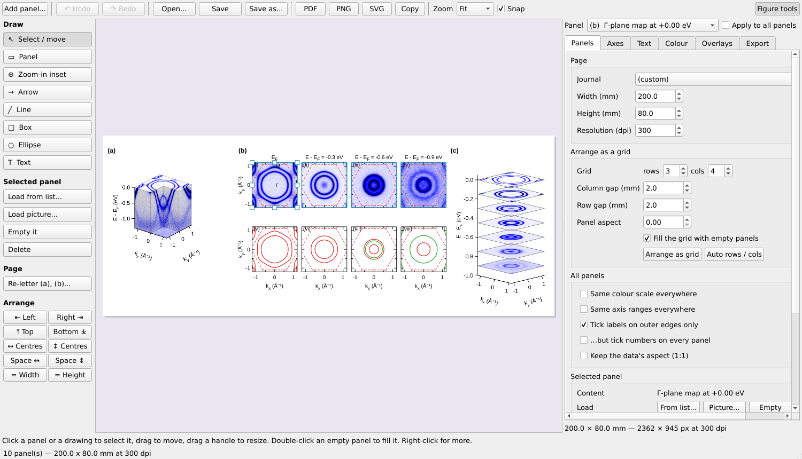

### Letters and colour bars

- **Letters in line** (*Text* tab, on by default): the letters of panels
  side by side sit at one height and those of panels one above another at
  one left edge, whatever titles or axes each panel has. **Nudge (mm)**
  moves one panel's letter (clear of a long axis title, say);
  **Re-letter** names them (a), (b)… in reading order.
- **Colour bar** (*Colour* tab): **Ends** writes the levels, the words
  *High* / *Low*, or nothing; **Length (%)** of the panel's height or width;
  **Position** *right* (upright beside the panel) or *below* (lying under
  it, centred). A 3-D view's bar is sized to the cube as drawn, not to the
  whole frame round it.


### Curves: lines, symbols and error bars

*Overlays* tab, **Curves drawn on the panel**: select curves in the list (or
none, for all), then set their **colour**, **width**, **style** (solid,
dashed, dotted…), **symbols** (circle, square, triangles, diamond, with a
size) and whether they are **joined by a line**; **± σ as error bars**
turns a curve's two dotted ±σ curves into error bars at its points. **Apply
to the curves**. A curve with gaps (NaN) is drawn in pieces.

### Saving a figure to edit later, with its data

**Save** / **Save as...** write the figure in the program's own format,
`fig1.afig`: the page, its drawings and every panel with its data and
settings — open it again with **Open...** (or pick it in **Load data...**
in the main window) and go on editing exactly where you stopped. A 3-D view
is kept as the picture it shows.

Beside it, **`data for fig1/`** gets one folder per panel (`a`, `b`, …):

```
data for fig1/
  a/  processed/  what the panel shows: the image as a .nxs cut (opens in the
                  viewer again), its lines (calculated bands, contours,
                  curves) as lines.csv, a picture as .png
      original/   what it was made from: the first measurement file (a
                  k-converted, symmetrised, cut-out plane traces back to the
                  file it was first read from), the calculation with the
                  files it is read with (.win, POSCAR...), the picture file
                  or the CIF
      sources.txt which entry of the file, and the processing in between
  b/  ...
```

The original file is copied even when the panel shows something computed
from it many steps later: every dataset remembers the file it began as. A
figure opened again whose original files have moved reuses the copies in
its own earlier data folder.

## 6.2 Crystal structure

Tool panel → Figure → **Crystal structure...** (needs nothing
selected). Four steps (the Brillouin zone is the tool of its own **3D
BZ...**, [§6.2](#63-3d-bz-the-brillouin-zone-in-three-dimensions)):

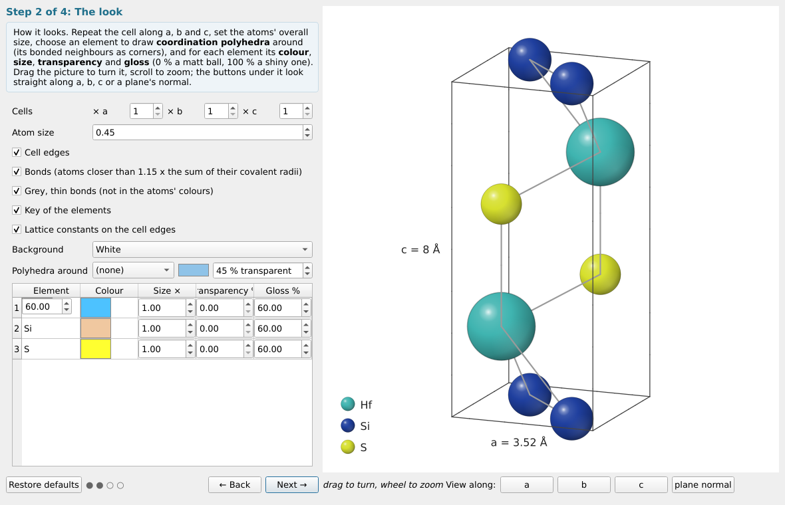

1. **The structure** — **Read a CIF file...** (the button at the top)
   fills the space group, cell and atoms from a file, applies its symmetry
   operations and redraws the crystal at once; everything stays editable.
   Or type it in, like the BZ overlap cell: the **space group first** (the
   cell parameters it fixes are greyed and follow the free ones), then the
   cell and the atoms of the basis (the centering copies are added). CIFs with several data
   blocks (FullProf's, which open on a block of journal fields) are read
   from the block that holds the structure.
2. **The look**
   - cells along a, b, c, the atoms' overall size, cell edges and bonds
     (in the atoms' colours, or *grey, thin*);
   - per element its **colour**, **size**, **transparency** and **gloss**
     (0 %: a matt ball, 100 %: a shiny one with a sharp highlight);
   - **Polyhedra around** an element: its coordination polyhedra (its
     bonded neighbours as corners) in a colour and transparency of their
     own — the TiSe₆ octahedra, the CuS₄ tetrahedra;
   - **Key of the elements** (a ball and its name for each), **Lattice
     constants on the cell edges** (`a = 3.52 Å`, `c = 8 Å`).

   Drag the picture to turn it, wheel to zoom; *View along* a, b, c or the
   plane normal.
3. **Cleavage plane** — tick *Draw a plane*, give (hkl), slide it, or
   double-click an **atomic layer** in the list to put it there; *Hide the
   atoms above* shows the termination; atoms in the plane are ringed red.
4. **Export** — the crystal: **Save picture...** (PNG at any
   size, drawn again at that size) or **To figure composer...**. A picture
   from a CIF names the CIF as its source, so the figure's data folder keeps
   it ([§6.1](#61-the-figure-composer)).

## 6.3 3D BZ: the Brillouin zone in three dimensions

Tool panel → Figure → **3D BZ...** (needs nothing selected). It was step 4
of the crystal-structure window.

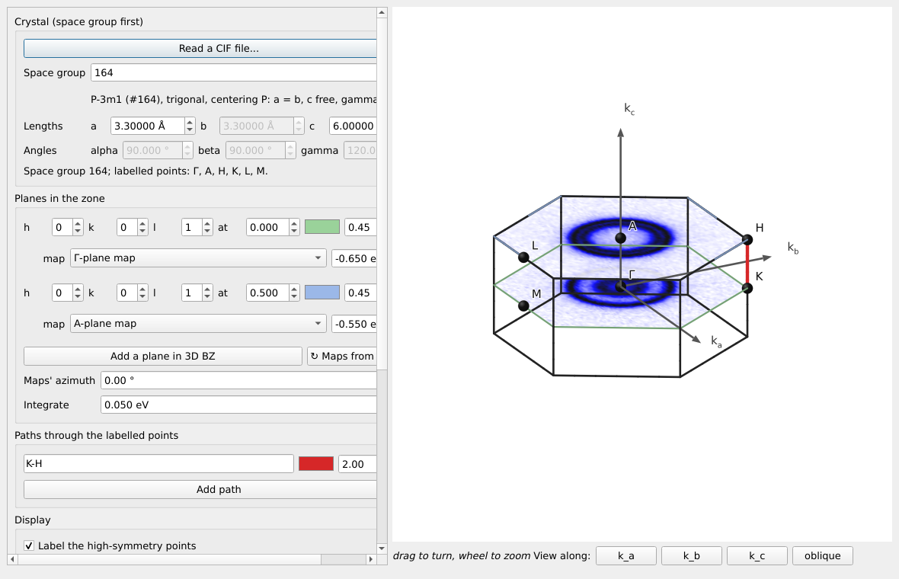

- **Crystal**: the **space group first**, then the cell — the parameters the
  space group fixes are greyed and follow the free ones, as in BZ overlap.
  **Read a CIF file...** fills them from a file. It starts from BZ
  overlap's last 3-D crystal.
- **Planes in the zone**: **Add a plane in 3D BZ** as often as you like.
  Each has its own normal (h k l), its height along it (in units of G(hkl):
  0 through Γ, 0.5 at the zone top), colour and opacity, and ✕ to remove
  it.
- **Measured maps on the planes**: *any* plane can carry a k-map's
  constant-energy map — choose it in the plane's *map* list and give the
  energy (E − E_F). The list offers the k-maps selected when the window
  was opened and every k-map in the main list (**↻ Maps from the list**
  brings in ones added since); a map is read only when it is chosen. The
  map's kx, ky lie along the plane's own in-plane axes — k_a, k_b for a
  plane normal to k_c — turned by *Maps' azimuth*, averaged over
  *Integrate*, and cut to the zone.
- **Paths**: **Add path** as often as you like, each through the labelled
  points (`Γ-M-K-Γ`, `A-L-H-A`; `|` for a jump) in a colour and width of its
  own.
- **Display**: labels of the high-symmetry points, the axes, and *Label on
  the left* (those points labelled at their leftmost equivalent, clear of
  the paths and axes).
- **Axes**: the crystal's own, **k_a, k_b, k_c** (Cartesian axes of the
  cell: k_a along a, k_c normal to the a–b plane), by default; or **the
  sample's, as the data has them — k_x, k_y, k_z**: k_z along the normal of
  the *Cleavage plane (hkl)*, k_x along the maps' k_x (turned by *Maps'
  azimuth*). One symbol never names two directions. The *View along*
  buttons follow the frame shown.
- **Export**: **Save picture...** at any size, or **To figure composer...**.
  *Labels: panel width / text* sizes the labels for the width the picture
  will have in the figure (8 pt in a 30 mm panel), whatever its size in
  pixels; off, they scale with the picture as on screen.

## 6.4 Tight-binding fit

> **One band, or two hybridised bands — chosen in step 1 (*Bands*).**
> **One band** is a single band on a Bravais lattice (one orbital per
> site): E(k) = e0 + Σ t_n Σ cos(k·R). It cannot describe two bands, their
> crossing or a hybridisation gap; fit each band on its own and read its
> hoppings as that band's effective parameters, not as microscopic
> orbital-to-orbital hoppings.
>
> **Two bands, hybridised** fits two such bands, ε_a(k) and ε_b(k), and the
> coupling V(k) = v0 + Σ v_n S_n(k) between them at once; the measured
> bands are E± = (ε_a+ε_b)/2 ± √(((ε_a−ε_b)/2)² + V²). Use it for an
> anticrossing, a hybridisation gap, or a bilayer splitting (t_⊥). V has the
> lattice's full symmetry (two orbitals of the same parity); an odd
> coupling such as s–p is not this form.

**Two bands, step by step.** In step 1 set the shells of band a (*Shells
of neighbours*), of band b (*Shells, band b*) and of the coupling beyond
v0 (*Coupling shells*, 0 for a constant V). In step 2 trace both bands at
two or more energies with *New points on* left at *either band*, then
click a few points of each band with it set to *the lower band* or *the
upper band* (blue / pink); a points file may carry a `branch` column
(`lower` / `upper` / blank). In step 3 the fit — nonlinear, started from
many models and refined — gives band a, band b and v0, v1… with errors,
draws both bands (red, orange), says which band each point went to, and
gives the **smallest gap** between the bands and where it is: 2|V| where
the bare bands cross. *Model to list* holds both bands; *Save parameters*
writes the three sets of parameters, their shells and the gap.

**Shells are symmetry orbits.** Each hopping t_n belongs to one set of
neighbours that symmetry makes equivalent: the space group's point group
(with inversion) for a 3-D crystal, the lattice's own symmetry for a 2-D
layer. Two inequivalent neighbours at the same distance — an in-plane and
an out-of-plane one, say — get a hopping each. Step 1 lists every shell with
its count, distance and a representative vector in lattice coordinates
(⟨1 0 0⟩), and **Save parameters...** writes all the vectors of each shell.

With a k-map selected (or nothing, to use a file of points):

1. **The lattice** -- a 2-D layer (a, b, γ) or a 3-D crystal (the **space
   group first**, then the cell parameters it leaves free -- the others are
   greyed and follow), or **Take the crystal from the Brillouin-zone tool**; the azimuth of a against kx; how
   many shells of neighbours.
2. **Band points** -- on **one band** only (a few stray points are set
   aside as outliers; many spoil the fit). Move to an energy and press **Trace this energy**
   (ridge detection), or tick *Click* and click on the band, or **Read
   points from a file**. Two or three energies are better than one: one
   contour fixes the band's shape but not its energy scale.
3. **Fit** -- the hoppings with their errors and the rms misfit; the model's
   contour is drawn in red on the plane of step 2. With one energy, hold
   t1; *Refine the azimuth* if the orientation is known only roughly. An
   orange note means the points cannot tell the shells apart: use fewer.
4. **Use the model** -- **Model to list** (its spectral function, as a map
   beside the data), **Save parameters...**, **Copy results**.

## 6.5 Calculated bands

Tool panel → Figure → **Calculated bands...** puts a band-structure
calculation beside the measurement. Select what to compare it with — k-maps,
kz maps in momentum and cuts in momentum — or nothing, to look at the
calculation alone. Four steps.

Like every step-by-step window (Crystal structure, Tight-binding fit, Sum
repeated scans, Detector corrections), it **asks before closing** — the last
step's Close sits where Next was, so a quick double click no longer loses the
work; the title bar's close and Esc ask too. **Enter in a field takes its
value** (and redraws what depends on it) — in every window of the program it
never presses Next, Close or any other button, whatever the value set going
(even a computation with a progress bar); only a button that has the focus
answers Enter. Where a window redraws only on a button — the Brillouin-zone
tool's **Plot**, a viewer's selection-box **Refresh**, the core-level zoom's
**Show** — Enter in its fields does that redraw, and nothing else. What you set is **kept**: the window opens as you left
it (**Restore defaults** at the bottom left starts afresh).

**1. The calculation.** First say **what you want to see**:

- **E–k dispersion** — the bands along a path, or along your measured cut.
  Any calculation works.
- **Constant-energy contours** — to compare with a k-map (Fermi-surface
  map).
- **3D Fermi surface.**

The last two need the bands **everywhere in the zone** (a band grid or a
Hamiltonian); a band structure along a path cannot give them, and the window
says so rather than going on. The choice also sorts the file list of
**Open calculation...**: its first filter shows only the kinds of file that
can give what you want. Selected k-maps choose contours for you, selected
cuts the dispersion. A file can also be dropped on the window; **Reopen …**
opens last time's file again.

| File | Written by | What it holds | Can show |
|---|---|---|---|
| `.bxsf` (XCrySDen band grid) | Wien2k, Quantum ESPRESSO, VASP, Wannier90 | the bands everywhere in the zone, interpolated | all three |
| `_hr.dat` (+ `.win` beside it) | Wannier90, any tight-binding model | a Hamiltonian, diagonalised exactly at each k; orbital weights | all three |
| `wannier90_hr_fplo.dat` (+ `KPOINTS`, `wannier_name_center.txt`) | FPLO's Wannier Hamiltonian | as `_hr.dat`; weights per Wannier function, per shell ("Cr 3d") and per spin | all three |
| `band.dat` with rows `k1 k2 k3 E1 E2 …` (+ `KPOINTS`) | FPLO + Wannier tools | a 3-D band grid | all three |
| MATLAB `.mat` holding `Ek_3D` (+ `KPOINTS`) | the theory side's MATLAB, from that 3-D `band.dat` | a 3-D band grid | all three |
| `EIGENVAL` (+ `POSCAR`, `PROCAR`) | VASP | bands along a path or on a grid; atomic and orbital weights | a grid: all three |
| `_band.dat` (+ `labelinfo`) | Wannier90 | bands along a path | dispersion |
| `.spaghetti_ene` (+ `.klist_band`) | Wien2k | bands along a path | dispersion |
| `band.dat`, `Eigenvalue.dat` (+ `KPOINTS`, `orbital.dat`) | FPLO + Wannier tools (`k_path.exe`, `H.exe`, `plot.exe`) | bands along a path (a third column is a weight) | dispersion |

Files are recognised by their **content**, not their name: a standard file
renamed on the way (`hamiltonian.txt` that is really an `_hr.dat`) opens all
the same. The FPLO tools' `KPOINTS` (first line "segments
points-per-segment", then the direct and reciprocal vectors, then each
segment's ends with `! label`) gives the cell and the labels — keep it beside
the band file; without one, the cell is taken from the Brillouin-zone tool's
crystal. Long reads (a 3-D `band.dat` of 101³ points and 136 bands is about
2 GB; a large `_hr.dat`) show a **progress bar** with Cancel; a big grid
keeps only the bands near E_F (*Reading options ▸ Big grids*).

**Which file? ...** helps when you do not know which of a dozen files is the
calculation: choose the folder the theory side sent, and every file in it is
read and said in plain words — what it is, what it can show, what reading it
lacks (the cell, the labels), whether it is a standard file under another
name, or one file **cut into pieces** (`band.dat.1, band.dat.2`,
`band_part1.dat …`, `xaa, xab` — as files are split to pass an upload
limit). Green rows open for what you want to see; **Join the pieces, then
open** writes the pieces back into one file beside them.

*Reading options ▸* (usually nothing to change): *Set E_F myself* overrides
the file's Fermi level; *bxsf k units* is for a grid written without 2π; *Big
grids: keep bands from … to …* of E_F.

**The crystal.** The cell (a, b, c, α, β, γ) is read from the calculation
and the **space group** that names the zone's points is guessed from its
shape. Once read, both are **locked** — as are *From the Brillouin-zone
tool* — so a stray click cannot change the calculation's lattice. Tick
**Change the lattice parameters** to change them on purpose: typing a new
cell (or taking the Brillouin-zone tool's) scales the calculation to it —
its bands, held in fractional coordinates, stretch with the zone.

**A calculation in another format.** When the theory side's files are none of
these, the safest route is to ask for (or convert to) one of the standard
ones: a `.bxsf` for bands everywhere, `_hr.dat` + `.win` for a Hamiltonian,
or a two-column `_band.dat` (distance, energy; a blank line between bands)
with its `_band.labelinfo.dat` for a path. What to ask them: which columns,
which order of k, the units of k (with or without 2π, fractional or
Cartesian) and whether energies are already relative to E_F.

**2. What it looks like** — by what you chose in step 1:

- **Along a path** (dispersion). The calculation through the high-symmetry
  points (`Γ-M-K-Γ-A-L-H-A`; `G` for Γ, `|` for a jump), over the
  **measurement along the same path**, assembled from the selected maps: each
  in-plane segment from the map measured on its k_z plane (Γ-M-K-Γ from the
  Γ-plane map, A-L-H-A from the zone-top one), Γ-A from a kz map. Each map's
  k_z comes from its photon energy and the inner potential V0; correct it in
  the table if needed, untick a map to leave it out, and give the azimuth of
  the crystal's a axis on the map. **Highlight bands** draws chosen bands
  thick and in colour, the others grey — their numbers as the file counts
  them (`41-44`), or `EF` for every band crossing E_F (step 1 lists them).
- **Constant-energy contours.** The calculated contours at one energy on any
  plane of k-space, set as in the Brillouin-zone tool: its **normal (hkl)**
  (conventional reciprocal axes; (001) gives k_x-k_y), and **k⊥**, how far it
  sits from Γ along that normal — **Through point** puts it through a
  high-symmetry point (Γ K M at 0, A H L at π/c for (001)); **In-plane
  rotation** turns the two drawn axes about the normal (to match a measured
  map's azimuth, say). The **k⊥
  integration window** sums the bands over a range of k⊥ about the plane —
  along the (hkl) normal, not the absolute k_z — as a map with a finite k⊥
  resolution does; the integrated intensity is drawn grey under the
  contours of the middle plane. **Show the plane in the Brillouin zone...**
  opens a turnable 3-D view of the zone with the plane in it (red), the
  faces of its k⊥ window (light red) and the named points it holds; it
  follows the plane as you change it. The zones' outlines on the plane are
  dashed grey.
- **3D Fermi surface.** The surfaces where the bands cross the energy,
  inside the first zone, with the zone's edges and named points. Drag to
  turn, wheel to zoom; Enter in *Energy* redraws it; *Detail* trades speed
  for smoothness (a Hamiltonian is diagonalised on a grid first, with a
  progress bar). **Open in its own window** shows it large, with *Save
  picture*; the energy, detail and bands are still set here. With this goal
  there is nothing to compare, so the Compare step is left out.

Each band's **colour** (from the list, or *Other colour...*), and for a
surface its **opacity**, and whether it is **shown**, are set in the band
table. Several bands may share one colour — to group the electron pockets
in one colour and the hole pockets in another, say — and a band keeps its
colour from the contours to the 3-D view.

**Colour by orbital weight** draws fat bands along a path, or splits the
contours where the chosen orbital's weight exceeds one half.

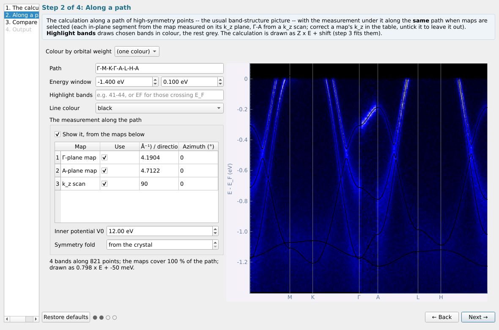

**3. Compare.** One measurement at a time, with the calculation drawn where
it was really taken: a **cut** gets the bands along its direction — on a
fixed k_z plane, or on the curved surface its photon energy reaches (k_z
changes along the cut and with the energy); a **map** gets the calculated
contours at the energy chosen. **Fit to the cut's bands** traces the
measured bands (ridge detection) and finds **Z** — the band-width
renormalisation, measured E = Z × calculated E + shift — and the **shift**,
each point matched to its nearest band, robustly. Z and the shift apply in
every step and every output. On the demo cut it finds Z = 0.798 and a shift
of −49.8 meV, the values the demo was made with (0.8 and −50 meV).

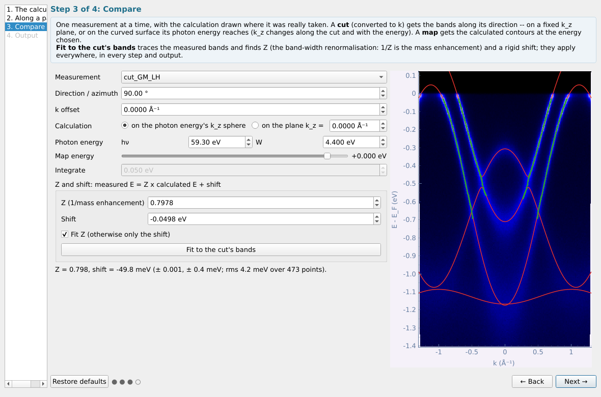

**4. Output.** With no measurement selected, step 3 says so: press Next.

- **To figure composer...** makes the panels ticked — ticked for you by
  what you chose in step 1: the measurement along the path with the
  calculation over it, the calculation alone (the points' names on its axis),
  the compared cut or map with its calculation, the calculated contours alone
  at the energies listed (no map needed), the 3D Fermi surface as drawn in
  step 2, and — with **Constant-energy series of the compared map** — the
  measured maps at each energy with the zones dashed (top row) and the
  calculated contours (bottom row).
- **Save … to main panel** (beside it) puts the calculation in the list as
  data the main panel's viewers open, and what it saves follows step 1:
  - *dispersion* — a cut: the bands as a spectrum (Lorentzians of the width
    set) along the compared cut or along the path. A cut along a path keeps
    its high-symmetry points: the cut viewer shows their names along the
    top, with a dashed line at each (**High-symmetry points**, ticked; the k
    values stay on the bottom axis), and the figure composer puts them on
    the k axis.
  - *contours* — **Save calculated map to main panel**: a k-map of the
    calculated intensity on the plane of step 2 (its (hkl), k⊥, in-plane
    rotation and k⊥ window) at every energy of *Energies of the saved map*, to slice and
    compare like a measured map.
  - *3D Fermi surface* — greyed out: the viewers open cuts and maps, not a
    surface; the figure composer (or *Save picture*) takes it.

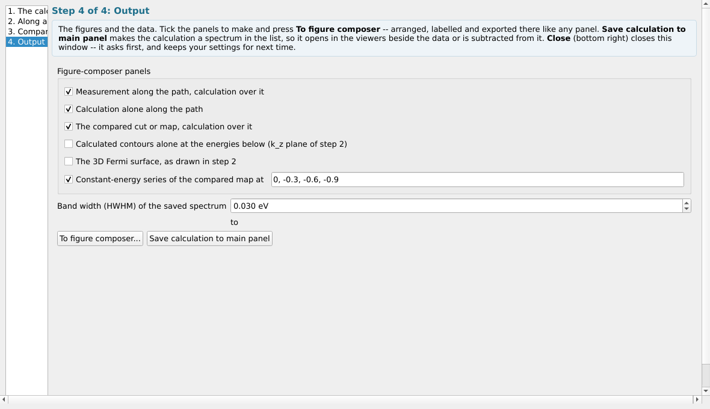

## 6.6 Worked example: from loading data to a figure

From the demo data ([§1.3](#13-trying-it-with-demo-data)) to a figure of
constant-energy maps with the Brillouin zone. This is the same path as the
agent's example in [§7.7](#77-worked-example-an-agent-from-set-up-to-figure),
done by hand.

1. **Load.** **Quick add...** → `demo_bulk_bands.nxs`. The list shows the
   Γ-plane map `FS_map_hv59.3_Gamma_plane`, the cuts `cut_GM_LH`,
   `cut_GM_LV`, `cut_GK_LH` and the photon-energy scan.
2. **Fermi level.** Select the map → Basic → **Fermi edge fit...**. Fit on
   the raw data, in a window around the edge; note E_F
   ([§4.2](#42-fermi-edge-fit)).
3. **To momentum.** Basic → **k conversion (map)**: Γ at normal emission,
   the fitted E_F as the energy reference. A new row `… [k]` appears
   ([§4.9](#49-converting-a-map-to-momentum)).
4. **The zone.** Select the k-map → Basic → **BZ overlap...**: space group
   164 (P-3m1), a = 3.3 Å, c = 6 Å, plane (001) through Γ
   ([§4.12](#412-brillouin-zone)).
5. **Slices.** Advanced → **Slice series figure...**: energies 0, −0.2,
   −0.4 eV, ±20 meV, three columns, the zone dashed
   ([§5.6](#56-slice-series-figure)). The figure opens in the composer.
6. **Lay out and export.** In the composer set the page width, colour map
   and levels, letters (a), (b), (c), then **Export** a PNG and a PDF and
   **Save** an `.afig` to edit later ([§6.1](#61-the-figure-composer)).


The next section builds two complete publication figures in the same way.

## 6.7 Worked example: two figures in the figure composer

The two figures below were made from the demo data
([§1.3](#13-trying-it-with-demo-data)) with the program's windows and put
together in the figure composer. `devtools/figure_tests.py` runs exactly
these steps, so it is also a script to read alongside this section.

### Figure 1: constant-energy contours


**(a) The notched cube.** Convert the Γ-plane map to momentum
([§4.9](#49-converting-a-map-to-momentum)); select the k-map → Advanced →
**Notched cube...**. *Change sampling...* to k_x, k_y within ±1.25 Å⁻¹ and E
up to E_F; put the notch at k_x = k_y = 0 down to the lowest energy, corner
**+ − +**; colormap *blue*, reversed; azimuth −52°, elevation 24°. **To
figure composer...**: a new figure. In the composer, *Colour* tab: **Colour
bar** on, Ends *high-low*, Position *below*, Length 60 %.

**(b) Measured and calculated contours.** Select the Γ-plane k-map →
Figure → **Calculated bands...**; open `demo_calc_hr.dat`; in step 2
choose the **Weight** `Se-pxy`; in step 3 choose the k-map, *Integrate*
0.050 eV, then a cut to **Fit to the cut's bands** (Z and the shift apply to
the contours too); in step 4 tick **Constant-energy series at** `0, -0.3,
-0.6, -0.9`, untick the others, **To figure composer...** → the figure of
(a). Eight panels arrive: the measured maps with the zones dashed, and the
calculated contours alone, red where the weight is below one half and green
above. In each, set the colormap (*blue*, reversed), the ranges ±1.2 and
drop the titles of the bottom row (*Text* tab); add the (i)…(viii) and Γ, M,
K notes with the **Text** tool.

**(c) Stacked contours.** Select the k-map → Advanced → **Stacked
slices...**; *Layers* along E − E_F at `0, -0.15, -0.3, -0.45, -0.6, -0.75,
-0.9`, *Integrate* 0.04, *Fade low values* 45 %, z aspect 2.2, azimuth −45°,
elevation 14°. **To figure composer...** → the same figure.

**Arranging.** Drag the panels roughly into place (the 2 × 4 contours in
two rows, (a) left, (c) right), then select (a), the top row of (b) and (c)
and press **⤒ Top**; select a row of contours and **Space ↔**, and **=
Height** for each row. The letters line up by themselves; **Nudge** moved
(b)'s 6 mm left, clear of its k_y title.


 Only (a), (b) and (c) carry a
letter: clear the others' *Letter* box. **Save as...** `example_figure_1.afig`
(its data folder is written beside it), and **PNG** / **PDF** for the paper.

### Figure 2: a band crossing followed through k_z

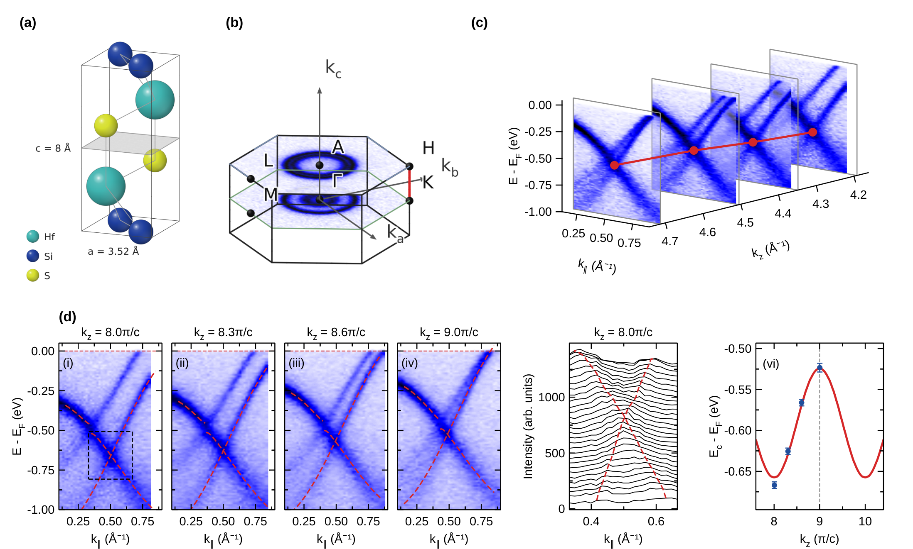

**(a) The crystal structure.** Figure → **Crystal structure...** →
*Read a CIF file* `demo_tetragonal_crystal.cif`. Step 2: Hf teal, Si dark
blue, S yellow, gloss 85 % each, atom size 0.52; *Grey, thin bonds*;
*Lattice constants on the cell edges* (no key of the elements). Step 3:
*Draw a plane* (001) at the middle of the cell, between the S layers, in
grey. Turn it to azimuth −68°, elevation 14°. Step 5: **To figure
composer...** → a new figure.

**(b) The zone with the measured maps.** Figure → **3D BZ...** → *Read a
CIF file* `demo_crystal.cif`. **Add a plane in 3D BZ** once (the first
plane is through Γ, the second at the zone top); the first plane's *map* →
*Γ-plane map* at −0.65 eV, the second's → *A-plane map* at −0.55 eV
(select the two k-maps first, or press **↻ Maps from the list**). *Path*
`K-H` (the line where the two bands cross); *Label on the left* `L, M`.
**To figure composer...** → the figure of (a).

**(c) The cuts stacked along k_z.** Convert the photon-energy scan to
momentum ([§4.10](#410-aligning-the-fermi-levels-of-a-kz-map)), select it → Advanced →
**Stacked slices...**: *Layers* along k_z at the four k_z of the cuts
(8.0, 8.3, 8.6 and 9.0 π/c), *Fade* 30 %, **Spread** 3, azimuth 40°,
elevation 12°. In **Mark a curve through the layers**, add the crossing on
each cut (k_z, k_∥, E) — from (d) — in red. **To figure composer...**.

**(d) The cuts, their MDCs and the crossing against k_z.**

- (i)–(iv): in the k_z map's viewer, **Functions → Slice → Save slice to the
  main list** at each k_z; open each cut in the figure composer (**Add
  panel...**). The dashed guides along the two crossing bands are the
  calculation (Calculated bands, step 3, on the plane k_z = …), shifted by
  the fitted Z and shift: in step 4, **To figure composer...** with only
  *The compared cut* ticked gives the cut with them; set their style to
  *dashed* in the *Overlays* tab. Draw the dashed box with the **Box** tool.
- (v): select the first cut → Advanced → **Stack plot (EDC / MDC)...** →
  MDCs, 40 curves of 3 rows each, over the box's energies; **Send to figure
  composer** → this figure. The guides through the MDCs are the same
  calculated bands, at each MDC's energy.
- (vi): the crossing energy at each k_z — from **MDC fit** on each cut and
  **Dispersion...**, where *Crosses band … at k = …, E = … ± …* gives it
  with its error — as points with error bars (*Overlays*: symbols *circle*,
  not joined, **± σ as error bars**), and the calculated crossing through
  k_z as the red line.

**Arranging.** (a), (b), (c) in the first row: select the three, **⤒ Top**
and **= Height**; the six panels of (d) in the second row, **⤒ Top** and
**= Height**. Letters: (a), (b), (c), (d) only. **Save as...**
`example_figure_2.afig`.

Each panel of either figure can be changed afterwards — open the `.afig`,
select the panel, and use the figure tools; the data folder keeps both the
data as shown and the measurement it came from.

---

# Part 7 — AI agents

An AI agent (Claude, or any app that can read and write files or call MCP tools) can drive the program on your screen, step by step, while you watch and can take over. This part explains how that works, how to start and watch an agent, and gives an example from set-up to figure.

## 7.1 How it works, and what leaves your computer

The program has no chat of its own. You talk to your AI app (the Claude
desktop app, Claude Code, or another agent) in plain words, and the program
is that agent's tool. The agent sends the program small steps: list the
data, fit a Fermi edge, convert to momentum, make a figure. The program runs
each step on your screen, so you see every result as a new row in the list
or a new window, and you can pause the agent and work by hand at any time.

**What stays on your computer, and what does not:**

- Your raw data files stay where they are and are read and processed by the
  program, locally. The program does not upload anything.
- What the **agent reads** is sent to the AI provider as part of the
  conversation: the text a step prints (row names, fitted values, axis
  ranges), and any picture the agent opens to judge a result. Ask for
  compact outputs, and the conversation holds numbers and a few pictures,
  not your data arrays.
- Whether the provider may use conversation content for training depends
  on the provider and your account settings. Check them before you start.
- Keep private code, unpublished manuscripts and anything you do not want
  read out of the folders the agent can reach. Give it the data folder
  (read only) and the results folder only.

As with any analysis, check what an agent produced before you use it.

## 7.2 Architecture: operations, reference, routes

```
 you  ⇄  AI app (chat)                       ARPES viewer (on your screen)
            │                                 ┌──────────────────────────┐
            │  writes <results>/_agent/        │  runs each command file, │
            ├──── viewer_cmd/01_….py  ───────▶ │  or each MCP call, with  │
            │                                 │  L = its operations      │
            │  reads out/cmd_01_….log  ◀────── │  new rows, windows, files│
            │  (or MCP tool results)           └──────────────────────────┘
```

- **The operations `L`.** About fifty documented operations on the named
  rows of the main list (`arpes_viewer/ui/common/live.py`): `L.rows()`,
  `L.add_files(...)`, `L.fermi_edge_search(...)`, `L.fermi_edge(...)`,
  `L.map_to_k(...)`, `L.kz_to_k(...)`, `L.bz_overlay(...)`,
  `L.cut_arithmetic(...)`, `L.slice_series(...)`, `L.figure_render(...)` …
  Each one adds new rows rather than changing old ones, never overwrites a
  file, and never waits for a click. A row can be named by its name, its
  number in `L.rows()` or the path of its file.
- **The reference `API.md`** (`arpes_viewer/agent/API.md`, inside the
  installed program) lists every operation, the tool-panel buttons, the MCP
  tools and the computations in `tools/`, with their parameters. It is
  generated from the program, so it is always current; the agent reads it
  instead of the source. `L.help()` prints the same list.
- **Three routes** to the same operations:
  1. **Command folder** (recommended): the agent writes one small Python
     file per step into `<results>/_agent/viewer_cmd/`; the program runs it
     and writes what it printed to `<results>/_agent/out/`. Any AI app that
     can read and write files works, and every step is kept as a file.
  2. **MCP**: the AI app calls the program through its MCP server
     (`arpes-viewer-mcp`); with the program started with the agent bridge,
     `viewer_api` calls the same operations.
  3. **Scripts without a screen**: the computations in `arpes_viewer/tools/`
     and the headless workspace, for a script to keep.
- **Windows.** A window an operation opens only to drive it (a conversion
  dialog, a temporary figure) never appears on screen; the windows still
  open when a step ends (a figure, a viewer, a tool waiting for you) appear
  on the screen of the main panel, not on the screen you are working on.

## 7.3 Starting from the AI assistant panel

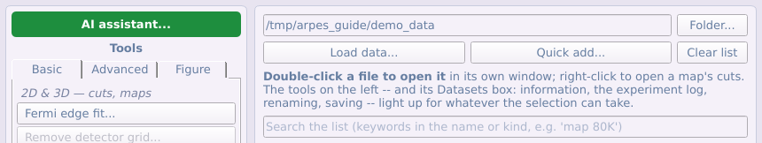

Press **AI assistant...** at the top of the tool panel.

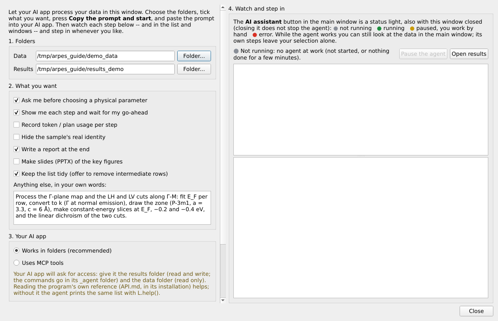

1. **Folders.** The **data** folder (the agent only reads it) and a
   **results** folder (everything the agent writes goes there; its commands
   go in `<results>/_agent`).
2. **What you want.** Tick what applies:
   - *Ask me before choosing a physical parameter*: Γ, an energy window,
     the inner potential, a threshold;
   - *Show me each step and wait for my go-ahead*;
   - *Record token / plan usage per step*: a usage log, one line per step;
   - *Hide the sample's real identity* in everything written;
   - *Write a report*, *Make slides*;
   - *Save every step as one Python script at the end* (on by default):
     the agent writes `agent_steps.py` in the results folder;
   - *Keep the list tidy*: offer to remove intermediate rows at the end.

   Then write your request in your own words: which data, which steps,
   which figures.
3. **Your AI app.** *Works in folders* (recommended; nothing to set up) or
   *Uses MCP tools* (the prompt says how to connect the app once).
4. Press **Copy the prompt and start**. The program starts listening and the
   prompt is on the clipboard. **Show the prompt** shows it: the folders,
   where `API.md` is, how to send steps, and the working rules
   ([§7.6](#76-the-working-rules-the-agent-follows)).
5. Paste the prompt into your AI app and send it. Allow the app to read the
   data folder and to read and write the results folder when it asks.

## 7.4 Watching and stepping in

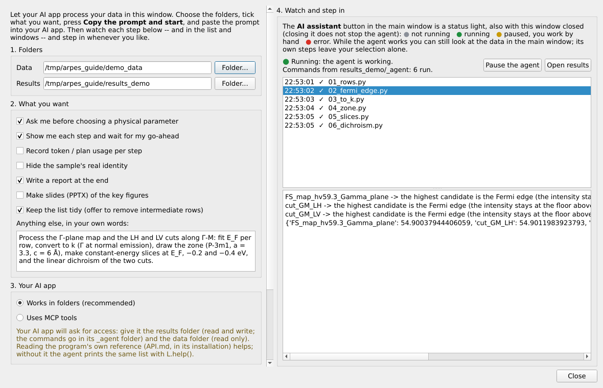

- **The list of steps** (right): each step the agent ran, with its time and
  ✓, or ✗ in red if it failed. Click a step to see what it printed.
- **The status light** on the **AI assistant** button, also with the window
  closed: grey not running, green running, yellow paused, red a failed step
  or commands no longer being run. Closing the window does not stop the
  agent.
- **Pause the agent** holds its next commands (the light turns yellow), so
  you can work by hand; **Resume** lets them through. The agent is told to
  wait and ask you when its commands are held.
- **Your work goes on.** The agent's steps leave your selection in the list
  as it was, so you can look at data while it works, and windows it opens
  only to drive them never appear on your screens.
- **Save the steps as a script...** writes everything the agent ran, in
  order, as one Python file: each step's code, when it ran, whether it
  failed (those are kept as comments) and what it printed. It is the record
  of the whole processing, and it runs again: copy it into
  `<results>/_agent/viewer_cmd` of a program started on that results
  folder. Steps sent through MCP are kept in memory only, so save them
  before closing the program. Steps you did by hand are not in it; they are
  in each dataset's history (*Experiment info*).
- **Open results** opens the results folder: the agent's command files and
  logs in `_agent`, the pictures and figures it wrote.

## 7.5 Other ways to start

- **Claude Code or another MCP app.** In the AI assistant choose *Uses MCP
  tools*: the program turns its agent bridge on and the prompt holds the
  command to add the server, for Claude Code
  `claude mcp add arpes-viewer -- python -m arpes_viewer.agent`. If your app
  loads tool definitions on demand, have it load all the arpes-viewer tools
  at once.
- **By hand.** Start the program with the bridge on
  (`arpes-viewer --agent-bridge`), add `arpes-viewer-mcp` to the app's MCP
  servers, and point the agent to `API.md`.
- **The command folder without the panel.** `agentic/launch_viewer.py`
  starts the program listening on a folder of your choice;
  `agentic/README.md` is the step-by-step guide, with requests to copy in
  `agentic/PROMPTS.md` and runnable examples in `agentic/examples/`.
- **A script to keep.** The computations in `arpes_viewer/tools/` need no
  window; `devtools/figure_tests.py` builds two complete figures from the
  demo data that way.

The details of the MCP server, for reference:

ARPES viewer is also an **MCP server** (Model Context Protocol), so an AI
agent of any model — Claude, GPT, Gemini, or a local model in an
MCP-capable client (Claude Desktop / Claude Code, Cursor, VS Code, Cline,
LM Studio…) — can call it as a set of tools. Everything stays on your
machine: files are read and written locally; only what a tool returns
(numbers, text, pictures) goes to the client.

**Set it up.** Installing the program installs the command
`arpes-viewer-mcp` (from a checkout: `python -m arpes_viewer.agent`). Add it
to the client's MCP servers, e.g. in a `claude_desktop_config.json`,
`.mcp.json`, or the client's settings:

```json
{
  "mcpServers": {
    "arpes-viewer": {"command": "arpes-viewer-mcp"}
  }
}
```

(With a checkout instead of `pip install`: `"command": "python", "args":
["-m", "arpes_viewer.agent"], "cwd": "<the ARPES-viewer folder>"`.) The
server speaks MCP over stdin/stdout and needs nothing beyond the program's
own requirements.

**Headless tools** — no window needed; they use the program's own readers
and algorithms:

| Tool | What it does |
|---|---|
| `find_files`, `list_loaders` | the data files in a folder that a reader recognises, and the readers |
| `open_dataset`, `list_datasets`, `describe`, `metadata`, `close_dataset` | open a dataset (gives an id, e.g. `d1`), its axes and metadata |
| `get_profile` | an EDC or MDC: values along one axis, averaged over ranges of the others (optionally saved as CSV) |
| `get_image` | a picture (PNG) of a cut, a constant-energy map or a dispersion, with colour map and levels (optionally saved as PNG / CSV) |
| `fit_fermi_edge` | E_F and the resolution, with errors |
| `shift_energy`, `crop` | a copy on E − E_F, a copy cut to ranges |
| `convert_cut_to_k`, `convert_map_to_k` | the k conversions, with the same choices as their windows (Γ, rotation; *energy offset* only for an axis that is not kinetic; *output_fermi_level_eV* for an E − E_F result) |
| `save_datasets` | `.nxs` (opens in the program), `.itx` / `.ibw` (Igor Pro) |
| `brillouin_zone`, `read_cif` | the zone's high-symmetry points for a space group and cell; a CIF's cell and sites |

Axes are named by number, by slot (`x`, `y`, `k`, `z`) or by a word of their
label (`energy`, `slit`, `deflector`, `kx`); ranges are `[lo, hi]` in the
axis's own units, or one number for the nearest plane.

**The program on screen** — start it with the bridge on:

```bash
arpes-viewer --agent-bridge
```

(or `python -m arpes_viewer --agent-bridge`; or set
`ARPES_VIEWER_AGENT_BRIDGE=1`). The status bar says *Agent bridge on
127.0.0.1:…*. The `viewer_*` tools then drive that window: `viewer_status`,
`viewer_rows`, `viewer_add_files`, `viewer_select`, `viewer_run_tool` (any
tool-panel button for the selection — `fermi`, `kcut`, `kmap`, `bz3d`,
`figure`, `notch3d`, `combine`…), `viewer_windows`, `viewer_screenshot`
(a picture of any of its windows, so the agent can check what it did),
`viewer_api_help` and `viewer_api` (the documented operations above: list
them, call one), `viewer_figure` and `viewer_render_figure` (a figure window in numbers —
page, frames, titles, levels, text sizes — and written as the PNG it will
print as), `viewer_close_window` and `viewer_python` (Python run inside the program,
with `A` = the program's main module — for setting a dialog's fields and
pressing its buttons). A headless result reaches the list with
`save_datasets` to a `.nxs` and `viewer_add_files`.

**Safety.** The bridge is off unless asked for; it listens on 127.0.0.1
only (not on the network) and answers only requests carrying the random
token it writes, at start, to `~/.arpes_viewer/agent_bridge.json`
(readable by you alone); the file is removed when the program closes.
`viewer_python` runs code in the program — let an agent use it as you would
let it type in a Python console on your computer.

The command-folder route is described in more detail in
[docs/AGENTIC_WORKFLOW_en.md](AGENTIC_WORKFLOW_en.md); the MCP server
is the same idea without the folder.

## 7.6 The working rules the agent follows

The prompt gives the agent rules learnt from real sessions; `API.md`
repeats them. You can add your own, or override one, in your request.

| Rule | Why |
|---|---|
| After adding the data, compare the rows with the folder and report what was left out, not recognised or warned about | single spectra in a map's folder, and files no reader takes, must not pass unnoticed |
| Say which part of a row name comes from the file name and which from recorded metadata; mark guesses | names are what everyone reads afterwards |
| Name a processed row after its source plus one tag in square brackets per step, from the table of `L.naming()` (`Map80eV [norm] [E-E_F] [k]`), also for names of its own | the list sorts by what was done ([§1.5](#15-data-kinds)) |
| Look for an operation (`L.help()`, `L.tools()`, `L.functions()`) before computing anything; never edit the program's internal tables; if an operation is missing, say which and ask | results stay reproducible, with their history |
| Fermi level: fit raw data, per row, on that row's own axis (`L.fermi_edge_search`), draw each fit; rows of the same photon and pass energy must agree; when the data cannot decide, ask once | the steepest drop is not always the edge; one window does not fit every axis |
| Chain steps in one call (`L.map_to_k(row, ef=…, normalise_axes=(1, 2))`) so only final rows are listed; remove rows only when you agree | a list you can still read |
| Try figures in `check/`, publish one version per figure in `figures/FigureN/`, move superseded versions aside | one final file per figure |
| Signed quantities (dichroism, differences) get a diverging colour map with symmetric levels | a sign must be readable |
| Small outputs: `L.rows(compact=True)`, `L.profile(..., summary=True)`, arrays to files | fewer tokens, less sent to the provider |
| Never delete or overwrite; ask before each physical parameter (if ticked) | your data and your decisions stay yours |

## 7.7 Worked example: an agent from set-up to figure

This example follows a real day of processing CASSIOPEE data with an agent
(Fermi-surface maps and cuts in several polarisations, up to dichroism
figures), redone here on the demo data so you can repeat it. The program
changes that day's session asked for are in the
[CHANGELOG](../CHANGELOG.md) (1.3.2).

**1. Set-up.** AI assistant: data `demo_data`, results `results_demo`;
*ask before a physical parameter*, *step by step*, *report* and *tidy list*
ticked; the request: *"Process the Γ-plane map and the LH and LV cuts along
Γ-M: fit E_F per row, convert to k (Γ at normal emission), draw the zone
(P-3m1, a = 3.3, c = 6 Å), make constant-energy slices at E_F, −0.2 and
−0.4 eV, and the linear dichroism of the two cuts."* → **Copy the prompt and
start**, paste into the AI app.

**2. Looking first.** The agent's first command file:

```python
print(L.add_files(DATA))           # added, left_out, unrecognised, warnings
print(L.rows(compact=True))        # one line per row
```

It reports what is in the folder and proposes a plan; with *step by step*
it waits for your go-ahead.

**3. The Fermi level, per row.** For each row, on its own energy axis:

```python
found = L.fermi_edge_search(row, temperature=20)   # the candidate edges
fit = L.fermi_edge(row, found["candidates"][0]["window"], temperature=20,
                   picture=os.path.join(HERE, "ef_" + row + ".png"))
```

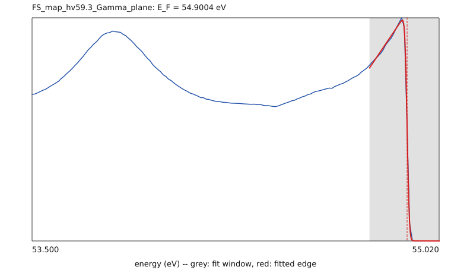

`fermi_edge_search` lists every drop of the EDC that stands above the noise,
highest energy first, fits each and says which is the Fermi edge. When two
fit (a weak tail above a strong drop, as on the real pass-energy-20 data),
it says so and the agent asks you once. Each fit is drawn: grey the window,
red the fitted edge.

**4. To momentum, one row each.**

```python
k = L.map_to_k(MAP, ef=EF[MAP], normalise_axes=(1, 2), new_name="map Gamma plane k")
L.cut_to_k("cut_GM_LH", ef=EF["cut_GM_LH"], new_name="cut GM LH k")
```

The shift to E − E_F, the normalisation of every cut of the map and the
conversion are one call: only the final row is listed, and its history
records the three steps.

**5. The zone and the figure.**

```python
L.bz_overlay("map Gamma plane k", space_group=164, a=3.3, c=6.0, hkl=(0, 0, 1), offset=0.0)
L.slice_series("map Gamma plane k", values=[0, -0.2, -0.4], half_width=0.02, cols=3,
               colormap="blue", flip=True, shared=False, percentiles=(3, 99.7),
               high_factor=1.4, zone_style="dashed", zone_color="#B8D62020",
               title="Figure 1")
L.figure_render("Figure 1", os.path.join(HERE, "..", "figures", "Figure1.png"), dpi=150)
```


**6. Dichroism.**

```python
L.cut_arithmetic("cut GM LH k", "cut GM LV k", operation="asymmetry", normalise="total")
```

The program's own cut arithmetic, the same as the Cut arithmetic window
([§5.5](#55-cut-arithmetic-dichroism-and-reference-division)): LV scaled to
LH's total, (LH − LV)/(LH + LV), points of low intensity masked.

**7. Watching.** Meanwhile the AI assistant lists each step
([§7.4](#74-watching-and-stepping-in)); you can click one to read its
output, pause to look at a row yourself, and resume. At the end the agent
writes the report and, if you agree, removes intermediate rows; the results
folder holds the figures, the fit pictures and every command file, which
together record exactly what was done.

## 7.8 Limitations and good practice

- **Check the physics.** An agent can choose a plausible but wrong Fermi
  edge, Γ position or inner potential. Tick *Ask me before choosing a
  physical parameter*, and look at each fit picture.
- **Keep the record.** The command files in `<results>/_agent/` and the rows'
  histories show what was done; keep them with the results.
- **Usage.** The agent cannot see its own token use; if you want a usage
  log with numbers, give them to it.
- **Privacy.** Only what the agent reads leaves your computer
  ([§7.1](#71-how-it-works-and-what-leaves-your-computer)); keep anything
  private out of the folders it can reach.
- **Encoding.** Command files are UTF-8; the program warns when a step's
  code holds characters garbled by a wrong encoding ("−" for "−").

---

# Part 8 — Housekeeping

Autosave and recovery, saving your work, error logs, versions, and what to do when something goes wrong.

## 8.1 Autosave, memory and recovery

- **Autosave.** Every computed dataset (a k-map, a processed cut, a fit
  result…) is written, uncompressed, to this session's folder in
  `~/.arpes_viewer/sessions/` the moment it exists. Real-space scans are not
  (they are the measurement itself, and large).
- **A normal close deletes the autosaved copies.** When you close the main
  window and confirm (everything you want is saved, or *Close anyway*), the
  open viewers are closed and the session folder is deleted straight away.
  A dataset's copy also goes as soon as you save it to a file of your own.
- **Recovery after a crash.** Only if the program did not close normally (a
  crash, a kill) is the session folder kept: the next start offers its
  datasets back, and it is deleted after three days.
- **Operations log.** `~/.arpes_viewer/sessions/operations.log`, one line per
  store / save / discard — how to find what was where.
- **Memory box** (bottom of the tool panel). This program's memory, the system's, how many viewers and
  HDF5 files are open, and how much computed data is held. **Free RAM**
  drops cached copies of computed data (they are re-read from their autosaved
  file when needed); **Close all** closes every window and then frees
  memory.
- **Autosaves** (in the Memory box) shows the session folders
  in the system's file browser, to delete old working copies by hand. The
  folder of the session now running (named in the status bar) is in use.
- **Long operations** (reading a big map, converting, de-gridding, assembling
  a folder) run off the GUI thread with a progress bar and a working Cancel.
- **Closing** with unsaved computed data asks first, and names the datasets:
  **Save to a file...**, **Close anyway** (the autosaved copies are deleted)
  or **Cancel** (nothing happens).

## 8.2 Saving and reopening work

- **Datasets.** Select rows → Datasets box → **Save**: one `.nxs` file in the
  program's own format (several datasets per file, with their metadata and
  processing history), which **Load data...** opens again; or Igor Pro text
  (`.itx`). A viewer's panel exports what it shows
  ([§3.8](#38-exporting-a-panel-and-saving-data)).
- **Figures.** In the figure composer, **Save** writes an `.afig` file that
  opens again for editing, with the data of every panel beside it ("data for
  <name>"), so it opens even where the original files are not. Leave that
  folder out of anything you share. **Export** writes PNG, PDF, SVG or TIFF.
- **The experiment log** and the **session log** record what was measured
  and what was done ([§2.3](#23-the-experiment-log)).
- Nothing is overwritten without asking: a save to an existing file asks
  first.

## 8.3 Error logs and bug reports

When something goes wrong, the program **keeps running** and saves the error
and its traceback in **`error_logs/errors_<date>_<time>.txt` in the program's
folder** (in `~/.arpes_viewer/error_logs/` if that folder cannot be
written), one file per session in which an error happened. A message says
so.

To report a bug, open an issue at
<https://github.com/DingPei1995/ARPES-viewer/issues> with:

- the error log: **upload the file** (drag it into the text box) **or paste
  its text**. The main panel's last line has **Copy the newest error log**
  and **Open the error logs**;
- the version, from the title bar;
- what you did just before, and if possible the kind of file
  (beamline, cut or map).

If the program does not start at all, the launcher's log
`~/.arpes_viewer/launcher.log` holds the reason.

## 8.4 Versions and updates

The title bar and the main panel's last line show the version and its date
(`ARPES viewer v1.3.4 (updated 2026-11-13)`). What changed in each version,
and why, is in the [CHANGELOG](../CHANGELOG.md).

To update a pip installation:

```bash
pip install --upgrade arpes-viewer
```

For the latest unreleased version, `pip install
git+https://github.com/DingPei1995/ARPES-viewer`; a downloaded copy is
updated by downloading it again. Datasets and figures saved by an earlier
version open in later ones.

## 8.5 Tips and troubleshooting

- **A greyed tool button** — hover over it: the tooltip says why (e.g. the
  MDC fit needs a cut already in Å⁻¹, cut arithmetic two cuts). Select the
  right rows in the list and it lights up.
- **A tool is not in a viewer's Functions menu** — it is in the tool panel
  (see *Where things are now* in [§2.1](#21-the-main-window-at-a-glance)); check all three tabs (Basic, Advanced, Figure).
- **A window is taller than the screen** — it opens no taller than the
  screen, and its contents scroll; the Apply / Close buttons stay at the
  bottom. Every window can be resized.
- **A k conversion is not offered** — the first axis of the map is not an
  angle (a photon energy, temperature…). Check *First axis of a map is* in
  the loader.
- **Cut k conversion of an E − E_F cut** — the energy offset is filled in for
  you from the Fermi fit; if you shifted the axis some other way, type the
  kinetic energy of E_F (photon energy − work function) into *Energy offset*.
- **A file is misread** — choose the reader explicitly in the loader, and see
  *Assumptions worth knowing about* in the
  [reading-data reference](../arpes_viewer/loader/README.md#assumptions-worth-knowing-about)
  (axis order in SOLEIL files).
- **Dragging the cursor on a big map is sluggish** — a map read lazily from
  its file re-slices in about 0.1 s per window, so the other windows wait for
  the mouse to pause. Once the map has been read into memory it follows live.
- **Typing numbers** — every number box takes a decimal point (`0.05`),
  whatever the system language; a comma is not accepted.
- **The machine is paging** — watch the Memory bar (amber past a third of the
  RAM, red past a half); use **Free RAM** or **Close all**.

<!-- Generated by devtools/build_guide.py from docs/guide/en/: edit those files, not this one. -->
