# ARPES viewer — Guide de l'utilisateur

*[English version](USER_GUIDE_en.md) · [中文版](USER_GUIDE_zh.md)*

*Dernière mise à jour : 13 novembre 2026 — pour ARPES viewer v1.3.4*

La version et sa date figurent dans la barre de titre de la fenêtre principale
et sur sa dernière ligne. Rapports de bogues, questions et dernière version :
<https://github.com/DingPei1995/ARPES-viewer> (indiquez la version quand vous
signalez un bogue).

Le guide suit le programme tel qu'il apparaît à l'écran :

- la **partie 1** pour démarrer : installation, données de démonstration,
  fichiers lus, configuration d'un agent IA, organisation du code ;
- la **partie 2**, le panneau principal : la liste des jeux de données et ce
  qui l'entoure ;
- la **partie 3**, les fenêtres de visualisation : coupes, cartes, cartes kz,
  cartes k, courbes, spin et balayages résolus spatialement ;
- les **parties 4, 5 et 6**, les trois onglets du panneau d'outils
  (**Basic**, **Advanced**, **Figure**) ; la partie 6 se termine par un
  exemple allant du chargement des données à la figure finie ;
- la **partie 7**, les agents IA : comment ils pilotent le programme, comment
  en démarrer et en suivre un, et un exemple de la configuration à la figure ;
- la **partie 8**, l'entretien : sauvegarde automatique et récupération,
  enregistrement du travail, journaux d'erreurs, versions et dépannage.

Toutes les captures d'écran viennent du programme en marche, sur les données
synthétiques de `devtools/demo_data.py`, pour que vous puissiez suivre sans
temps de faisceau ([§1.3](#13-essayer-avec-des-données-de-démonstration)).
**Ce ne sont pas des données expérimentales réelles.** Le contexte technique
de chaque étape (formules, tests, choix de conception) est dans les
références à côté du code : [lecture des données](../arpes_viewer/loader/README.md),
[les fenêtres](../arpes_viewer/ui/README.md),
[l'analyse](../arpes_viewer/tools/README.md), et le
[CHANGELOG](../CHANGELOG.md).

## Table des matières

**[Partie 1 — Premiers pas](#partie-1--premiers-pas)**

- [1.1 Ce qu'est ARPES viewer](#11-ce-quest-arpes-viewer)
- [1.2 Installation et lancement](#12-installation-et-lancement)
- [1.3 Essayer avec des données de démonstration](#13-essayer-avec-des-données-de-démonstration)
- [1.4 Installations et formats de fichiers](#14-installations-et-formats-de-fichiers)
- [1.5 Types de données](#15-types-de-données)
- [1.6 Configurer un agent IA](#16-configurer-un-agent-ia)
- [1.7 Organisation du code](#17-organisation-du-code)
- [1.8 Où le programme range ses fichiers](#18-où-le-programme-range-ses-fichiers)

**[Partie 2 — Le panneau principal](#partie-2--le-panneau-principal)**

- [2.1 La fenêtre principale en un coup d'œil](#21-la-fenêtre-principale-en-un-coup-dœil)
- [2.2 Charger des données](#22-charger-des-données)
- [2.3 Le journal d'expérience](#23-le-journal-dexpérience)
- [2.4 Combiner des jeux de données : empiler, raccorder, additionner](#24-combiner-des-jeux-de-données--empiler-raccorder-additionner)
- [2.5 Fenêtres pas à pas](#25-fenêtres-pas-à-pas)

**[Partie 3 — Les fenêtres de visualisation](#partie-3--les-fenêtres-de-visualisation)**

- [3.1 Ce que les fenêtres de visualisation ont en commun](#31-ce-que-les-fenêtres-de-visualisation-ont-en-commun)
- [3.2 Les cartes : le contour et ses deux coupes](#32-les-cartes--le-contour-et-ses-deux-coupes)
- [3.3 Coupes arbitraires](#33-coupes-arbitraires)
- [3.4 Cartes kz et cartes k](#34-cartes-kz-et-cartes-k)
- [3.5 Courbes : EDC, MDC et ajustement de courbes](#35-courbes--edc-mdc-et-ajustement-de-courbes)
- [3.6 Données résolues en spin](#36-données-résolues-en-spin)
- [3.7 Balayages résolus spatialement (nano-ARPES)](#37-balayages-résolus-spatialement-nano-arpes)
- [3.8 Exporter un panneau et enregistrer des données](#38-exporter-un-panneau-et-enregistrer-des-données)

**[Partie 4 — Le panneau d'outils : onglet Basic](#partie-4--le-panneau-doutils--onglet-basic)**

- [4.1 Comment fonctionnent les boutons d'outils](#41-comment-fonctionnent-les-boutons-doutils)
- [4.2 Ajustement du front de Fermi](#42-ajustement-du-front-de-fermi)
- [4.3 Correction de la surface de Fermi](#43-correction-de-la-surface-de-fermi)
- [4.4 Supprimer la grille du détecteur](#44-supprimer-la-grille-du-détecteur)
- [4.5 Corrections du détecteur](#45-corrections-du-détecteur)
- [4.6 Soustraction du fond](#46-soustraction-du-fond)
- [4.7 Conversion en k d'une coupe](#47-conversion-en-k-dune-coupe)
- [4.8 Vérification des niveaux de cœur](#48-vérification-des-niveaux-de-cœur)
- [4.9 Conversion en k d'une carte](#49-conversion-en-k-dune-carte)
- [4.10 Aligner les niveaux de Fermi d'une carte kz](#410-aligner-les-niveaux-de-fermi-dune-carte-kz)
- [4.11 Convertir une carte kz en impulsion](#411-convertir-une-carte-kz-en-impulsion)
- [4.12 Zone de Brillouin](#412-zone-de-brillouin)

**[Partie 5 — Le panneau d'outils : onglet Advanced](#partie-5--le-panneau-doutils--onglet-advanced)**

- [5.1 Lissage, dérivées, courbure et symétrisation](#51-lissage-dérivées-courbure-et-symétrisation)
- [5.2 Détection de crêtes](#52-détection-de-crêtes)
- [5.3 Empilements de courbes](#53-empilements-de-courbes)
- [5.4 Ajustement MDC et ajustement EDC](#54-ajustement-mdc-et-ajustement-edc)
- [5.5 Arithmétique de coupes : dichroïsme et division par une référence](#55-arithmétique-de-coupes--dichroïsme-et-division-par-une-référence)
- [5.6 Figure en série de tranches](#56-figure-en-série-de-tranches)
- [5.7 Les vues 3D](#57-les-vues-3d)
- [5.8 Poche de Fermi (quasi-2D, en test)](#58-poche-de-fermi-quasi-2d-en-test)

**[Partie 6 — Le panneau d'outils : onglet Figure](#partie-6--le-panneau-doutils--onglet-figure)**

- [6.1 Le composeur de figures](#61-le-composeur-de-figures)
- [6.2 Structure cristalline](#62-structure-cristalline)
- [6.3 3D BZ : la zone de Brillouin en trois dimensions](#63-3d-bz--la-zone-de-brillouin-en-trois-dimensions)
- [6.4 Ajustement de liaisons fortes](#64-ajustement-de-liaisons-fortes)
- [6.5 Bandes calculées](#65-bandes-calculées)
- [6.6 Exemple : du chargement des données à la figure](#66-exemple--du-chargement-des-données-à-la-figure)
- [6.7 Exemple complet : deux figures dans le composeur](#67-exemple-complet--deux-figures-dans-le-composeur)

**[Partie 7 — Agents IA](#partie-7--agents-ia)**

- [7.1 Principe, et ce qui quitte votre ordinateur](#71-principe-et-ce-qui-quitte-votre-ordinateur)
- [7.2 Architecture : opérations, référence, voies](#72-architecture--opérations-référence-voies)
- [7.3 Démarrer depuis le panneau AI assistant](#73-démarrer-depuis-le-panneau-ai-assistant)
- [7.4 Suivre et intervenir](#74-suivre-et-intervenir)
- [7.5 Autres façons de démarrer](#75-autres-façons-de-démarrer)
- [7.6 Les règles de travail de l'agent](#76-les-règles-de-travail-de-lagent)
- [7.7 Exemple : un agent, de la configuration à la figure](#77-exemple--un-agent-de-la-configuration-à-la-figure)
- [7.8 Limites et bonnes pratiques](#78-limites-et-bonnes-pratiques)

**[Partie 8 — Entretien](#partie-8--entretien)**

- [8.1 Sauvegarde automatique, mémoire et récupération](#81-sauvegarde-automatique-mémoire-et-récupération)
- [8.2 Enregistrer et rouvrir son travail](#82-enregistrer-et-rouvrir-son-travail)
- [8.3 Journaux d'erreurs et rapports de bogue](#83-journaux-derreurs-et-rapports-de-bogue)
- [8.4 Versions et mises à jour](#84-versions-et-mises-à-jour)
- [8.5 Conseils et dépannage](#85-conseils-et-dépannage)

---

# Partie 1 — Premiers pas

Ce qu'est le programme, comment l'installer et le lancer, les données de démonstration dont proviennent toutes les captures d'écran, les fichiers qu'il lit, comment connecter un agent IA, et où se trouvent les choses dans le code et sur le disque.

## 1.1 Ce qu'est ARPES viewer

ARPES viewer est un programme Python/PyQt5 pour les données de photoémission
résolue en angle. Il parcourt les mesures d'un temps de faisceau, ouvre
chacune dans sa propre fenêtre, convertit en impulsion, coupe, ajuste et
traite, compare aux calculs de structure de bandes, et met les résultats en
page comme une figure de publication. Chaque étape est aussi du Python simple
qu'un script ou un agent IA peut exécuter.

Il est gratuit pour un **usage non commercial** (recherche académique et
enseignement), sous la licence PolyForm Noncommercial 1.0.0. Si vous l'utilisez
pour un article, merci de le citer : Ding Pei, *ARPES viewer*, Zenodo,
<https://doi.org/10.5281/zenodo.23771647>.

Ce n'est pas un programme d'acquisition, et il ne modifie pas vos fichiers de
données : chaque résultat est un nouveau jeu de données dans la liste ou un
nouveau fichier que vous choisissez.

## 1.2 Installation et lancement

Il faut Python 3.9 ou plus récent, et cinq paquets :

```bash
pip install PyQt5 pyqtgraph numpy h5py scipy
```

Puis, depuis le dossier `ARPES_viewer` :

```bash
python ARPES_viewer.py
```

**Sous Windows, double-cliquez `ARPES viewer.pyw`** dans le dossier du
programme, et non `ARPES_viewer.py` : Windows lance un `.pyw` avec
`pythonw`, sans fenêtre de console noire -- la fermer par erreur fermait le
programme. (Un `.py` double-cliqué malgré tout cache désormais la console
ouverte pour lui seul ; lancé depuis une invite de commande, il la garde.)
Les messages du programme vont dans `~/.arpes_viewer/launcher.log` ; s'il
s'arrête sur une erreur, une fenêtre montre la fin de ce journal.

**Les erreurs sont gardées dans un fichier texte.** Ce que la console
afficherait en cas d'erreur -- l'erreur et sa trace -- est enregistré de
lui-même dans **`error_logs/errors_<date>_<heure>.txt` du dossier du
programme** (dans `~/.arpes_viewer/error_logs` si ce dossier n'est pas
accessible en écriture), seulement quand une erreur survient. Une fenêtre le
signale et le programme **continue** au lieu de se fermer. Avec un rapport
de bug, **téléversez ce fichier** (dans GitHub Issues : glissez-le dans la
zone de texte) **ou collez son texte** -- le pied du panneau principal offre
**Copy the newest error log** et **Open the error logs**.

**Les opérations longues montrent une barre de progression.** Tout ce qui
peut prendre du temps sur de grosses données ou un ordinateur lent — lire
une carte entière, conversion en k, correction FS, coupes arbitraires,
opérations sur les données, assemblage, enregistrement, détection de
crêtes, ajustements, et dans Calculated bands la lecture d'un calcul, les
bandes sur un plan et la surface de Fermi 3D — affiche après 0,4 s une
fenêtre de progression : une barre qui avance, les secondes écoulées, et
Cancel quand l'étape peut s'arrêter. Le programme travaille ; il n'est pas
figé.

**Sur Mac, pas besoin du Terminal :** double-cliquez **`ARPES viewer.app`**
dans le dossier du programme (glissez-la dans le Dock pour l'y garder). Elle
trouve le Python qui a les paquets ci-dessus -- le même que `python3` dans le
Terminal, environnements conda compris -- et le retient. Si aucun ne les a,
une fenêtre donne la commande `pip install` (déjà copiée dans le
presse-papiers : collez-la une fois dans le Terminal), ou permet de choisir
un Python.

- Si macOS dit que l'app *provient d'un développeur non identifié* (le
  programme a été téléchargé en ZIP) : **Réglages Système → Confidentialité
  et sécurité → Ouvrir quand même** (macOS plus ancien : clic droit sur
  l'app → **Ouvrir**). Seulement la première fois.
- Une copie de l'app placée hors du dossier du programme (dans Applications,
  par exemple) demande une fois où il se trouve.
- Si le programme s'arrête sur une erreur, la fenêtre montre la fin de
  `~/.arpes_viewer/launcher.log` ; joignez ce fichier à un rapport de bogue.

Les fichiers lus sont listés au [§1.4](#14-installations-et-formats-de-fichiers).

## 1.3 Essayer avec des données de démonstration

```bash
python devtools/demo_data.py            # écrit ./demo_data/
```

Ce script écrit des données synthétiques qui s'ouvrent exactement comme des
données mesurées :

- le jeu d'origine — une carte de surface de Fermi, une paire de coupes en
  polarisation LH et LV, un balayage en énergie de photon, une EDC résolue en
  spin, un petit balayage spatial et une carte où est imprimée la grille du
  détecteur — issu d'une structure de bandes simple (une poche d'électrons
  hexagonale et une bande de trous en Γ, des poches de trous en K) ;
- **un cristal lamellaire en trois dimensions** (`demo_bulk_bands.nxs`) : des
  cartes aux énergies de photon du plan Γ (59,3 eV) et du haut de la zone
  (77 eV), des coupes selon Γ-M (LH et LV) et Γ-K, et un balayage en énergie
  de photon selon Γ-M couvrant une période entière de k_z. Deux de ses bandes
  se croisent le long d'une ligne qui traverse la zone, dont l'énergie varie
  avec k_z ;
- **un calcul de ce cristal**, tel qu'un groupe de théorie l'enverrait : un
  hamiltonien Wannier90 (`demo_calc_hr.dat` avec `demo_calc.win`) et les
  mêmes bandes sur une grille (`demo_calc.bxsf`). C'est le cristal avant
  renormalisation — ses bandes 1/0,8 fois plus larges et 50 meV plus haut —
  ce que l'ajustement aux données retrouve ([§6.5](#65-bandes-calculées)) ;
- deux structures cristallines en fichiers CIF (`demo_crystal.cif`, un cristal
  hexagonal lamellaire 1T ; `demo_tetragonal_crystal.cif`, un cristal de type
  ZrSiS) et un spectre EDS (`demo_eds.nxs`).

Toutes ont une coupure de Fermi, la résolution de l'analyseur et un bruit de
Poisson.

Pour refaire toutes les captures d'écran de ce guide après avoir modifié une
fenêtre :

```bash
python devtools/guide_screenshots.py    # écrit docs/images/*.png
```

Les deux figures d'exemple du
[§6.7](#67-exemple-complet--deux-figures-dans-le-composeur) sont reconstruites,
à partir des données de démonstration et avec les fenêtres du programme, par

```bash
python devtools/figure_tests.py docs/images [dossier des fichiers .afig]
```

## 1.4 Installations et formats de fichiers

Le lecteur d'un fichier est détecté automatiquement ([§2.2](#22-charger-des-données)).

| Installation / ligne | Fichiers | Données |
|---|---|---|
| SOLEIL **ANTARES** | NeXus `*.nxs` | coupes, cartes en déflecteur, balayages en énergie de photon (PhD), balayages spatiaux |
| SOLEIL **CASSIOPEE** | texte Scienta `*.txt` | spectres seuls ; dossiers numérotés assemblés en carte ou en balayage en énergie de photon |
| CASSIOPEE **station spin** (MBS A-1) | `*.krx`, `*.txt` | coupes, cartes en déflecteur, EDC résolues en spin |
| ALS **MAESTRO** | `*.h5`, `*.hdf5` | coupes, cartes, balayages en énergie de photon et spatiaux |
| ALBA **LOREA** | `*.nxs` | coupes, cartes |
| Diamond **I05** (HR-ARPES) et **I05-1** (nano-ARPES) | `*.nxs` | coupes, cartes, balayages en énergie de photon, balayages spatiaux |
| MAX IV **Bloch** (et tout fichier Scienta SES qu'aucun autre lecteur ne prend) | `*.ibw`, `*.zip`, `*.txt` | coupes, cartes en déflecteur, balayages en énergie de photon et du manipulateur |
| Elettra **APE**, BESSY **One Cube / One Square**, SOLARIS **URANOS** | `*.ibw`, `*.zip`, `*.txt` | tels que SES les écrit |
| ASTRID2 **SGM4** | `*.h5`, `*.hdf5` | coupes, cartes, balayages au couteau |
| Ce programme | son propre `*.nxs` | tout ce qu'il a enregistré, plusieurs jeux de données par fichier |

Les jeux de données s'enregistrent dans le format `.nxs` du programme (qu'il
rouvre) ou en texte Igor Pro (`.itx`). La façon dont les fichiers de chaque
installation sont lus, et les hypothèses qu'imposent leurs formats, sont dans
[la référence des lecteurs](../arpes_viewer/loader/README.md), qui
explique aussi comment ajouter une ligne de lumière.

**Une carte dont le balayage a été arrêté avant la fin** -- à la main, par
une perte du faisceau, un plantage du contrôle-commande -- s'ouvre jusqu'où
elle est allée, quelle que soit l'installation. Les pas jamais mesurés
(aucun coup, ou aucune valeur de l'axe balayé) et un dernier pas nettement
plus faible que ceux d'avant (moins de la moitié : arrêté en cours
d'acquisition) sont laissés de côté ; la barre d'état et le panneau
Information (`incomplete.note`) disent combien et pourquoi. Les pas faibles
au milieu d'un balayage viennent de l'échantillon et ne sont jamais touchés.

## 1.5 Types de données

| Type | Axes | Ce que c'est |
|---|---|---|
| `cut` | angle (ou k) × E | un spectre |
| `map` | angle × angle × E | un balayage au déflecteur ou en angle polaire |
| `k_map` | kx × ky × E | une carte convertie en impulsion |
| `kz_map` | hν × angle × E | un balayage en énergie de photon |
| `kz_map_k` | k_z × k∥ × E | ce balayage converti en impulsion |
| `spem_4d`, `spem_1d` | x (× y) × angle × E | balayages en espace réel |
| `edc`, `mdc`, `spin_edc` | E (ou k) × canaux | courbes, avec canaux σ facultatifs |

### Noms des données traitées

Chaque résultat est une nouvelle ligne nommée d'après sa source, avec une
étiquette entre crochets ajoutée par étape, la plus ancienne d'abord :
`Map80eV [norm] [E-E_F] [k]` est Map80eV normalisée, rapportée à E_F, puis
convertie en impulsion. Les étiquettes, dans l'ordre habituel d'un
traitement (`arpes_viewer/tools/runtime/naming.py`) :

| Étiquette | Faite par | Ce qui a été fait |
|---|---|---|
| `[combined …]` | Combine…, somme de balayages répétés | jeux joints, empilés ou sommés |
| `[degrid] / [grid]` | Remove detector grid… | grille du détecteur retirée / la grille elle-même |
| `[det]` | Correction du détecteur | trapèze et régions corrigés |
| `[crop]` | Truncate…, `L.crop` | réduit à une plage de ses axes |
| `[bin]` | Compress…, `L.bin` | points sommés par blocs |
| `[despike]` | Smooth… (pics) | pics retirés |
| `[norm]` | Self-normalise…, `L.normalise` | chaque spectre ou plan divisé par son total ou son maximum |
| `[bg]` | Background subtraction… | fond soustrait |
| `[E-E_F]` | Ajustement du niveau de Fermi (décalage), `L.shift_energy` | énergie rapportée au niveau de Fermi |
| `[dFD]` | Ajustement du niveau de Fermi (division) | divisé par la fonction de Fermi–Dirac |
| `[FS corr]` | Fermi surface correction…, `L.fs_correction` | bandes redressées le long de la fente |
| `[sm]` | Smooth… | lissé |
| `[symm]` | Symmetrise… | symétrisé |
| `[k]` | Conversion en k (coupe / carte) | converti en impulsion |
| `[kz]` | Conversion en kz | balayage en hν converti en k_z |
| `[d2] / [grad] / [cur]` | Second derivative… / Minimum gradient… / Curvature… | dérivée seconde, gradient minimum, courbure |
| `[ridge]` | Détection des crêtes | positions des bandes |
| `[arb cut]` | Coupe arbitraire dans une carte | coupe le long d'une ligne choisie |
| `[slice …]` | Save slice to list (visualiseur) | plan ou coupe sorti d'un visualiseur |
| `[EDC …] / [MDC …]` | EDC / MDC d'un visualiseur vers la liste | courbe extraite, avec sa position |
| `[shifted] / [sigma]` | visualiseur de courbes | courbe décalée / son incertitude de Poisson |
| `[fit]` | ajustement de courbe | résultat d'ajustement |
| `[LD] [CD] [diff] [asym] [ratio] [sum]` | Cut arithmetic… | deux coupes combinées |
| `[calc]` | Bandes calculées | un calcul, pas une mesure |

**Tri.** Clic droit sur la liste → **Sort by data type** regroupe les lignes
par leur **dernière** étiquette -- la dernière opération faite -- dans
l'ordre de ce tableau : les mesures telles que lues d'abord, puis `[crop]`,
`[norm]`, `[E-E_F]`, `[k]`… ; une étiquette absente du tableau vient
ensuite. Dans un groupe, les lignes sont classées par type (coupe,
carte…), puis par nom, les nombres comparés comme des nombres. **Sort by
name** ignore l'ordre des étiquettes. Les noms des versions précédentes
sont lus de la même façon : `_s_nor` vaut `[norm]`, `_tk` `[crop]`,
`_comb` `[bin]`, `_sm`, `_d2`, `_cur` `[sm]`, `[d2]`, `[cur]`, et `[E-Ef]`
`[E-E_F]`. Une ligne renommée à la main ne garde sa place que si elle
garde ses étiquettes. Un agent IA suit la même règle, aussi pour les noms
qu'il choisit ([§7.6](#76-les-règles-de-travail-de-lagent)) ; `L.naming()` lui
donne le tableau.

## 1.6 Configurer un agent IA

Un agent IA peut piloter le programme pour vous ([partie 7](#partie-7--agents-ia)). La voie
habituelle ne demande rien à installer :

1. Ayez une application IA capable de lire et d'écrire des fichiers sur votre
   ordinateur : l'application de bureau Claude, Claude Code ou un agent
   semblable.
2. Dans ARPES viewer, cliquez sur **AI assistant...** en haut du panneau
   d'outils, choisissez le dossier des données et celui des résultats, et
   cliquez sur **Copy the prompt and start** ([§7.3](#73-démarrer-depuis-le-panneau-ai-assistant)).
3. Collez le prompt dans l'application IA et autorisez-la à lire le dossier
   des données et à lire et écrire celui des résultats.

Une application qui utilise des outils MCP doit d'abord ajouter une fois le
serveur MCP du programme ; le prompt indique comment ([§7.5](#75-autres-façons-de-démarrer)). Avant de
commencer, lisez ce qui quitte votre ordinateur ([§7.1](#71-principe-et-ce-qui-quitte-votre-ordinateur)).

## 1.7 Organisation du code

| Dossier | Contenu |
|---|---|
| `arpes_viewer/loader/` | les lecteurs : un par installation (`beamlines/`), les formats communs (`formats/`), le `.nxs` du programme, la sauvegarde automatique de la session |
| `arpes_viewer/tools/` | les calculs, sans fenêtre : spectres (front de Fermi, ajustements, niveaux de cœur, spin), impulsion (conversions k et kz), traitement (lissage, dérivées, arithmétique de coupes ...), cristal (réseaux, zones de Brillouin, bandes calculées), sorties (figures, export) |
| `arpes_viewer/ui/` | les fenêtres : panneau principal (`launcher/`), visualisation (`viewers/`), outils (`panels/`), parties communes (`common/`), dont les opérations de l'agent `L` (`common/live.py`) |
| `arpes_viewer/agent/` | le serveur MCP, le pont agent (agent bridge) et `API.md`, la référence de l'agent générée à partir du programme |
| `agentic/` | exemples et recettes pour agents et scripts |
| `devtools/` | les données de démonstration, les captures d'écran, les tests de figures, la construction de ce guide |
| `test/` | les tests (`python -m pytest`) |

Comme les calculs de `tools/` n'ont besoin d'aucune fenêtre, un script peut les
appeler directement, par exemple
`arpes_viewer.tools.momentum.kspace.convert_map(...)`. Chaque dossier a un
README avec les formules et les tests ; l'organisation et les conventions sont
dans [les notes pour développeurs](DEVELOPER.md).

## 1.8 Où le programme range ses fichiers

| Où | Quoi |
|---|---|
| `~/.arpes_viewer/` | les réglages mémorisés d'une session à l'autre, le journal du lanceur, le jeton du pont agent pendant qu'il tourne, les derniers dossiers de l'AI assistant |
| `~/.arpes_viewer/sessions/` | les copies sauvegardées automatiquement des données calculées, un dossier par session, et `operations.log` ([§8.1](#81-sauvegarde-automatique-mémoire-et-récupération)) |
| `error_logs/` dans le dossier du programme (sinon `~/.arpes_viewer/error_logs/`) | un fichier texte par session où une erreur s'est produite ([§8.3](#83-journaux-derreurs-et-rapports-de-bogue)) |
| `<résultats>/_agent/` | les fichiers de commandes d'un agent, leur sortie et leurs images, lorsqu'il est démarré depuis l'AI assistant ([§7.3](#73-démarrer-depuis-le-panneau-ai-assistant)) |

Vos dossiers de données sont seulement lus ; le programme n'y écrit que si vous
y enregistrez vous-même un fichier.

---

# Partie 2 — Le panneau principal

La fenêtre principale est un navigateur de jeux de données. Cette partie présente la liste et tout ce qui l'entoure, sauf le panneau d'outils (parties 4 à 6) et l'AI assistant (partie 7).

## 2.1 La fenêtre principale en un coup d'œil

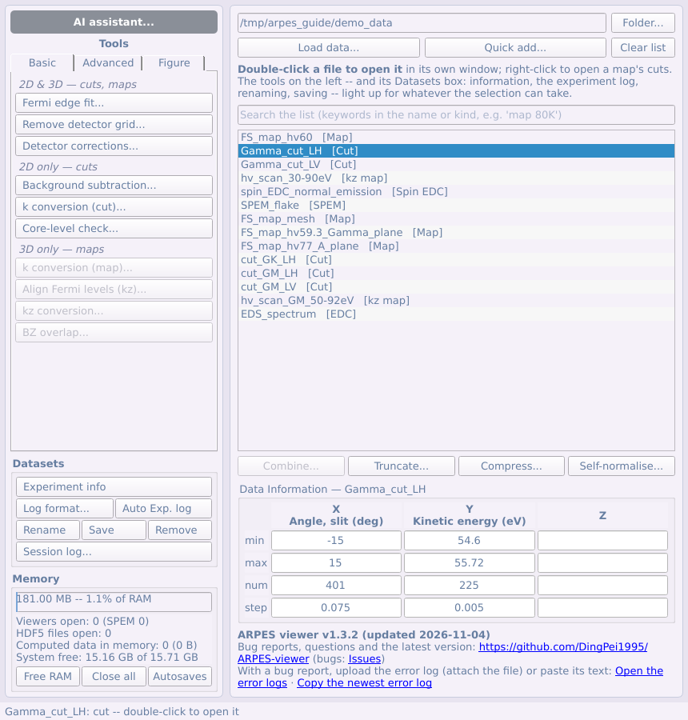

La fenêtre principale est un **navigateur** : une ligne par *jeu de
données*, et non par fichier (un fichier `.nxs` contient souvent plusieurs
mesures, chacune sur sa propre ligne). Le type est indiqué après le nom :
`[Cut]`, `[Map]`, `[kz map]`, `[k-map]`, `[SPEM]`, `[EDC]`, `[Spin EDC]`…

Elle a trois parties :

- **Le panneau d'outils** (à gauche) : le bouton **AI assistant...** en haut
  ([partie 7](#partie-7--agents-ia)), puis tous les outils d'analyse et de traitement sous
  forme de boutons, en trois onglets **Basic**, **Advanced** et **Figure**
  ([parties 4 à 6](#partie-4--le-panneau-doutils--onglet-basic)). Sous les onglets, le cadre **Datasets**.
- **La liste** (à droite), avec ses boutons.
- **Le cadre Memory** (en bas à gauche) et la ligne de version (en bas à
  droite).

| Action | Comment |
|---|---|
| Ouvrir un jeu de données dans sa propre fenêtre | **double-clic** sur la ligne (ou clic droit → **Open**) |
| Lancer un outil sur les lignes sélectionnées | son bouton dans le **panneau d'outils** |
| Empiler plusieurs coupes en une carte, raccorder une carte / carte kz mesurée en plusieurs morceaux, ou additionner des mesures répétées | **Combine...** sous la liste |
| Chercher et trier dans la liste | la **recherche** au-dessus de la liste ; clic droit → **Sort by name** / **Sort by data type** |
| Rogner à un intervalle, regrouper des points, normaliser chaque spectre sur lui-même | **Truncate...**, **Compress...**, **Self-normalise...** sous la liste |
| Ouvrir la coupe le long de la fente ou de l'axe balayé d'une carte | **clic droit** sur la ligne (ou sur une sélection de lignes) |
| Lire les métadonnées, écrire le journal d'expérience, renommer, enregistrer, retirer | le cadre **Datasets** du panneau d'outils, au-dessus de Memory |
| Voir et libérer la mémoire, fermer toutes les fenêtres, ouvrir le dossier de sauvegarde | le cadre **Memory**, en bas à gauche |
| Voir quelle version est utilisée, signaler un bogue, obtenir la dernière version | la barre de titre et la dernière ligne de la fenêtre (lien GitHub) |

Les quatre boutons sous la liste agissent sur les lignes sélectionnées
au-dessus et créent de nouvelles lignes — les originaux ne sont jamais
modifiés.

**Le menu contextuel** contient les façons d'ouvrir les lignes :
**Open**, **Open slit cut** et **Open scan-axis cut** (pour une carte), et
deux façons d'ordonner toute la liste : **Sort by name** (`Cut_9` avant
`Cut_10`) et **Sort by data type** (groupées par la dernière étiquette de
traitement du nom -- `[norm]`, `[E-E_F]`, `[k]`… -- dans l'ordre du
traitement, puis par type et nom ; voir [§1.5](#15-types-de-données)). Une entrée qui ne convient pas à la sélection est grisée, et son
infobulle en donne la raison.

**La recherche** (au-dessus de la liste) n'affiche que les lignes dont le
nom ou le type contient chacun des mots tapés (`map 80K`, sans tenir compte
des majuscules) ; videz-la pour tout revoir. Les lignes cachées sont
désélectionnées : rien d'invisible n'est traité.

**Le cadre Datasets** (panneau d'outils, entre les outils et Memory) contient
le reste de ce qui se fait aux lignes : **Experiment info**, **Log format...**
et **Auto Exp. log** côte à côte (voir [le journal d'expérience](#23-le-journal-dexpérience)),
**Rename**, **Save** et **Remove** sur une ligne, et **Session log...**. Ses
boutons se grisent quand ils ne conviennent pas à la sélection.

## 2.2 Charger des données

**Load data...** ouvre la fenêtre de chargement. **Quick add...** la saute et
ajoute les fichiers choisis avec la détection automatique.


1. **Files** — choisir un ou plusieurs fichiers (*Select file(s)...*). Le
   filtre de fichiers est construit à partir de ce que les lecteurs installés
   savent ouvrir.
2. **Reader** — détecté automatiquement, et le résultat est affiché
   (*Detected: 3 × This program's own format*). À ne changer que si un
   fichier est mal lu.
3. **Datasets found** — le contenu de chaque fichier, lu à partir de sa seule
   *structure*. C'est instantané même pour un balayage de plusieurs Go ; rien
   n'est lu avant d'ouvrir une ligne.
4. **Axes** — *Axis order* réordonne une fois pour toutes les dimensions du
   tableau, dès le chargement. *First axis of a map is* indique ce qui a été
   balayé : un angle de déflecteur (par défaut), une **énergie de photon**, une
   température, une tension de grille, un délai… L'unité reste ainsi correcte
   partout ensuite, et aucune conversion en k n'est proposée pour un axe qui
   n'est pas un angle.

**Dossiers CASSIOPEE.** Sélectionnez n'importe quel fichier d'une série
numérotée (`nom_1_ROI1_.txt`, `nom_2_ROI1_.txt`, …) : tout le dossier est
listé une seule fois, comme un cube assemblé. Qu'il devienne une carte en
angle ou une carte kz est déterminé à partir des fichiers de paramètres `_i`
placés à côté des spectres. La ligne porte l'énergie de photon et la
polarisation lues dans ces fichiers — `FineMap 117eV LH`, ou
`KzScan 40-120eV LH` pour un balayage en énergie de photon — pour distinguer
les répétitions d'un même balayage à une autre énergie ou polarisation.

**Fichiers ANTARES en énergie de photon (PhD).** Un fichier `.nxs` PhD (une
entrée `Phd_NNNN` par énergie de photon) est listé comme une seule `kz map` :
les images sont triées par énergie de photon et chaque axe en énergie
cinétique est rapporté à E_F avec son propre hν (travail de sortie 4,5 eV,
que la conversion k_z utilise ensuite). Chaque image s'ouvre encore seule
comme une coupe.

## 2.3 Le journal d'expérience

Deux boutons côte à côte dans le cadre **Datasets** écrivent le journal du
temps de faisceau -- un fichier CSV, une ligne par mesure -- à partir des
métadonnées des fichiers : **Log format...** (à gauche) le prépare une fois,
**Auto Exp. log** (à droite) y ajoute les jeux sélectionnés d'un clic.

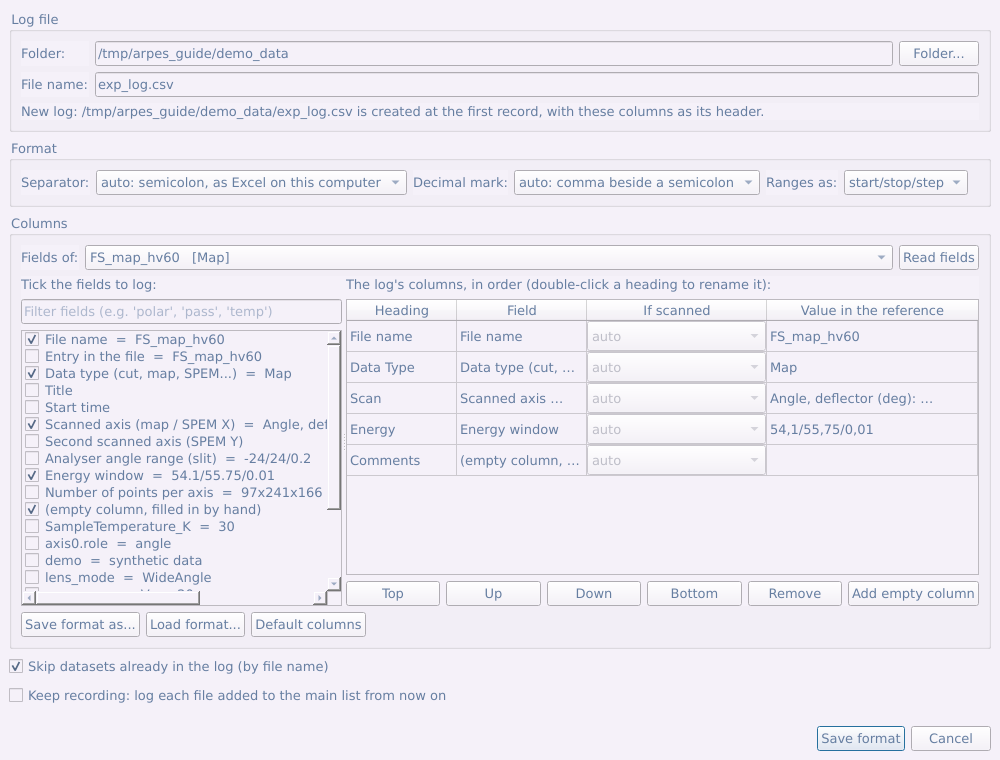

**Log format...**

1. **Log file.** Choisissez le dossier et tapez le nom du fichier. Si un
   journal de ce nom existe déjà, la fenêtre montre **son propre format**,
   à ajuster.
2. **Format.** *Separator* et *Decimal mark* sont par défaut ceux d'Excel
   sur cet ordinateur. Excel découpe un CSV au séparateur de liste du
   système -- un **point-virgule** partout où la virgule est le séparateur
   décimal (réglages français, allemands, italiens...) -- et un fichier
   séparé par des virgules s'y ouvre avec tout dans la première colonne.
   Laissez-les sur *auto*, sauf si le journal est destiné à un ordinateur
   réglé autrement. *Ranges as:* écrit un intervalle `start/stop/step` ou
   `start:step:stop`.
3. **Columns.** *Fields of:* choisit un jeu de données de la liste -- du
   type que vous consignez le plus -- et **Read fields** liste tout ce qu'il
   contient, avec sa valeur : nom du fichier, type, heure de début et
   intervalles balayés tirés des données, puis chaque champ de métadonnées
   et chaque moteur. **Cochez** un champ pour en faire une colonne. Dans le
   tableau de droite, double-cliquez un titre pour le renommer, et rangez
   les colonnes dans l'ordre voulu avec **Top / Up / Down / Bottom**. **Add
   empty column** ajoute une colonne à remplir à la main (commentaires).
   **Save format as...** / **Load format...** en gardent un par ligne de
   lumière.
4. **If scanned.** Ce qu'écrit une colonne de position ou d'angle dépend de
   la mesure :
   - une **coupe** : l'échantillon n'a pas bougé -- la valeur du moteur ;
   - un balayage **SPEM** : l'axe de platine balayé, `start/stop/step`
     (*SPEM: scanned X* / *Y* pour les colonnes de la platine) ;
   - une **carte** prise au manipulateur plutôt qu'au déflecteur : l'angle
     en `start/stop/step` (*map: scanned angle*), et une position de
     l'échantillon corrigée avec l'angle en `début..fin` ;
   - une **carte kz** : l'intervalle d'énergie de photon (*kz map: photon
     energy*).

   *auto* (par défaut) reconnaît le moteur balayé à son nom, et une position
   qui a bougé à ses valeurs. Toute autre mesure reçoit la valeur du champ.
5. **Save format.** Si le journal contient déjà des lignes et que son format
   a changé, il est **réécrit sous le nouvel en-tête** : chaque ligne suit
   ses colonnes (renommées ou déplacées), les nouvelles colonnes restent
   vides pour les anciennes lignes, et les colonnes retirées sont nommées
   d'abord, car leur contenu disparaît. L'en-tête reste la seule première
   ligne.

*Skip datasets already in the log* omet les fichiers dont le nom figure déjà
dans la colonne des noms. **Keep recording** consigne chaque fichier ajouté
ensuite à la liste, jusqu'à la fermeture du programme : pendant le temps de
faisceau, ajoutez chaque fichier mesuré et le journal se tient à jour.

**Auto Exp. log** ajoute les lignes sélectionnées après la dernière ligne du
journal, sans rien ouvrir ; la barre d'état dit combien. La toute première
fois, il ouvre d'abord *Log format...*.

Si le journal est ouvert dans Excel, Windows refuse de l'écrire : fermez-le
dans Excel et cliquez à nouveau.

## 2.4 Combiner des jeux de données : empiler, raccorder, additionner

**Combine...** (sous la liste) fait trois choses différentes, et demande
laquelle :

- **Stack (empiler)** — *coupes seulement*. Chaque coupe devient une tranche
  d'une nouvelle carte, le long d'un axe que vous nommez : série en
  température, en tension de grille, une coupe par énergie de photon. Le
  résultat s'examine comme n'importe quelle carte.
- **Join (raccorder)** — *coupes, cartes, cartes kz ou cartes k, toutes du
  même type*. Les morceaux d'une mesure prise en plusieurs fois sont remis
  bout à bout le long de l'un de leurs propres axes : une carte dont la plage
  du déflecteur a été balayée en deux parties, une carte kz dont la plage
  d'énergie de photon a été répartie sur plusieurs acquisitions, une coupe
  dont la fenêtre d'énergie a été prise en deux moitiés.
- **Sum repeated scans (additionner)** — la même mesure prise plusieurs
  fois : **Combine** ouvre la fenêtre des mesures répétées (voir
  [ci-dessous](#additionner-des-mesures-répétées)).

**Empiler des coupes**

1. Sélectionnez les coupes dans la liste (Ctrl/Maj-clic) et cliquez sur
   **Combine...**. L'empilement exige un axe identique point par point
   (même nombre de points, mêmes valeurs, mêmes unités). Si **l'autre** axe
   diffère — des fenêtres d'énergie un peu décalées d'une coupe à l'autre,
   en général — les coupes sont empilées quand même : cet axe est d'abord
   **tronqué** à la plage que toutes couvrent, et chaque coupe rééchantillonnée
   sur les points de la première dans cette plage (la fenêtre l'indique).
   Si la plage commune fait moins de la moitié de celle d'une coupe, ce sont
   plutôt les morceaux d'une mesure : utilisez *Join*. Si les deux axes
   diffèrent, ou si les plages ne se recouvrent pas, *Stack* est grisé avec
   la raison, et *Join* est proposé à la place.
2. Il demande s'il faut les combiner **dans l'ordre de la liste**. *Yes* garde
   cet ordre ; *No* permet de le choisir.
3. Choisissez **Stack**, puis définissez le nouvel axe : **New axis is**
   (température, tension de grille, énergie de photon, délai, position,
   autre — ce choix remplit *Name* et *Unit*, modifiables), **Start** et
   **Step** (le pas). Chaque coupe est affichée avec la valeur qu'elle reçoit.
   Si vous avez choisi de réordonner, **faites glisser** les lignes (ou
   utilisez **Move up** / **Move down** / **Reverse**). Cliquez sur
   **Combine**.


Une série en énergie de photon de coupes en angle devient une `kz map`, que
*Align Fermi levels (kz map)* et *Convert to momentum (kz, k∥)* acceptent
(voir [§4.10](#410-aligner-les-niveaux-de-fermi-dune-carte-kz)) ; tout autre axe donne une
`map` dont le premier axe est marqué comme n'étant pas un angle, si bien
qu'aucune conversion en k n'est proposée.

**Raccorder les morceaux d'une mesure**

1. Sélectionnez les morceaux (toutes des cartes, ou toutes des cartes kz, ou
   toutes des coupes …) et cliquez sur **Combine...**. Les cartes et
   cartes kz passent directement à *Join*.
2. **Join along** : l'axe selon lequel la mesure a été découpée. Il part de
   l'axe dont l'étendue diffère d'un morceau à l'autre — l'axe déflecteur
   d'une carte, l'énergie de photon d'une carte kz, ou l'énergie de coupes
   prises en deux fenêtres d'énergie — et il est donc en général déjà juste.
3. **Where pieces overlap** : *Average them* (moyenne), ou garder le morceau
   le plus tôt / le plus tard dans l'ordre affiché (faites glisser les lignes
   pour le changer).
4. La boîte de dialogue donne l'intervalle de chaque morceau et le
   **Result** — l'intervalle raccordé et le nombre de points — avec des notes
   sur ce qu'il a fallu faire. Cliquez sur **Combine**.


Traitement des axes :

- Des morceaux sur une même grille (même pas, intervalles qui se touchent ou
  se recouvrent d'un nombre entier de points — le cas habituel) sont
  **copiés tels quels**, sans interpolation.
- Un morceau de pas différent ou décalé d'un demi-pas est **interpolé** sur
  l'axe commun (au pas du premier morceau), et la boîte de dialogue le dit.
- Si les **autres axes** diffèrent — une fenêtre en énergie décalée de
  quelques meV entre deux acquisitions, un nombre différent de canaux de
  fente — tous les morceaux sont rééchantillonnés sur l'intervalle que
  **tous** couvrent, et la boîte de dialogue le dit.
- Un intervalle couvert par aucun morceau est un **trou**, laissé à zéro et
  signalé.
- Une carte kz raccordée reste une `kz map` : lancez *Align Fermi levels (kz
  map)* sur le résultat plutôt que sur les morceaux (les ajustements par
  énergie de photon des morceaux ne sont pas repris).

### Additionner des mesures répétées

Pour une coupe ou une carte fine prise en plusieurs balayages courts, afin de
repérer un échantillon qui vieillit. Sélectionnez les balayages (au moins
deux, d'un même type) → **Combine...** → **Sum repeated scans** →
**Combine**, qui ouvre la fenêtre des mesures répétées :

1. **Est-ce bien la même mesure ?** La grille et les conditions enregistrées
   de chaque balayage (énergie de photon, polarisation, angles, position,
   température, énergie de passage, mode de lentille) ; en orange ce qui
   diffère du premier.
2. **L'échantillon a-t-il changé ?** Cliquez sur **Compare the scans**.
   Chaque balayage est comparé à la somme des autres : le *χ² / point* est à
   peu près le même pour des balayages qui ne diffèrent que par le bruit de
   comptage et augmente quand le spectre change ; ceux qui ressortent sont
   marqués **changed**. Le décalage en énergie de l'EDC de chacun et son taux
   de comptage sont donnés ; cliquez une ligne pour voir son EDC face aux
   autres.
3. **Additionner.** Cochez les balayages à garder (les *changed* sont
   décochés au départ), choisissez de corriger ou non les décalages, **Sum**
   ou **Mean**, puis **Sum to list**.

## 2.5 Fenêtres pas à pas

Les outils qui demandent plusieurs décisions s'ouvrent en **étapes numérotées**
(additionner des mesures répétées, corrections du détecteur, ajustement de
liaisons fortes, structure cristalline, bandes calculées) : le titre indique
*Step 2 of 4: …*, un encadré bleu dit à quoi sert l'étape et quoi faire,
**Next →** reste grisé (avec la raison à côté) tant que l'étape n'est pas
terminée, et **← Back** ou la liste des étapes à gauche permet de revenir.

---

# Partie 3 — Les fenêtres de visualisation

Chaque jeu de données s'ouvre dans sa propre fenêtre de visualisation. Cette partie présente d'abord ce que toutes ces fenêtres ont en commun, puis chaque type de données.

## 3.1 Ce que les fenêtres de visualisation ont en commun

Chaque jeu de données s'ouvre dans sa propre fenêtre : on peut placer côte à
côte une carte, ses coupes et un autre fichier.


- **La ligne du haut** : le menu **Functions** (tout ce que la fenêtre sait
  faire), **Plot tools** (lignes guides et étiquettes sur ce graphique — voir
  plus bas), la palette de couleurs (propre à chaque fenêtre) avec **Flip**, et
  les réglages de vue — étendue des axes, **Auto**, **Inv** (inverser),
  **Reset**, **Grid**.
- **Au-dessus de chaque image** : la barre **Levels** (faire glisser les deux
  poignées, ou saisir des centiles **Min%/Max%** ; **Clip** les applique) et
  **Gamma**. Un min/max que vous fixez est conservé quand la tranche se
  déplace (l'énergie d'un contour, l'angle d'une coupe, le curseur d'une
  carte spatiale), si bien que toutes les positions partagent la même échelle
  de couleurs ; ramenez les poignées aux deux extrémités, ou réglez 0 %–100 %,
  pour suivre de nouveau la plage propre à chaque image.
- **Sous chaque image** : **Smooth** (affichage seulement, les données ne
  changent pas) et **Lock x/y** (rapport d'aspect).
- **Curseur de lecture** — clic droit sur l'image → *Readout cursor*. Il
  donne la valeur sous le curseur et, sur une coupe, trace l'**EDC** (à
  droite) et la **MDC** (en dessous) passant par ce point. **EDC ±** /
  **MDC ±** intègrent sur une fenêtre, affichée comme une bande ombrée sur
  l'image. Saisissez une position dans la ligne **Cursor** et appuyez sur
  Entrée pour l'y placer exactement.
- **EDC → list** / **MDC → list** ajoutent la courbe affichée à la liste
  principale comme jeu de données à part entière (voir
  [§3.5](#35-courbes--edc-mdc-et-ajustement-de-courbes)).
- **Clic droit sur l'image → Export** enregistre ce que montre le panneau —
  données (`.nxs`), image, ou axes vectoriels (`.eps`) ; voir
  [§6.1](#61-le-composeur-de-figures).
- **Functions → Slice → Save slice to the main list / Freeze slice in a new
  window** conserve une copie de la tranche affichée. La fenêtre figée (et
  *Open this position in a new window* sur une carte spatiale) s'ouvre avec le
  min/max et le gamma du panneau, pour une comparaison directe. Elle a ses
  propres **Plot tools**, et un bouton **Figure composer...** pour en faire
  une figure ([§6.1](#61-le-composeur-de-figures)).

Le menu **Functions** ne contient plus que ce qui agit sur la fenêtre
elle-même — les outils qui prennent un jeu de données sont dans le panneau
d'outils de la fenêtre principale ([§2.1](#21-la-fenêtre-principale-en-un-coup-dœil)) :

| Fenêtre | Functions |
|---|---|
| carte / carte kz / carte k (contour) | Arbitrary cut ; Slice : enregistrer / figer la tranche |
| coupe | Slice : enregistrer / figer |
| coupe selon la fente d'une carte | Show the map |
| courbe | Curve fit, Spin analysis ; Crop, Bin, Normalise, Background, Shift axis, Add √N errors |

Une entrée qui s'applique mais ne peut pas encore être lancée est grisée, et
son infobulle en donne la raison.

**Case Brillouin zone.** Une carte k ou une carte kz convertie sur laquelle
une zone a été tracée ([§4.12](#412-zone-de-brillouin)) la garde : sa fenêtre a
une case **Brillouin zone** sur la ligne du haut pour l'afficher ou la
masquer.

### Plot tools : lignes de repère et textes sur le graphique

**Plot tools**, sur la ligne du haut de chaque fenêtre de visualisation
(coupes, cartes, balayages spatiaux, courbes, tranches figées), ouvre une
petite fenêtre qui dessine **sur le graphique que vous avez sous les yeux** :


|  | |
|---|---|

- **Type** : *Vertical line*, *Horizontal line*, *Line at an angle* (passant
  par un point ; l'angle est dans les unités du graphique, la pente vaut donc
  tan(angle) unités y par unité x), ou *Text label*.
- **Position** (x, y), **Angle**, une **Label** facultative (affichée sur la
  ligne, p. ex. `E_F`, `Γ`), une **Colour** (neuf couleurs en un clic, ou
  **More...**), **Width**, **Style** (plein, tirets, pointillés, tiret-point)
  et **Text size**.
- **Add** la dessine à la position saisie (**Centre of view** la remplit) ;
  **Place by clicking** en dessine une là où vous cliquez sur le graphique.
- **Faites glisser** une ligne sur le graphique pour la déplacer ; la fenêtre
  suit. Sélectionnez un repère dans la liste pour le **modifier** — chaque
  changement s'affiche aussitôt — ou **Remove** pour le supprimer ; **New
  guide** arrête la modification ; **Remove all** vide le graphique.
- Dans une fenêtre à plusieurs panneaux, **Draw on** choisit lequel.
- Les repères restent quand la tranche se déplace (une ligne E_F reste à E_F
  quand on parcourt une carte) et quand la fenêtre Plot tools est fermée.
  **Export → Image** du panneau les dessine aussi (*Include the Plot tools
  guides*).

Les *Plot tools* servent à regarder les données. Pour faire une figure
d'article, utilisez le **composeur de figures** et ses **Figure tools**
([§6.1](#61-le-composeur-de-figures)).

## 3.2 Les cartes : le contour et ses deux coupes

Une carte s'ouvre sur son **contour à énergie constante**. Le curseur du haut
choisit l'énergie (**Pos** en eV, ou **Ind** en indice ; **±** intègre sur une
fenêtre, en **mean** ou **sum**). **Scan-axis cut** et **Slit cut** ouvrent
les deux coupes orthogonales, chacune dans sa fenêtre. (L'axe de balayage
est ce qui a été balayé pour faire la carte — en général l'angle du
déflecteur, mais aussi une rotation du manipulateur ou, pour une carte kz,
l'énergie de photon — d'où le nom du bouton.)


| Coupe selon la fente (angle de fente vs énergie) | Coupe selon le déflecteur (angle de déflecteur vs énergie) |
|---|---|
|  |  |

**Un seul curseur pour les trois fenêtres.** Activer le curseur de lecture
dans l'une l'active dans les autres, et le déplacer n'importe où recoupe les
autres en ce nouveau point. Chaque axe garde sa couleur partout :
**déflecteur en rouge, fente en vert, énergie en bleu**. Une ligne de curseur
a la couleur de l'axe qu'elle maintient constant, et l'EDC ou la MDC qu'elle
alimente est tracée de la même couleur. Les largeurs d'intégration (les
champs ±) appartiennent à chaque fenêtre et ne sont jamais partagées.

On peut aussi ouvrir directement une coupe d'une carte depuis la liste (clic
droit → **Open slit cut** / **Open scan-axis cut**) ; le contour reste alors
caché jusqu'à ce qu'on le demande (*Functions → Show the map*).

## 3.3 Coupes arbitraires

*Functions → Arbitrary cut...* sur n'importe quel contour : cliquez jusqu'à
six points (ou saisissez-les) ; la coupe les parcourt dans l'ordre — ici
Γ → M → K → Γ sur la carte k. **One dataset per segment** crée un jeu de
données par segment.

| Chemin sur le contour | Points |
|---|---|
| 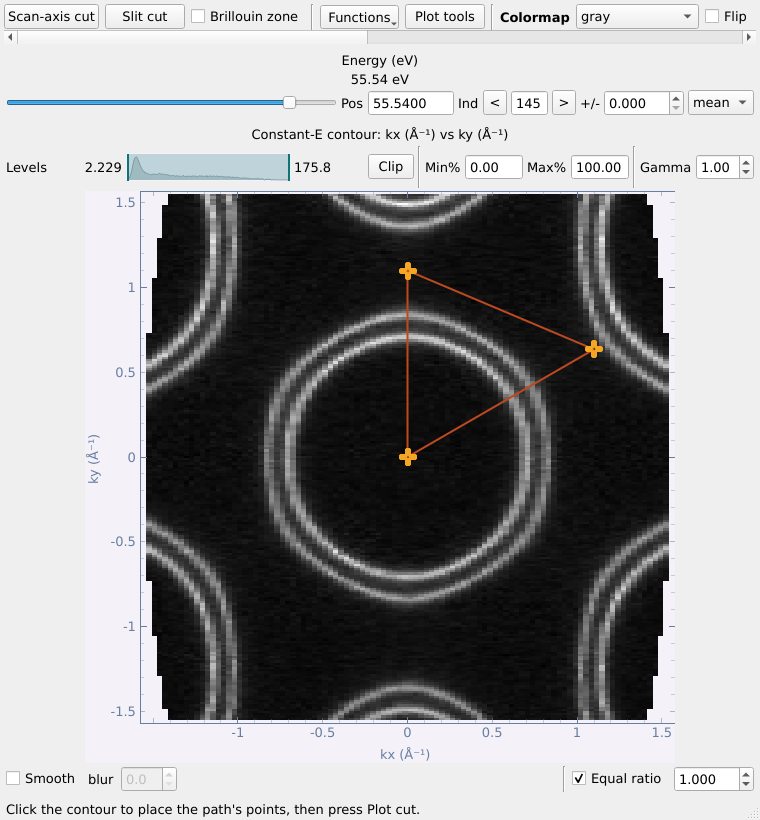 |  |

Le résultat est une coupe en fonction de la distance le long du chemin ; les
coins du chemin sont marqués par des tirets verts, pour qu'un coude à cet
endroit ne soit pas pris pour de la physique.

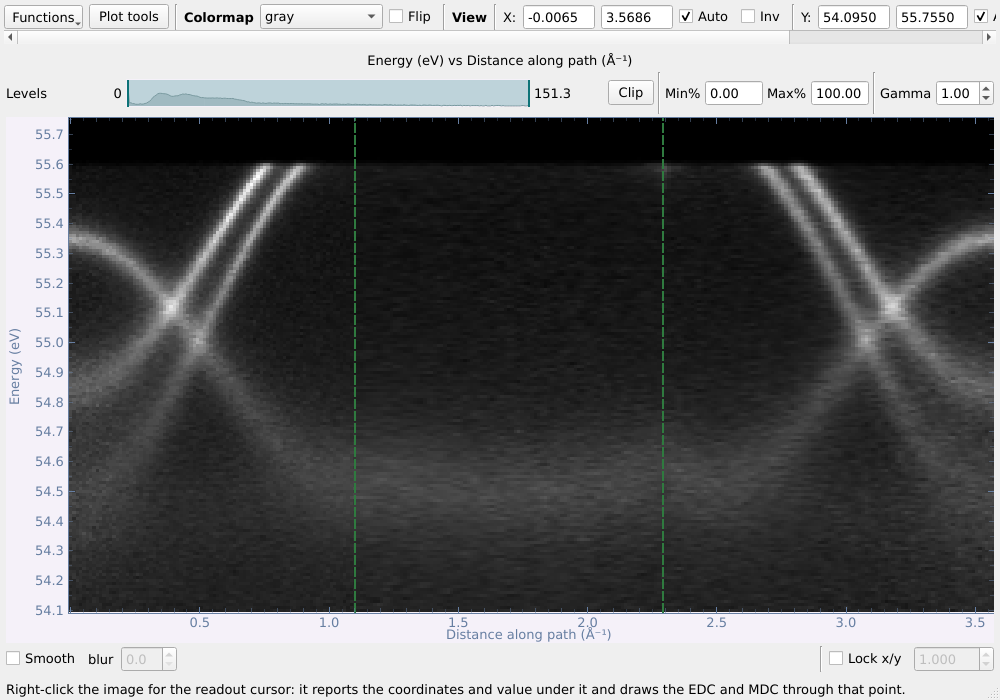

La correction de la surface de Fermi (FS), qui redresse un front de Fermi
courbé par l'analyseur, est un outil de l'onglet Basic du panneau d'outils
([§4.3](#43-correction-de-la-surface-de-fermi)).

## 3.4 Cartes kz et cartes k

Une **carte kz** (balayage en énergie de photon) s'ouvre comme une carte en
angle : son contour montre l'énergie de photon en fonction de l'angle de
l'analyseur à l'énergie choisie par le curseur, et ses deux coupes sont le
spectre à une énergie de photon et la dispersion en énergie de photon à un
angle. Alignez ses niveaux de Fermi et convertissez-la en (k_z, k∥) depuis
l'onglet Basic ([§4.10](#410-aligner-les-niveaux-de-fermi-dune-carte-kz), [§4.11](#411-convertir-une-carte-kz-en-impulsion)).


Une **carte k** (une carte convertie en impulsion, [§4.9](#49-conversion-en-k-dune-carte)) et une
**carte kz convertie** s'ouvrent dans la même fenêtre de contour, sur des axes
en impulsion. Quand une zone de Brillouin y a été tracée ([§4.12](#412-zone-de-brillouin)),
elles la gardent, et une case **Brillouin zone** sur la barre du haut l'affiche
ou la masque. Les séries de tranches ([§5.6](#56-figure-en-série-de-tranches)) et les exports la
dessinent aussi.

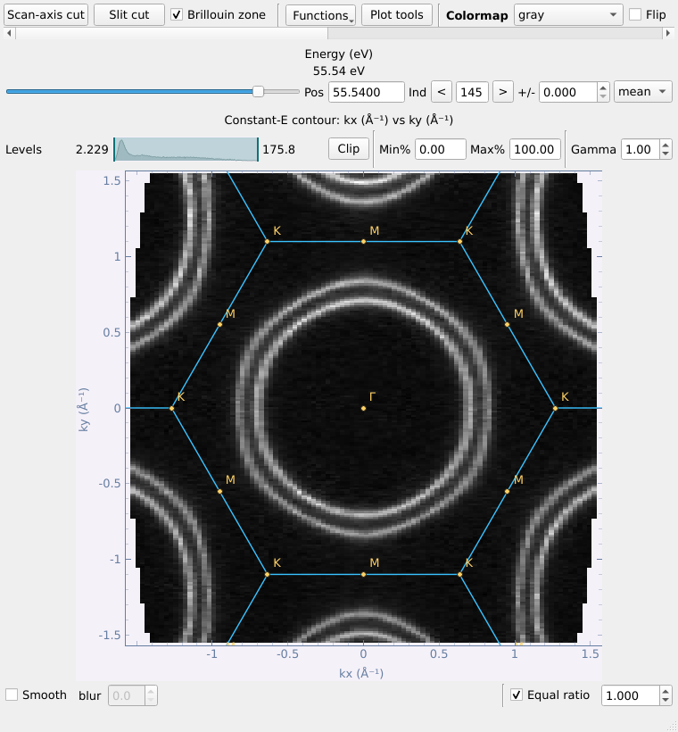

## 3.5 Courbes : EDC, MDC et ajustement de courbes

**EDC → list** / **MDC → list** sous n'importe quelle image, ou un fichier
résolu en spin, donnent un jeu de données de courbes, qui s'ouvre dans la
**fenêtre de courbes** :


Les canaux peuvent être masqués, décalés en cascade (**Offset**), affichés
avec des **Error bars** (à partir d'un canal σ), et **Range** délimite une
fenêtre en x utilisée par les opérations. *Functions → Transform*
propose **Crop**, **Bin**, **Normalise**, **Subtract a background**
(constant, linéaire, Shirley), **Shift the axis** et **Add counting errors
(√N)** ; chacune crée un nouveau jeu de données et propage correctement σ.

### Ajustement de courbes

*Functions → Curve fit...* : **Peaks on a background** (pics lorentziens,
gaussiens ou de Voigt, placés par clic ou par **Find peaks** ; fond nul /
constant / linéaire / Shirley ; résolution instrumentale ; **× Fermi edge**
facultatif), ou le **Fermi edge** lui-même. La pondération est le σ propre au
canal, √N, ou uniforme. Chaque paramètre est donné avec son erreur ; le
résidu est affiché en unités de σ.


**Fit to list** conserve les données, l'ajustement, le résidu et les
composantes ; **Copy results** copie un tableau séparé par des tabulations.
Un ajustement du front de Fermi permet **List a copy with E_F = 0**.

## 3.6 Données résolues en spin

Une EDC de spin s'ouvre avec une courbe par canal de spin :


*Functions → Spin analysis...* :


- Le tableau lit l'étiquette de chaque canal (réglage du manipulateur,
  aimantation de la cible, axe et signe comptés comme « haut ») ; **Axis** et
  **Counts as** peuvent être modifiés.
- Le **Cross ratio** (par défaut quand les canaux le permettent) élimine
  exactement à la fois la transmission et la réflectivité de la cible ; une
  **seule paire** est disponible mais porte l'asymétrie instrumentale, qui est
  mesurée et indiquée (ε).
- **S_eff** (fonction de Sherman, 0,2 par défaut), **Bin**, fenêtre **Zero
  reference** facultative.
- Graphiques : canaux bruts, P avec ses barres d'erreur, et I↑ / I↓ avec
  leurs erreurs.
- **P to list**, **I↑ / I↓ to list**, **As a figure** (ouvre le composeur de figures).

## 3.7 Balayages résolus spatialement (nano-ARPES)

Un balayage en espace réel s'ouvre dans **deux fenêtres** : la **carte
spatiale** (l'intensité totale en chaque position) et, à côté, le **spectre
E-k au curseur** dans la visionneuse de coupe — avec ses propres outils
(Functions, curseur de lecture avec EDC/MDC, Export). Sur la carte, le
**curseur de lecture** (actif dès l'ouverture) choisit le point : faites-le
glisser, ou tapez une position dans la ligne **Cursor** sous la carte. Fermer
l'une des fenêtres ferme les deux.

**Selection box** — dans la ligne au-dessus de chaque image. Cochez-la,
faites glisser le cadre (ou tapez ses coins **x0 y0 x1 y1**), puis appuyez
sur **Refresh** (ou Entrée) ; rien n'est calculé avant, si bien qu'un gros
balayage n'est lu que lorsque vous le demandez. Décocher le cadre le masque
mais garde ses coins — recochez-le, il revient à la même place — et garde le
**résultat** : l'intégration reste affichée jusqu'à **Reset** (à côté de
Refresh).

- sur la carte, la fenêtre du spectre montre les spectres **sommés sur le
  cadre**. Le spectre reste cette somme, cadre coché ou non, jusqu'à
  **Reset** ; il suit alors de nouveau le curseur ;
- sur le spectre, la carte montre l'intensité de la **fenêtre (k, E)**
  choisie sur l'échantillon — c'est ainsi qu'on repère un domaine ou le bord
  d'un flocon. **Reset** redonne la carte complète.

**E vs position / k vs position** — deux cases sur la ligne sous la
Selection box (une à la fois). Elles tracent, **à droite et sous la carte**, le spectre passant par
le curseur en fonction de chaque axe spatial : l'énergie (ou k) en fonction de
la position, sur les mêmes axes que la carte. Deux **lignes pointillées**
apparaissent sur le spectre : la bande de k (pour E vs position) ou d'énergie
(pour k vs position) sur laquelle l'image est intégrée. Faites glisser les
lignes (la bande ombrée entre elles ne prend pas la souris : un cadre de
sélection dessous reste déplaçable), ou tapez **from / to** dans les cases
**Band** au-dessus du spectre. La fenêtre s'agrandit pour faire place aux
images à droite et sous la carte, qui garde ainsi sa taille, et se réduit
quand elles disparaissent.

**Line cursor** — clic droit sur l'image à droite ou sous la carte →
*Line cursor*. Une ligne à une énergie (ou un k) apparaît sur cette image, et
l'intensité le long de cette ligne est tracée en fonction de la position
**plus à droite** (pour l'image à droite de la carte) ou **plus bas** (pour
celle du dessous). Faites glisser la ligne pour la déplacer ; décochez
l'entrée pour la retirer.

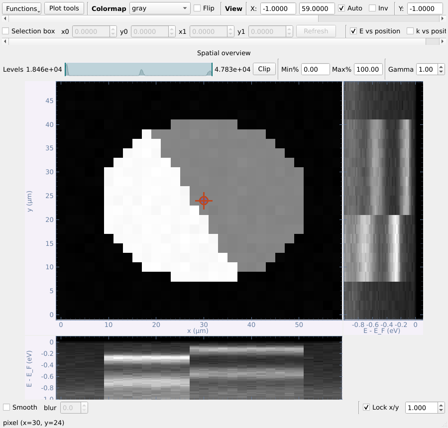

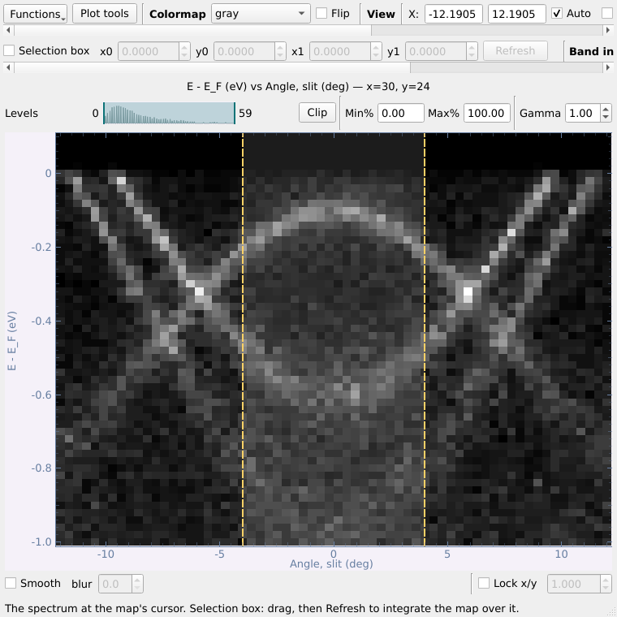

## 3.8 Exporter un panneau et enregistrer des données

Clic droit sur n'importe quelle image → **Export** → **Data (.nxs, Igor)...**,
**Image...** ou **Axes only (.eps)...**. L'exportation reprend toujours
exactement ce que montre le panneau (étendue comprise) : les données, comme
un jeu de données que ce programme sait relire, ou pour Igor Pro (`.itx`
texte ou onde binaire `.ibw`, axes étalonnés, unités et métadonnées dans la
note de l'onde) ; une image avec la palette
appliquée (PNG, TIFF ou JPEG, à la taille et à la résolution choisies, avec
ou sans les axes, avec les guides des Plot tools s'il y en a, et avec la zone
de Brillouin si le jeu de données en a une) ; ou le cadre, les graduations et
les étiquettes en PostScript vectoriel, pour y placer l'image dans
Illustrator (avec, au choix, la zone de Brillouin tracée dans le cadre — voir
[§4.12](#412-zone-de-brillouin)).

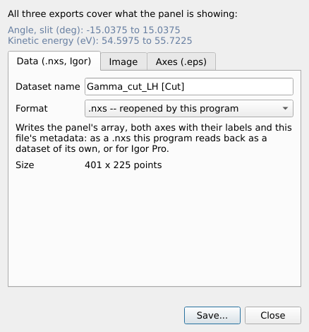

**Save** (panneau d'outils, cadre Datasets) écrit les jeux de données
sélectionnés dans un fichier `.nxs` de votre choix -- plusieurs lignes
sélectionnées vont dans un même fichier -- ou, selon le type de fichier
choisi, pour Igor Pro : un `.itx` qui les contient tous, ou un `.ibw` par jeu
de données. Un fichier Igor est une copie ; les lignes restent inchangées.

---

# Partie 4 — Le panneau d'outils : onglet Basic

L'onglet **Basic** regroupe les étapes par lesquelles passe presque chaque jeu de données : le niveau de Fermi, le détecteur, le fond, les conversions en impulsion, les niveaux de cœur et la zone de Brillouin.

## 4.1 Comment fonctionnent les boutons d'outils

Chaque onglet regroupe ses outils selon les données qu'ils prennent :
*2D & 3D — cuts, maps*, *2D only — cuts*, *3D only — maps*. **Un bouton ne
s'allume que si les lignes sélectionnées dans la liste conviennent** : une
conversion k (coupe) demande une coupe en angle, l'arithmétique de coupes
exactement deux coupes, une vue 3D une carte. Survolez un bouton grisé pour
savoir pourquoi.

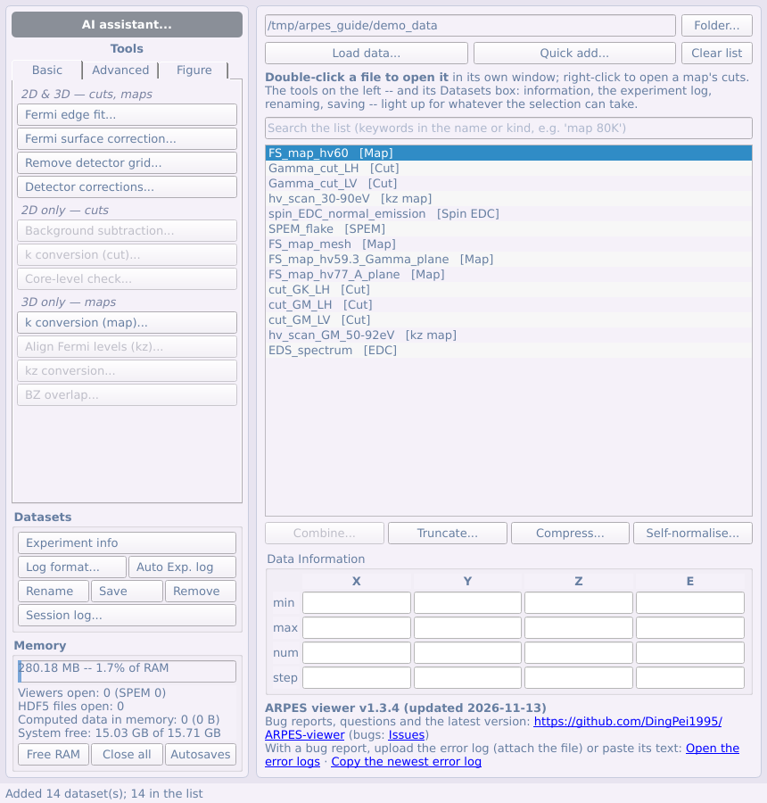

Un outil ne modifie jamais les lignes qu'on lui donne : son résultat est une
nouvelle ligne de la liste, nommée d'après l'originale et l'opération
(`cut1 [k]`), et son historique enregistre l'étape et ses paramètres
(*Experiment info* l'affiche). Les outils qui demandent plusieurs décisions
s'ouvrent en étapes numérotées ([§2.5](#25-fenêtres-pas-à-pas)).

## 4.2 Ajustement du front de Fermi

L'ordre habituel pour une coupe est : **ajustement du front de Fermi → décaler
l'axe en énergie → conversion en impulsion → ajustement MDC/EDC**. Chaque
étape est un bouton du panneau d'outils : sélectionnez la coupe dans la
liste et appuyez dessus.

Panneau → Basic → **Fermi edge fit...** ajuste un front de Fermi (Fermi–Dirac
× densité d'états linéaire, convoluée par une résolution gaussienne) sur
l'EDC sommée dans un cadre. Il ouvre la fenêtre de la coupe avec la fenêtre
d'ajustement ; les deux vont ensemble, et fermer l'une ferme l'autre. La
fenêtre a deux colonnes : à gauche tout ce qui se règle (la région, les
paramètres, les boutons), à droite l'ajustement — l'EDC et la courbe
ajustée, toujours montrées en entier (le graphe ne zoome ni ne se déplace),
et le résumé dessous.

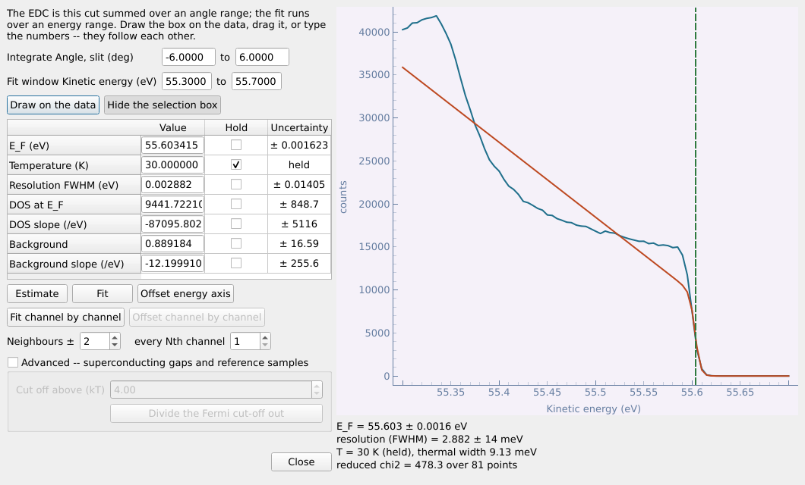

1. Fixez la région : appuyez sur **Show the selection box** et faites
   glisser le cadre sur la coupe — sa largeur est l'intervalle d'angle
   sommé, sa hauteur la fenêtre d'énergie ajustée — ou saisissez les
   intervalles. Les deux se suivent.

   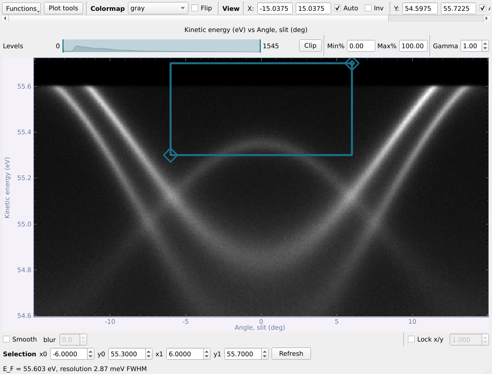

2. **Estimate**, puis **Fit**. Cochez **Hold** pour fixer un paramètre (la
   température est fixée par défaut à la valeur enregistrée). Chaque
   paramètre est donné avec son incertitude.
3. **Offset energy axis** ajoute à la liste une copie de la coupe en
   **E − E_F**.

**Canal par canal.** Sur la ligne sous Fit, **Fit channel by channel**
ajuste le front le long du détecteur, dans la fenêtre d'ajustement, et
trace E_F en fonction de l'angle sur la coupe — la courbure du front de
Fermi, mesurée. Ses réglages ne sont pas des valeurs par défaut fixes ; ils
sont mesurés sur les données :

1. L'EDC sommée dans le cadre est ajustée d'abord (comme le fait **Fit**) :
   c'est la **graine**, dont la forme de raie sert de départ à chaque
   ajustement de canal. Si le cadre contient trop peu de coups pour
   déterminer la résolution, il vous est demandé de l'agrandir.
2. Quelques ajustements d'essai à plusieurs largeurs mesurent la précision
   avec laquelle un canal donne E_F, et de là **combien de canaux chaque
   ajustement doit sommer** pour une précision utile (10 meV, deux pas en
   énergie ou un dixième de la résolution, le plus grand des trois).
3. Ce nombre est comparé aux canaux mesurés. Si moins de dix ajustements
   indépendants tiennent sur le détecteur, le programme dit que **ces
   données ne se prêtent pas à un ajustement canal par canal**, chiffres à
   l'appui, et propose un seul E_F (Fit, puis Offset energy axis) ou la
   correction de la surface de Fermi. Sinon il propose les réglages —
   canaux par ajustement, un ajustement tous les N canaux, garder la forme
   de raie de la graine (seuls E_F, la hauteur et le fond ajustés par
   canal) — avec la précision attendue, à accepter ou modifier.

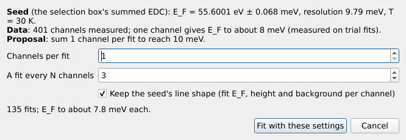

Les ajustements tournent en arrière-plan : la fenêtre répond toujours, et
**Cancel** les arrête aussitôt, en gardant les canaux déjà ajustés. Les
canaux vides aux deux bouts de la coupe (sans coups, ou NaN, comme en
laissent certains détecteurs) sont coupés, jamais ajustés. **Offset channel
by channel**, à côté, ajoute une copie où chaque canal est sur son propre
**E − E_F** (sur la coupe selon la fente d'une carte : toute la carte, le
long de la fente), les bords vides coupés.

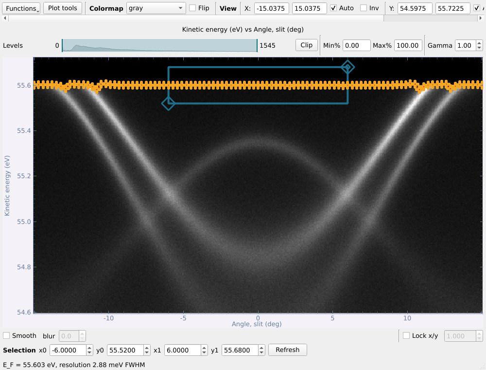

Les deux ajustements sont gardés avec la ligne du jeu de données : elle
devient une **référence** pour la correction de la surface de Fermi
([§4.3](#43-correction-de-la-surface-de-fermi)).

Le coin *Advanced* divise par la coupure de Fermi (pour les gaps et les
échantillons de référence).

**Sur une carte.** Sélectionnez une carte (en angle ou en k) et appuyez sur
le même bouton : la **coupe selon la fente** de la carte s'ouvre avec la
fenêtre d'ajustement, et son curseur choisit la coupe ajustée. Après un
ajustement, **Offset energy axis** demande s'il faut décaler **toute la carte
par l'E_F de cette coupe** (*Yes*) ou ajuster **un E_F par coupe** (*No*).
Dans ce second cas, la liste **Fitted cuts** à droite se remplit au fur et à
mesure : déplacez le curseur, **Fit**, recommencez. Un second ajustement au
même endroit remplace le premier, et chaque E_F de la liste se modifie à la
main. Les coupes entre deux coupes ajustées sont décalées selon une droite
entre leurs voisines (au-delà de la première et de la dernière, selon
l'ajustement le plus proche), tracée sous la liste. **Offset energy axis by
these fits** ajoute la carte corrigée à la liste.


## 4.3 Correction de la surface de Fermi

L'analyseur courbe le front de Fermi : aux extrémités de la fente, il se
trouve quelques dizaines de meV plus bas qu'au milieu, si bien qu'une bande
qui devrait être plate paraît courbée. Panneau → Basic → **Fermi surface
correction...** le redresse : la courbe du front de Fermi est ajustée par un
polynôme, et chaque colonne d'angle est décalée en énergie pour qu'elle
devienne plate. À faire avant une conversion en k.

Sélectionnez une **coupe**, ou une **carte** (ou carte kz) encore en angle,
et appuyez sur le bouton. Une coupe s'ouvre dans sa fenêtre ; une carte
s'ouvre sur sa **coupe selon la fente**, et la correction est appliquée à
tout le cube. La fenêtre de données et celle de la correction vont
ensemble : fermer l'une ferme l'autre. La fenêtre guide pas à pas
(**Back** et **Next** pour passer d'une étape à l'autre).

**Étape 1 — comment trouver le front de Fermi.** Au choix :

- **By hand** (à la main) : cliquer le front de Fermi sur la fenêtre de
  données (trois étapes) ;
- **From a reference** (référence) : appliquer l'ajustement du front de
  Fermi d'une autre coupe ou carte de la liste principale (deux étapes).
  Seules les lignes dont le front de Fermi a été ajusté avec l'ajustement du
  front de Fermi ([§4.2](#42-ajustement-du-front-de-fermi)) sont proposées ;
  sans elles, ce choix est grisé.

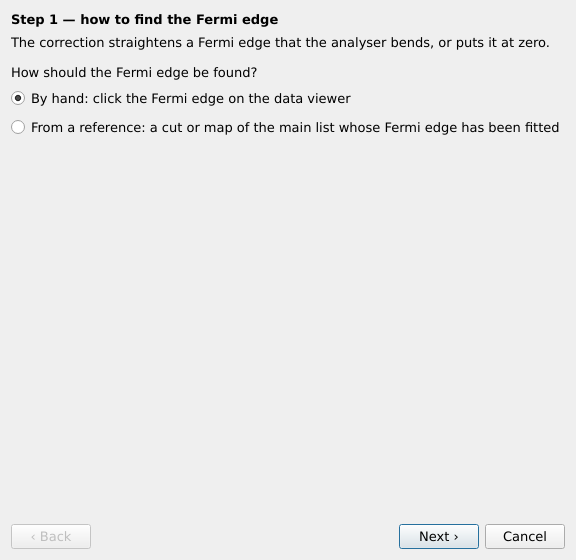

**Étape 2, à la main — cliquer le front de Fermi sur la fenêtre de
données.** Cliquez sur l'image de la fenêtre de données là où se trouve le
front de Fermi, à plusieurs angles répartis sur tout le front, extrémités
comprises. Chaque clic place une croix orange sur l'image et une ligne dans
le tableau des points ; la courbe ajustée est tracée en tirets au fur et à
mesure. Un point mal placé se corrige dans le tableau, ou se supprime
(**Remove selected**, **Clear**). Les clics ne comptent que pendant la
saisie à la main. **Back** vers l'étape 1 efface les points saisis.

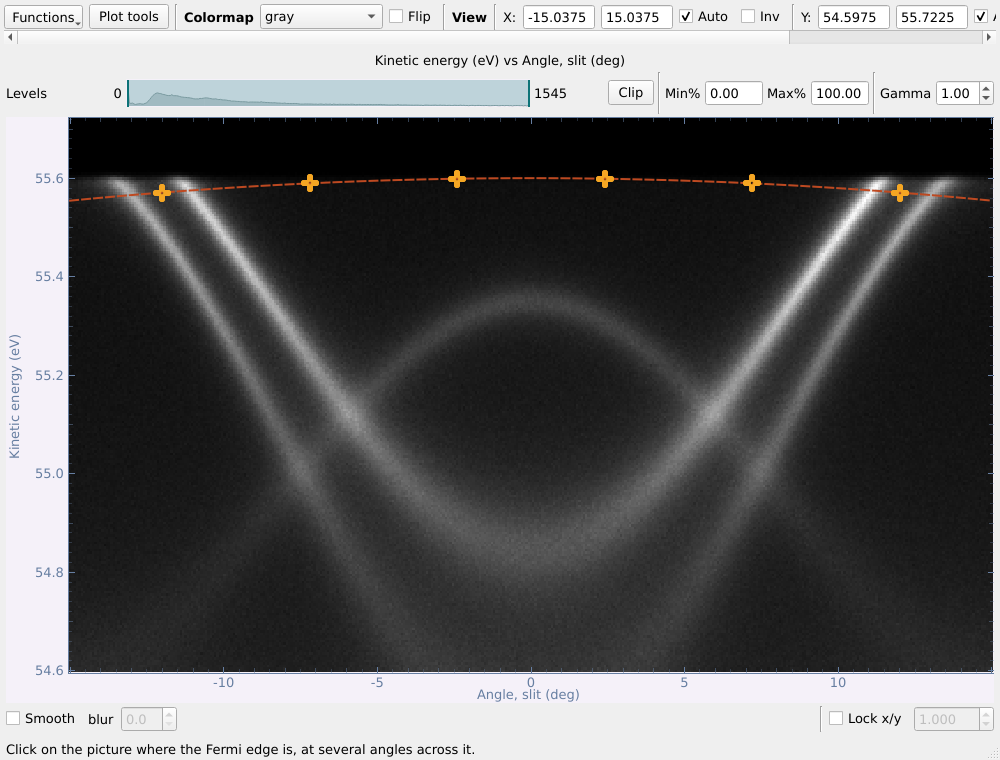

**Étape 3, à la main — vérifier l'ajustement et corriger.** La courbe
ajustée est tracée en tirets sur les données ; vérifiez qu'elle suit le
front de Fermi et supprimez un point égaré sinon. **Fit order** fixe le
polynôme (2, une parabole, est la forme habituelle de la courbure de
l'analyseur ; un ajustement d'ordre n demande n+1 points), **Name** le nom
du résultat. **Correct** décale chaque colonne d'angle pour aplatir la
courbe et ajoute le résultat à la liste (`[FS corr]`) ; l'axe en énergie
s'allonge de l'amplitude de la courbe, et les cases qu'aucune colonne
n'atteint restent vides.

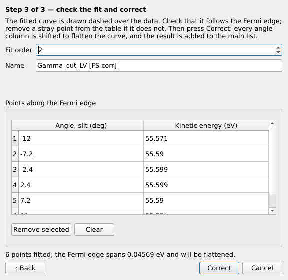

**Étape 2 sur 2, par une référence — la référence, et comment
l'appliquer.** **Reference** liste les autres lignes dont le front de Fermi
a été ajusté (jamais les données elles-mêmes). Leurs paramètres
d'ajustement sont lus sur elles et affichés — rien n'est ajusté ici.
Choisissez ensuite comment l'appliquer, selon les deux façons de
l'ajustement du front de Fermi :

- **One offset** (un décalage) : toutes les données sont décalées de l'E_F
  de la référence (son *Fit*, le front entier). Le résultat est en E − E_F,
  tous les canaux de même.
- **Channel by channel** (canal par canal) : chaque canal est décalé de
  l'E_F de la référence dans ce canal (son *Fit channel by channel*). Les
  canaux hors de ceux que la référence a ajustés — ses bords vides compris
  — sont coupés, comme les bords vides des données elles-mêmes.

Le front de la référence est tracé en tirets sur les données, pour le
comparer au front qu'on y voit. **Correct** ajoute le résultat à la liste
(`[E-E_F]`, ou `[E-E_F ch]` canal par canal).

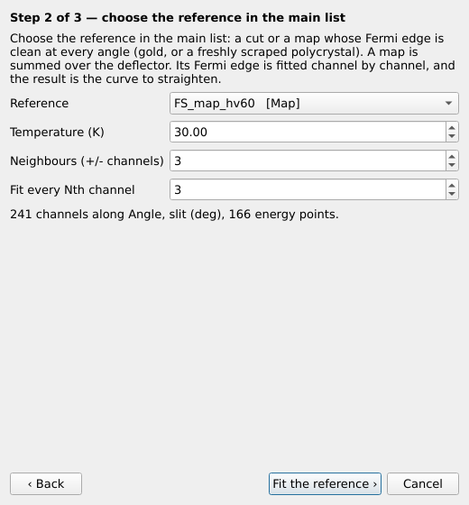

## 4.4 Supprimer la grille du détecteur

Les motifs du MCP (hexagonal) et de la grille (carré) s'impriment sur chaque
image. **À faire en premier** : seules les données encore sur les pixels du
détecteur peuvent être dégrillées ; le bouton refuse donc tout ce qui a déjà
été converti, corrigé ou lissé, et dit pourquoi.

Sélectionnez une carte (ou une carte kz) ou une coupe et appuyez sur panneau
→ Basic → **Remove detector grid...**. Pour une carte, aucune référence n'est
nécessaire — la grille reste sur les mêmes pixels dans chaque tranche, alors
que la photoémission se déplace. **Find and remove the grid** :


- **Before / After** pour une tranche choisie, sur une même échelle de
  couleurs (cochez **Show −∂²I/∂E²** pour rendre toute grille évidente).
- **La grille trouvée**, ses **régions dans l'espace réciproque** (en rouge),
  et le **contraste et le décalage** ajustés pour chaque tranche.
- La puissance restant dans les régions de la grille (1 = plus de grille).
- **Also list the grid pattern** conserve un jeu de données `[grid]`, qu'une
  coupe prise plus tard avec le même mode de lentille et la même énergie de
  passage retrouvera et utilisera.

## 4.5 Corrections du détecteur

Sur une coupe, une carte ou une carte kz telle que mesurée :

1. **Trapèze** -- cochez *Correct a trapezoidal image* et placez les quatre
   coins jaunes sur ceux de la zone éclairée ; l'image de droite la montre
   rendue rectangulaire, le nombre de coups de chaque ligne conservé.
2. **Zones défectueuses** -- **Add a region** et déplacez-la sur un point
   mort ou chaud, ou **Find bad pixels** ; remplissage *smooth* (pour un
   point) ou *linear along* un axe (pour une bande).
3. **Appliquer** -- **Apply to list**. Faites ensuite la suppression de la
   grille, le niveau de Fermi et la conversion en k sur le résultat.

## 4.6 Soustraction du fond

Panneau → Basic → **Background subtraction...** (coupes) retire l'intensité
qui n'appartient pas aux bandes : un fond inélastique de **Shirley** ou de
**Tougaard**, un plancher commun à tous les angles (un percentile de chaque
ligne d'énergie), un **polynôme** lisse — ou divise par la **coupure de
Fermi** (Fermi–Dirac à la température et la résolution enregistrées dans le
fichier, à partir de l'E_F enregistré ou, à défaut, de la chute la plus
raide de l'EDC intégrée en angle). La fenêtre est celle des fenêtres de
traitement de l'onglet Advanced — source et résultat côte à côte, aperçu en
direct, **Apply** ajoute le résultat à la liste — décrite au
[§5.1](#51-lissage-dérivées-courbure-et-symétrisation).

## 4.7 Conversion en k d'une coupe

Panneau → Basic → **k conversion (cut)...** convertit l'axe angulaire en k∥
(Å⁻¹). Une **ligne verticale** est tracée sur la coupe : faites-la glisser
sur l'angle de fente de Γ. La coupe est alors supposée passer par Γ — ce
n'est pas exact si elle le manque, mais c'est le seul choix quand seule cette
coupe a été mesurée.


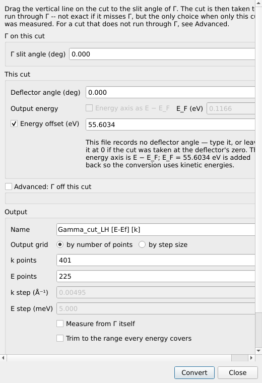

- **Advanced: Γ off this cut** est pour une coupe qui ne passe pas par Γ :
  saisissez les angles déflecteur et fente de Γ, ou **From a converted
  map...** pour les reprendre d'une carte du même échantillon déjà convertie.
- **Output energy — Energy axis as E − E_F** (décochée par défaut) :
  cochez-la et donnez la position de E_F sur l'axe en énergie de la coupe
  elle-même ; l'axe en énergie du résultat est alors E − E_F. Les moments
  ne changent pas : la conversion utilise toujours les énergies cinétiques.
- **Energy offset** (une case, décochée par défaut) n'est *pas* le niveau
  de Fermi : cochée, sa valeur est ajoutée à l'axe en énergie avant la
  conversion, pour un axe qui n'est pas une vraie énergie cinétique. Si la
  coupe est déjà en E − E_F, elle est cochée et remplie avec le E_F
  soustrait (la note en dessous le signale) : la conversion utilise les
  vraies énergies cinétiques, et le résultat reste en E − E_F.
- **Réglages mémorisés.** La fenêtre part de la dernière conversion d'une
  coupe de même taille (même nombre de points sur chaque axe) — le cas
  habituel pour une série de coupes d'un même échantillon. Les conversions
  de cartes et kz font de même.


## 4.8 Vérification des niveaux de cœur

Un balayage large des niveaux de cœur est lui aussi listé comme une coupe.
Sélectionnez-le et appuyez sur panneau → Basic → **Core-level check...** pour
savoir d'où viennent ses pics.

1. Saisir les éléments de l'échantillon — `NbSCl` ou `Nb, S, Cl` — puis
   **Next**. *Match within* (0,5 eV) est l'écart maximal entre un pic et
   l'énergie de liaison tabulée pour l'attribuer à l'échantillon.

   

2. Vérifier la référence en énergie. E_F est ajusté si la fenêtre contient
   le front de Fermi, sinon placé à hν − W. Corriger l'énergie de photon,
   le travail de sortie ou E_F s'ils sont faux (la ligne verte se déplace à
   la souris) ; un hν − E_F loin de 4–5 eV signale une énergie de photon
   erronée. **Analyse**.

   

3. Les résultats : l'EDC en énergie de liaison, chaque pic marqué — vert
   *sample* (orbitale nommée), orange *uncertain* (un niveau de
   l'échantillon à moins de 2 eV : déplacement chimique ou charge — à vous
   de juger), rouge *not the sample* (éléments courants qui pourraient
   l'expliquer : contamination, lumière d'ordre supérieur, raies Auger).
   Cliquer une ligne affiche tous les candidats ; la colonne *Assignment*
   accepte votre propre attribution.

   

**Raies faibles et pics à la main.** Cochez **Log counts** pour voir les raies
faibles à côté d'une raie forte ; **Min height** (0,2 % de la plus forte par
défaut) fixe la hauteur minimale d'un pic trouvé. Pour ajouter un pic que la
recherche a manqué, appuyez sur **Click to add peak** puis cliquez sur le
graphe (un double-clic fonctionne toujours), ou saisissez son énergie de
liaison après *or at* et cliquez sur **Add** : sa position est affinée par un
ajustement local, il est marqué ◆ et nommé avec tous les niveaux tabulés à
±2 eV. **Remove selected** retire des pics ; **Reset peaks** rétablit les pics
trouvés et oublie ceux ajoutés à la main. Les attributions saisies survivent
à **Re-analyse**.

**Peak table...** liste tous les niveaux tabulés, filtrés par élément et par
plage d'énergie de liaison : chercher un pic, afficher un niveau sur le
graphe, ou l'ajouter comme pic avec ce niveau pour attribution. **Select
range** affiche une bande à faire glisser sur une région ; **Zoom window...**
l'ouvre (ou la vue courante) dans une fenêtre à part, avec un curseur, un
ajustement gaussien au curseur et la dérivée seconde négative divisée par
l'intensité — un épaulement ou une raie faible à côté d'une raie forte y est
aussi visible que la raie forte.

Si tous les pics sont décalés de la même quantité, les notes le disent et
**Apply suggested shift** corrige (échantillon chargé, ou E_F faux).
**Add EDC to list** ajoute l'EDC en énergie de liaison à la liste ;
**Copy report** copie le résultat en texte. Une mesure à une seconde
énergie de photon tranche ce qui reste douteux : les niveaux de cœur
restent fixes en énergie de liaison, les raies Auger et la lumière d'ordre
supérieur se déplacent.

## 4.9 Conversion en k d'une carte

Sélectionnez une carte en angle et appuyez sur panneau → Basic → **k
conversion (map)...**. La carte s'ouvre sur un contour nu — sans coupes ni
autres fonctions, juste l'image — à côté de la fenêtre de conversion ; les
deux se ferment ensemble. Faites glisser le curseur de lecture sur le point
qui doit devenir **k = (0, 0)** — la fenêtre le suit — puis **Convert**. Le
résultat est une nouvelle ligne `k-map` dans la liste.

| Le contour pour choisir Γ | La conversion |
|---|---|
|  | 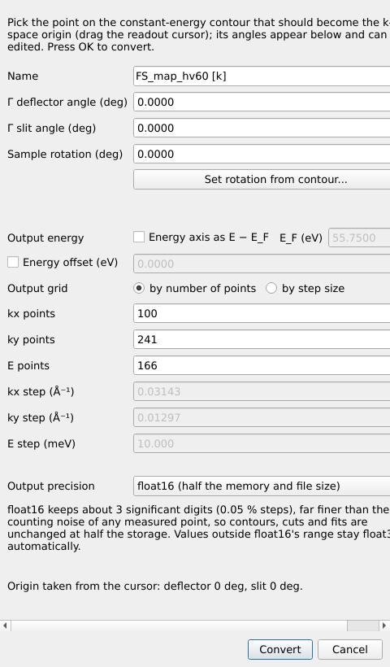 |

- **Γ deflector angle / Γ slit angle** : les angles du point qui devient
  k = (0, 0), remplis depuis le curseur.
- **Sample rotation** fait tourner la carte autour de la normale à la
  surface ; **Set rotation from contour...** la déduit d'une direction
  cliquée sur le contour (deux points le long d'une ligne de symétrie, par
  exemple).
- **Output grid** : nombre de points, ou résolution (Å⁻¹, meV). Les nombres
  de points partent de ceux de la mesure — autant de points kx que d'angles
  déflecteur, de points ky que d'angles de fente, de points E que d'énergies.
- **Output energy — Energy axis as E − E_F** (décochée par défaut) :
  cochez-la et donnez E_F tel qu'il est sur l'axe en énergie de la carte ;
  la carte k sort alors en E − E_F. Les moments sont les mêmes dans les deux
  cas.
- **Energy offset** (une case, décochée par défaut) n'est pas le niveau de
  Fermi : cochée, elle est ajoutée à l'axe en énergie avant la conversion,
  pour un axe qui n'est pas une vraie énergie cinétique (cochée et remplie
  automatiquement pour une carte en E − E_F).
- Les réglages partent de la dernière conversion d'une carte de même
  taille : une deuxième carte d'une série n'a rien à ressaisir.

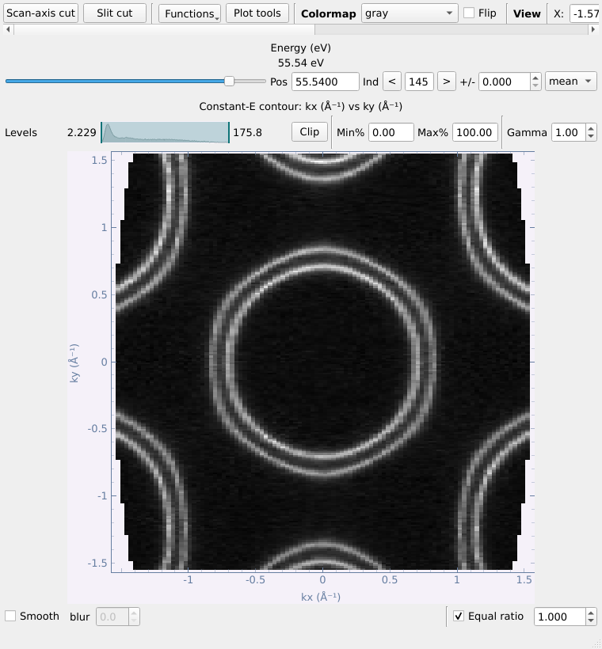

## 4.10 Aligner les niveaux de Fermi d'une carte kz

Un balayage en énergie de photon est listé comme `kz map` ; son contour est
l'énergie de photon en fonction de l'angle, à une énergie donnée.


Rien dans les fichiers n'indique où se trouve réellement le niveau de Fermi
de chaque spectre. Panneau → Basic → **Align Fermi levels (kz)...** le mesure
sur les spectres eux-mêmes ; la coupe selon la fente de la carte kz s'ouvre
avec lui, et les deux se ferment ensemble.

1. La coupe selon la fente s'ouvre avec un cadre. Faites glisser le cadre sur
   un front de Fermi — l'intervalle d'angle fixe les canaux sommés,
   l'intervalle d'énergie la fenêtre d'ajustement.

   

2. **Fit and assemble** : le même cadre (en indices du détecteur) est utilisé
   pour chaque spectre ; chacun est décalé pour placer son propre front à
   zéro ; le cube est rogné à l'intervalle couvert par tous ; et, par défaut,
   chaque spectre est **normalisé par son intensité totale**, ce qui élimine
   les variations du flux de photons.


E_F en fonction de l'énergie de photon est tracé. Une courbe régulière
signifie des ajustements fiables ; les points dont l'ajustement n'est pas
crédible sont signalés et remplacés par interpolation de leurs voisins.

## 4.11 Convertir une carte kz en impulsion

Panneau → Basic → **kz conversion...** convertit le balayage en (k_z, k∥). Il
part de la dernière conversion d'un balayage de même taille.

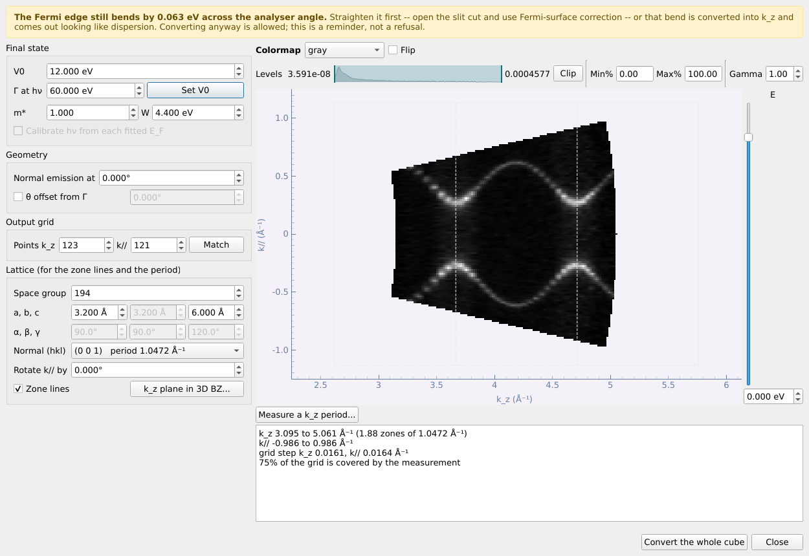

- Le **potentiel interne V0** est l'inconnue : l'aperçu reconvertit une
  tranche en énergie à chaque modification, en quelques millisecondes. Il
  peut être négatif ; **Γ at hν → Set V0** donne le V0 qui place Γ en
  émission normale à l'énergie de photon choisie.
- Le **θ du manipulateur** est désactivé par défaut ; cochez *θ offset from
  Γ* seulement pour corriger un écart, saisi par rapport à l'émission
  normale (pas la lecture absolue du moteur).
- Avec le **réseau** (groupe d'espace, a, b, c), la **normale à la surface**
  et **Rotate k// by** (la direction de la fente, en rotation autour de la
  normale ; tout angle, la fente ne suit pas forcément une direction de
  haute symétrie), les limites de zone sont tracées sur l'aperçu ;
  **k_z plane in 3D BZ...** montre ce plan dans la zone en 3D.
- L'énergie de l'aperçu se choisit avec le **curseur** à côté ; au-dessus,
  les commandes de couleur des fenêtres de données : carte de couleurs,
  *Flip*, barre de niveaux (*Clip*, pourcentages, *Gamma*).
- *Calibrate hν from each fitted E_F* (facultatif, désactivé par défaut)
  utilise hν − E_kin(E_F) mesuré à chaque énergie de photon.
- **Measure a k_z period...** : cliquez deux points correspondant à la même
  structure, distants d'une zone ; les plans du réseau réciproque compatibles
  sont listés.
- Le bandeau jaune avertit quand le front de Fermi est encore courbé en
  fonction de l'angle de l'analyseur — corrigez-le d'abord (correction de la surface de Fermi,
  [§4.3](#43-correction-de-la-surface-de-fermi)).
- **Convert the whole cube** ajoute une `kz map (k)` à la liste.

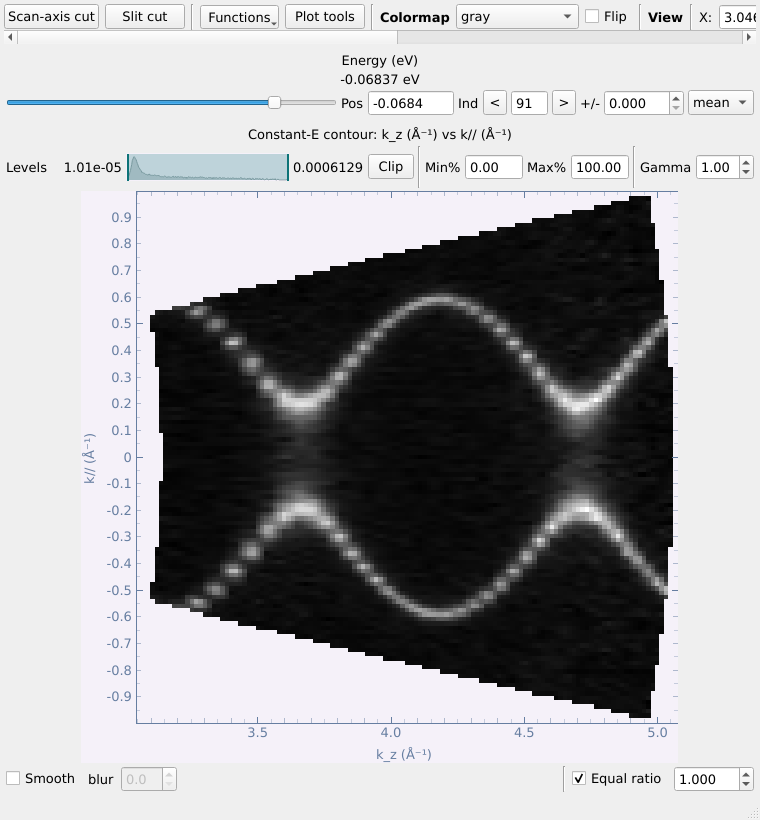

## 4.12 Zone de Brillouin

Sélectionnez une carte k (ou une carte kz convertie) et appuyez sur panneau
→ Basic → **BZ overlap...**.
Comme la conversion de carte, il ouvre un
contour à lui avec la fenêtre de la zone, et les deux se ferment ensemble.


1. D'abord le **groupe d'espace** (1–230) ; les paramètres de maille qu'il
   impose sont grisés et suivent les paramètres libres. Ou passez en **2D
   layer** pour un réseau de surface.
2. **Cut plane** : la normale à la surface (hkl) et un décalage le long de
   celle-ci — on trace la section de la zone 3D par ce plan, pour n'importe
   quelle surface et pas seulement (001). **Through point** donne les
   décalages pour lesquels le plan passe par un point de haute symétrie (Γ,
   Z, L, F ... pour un cristal rhomboédrique) : choisissez-en un plutôt que
   de calculer la valeur. **Show cut plane in 3D...** la prévisualise, avec
   les points nommés et, entourés, ceux que contient le plan ; **Label
   high-symmetry points** les écrit sur le contour, ce qui aide à régler
   l'azimut. La fenêtre s'ouvre sur le dernier cristal utilisé.
3. Zone **Conventional** ou **Irreducible** ; **Azimuth** (ou **Pick
   direction from contour...**) ; **Repeat across the field of view**.
4. **Moiré** ajoute une seconde couche, tournée ou désaccordée, et sa zone de
   moiré.
5. **Plot**.

La fenêtre est haute : son contenu défile, et elle se redimensionne comme
toutes les autres.

**La zone reste avec le jeu de données.** Une fois tracée, elle est une
propriété de la carte k : elle est enregistrée avec elle dans un fichier
`.nxs`, et sa fenêtre l'affiche avec la case **Brillouin zone** de la ligne
du haut. **Clear overlay** la retire.


Les exportations peuvent aussi la tracer : **Export → Image...** propose
**Include the Brillouin zone**, et **Axes only (.eps)...** propose **Draw the
Brillouin zone in the box**, pour obtenir la zone en traits vectoriels sur
l'image dans Illustrator.

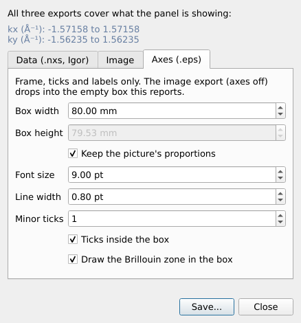

---

# Partie 5 — Le panneau d'outils : onglet Advanced

L'onglet **Advanced** regroupe l'analyse qui suit : filtres d'affinement des bandes et symétrisation, détection de crêtes, empilements, ajustements MDC et EDC avec la self-énergie, arithmétique de coupes, figure en série de tranches, vues 3D, et l'analyse des poches de Fermi pour les échantillons quasi bidimensionnels (en test).

## 5.1 Lissage, dérivées, courbure et symétrisation

Chaque filtre a sa propre fenêtre, ouverte depuis le panneau d'outils avec
une ou plusieurs coupes (ou cartes) sélectionnées :

| Onglet | Bouton | Ce que cela fait |
|---|---|---|
| Basic | **Background subtraction...** | retire l'intensité qui n'est pas celle des bandes : fond inélastique de Shirley ou de Tougaard, un plancher commun à tous les angles, un polynôme lisse — ou divise par la coupure de Fermi |
| Advanced | **Smooth...** | lissage gaussien, Savitzky–Golay ou moyenne glissante, avec suppression des pics facultative |
| Advanced | **Second derivative...** | −d²I/dE² ou −d²I/dk² après un pré-lissage, pour affiner les bandes |
| Advanced | **Curvature...** | courbure 1D ou 2D (Zhang et al.), qui suit la bande mieux qu'une dérivée seconde |
| Advanced | **Minimum gradient...** | I/\|∇I\| : les bandes comme vallées du gradient de l'intensité — dérivées premières seulement, donc moins de bruit ; les épaulements apparaissent |
| Advanced | **Symmetrise...** | miroir d'une coupe par rapport à une droite ; pour une carte, miroir ou rotation de ses plans à énergie constante |

Chaque résultat est un nouveau jeu de données qui garde la trace des étapes
qui l'ont produit.


**Gradient minimum (Minimum gradient).** Le long de la crête d'une bande
l'intensité est plate, donc le module de son gradient |∇I| y est minimal
(He, Wang et Shen, Rev. Sci. Instrum. 88, 073903 (2017)). La fenêtre montre
cette vallée de trois façons : **I / |∇I|** (à utiliser : une intensité qui
varie lentement le long de la bande se compense, et les régions vides
restent sombres), **1 / |∇I|**, ou **|∇I|** lui-même (les bandes en lignes
sombres ; rien n'est divisé, c'est donc le contrôle des deux autres). Il ne
demande que des dérivées premières, donc moins de bruit qu'une dérivée
seconde ou la courbure ; il ne privilégie aucun axe, donc une bande est
suivie à travers son extremum ; et un épaulement apparaît. **Floor** limite
la brillance d'une zone parfaitement plate (à baisser sur des données
lissées pour une ligne plus fine). Il marque *tout* endroit plat — y
compris le creux entre deux bandes — à lire donc à côté des données, les
nombres venant d'un ajustement.

- **Source** et **Result** sont affichés côte à côte, sur la même échelle,
  pour voir quand un réglage a « mangé » la bande. Ils se déplacent et
  zooment ensemble.
- **Lisser d'abord.** Les fenêtres de dérivée seconde et de courbure
  s'ouvrent avec un conseil : toutes deux amplifient le bruit, et marchent
  donc mieux sur des données déjà lissées — lancez **Smooth...**,
  sélectionnez son résultat dans la liste et ouvrez le filtre sur celui-ci,
  ou augmentez les largeurs de pré-lissage dans la fenêtre même. Un résultat
  lissé porte l'étiquette **‹smoothed›** dans la liste (tout ce qui en est
  tiré aussi) ; sur ces données le conseil laisse place à une ligne « déjà
  lissé » et les largeurs de pré-lissage partent de 0.
- **Shape** : *Square pixels* (un point de données est carré — sans
  distorsion pour une coupe angle-énergie), *Equal axes* (une unité a la même
  longueur sur les deux axes — adapté à angle-angle ou k-k ; choisi
  automatiquement quand les deux axes ont la même unité), ou *Fill the box*.
- **Live preview** recalcule à chaque changement de valeur ; **Apply** ajoute
  le résultat à la liste.
- Valeurs de départ : **Symmetrise** fait un miroir par rapport à une droite
  verticale passant par angle (ou k) = 0, c.-à-d. k → −k ; la **Fermi
  cut-off** de *Background subtraction* part de l'E_F enregistré dans le
  fichier, sinon de la chute la plus raide de l'EDC intégrée en angle, avec
  la température et la résolution du fichier.

Pour une carte, la fenêtre travaille plan par plan et demande d'abord **sur
quels plans** — contours à énergie constante ou dispersions — car la courbure
d'un contour et celle d'une coupe sont des grandeurs différentes. **Preview
at** choisit le plan affiché ; **Apply to the whole cube** traite tous les
plans. Les opérations et les largeurs portent le nom des axes du plan choisi
(*Second derivative along Kinetic energy*…), et les largeurs de lissage
partent de 1/100 de chaque axe.


**Truncate...**, **Compress...** et **Self-normalise...** (sous la liste)
changent la grille ou l'échelle d'un ou plusieurs jeux de données à la fois
— à condition qu'ils soient du même type et aient le même nombre de points
sur chaque axe : **Truncate** rogne à un intervalle, **Compress** regroupe
des points, **Self-normalise** divise chaque spectre par son propre total.

**Self-normalise** divise chaque morceau des données par son propre total (ou
son maximum) :

- **Normalise** choisit le morceau en termes d'ARPES et part du choix
  habituel : *each EDC* pour une coupe, *each cut (slit × energy at one scan
  step)* pour une carte, une carte k ou une carte kz — ce qui retire une
  dérive du flux ou du courant faisceau le long du balayage. Autres choix :
  chaque MDC, chaque EDC d'une carte, chaque carte à énergie constante, ou
  *custom*.
- **Summed over** montre les axes sur lesquels on somme ; les cases peuvent
  être changées à la main, et la phrase en dessous dit ce qu'elles font
  (« Each plane over Angle, slit × Kinetic energy is divided by its own
  total — one factor for every Angle, deflector »).
- **Sum only over** restreint la somme à une fenêtre sur l'un des axes
  sommés — l'énergie par défaut — par exemple les énergies d'un niveau de
  cœur.


## 5.2 Détection de crêtes

Panneau → Advanced → **Ridge detection...** (coupes ou cartes) suit les
bandes comme des crêtes de l'intensité, chaque point à une fraction de pixel
près : plus net qu'une dérivée seconde, et sans fausses lignes doubles.

- **Smoothing** selon chaque axe, dans son unité — à peu près la largeur de
  la bande.
- **Threshold** : l'augmenter jusqu'à ce qu'il ne reste que les bandes (points
  jaunes sur la source).
- **Result to list** — l'image des crêtes (une carte plan par plan, sur les
  plans choisis) ; **Save ridge points...** — un CSV que l'ajustement de
  liaisons fortes ([§6.4](#64-ajustement-de-liaisons-fortes)) sait lire.

## 5.3 Empilements de courbes

**Stack plot (EDC / MDC)...** (panneau → Advanced, une coupe sélectionnée) :
une cascade d'EDC ou de MDC, avec le nombre de courbes, le regroupement, la
normalisation, le décalage, le cisaillement et la coloration ; **Send to
figure composer** en fait un panneau de figure.


## 5.4 Ajustement MDC et ajustement EDC

Deux outils de l'onglet Advanced ajustent des pics ligne par ligne :

- **MDC fit (k-cut only)...** ajuste les courbes de distribution en impulsion
  et en déduit la bande à partir des centres ajustés : vitesse de Fermi,
  masse effective, self-énergie. N'accepte qu'une coupe dont l'axe est déjà
  en Å⁻¹ — une vitesse en eV·deg n'aurait aucun sens — et son bouton est grisé
  sinon.
- **EDC fit...** ajuste les courbes de distribution en énergie, sur
  n'importe quelle coupe, éventuellement avec la coupure de Fermi dans le
  modèle. v_F et m\* de la bande ajustée demandent une coupe en impulsion.


**Guided fit (step by step)**, en haut du panneau, guide tout l'ajustement
pas à pas à côté des réglages, en disant à quoi sert chaque étape et en
encadrant la partie du panneau qu'elle utilise : ce que fait un ajustement
MDC (EDC), la forme de pic, l'intervalle (*Start here* / *End here* à la
ligne bleue), les bandes, les points de départ (le guide place la ligne en
cinq endroits de l'intervalle — cliquez à chaque fois le pic de la bande sur
la courbe), une ligne d'essai, la série et le résultat. *Next* attend que
l'étape ait ce qu'il faut à l'ajustement.

Les images et les réglages se partagent la fenêtre avec une poignée entre
eux : les réglages restent visibles ; la molette sur une image fait défiler
la fenêtre quand elle est trop courte (Ctrl + molette zoome l'image).

À la main :

1. Onglet **Bands** : **Add band** pour chaque branche ; sélectionnez une
   bande, appuyez sur **Place a seed** et cliquez sur le pic, sur la courbe (à
   droite). Quatre ou cinq points de départ le long d'une bande suffisent ;
   **Line at** change la ligne examinée.
2. **Try this line** montre l'ajustement de la ligne courante (en tirets :
   l'estimation initiale).
3. Onglet **Fit settings** : forme de pic (lorentzienne, gaussienne, Voigt),
   fond, pas, puis **Fit the series**. Les positions ajustées sont tracées
   sur l'image, avec une taille proportionnelle à l'amplitude.
4. **Dispersion...** ajuste la bande : **v_F** (droite), **m\*** (parabole) —
   et vérifie jusqu'où l'ajustement reste stable. **Self-energy...** ouvre
   la fenêtre décrite plus bas.

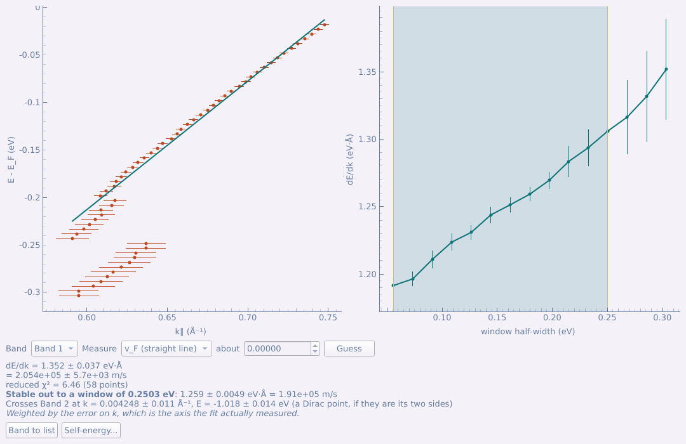

**Save table...** écrit toutes les lignes ajustées ; **Band to list** ajoute
une bande à la liste principale.

**Là où deux branches droites se croisent.** Dans la fenêtre
**Dispersion...**, avec *v_F* (une droite) choisi, chaque autre bande ajustée
l'est de la même façon et le point où les deux droites se rencontrent est
donné avec son incertitude (propagée des deux ajustements) : le point de
Dirac d'un cône ajusté par ses deux flancs, ou tout croisement de deux
bandes. Un point ajusté dont l'erreur s'est effondrée (un pic ajusté à
largeur nulle) ne prend plus tout le poids de l'ajustement de la
dispersion : aucun point ne compte plus que dix points typiques.

### Self-énergie

**Self-energy...** (fenêtre Dispersion, ajustements MDC seulement) fait
d'une bande ajustée **Re Σ** et **|Im Σ|** en fonction de l'énergie : Re Σ
est la distance de la bande mesurée à une *bande nue*, et |Im Σ| la moitié
de la largeur ajustée multipliée par la pente de la bande nue.

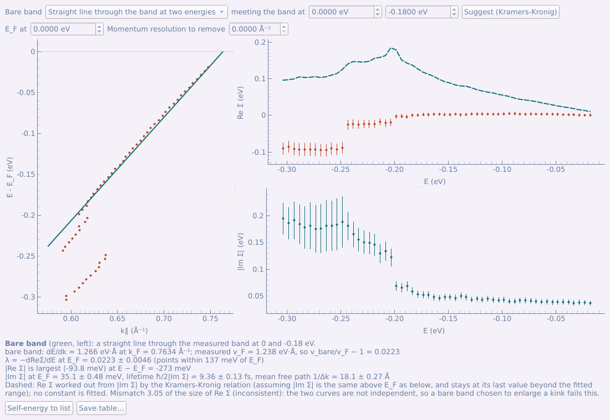

- **Bare band** — la seule hypothèse sur laquelle tout repose ; elle se
  choisit donc ici et est écrite dans le résultat : une **droite passant
  par la bande à deux énergies** (E_F et l'énergie ajustée la plus profonde
  au départ), une **droite de vitesse donnée** passant par le k_F mesuré
  (issue d'un calcul, par exemple), ou **l'ajustement de la fenêtre
  Dispersion**.
- **Suggest (Kramers-Kronig)** trouve la vitesse nue pour laquelle Re Σ et
  la transformée de Kramers-Kronig de |Im Σ| s'accordent le mieux. Les deux
  dépendent de ce seul nombre : exiger qu'elles forment une paire le fixe
  sans calcul. À ne croire que si la plage ajustée va bien au-delà du
  kink, là où |Im Σ| s'est stabilisé.
- **E_F at** et **Momentum resolution to remove** (retirée des largeurs en
  quadrature ; laisser 0 si l'ajustement avait la résolution dans sa forme
  de raie).
- **Ligne en tirets** : Re Σ déduite de |Im Σ| par la relation de
  Kramers-Kronig, en prenant |Im Σ| identique au-dessus et au-dessous de
  E_F et constante au-delà de la plage ajustée. Aucune constante n'est
  ajustée : la comparaison teste donc la bande nue, et une bande nue
  choisie pour grossir un kink y échoue.
- **Sous les graphes** : k_F et v_F mesurés, v_bare/v_F − 1, le couplage
  λ = −dRe Σ/dE à E_F, l'énergie où |Re Σ| est maximale (le kink), |Im Σ| à
  E_F avec la durée de vie et le libre parcours moyen.
- **Self-energy to list** ajoute les courbes à la liste principale ; **Save
  table...** les écrit en CSV avec la bande nue dans l'en-tête.

## 5.5 Arithmétique de coupes : dichroïsme et division par une référence

Deux coupes en donnent une troisième : dichroïsme linéaire (LH − LV),
dichroïsme circulaire, division par une référence d'or, ou simples
différences, rapports et sommes. Sélectionnez deux coupes dans la liste et
appuyez sur panneau → Advanced → **Cut arithmetic (two cuts)...** (la
première sélectionnée est A ; la fenêtre permet de les échanger). Le bouton
reste grisé tant qu'exactement deux coupes ne sont pas sélectionnées.


- **Le tableau du haut** compare ce que les deux mesures ont enregistré
  (polarisation, énergie de photon, angles, position de l'échantillon,
  température, énergie de passage, mode de lentille). Les lignes en orange
  diffèrent au-delà d'une tolérance — une carte de dichroïsme entre deux
  points de l'échantillon est une carte de *cette* différence-là.
- Préréglages **Purpose** : *Linear dichroism* (A − B, B mis à la même
  intensité totale), *Circular dichroism* ((A − B)/(A + B)), *Divide by a
  reference*, *Custom*. Un avertissement apparaît si les polarisations
  semblent inversées (**Swap A ↔ B**).
- **Scale B to A** par l'intensité totale ou celle d'une région ; **Hide
  where A+B below** masque le fond.
- A et B sont tracés sur une seule échelle de couleurs ; le résultat sur une
  échelle rouge-blanc-bleu symétrique autour de zéro. Avec des comptages
  bruts des deux côtés, l'incertitude de Poisson est propagée et résumée sous
  le graphique.
- **Result to list**, **Uncertainty to list**, **All three as a figure**.

## 5.6 Figure en série de tranches

Sélectionnez une carte → panneau → Advanced → **Slice series figure...**
dispose une page de tranches 2D planes du cube en une figure pour un
article — contours à énergie constante à une série d'énergies, ou coupes à
une série d'angles ou d'impulsions — régulièrement espacées ou à des valeurs
choisies, avec intégration, une échelle de couleurs commune et des
étiquettes seulement sur les bords extérieurs. (À ne pas confondre avec
**3D slices**, qui trace trois plans dans une vue 3D.)

| Réglages | Résultat |
|---|---|
| 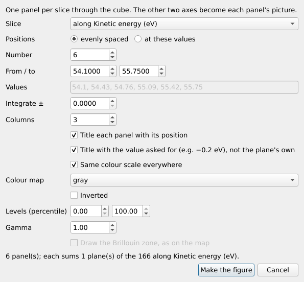 | 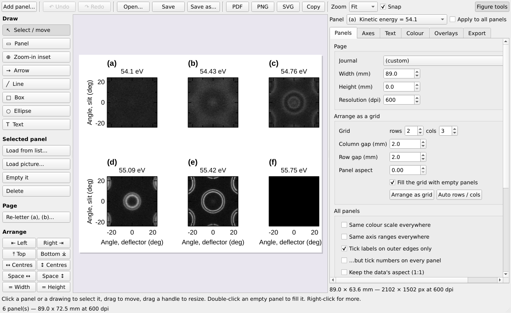 |

## 5.7 Les vues 3D

Quatre outils de l'onglet Advanced montrent une carte en 3D, chacun dans sa
propre fenêtre — faites glisser l'image pour la faire tourner :

- **3D slices...** — les trois plans orthogonaux du cube, chacun placé où
  vous voulez (case, curseur ou position saisie pour chaque axe).
- **Notched cube...** — le cube avec un coin retiré : une carte à énergie
  constante et deux dispersions dans une seule image.
- **Volume projection...** — tout le volume projeté selon la direction de
  vue : intensité maximale, somme, composition alpha, ou isosurface ombrée.
- **Stacked slices...** — des tranches parallèles empilées en 3D (ci-dessous).
- Pour une **carte k**, les vues 3D commencent aux premiers plans k_x et k_y
  remplis de données : le cube converti est la boîte autour d'un cône de
  lumière qui se resserre loin de E_F, et ses plans extérieurs se
  dessinaient en faces vides. *Change sampling... → Whole range* montre tout.

| 3D slices | Notched cube |
|---|---|
| 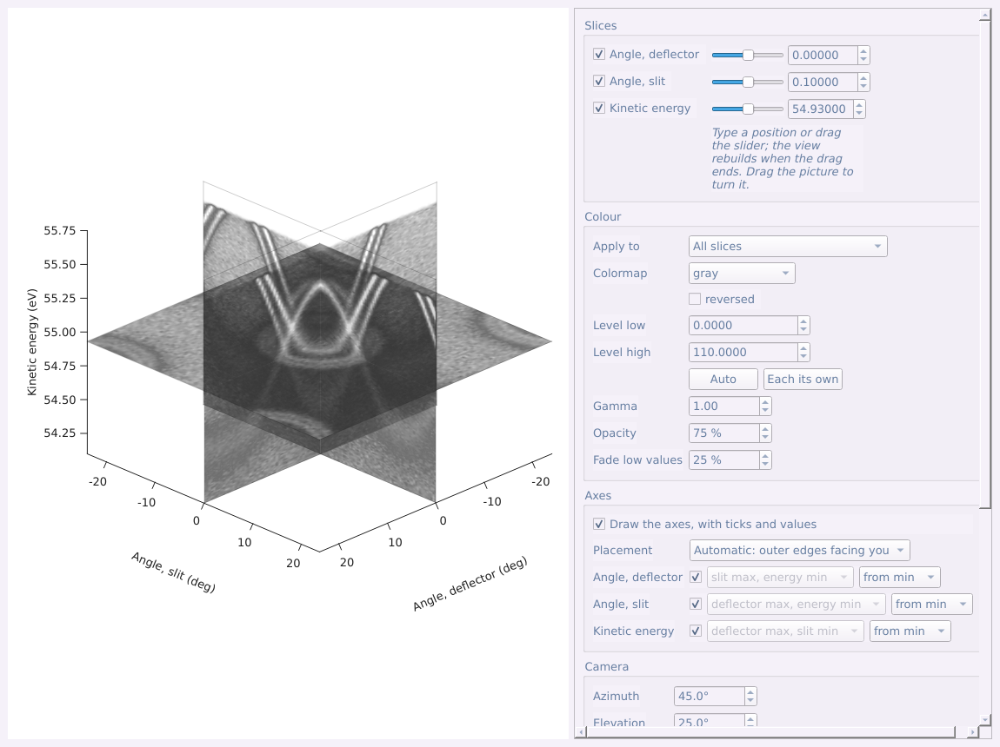 | 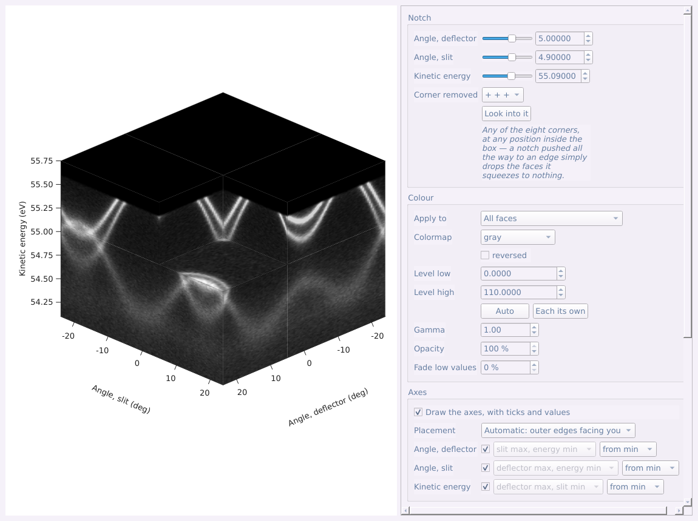 |

- **Échantillonnage.** Chaque image rééchantillonne le cube ; chaque fenêtre
  s'ouvre donc en échantillonnage *Balanced*, qui suit la souris.
  L'échantillonnage courant est indiqué sous **Save the view...** ; **Change
  sampling...** choisit la région et *Fast*, *Balanced* ou *Fine*, puis
  redessine depuis le cube complet.

  

- **Couleurs.** *Apply to* règle les couleurs de **toutes les tranches** à
  la fois ou d'une seule orientation (le plan en énergie dans une palette,
  les dispersions dans une autre) : palette (et *reversed*), niveaux
  (**Auto**, ou **Each its own** pour une échelle par tranche), gamma,
  **Opacity** et **Fade low values**, qui rend transparente l'intensité
  faible pour laisser voir les plans de derrière.
- **Axes.** **Draw the axes, with ticks and values**. *Placement* est
  automatique — sur les arêtes extérieures face à vous, qui suivent la vue
  quand elle tourne — ou choisi : pour chaque axe, l'arête du cube qu'il
  longe et s'il compte **from min** ou **from max**.
- **Camera** : azimut, élévation, rapport de profondeur ; **Look into it**
  fait face à un plan choisi. **Outline the faces** et un **Orientation
  tripod** sont facultatifs.
- **Save the view...** exporte l'image par la même fenêtre d'exportation que
  tout panneau (PNG, TIFF, JPEG à la taille et à la résolution choisies).
  **To figure composer...** ajoute la vue comme panneau d'une figure.

### Tranches empilées

**Stacked slices...** (panneau → Advanced → 3D only) dessine des tranches
parallèles du cube empilées en 3D : des cartes à énergie constante les unes
au-dessus des autres le long de l'axe d'énergie, ou des coupes les unes
derrière les autres selon k_z (ou l'énergie de photon) — l'image habituelle
de l'évolution d'une bande.

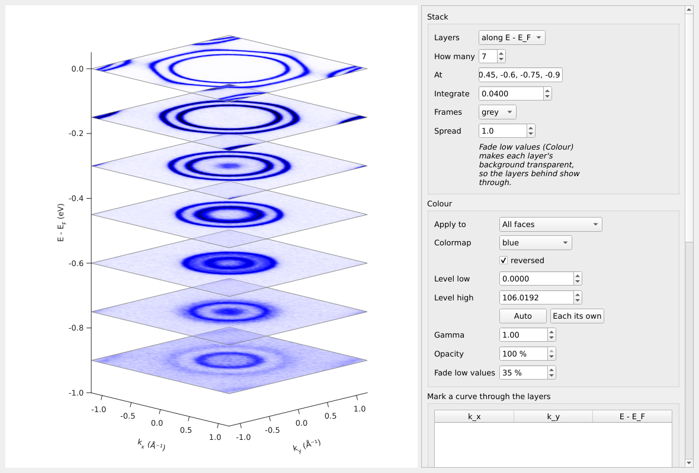

- **Layers** — l'axe d'empilement ; **How many** les répartit régulièrement,
  ou tapez les positions dans **At** (séparées par des virgules, dans les
  unités de l'axe) ; **Integrate** moyenne chaque tranche sur cette largeur.
- **Frames** — un contour autour de chaque tranche (gris, noir ou aucun).
- **Spread** étire la boîte selon l'axe d'empilement, pour que les tranches
  vues en oblique se séparent au lieu de se couvrir : pour quelques coupes
  empilées selon k_z, *Spread* 3 avec un azimut d'environ 40° montre chaque
  coupe presque entière.
- **Fade low values** (*Colour*) part ici de 35 % : le fond de chaque tranche
  est transparent, on voit donc les tranches de derrière.
- **Mark a curve through the layers** — des points dans les unités des
  données (un par tranche, par exemple le croisement de deux bandes), reliés
  par une courbe rouge, noire, bleue… tracée par-dessus l'empilement, avec
  une étiquette facultative au premier point.
- Les axes de toutes les vues 3D ajustent désormais l'image *et* ses
  étiquettes à la fenêtre ou au panneau de figure (sans marge fixe),
  espacent leurs graduations selon la place de chaque axe, et écrivent
  indices et exposants dans les titres d'axe (`E - E_F`, `k_x`).

## 5.8 Poche de Fermi (quasi-2D, en test)

> **En test** (nouveau dans la 1.3.3) : vérifiez chaque nombre sur l'image,
> et signalez ce qui paraît faux.
>
> **Échantillons quasi bidimensionnels seulement.** L'aire d'un contour
> dans une carte en k n'est une propriété de la surface de Fermi que si les
> bandes ne dispersent pas selon k_z — un état de surface, une monocouche,
> un matériau lamellaire dont la surface de Fermi est un cylindre. Une
> carte est alors toute la surface de Fermi. Pour une surface de Fermi
> tridimensionnelle, la carte est une nappe courbe qui la traverse, à un
> k_z fixé par l'énergie de photon et élargi par la profondeur
> d'échappement : le contour n'est pas une orbite extrémale, et les nombres
> ci-dessous ne signifient rien. Le programme ne peut pas distinguer les
> deux cas.

Sélectionnez une carte convertie en moment (une carte en k, en E − E_F) et
appuyez sur panneau d'outils → Advanced → **Fermi pocket (quasi-2D)...**.

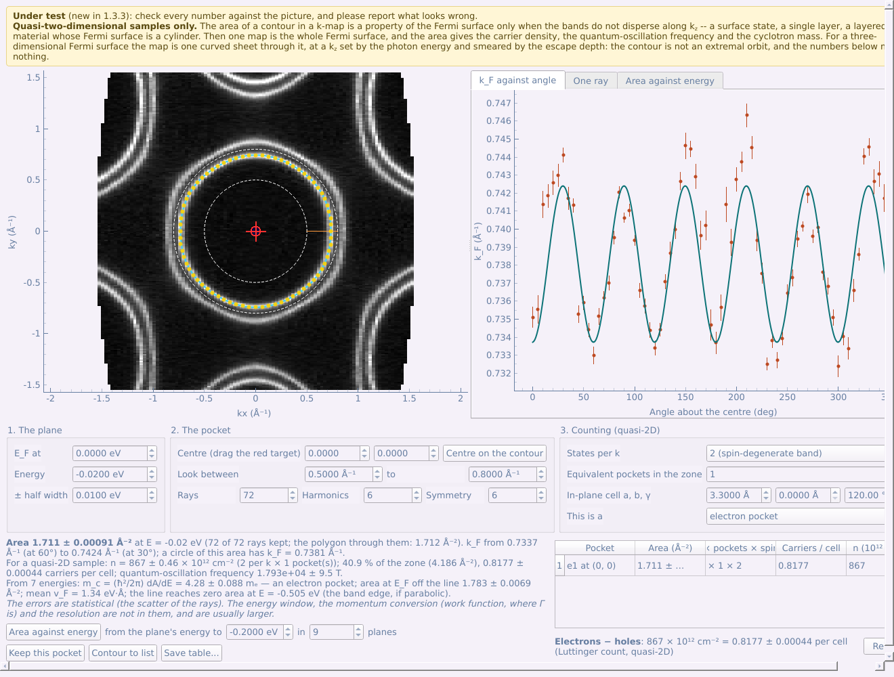

1. **The plane.** L'énergie à laquelle le contour est tracé (E_F au départ)
   et la demi-largeur sur laquelle on moyenne.
2. **The pocket.** Faites glisser la cible rouge sur un point à l'intérieur
   de la poche (ou tapez-le), et réglez **Look between** pour que les deux
   cercles en tirets contiennent la bande de cette poche et aucune autre.
   Un rayon part du centre à chacun des **Rays** angles, et un pic ajusté
   le long de ce rayon y donne k_F (points jaunes ; les croix rouges sont
   les rayons écartés, et l'onglet **One ray** montre n'importe quel rayon
   avec son ajustement). Le contour (bleu) est une série de Fourier du
   rayon en fonction de l'angle, jusqu'à **Harmonics** ; **Symmetry** ne
   garde que les harmoniques permises par un axe d'ordre n passant par le
   centre, ce qui comble aussi les lacunes des données. **Centre on the
   contour** déplace le centre au milieu du contour ; l'aire ne dépend pas
   du centre.
3. **Counting.** *States per k* (2 pour une bande dégénérée en spin, 1
   quand chaque spin a son propre contour), le nombre de *poches
   équivalentes dans la zone*, la *maille dans le plan* a, b, γ (pour les
   porteurs par maille), et s'il s'agit d'une poche d'électrons ou de
   trous.

Ce qui en sort, sous les images :

- l'**aire** avec son erreur, l'étendue de k_F le long du contour et le
  nombre de rayons gardés ;
- pour un échantillon quasi-2D : la **densité de porteurs**
  n = g N A/(2π)², la fraction de la zone de Brillouin et les **porteurs
  par maille** (ce que compte le théorème de Luttinger), et la **fréquence
  des oscillations quantiques** F = (ħ/2πe) A ;
- **Area against energy** trace la même poche à une série d'énergies et
  ajuste une droite : la **masse cyclotron** m_c = (ħ²/2π) dA/dE — positive
  pour une poche d'électrons, qui grandit avec l'énergie, négative pour une
  poche de trous —, l'aire à E_F lue sur la droite (sans le biais que la
  coupure de Fermi donne à un plan pris à E_F même), la vitesse de Fermi
  moyenne, et l'énergie à laquelle la droite atteint une aire nulle.

**Keep this pocket** l'ajoute à un tableau qui compte plusieurs poches
ensemble, électrons moins trous. **Contour to list** ajoute k_F en fonction
de l'angle (et l'aire en fonction de l'énergie) à la liste principale ;
**Save table...** écrit le tout en CSV.

Les erreurs données sont statistiques (la dispersion des rayons). La
fenêtre en énergie, la conversion en moment (travail de sortie, position de
Γ) et la résolution n'y sont pas, et sont en général plus grandes.

---

# Partie 6 — Le panneau d'outils : onglet Figure

L'onglet **Figure** regroupe le composeur de figures et ce qui est calculé plutôt que mesuré : la structure cristalline, la zone de Brillouin en 3D, les ajustements de liaisons fortes et les bandes calculées. Il se termine par un exemple allant du chargement des données à la figure finie.

## 6.1 Le composeur de figures

Panneau → Figure → **Figure composer...** (en haut de l'onglet) **sans rien
sélectionner** ouvre
une page vierge, comme une figure d'article : quatre panneaux vides (a),
(b), (c), (d) à la largeur de colonne d'une revue. Avec des coupes (ou des
courbes) sélectionnées, chacune devient un panneau (de même pour le bouton
**Figure composer...** d'une tranche figée ; un empilement de courbes ou une
vue 3D a son propre bouton **To figure composer**).

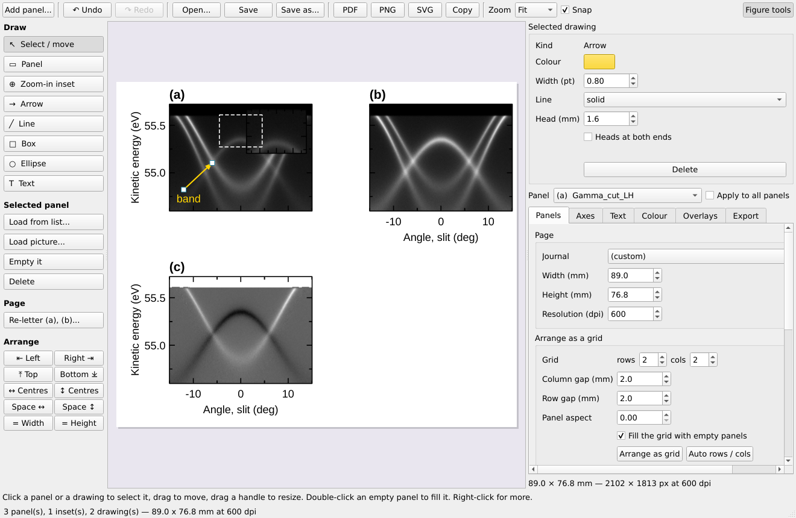

- **Mise en page.** Cliquez un panneau pour le sélectionner ; faites-le
  glisser pour le déplacer, tirez ses poignées pour le redimensionner (Maj
  sur un coin garde ses proportions). Les panneaux s'alignent sur les bords
  des autres et sur une grille de 0,5 mm (**Snap**) ; les flèches du clavier
  le décalent de 0,5 mm (Maj : 5 mm). *Arrange as grid* (onglet Panels à
  droite) les remet en lignes × colonnes. **Re-letter** les nomme (a), (b)…
  dans l'ordre de lecture.
- **Remplir un panneau.** Double-cliquez un panneau vide, ou **Load from
  list...** / **Load picture...** à gauche : un jeu de la liste principale,
  ou une image d'un fichier (PNG, JPEG, TIFF… — un schéma ou une figure
  faite ailleurs ; elle garde ses proportions et n'a pas d'axes).
- **Encarts.** **Zoom-in inset** : tracez une région d'un panneau — un
  petit panneau qui l'agrandit apparaît dans le coin, et la région est
  encadrée. Un **Panel** tracé dans un autre panneau est un encart à remplir
  avec un autre jeu. Les encarts n'ont pas de lettre et suivent leur panneau.
- **Dessiner.** **Arrow**, **Line**, **Box**, **Ellipse**, **Text** :
  faites glisser (ou cliquez, pour le texte) sur la page. Un dessin
  sélectionné se déplace, ses extrémités ou coins se tirent, et sa couleur,
  son épaisseur, son trait, son remplissage et son texte se règlent au-dessus
  des outils. Double-cliquez un texte pour le modifier ; Suppr efface la
  sélection ; clic droit pour le reste.
- **Axes et polices.** Les outils à côté de la page agissent sur le panneau
  sélectionné (ou sur tous) : bornes, graduations, étiquettes, bords
  numérotés, taille de police propre au panneau, carte de couleurs, barre de
  couleurs, lignes de référence.
- **Undo / Redo** (Ctrl+Z / Ctrl+Y) couvrent tout. **PDF**, **PNG**, **SVG**
  exportent, **Copy** copie dans le presse-papiers ; les panneaux vides ne
  sont jamais écrits. Les **Figure tools** du composeur ne sont pas les
  **Plot tools** d'une fenêtre, qui dessinent des guides sur le graphique
  affiché.

### Disposer les panneaux

Cliquez un panneau, puis **Ctrl+clic** (ou Maj+clic) sur les autres pour en
sélectionner plusieurs. Les boutons **Arrange** à gauche alors :

| Bouton | Effet |
|---|---|
| ⇤ Left, Right ⇥, ⤒ Top, Bottom ⤓ | alignent leurs bords gauche / droit / haut / bas (sur le plus extérieur) |
| ↔ Centres, ↕ Centres | mettent leurs centres sur une même verticale / horizontale (celle du premier panneau sélectionné) |
| Space ↔, Space ↕ | espaces égaux entre eux, de gauche à droite / de haut en bas (trois ou plus) |
| = Width, = Height | la largeur / hauteur du premier panneau sélectionné pour tous |

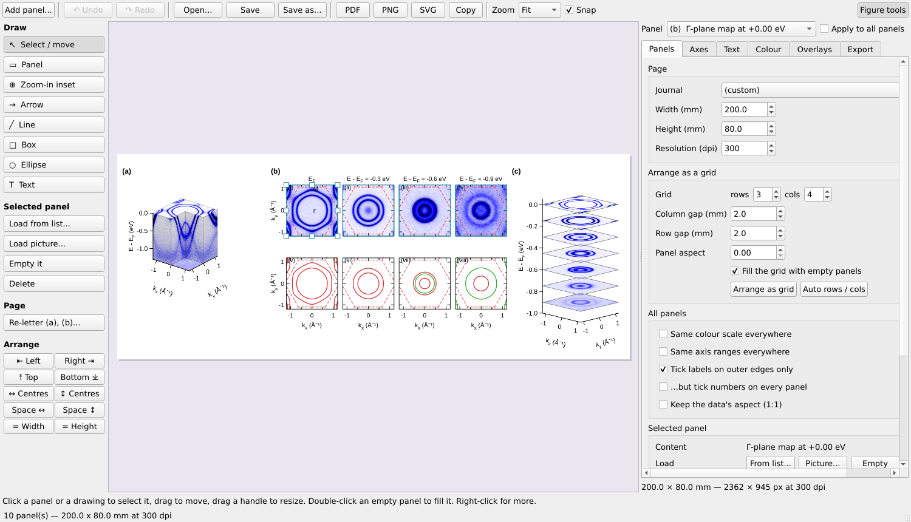

### Lettres et barres de couleur

- **Letters in line** (onglet *Text*, activé par défaut) : les lettres des
  panneaux côte à côte sont à la même hauteur, celles des panneaux l'un
  au-dessus de l'autre au même bord gauche, quels que soient les titres ou
  les axes de chacun. **Nudge (mm)** déplace la lettre d'un panneau (pour
  dégager un long titre d'axe, par exemple) ; **Re-letter** les renomme (a),
  (b)… dans l'ordre de lecture.
- **Colour bar** (onglet *Colour*) : **Ends** écrit les valeurs, les mots
  *High* / *Low*, ou rien ; **Length (%)** de la hauteur ou de la largeur du
  panneau ; **Position** *right* (debout à côté du panneau) ou *below*
  (couchée dessous, centrée). La barre d'une vue 3D est dimensionnée sur le
  cube tel qu'il est dessiné, non sur tout le cadre qui l'entoure.


### Courbes : lignes, symboles et barres d'erreur

Onglet *Overlays*, **Curves drawn on the panel** : sélectionnez des courbes
dans la liste (ou aucune, pour toutes), puis réglez leur **couleur**, leur
**épaisseur**, leur **style** (plein, tirets, pointillés…), leurs
**symboles** (cercle, carré, triangles, losange, avec une taille) et si elles
sont **reliées par une ligne** ; **± σ as error bars** change les deux courbes
pointillées ±σ d'une courbe en barres d'erreur à ses points. **Apply to the
curves**. Une courbe avec des trous (NaN) est tracée en morceaux.

### Enregistrer une figure pour la modifier plus tard, avec ses données

**Save** / **Save as...** écrivent la figure dans le format propre au
programme, `fig1.afig` : la page, ses dessins et chaque panneau avec ses
données et ses réglages — rouvrez-la avec **Open...** (ou choisissez-la dans
**Load data...** de la fenêtre principale) et reprenez la modification là où
vous l'aviez laissée. Une vue 3D est conservée comme l'image qu'elle montre.

À côté, **`data for fig1/`** reçoit un dossier par panneau (`a`, `b`, …) :

```
data for fig1/
  a/  processed/  ce que montre le panneau : l'image en coupe .nxs (qui se
                  rouvre dans la fenêtre de visualisation), ses lignes
                  (bandes calculées, contours, courbes) en lines.csv, une
                  image en .png
      original/   ce dont il a été fait : le premier fichier de mesure (un
                  plan converti en k, symétrisé, découpé remonte au fichier
                  d'où il a d'abord été lu), le calcul avec les fichiers lus
                  avec lui (.win, POSCAR...), le fichier image ou le CIF
      sources.txt quelle entrée du fichier, et les traitements entre les deux
  b/  ...
```

Le fichier d'origine est copié même quand le panneau montre un résultat
calculé à partir de lui bien des étapes plus tard : chaque jeu de données se
souvient du fichier dont il est parti. Une figure rouverte dont les fichiers
d'origine ont été déplacés réutilise les copies de son propre dossier de
données précédent.

## 6.2 Structure cristalline

Panneau → Figure → **Crystal structure...** (rien à sélectionner). Quatre
étapes (la zone de Brillouin est l'outil à part **3D BZ...**,
[§6.2](#63-3d-bz--la-zone-de-brillouin-en-trois-dimensions)) :

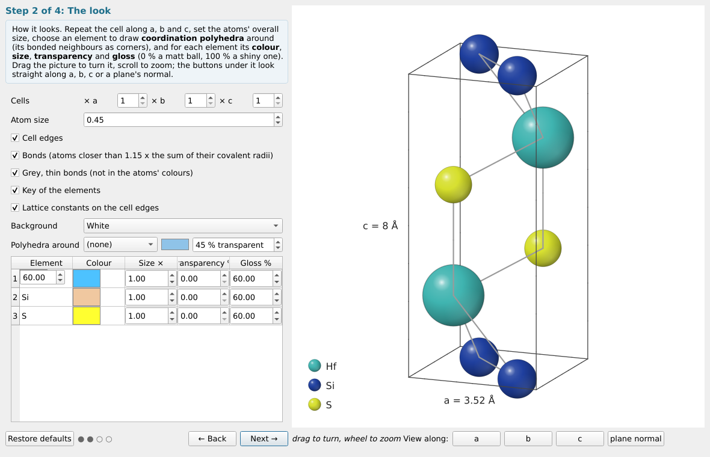

1. **La structure** — **Read a CIF file...** (le bouton du haut) remplit le
   groupe d'espace, la maille et les atomes depuis un fichier, applique ses
   opérations de symétrie et redessine aussitôt le cristal ; tout reste
   modifiable. Un CIF à plusieurs blocs (celui de FullProf, qui commence par
   un bloc de champs de revue) est lu dans le bloc qui contient la
   structure. Ou la saisir, comme la maille de BZ overlap : **d'abord le
   groupe d'espace** (les paramètres de maille qu'il fixe sont grisés et
   suivent les libres), puis la maille et les atomes de la base (les copies
   du mode de réseau sont ajoutées).
2. **L'aspect**
   - nombre de mailles selon a, b, c, taille globale des atomes, arêtes de
     la maille et liaisons (aux couleurs des atomes, ou *grey, thin*) ;
   - pour chaque élément sa **couleur**, sa **taille**, sa **transparence**
     et son **brillant** (0 % : une boule mate, 100 % : une boule brillante
     au reflet net) ;
   - **Polyhedra around** un élément : ses polyèdres de coordination (ses
     voisins liés pour sommets), avec leur propre couleur et transparence —
     les octaèdres TiSe₆, les tétraèdres CuS₄ ;
   - **Key of the elements** (une boule et son nom pour chacun), **Lattice
     constants on the cell edges** (`a = 3.52 Å`, `c = 8 Å`).

   Faites glisser l'image pour la tourner, molette pour zoomer ; *View
   along* a, b, c ou la normale au plan.
3. **Plan de clivage** — cochez *Draw a plane*, donnez (hkl), faites-le
   glisser, ou double-cliquez une **couche atomique** de la liste pour l'y
   placer ; *Hide the atoms above* montre la terminaison ; les atomes du plan
   sont cerclés de rouge.
4. **Export** — le cristal : **Save picture...** (PNG à toute
   taille, redessiné à cette taille) ou **To figure composer...**. Une image
   issue d'un CIF a ce CIF pour source, et le dossier de données de la figure
   le conserve ([§6.1](#61-le-composeur-de-figures)).

## 6.3 3D BZ : la zone de Brillouin en trois dimensions

Panneau → Figure → **3D BZ...** (rien à sélectionner). C'était l'étape 4 de
la fenêtre de la structure cristalline.

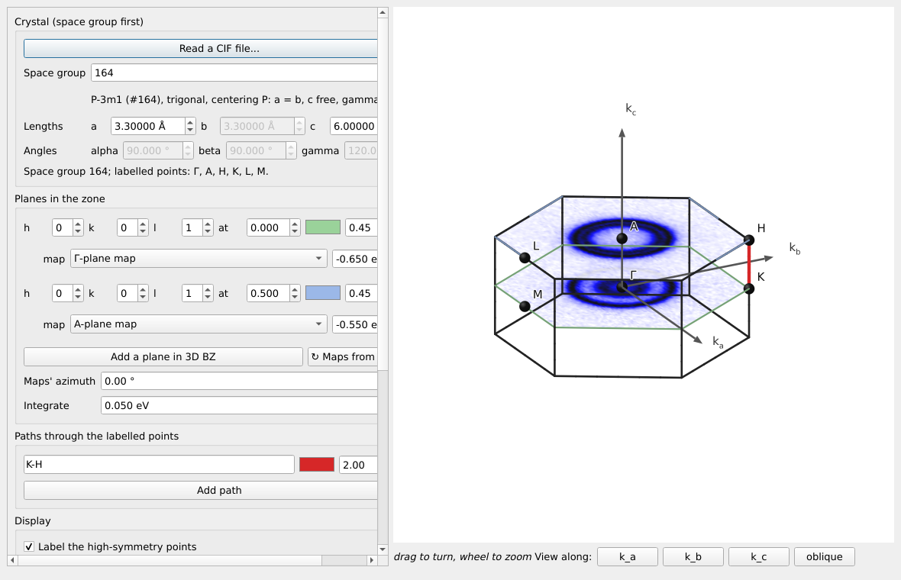

- **Cristal** : **d'abord le groupe d'espace**, puis la maille — les
  paramètres que le groupe fixe sont grisés et suivent les libres, comme
  dans BZ overlap. **Read a CIF file...** les remplit depuis un fichier. La
  fenêtre part du dernier cristal 3D de BZ overlap.
- **Plans dans la zone** : **Add a plane in 3D BZ** autant de fois que
  voulu. Chacun a sa normale (h k l), sa hauteur le long de celle-ci (en
  unités de G(hkl) : 0 par Γ, 0,5 au sommet de la zone), sa couleur et son
  opacité, et ✕ pour le retirer.
- **Cartes mesurées sur les plans** : *n'importe quel* plan peut porter la
  carte à énergie constante d'une carte k — choisissez-la dans la liste
  *map* du plan et donnez l'énergie (E − E_F). La liste propose les cartes k
  sélectionnées à l'ouverture et toutes celles de la liste principale
  (**↻ Maps from the list** ajoute celles venues depuis) ; une carte n'est
  lue que lorsqu'elle est choisie. Ses kx, ky suivent les axes propres du
  plan — k_x, k_y pour un plan normal à k_z —, tournés de *Maps' azimuth*,
  moyennés sur *Integrate*, et découpés à la zone.
- **Chemins** : **Add path** autant de fois que voulu, chacun par les points
  nommés (`Γ-M-K-Γ`, `A-L-H-A` ; `|` pour un saut), avec sa couleur et son
  épaisseur.
- **Affichage** : noms des points de haute symétrie, axes k_x, k_y, k_z, et
  *Label on the left* (ces points nommés à leur équivalent le plus à
  gauche, à l'écart des chemins et des axes).
- **Export** : **Save picture...** à toute taille, ou **To figure
  composer...**.

## 6.4 Ajustement de liaisons fortes

> **Une bande, ou deux bandes hybridées — au choix à l'étape 1 (*Bands*).**
> **Une bande** : une bande unique sur un réseau de Bravais (une orbitale
> par site) : E(k) = e0 + Σ t_n Σ cos(k·R). Elle ne peut décrire ni deux
> bandes, ni leur croisement, ni un gap d'hybridation ; ajustez chaque
> bande à part et lisez les sauts comme ses paramètres effectifs, non comme
> des sauts microscopiques entre orbitales.
>
> **Deux bandes hybridées** : ajuste à la fois deux telles bandes, ε_a(k)
> et ε_b(k), et leur couplage V(k) = v0 + Σ v_n S_n(k) ; les bandes
> mesurées sont E± = (ε_a+ε_b)/2 ± √(((ε_a−ε_b)/2)² + V²). Pour un
> anticroisement, un gap d'hybridation ou un dédoublement de bicouche
> (t_⊥). V a toute la symétrie du réseau (deux orbitales de même parité) ;
> un couplage impair, s–p par exemple, n'est pas de cette forme.

**Deux bandes, pas à pas.** À l'étape 1, fixez les couches de la bande a
(*Shells of neighbours*), de la bande b (*Shells, band b*) et du couplage
au-delà de v0 (*Coupling shells*, 0 pour un V constant). À l'étape 2,
tracez les deux bandes à deux énergies ou plus avec *New points on* sur
*either band*, puis cliquez quelques points de chaque bande avec *the
lower band* ou *the upper band* (bleu / rose) ; un fichier de points peut
porter une colonne `branch` (`lower` / `upper` / vide). À l'étape 3,
l'ajustement — non linéaire, lancé depuis de nombreux modèles puis affiné —
donne la bande a, la bande b et v0, v1… avec leurs erreurs, trace les deux
bandes (rouge, orange), indique à quelle bande va chaque point, et donne le
**plus petit gap** entre elles et où il se trouve : 2|V| là où les bandes
nues se croisent. *Model to list* contient les deux bandes ; *Save
parameters* écrit les trois jeux de paramètres, leurs couches et le gap.

**Les couches sont des orbites de symétrie.** Chaque saut t_n correspond à
un ensemble de voisins que la symétrie rend équivalents : le groupe ponctuel
du groupe d'espace (avec l'inversion) pour un cristal 3D, la symétrie propre
du réseau pour une couche 2D. Deux voisins non équivalents à la même
distance — l'un dans le plan, l'autre hors du plan — ont chacun leur saut.
L'étape 1 liste chaque couche avec son nombre de voisins, sa distance et un
vecteur représentatif en coordonnées du réseau (⟨1 0 0⟩) ; **Save
parameters...** écrit tous les vecteurs de chaque couche.

Avec une k-map sélectionnée (ou rien, pour lire des points dans un fichier) :

1. **Le réseau** -- une couche 2D (a, b, γ) ou un cristal 3D (**d'abord le
   groupe d'espace**, puis les paramètres de maille qu'il laisse libres --
   les autres sont grisés et suivent), ou **Take the crystal from the
   Brillouin-zone tool** ; l'azimut de a par rapport à kx ;
   le nombre de couches de voisins.
2. **Points de bande** -- sur **une seule bande** (quelques points
   égarés sont écartés comme aberrants ; trop gâchent l'ajustement).
   Placez-vous à une énergie et cliquez sur **Trace
   this energy** (détection de crêtes), ou cochez *Click* et cliquez sur la
   bande, ou **Read points from a file**. Deux ou trois énergies valent mieux
   qu'une : un seul contour fixe la forme de la bande, pas son échelle
   d'énergie.
3. **Ajuster** -- les intégrales de saut avec leurs erreurs et l'écart
   quadratique moyen ; le contour du modèle est tracé en rouge sur le plan de
   l'étape 2. Avec une seule énergie, fixez t1 ; *Refine the azimuth* si
   l'orientation n'est connue qu'approximativement. Une note orange signifie
   que les points ne distinguent pas les couches : prenez-en moins.
4. **Utiliser le modèle** -- **Model to list** (sa fonction spectrale, comme
   une carte à côté des données), **Save parameters...**, **Copy results**.

## 6.5 Bandes calculées

Panneau → Figure → **Calculated bands...** met un calcul de structure
de bandes à côté de la mesure. Sélectionnez ce avec quoi le comparer —
k-maps, cartes kz en impulsion et coupes en impulsion — ou rien, pour
regarder le calcul seul. Quatre étapes.

**Nouveautés de la v1.2.1** (le guide anglais les détaille) :

- L'étape 1 commence par **ce que vous voulez voir** : dispersion E–k,
  contours à énergie constante, ou surface de Fermi 3D. Le choix trie la
  liste des fichiers, refuse un calcul le long d'un chemin pour les contours
  (en disant pourquoi) et règle les étapes suivantes. **Which file?** lit tout
  un dossier et dit, pour chaque fichier, ce qu'il est, ce qu'il peut montrer,
  ce qui lui manque, s'il s'agit d'un fichier standard renommé ou découpé en
  morceaux (qu'il recolle). Les fichiers sont reconnus par leur contenu ; les
  fichiers des outils FPLO + Wannier (`band.dat`, `Eigenvalue.dat`,
  `KPOINTS`) et les grilles MATLAB `Ek_3D` (`.mat`) sont lus. Les lectures
  longues ont une barre de progression.
- La maille lue dans le calcul est **verrouillée** (groupe d'espace et
  *From the Brillouin-zone tool* compris) tant que **Change the lattice
  parameters** n'est pas coché.
- Étape 2, **contours** : sur n'importe quel plan, réglé comme dans l'outil
  de zone de Brillouin — normale (hkl), k⊥ le long de cette normale
  (*Through point*), **rotation dans le plan**, et une **fenêtre
  d'intégration en k⊥** le long de la normale (hkl), pas du k_z absolu.
  **Show the plane in the Brillouin zone...** montre où se trouve la coupe.
  **Surface de Fermi 3D** : à tourner à la souris, aussi dans sa propre
  fenêtre. Couleur (la même pour plusieurs bandes, pour grouper les poches),
  opacité et visibilité se règlent **bande par bande**. *Highlight bands*
  (`41-44` ou `EF`) colore les bandes choisies le long du chemin.
- Pour la surface de Fermi 3D, l'étape *Compare* est sautée. **Save … to
  main panel** suit le choix de l'étape 1 : une coupe (qui garde les noms des
  points de haute symétrie, affichés par la visionneuse de coupe — case
  **High-symmetry points**), une carte k calculée pour les contours, et
  grisé pour la surface 3D.
- Toutes les fenêtres pas à pas **demandent avant de se fermer** et
  **gardent leurs réglages** (**Restore defaults** pour repartir de zéro) ;
  **Entrée dans un champ valide la valeur** sans jamais appuyer sur Next,
  Close ni un autre bouton.

**Nouveautés de la v1.2.1** (le guide anglais les détaille) :

- L'étape 1 commence par **ce que vous voulez voir** : dispersion E–k,
  contours à énergie constante, ou surface de Fermi 3D. Le choix trie la
  liste des fichiers, refuse un calcul le long d'un chemin pour les contours
  (en disant pourquoi) et règle les étapes suivantes. **Which file?** lit tout
  un dossier et dit, pour chaque fichier, ce qu'il est, ce qu'il peut montrer,
  ce qui lui manque, s'il s'agit d'un fichier standard renommé ou découpé en
  morceaux (qu'il recolle). Les fichiers sont reconnus par leur contenu ; les
  fichiers des outils FPLO + Wannier (`band.dat`, `Eigenvalue.dat`,
  `KPOINTS`) et les grilles MATLAB `Ek_3D` (`.mat`) sont lus. Les lectures
  longues ont une barre de progression.
- La maille lue dans le calcul est **verrouillée** (groupe d'espace et
  *From the Brillouin-zone tool* compris) tant que **Change the lattice
  parameters** n'est pas coché.
- Étape 2, **contours** : sur n'importe quel plan, réglé comme dans l'outil
  de zone de Brillouin — normale (hkl), k⊥ le long de cette normale
  (*Through point*), rotation dans le plan, et une **fenêtre d'intégration
  en k⊥** le long de la normale (hkl), pas du k_z absolu. **Show the plane in
  the Brillouin zone...** montre où se trouve la coupe. **Surface de Fermi
  3D** : à tourner à la souris, aussi dans sa propre fenêtre. Couleur (la
  même pour plusieurs bandes, pour grouper les poches), opacité et
  visibilité se règlent **bande par bande**. *Highlight bands* (`41-44` ou
  `EF`) colore les bandes choisies le long du chemin.
- Pour la surface de Fermi 3D, l'étape *Compare* est sautée. **Save … to
  main panel** suit le choix de l'étape 1 : une coupe (qui garde les noms des
  points de haute symétrie, affichés par la visionneuse de coupe — case
  **High-symmetry points**), une carte k calculée pour les contours, et
  grisé pour la surface 3D.
- Toutes les fenêtres pas à pas **demandent avant de se fermer** et
  **gardent leurs réglages** (**Restore defaults** pour repartir de zéro) ;
  **Entrée dans un champ valide la valeur** sans jamais appuyer sur Next,
  Close ni un autre bouton.

**1. Le calcul.** **Open calculation...** lit, quel que soit le programme
qui l'a écrit :

| Fichier | Écrit par | Contenu |
|---|---|---|
| `.bxsf` (grille de bandes XCrySDen) | Wien2k, Quantum ESPRESSO, VASP, Wannier90 | les bandes partout dans la zone, interpolées |
| `_hr.dat` (+ `.win` à côté) | Wannier90, tout modèle de liaisons fortes | un hamiltonien, diagonalisé exactement en chaque k ; poids orbitaux |
| `_band.dat` (+ `labelinfo`) | Wannier90 | bandes le long d'un chemin |
| `.spaghetti_ene` (+ `.klist_band`) | Wien2k | bandes le long d'un chemin |
| `EIGENVAL` (+ `POSCAR`, `PROCAR`) | VASP | bandes le long d'un chemin ou sur une grille ; poids atomiques et orbitaux |

Un calcul « partout » se coupe n'importe où : le long de toute coupe
mesurée, sur le k_z qu'atteint une énergie de photon, à toute énergie en
contours. Un calcul « le long d'un chemin » ne se trace que le long de ce
chemin. *Set E_F myself* remplace le niveau de Fermi du fichier ; *bxsf k
units* sert pour une grille écrite sans 2π. Le **groupe d'espace** nomme les
points de la zone ; il est deviné d'après la forme de la maille — indiquez
celui du cristal (ou prenez-le dans l'outil zone de Brillouin).

**2. Le long d'un chemin.** Le calcul par les points de haute symétrie
(`Γ-M-K-Γ-A-L-H-A` ; `G` pour Γ, `|` pour un saut), par-dessus la **mesure
le long du même chemin**, assemblée à partir des cartes sélectionnées :
chaque segment dans le plan pris dans la carte mesurée sur son plan k_z
(Γ-M-K-Γ dans la carte du plan Γ, A-L-H-A dans celle du haut de la zone),
Γ-A dans une carte kz. Le k_z de chaque carte vient de son énergie de photon
et du potentiel interne V0 ; corrigez-le dans le tableau si besoin, décochez
une carte pour l'écarter, et donnez l'azimut de l'axe a du cristal sur la
carte. Là où une carte n'atteint pas un point, son équivalent par symétrie
est utilisé. **Weight** trace des bandes épaisses : l'épaisseur est le poids
de l'orbitale choisie.

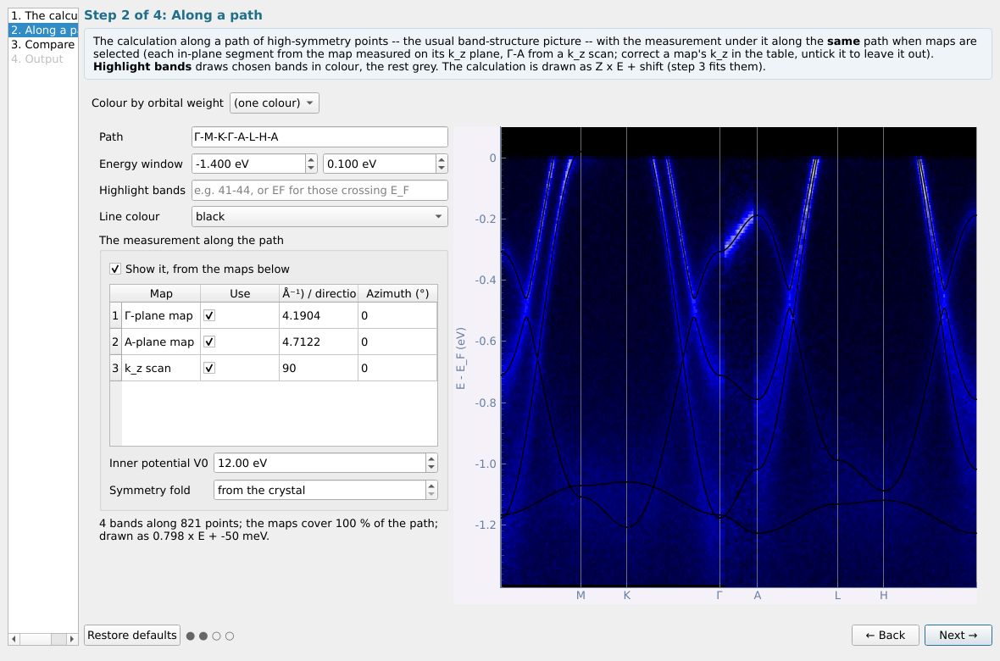

**3. Comparer.** Une mesure à la fois, avec le calcul tracé là où elle a
réellement été prise : une **coupe** reçoit les bandes selon sa direction —
sur un plan k_z fixe, ou sur la surface courbe qu'atteint son énergie de
photon (k_z varie le long de la coupe et avec l'énergie) ; une **carte**
reçoit les contours calculés à l'énergie choisie. **Fit to the cut's bands**
suit les bandes mesurées (détection de crêtes) et trouve **Z** — la
renormalisation de la largeur de bande, E mesurée = Z × E calculée +
décalage — et le **décalage**, chaque point associé à la bande la plus
proche, de façon robuste. Z et le décalage s'appliquent à chaque étape et à
chaque sortie. Sur la coupe de démonstration il trouve Z = 0,798 et un
décalage de −49,8 meV, les valeurs avec lesquelles la démonstration a été
faite (0,8 et −50 meV).

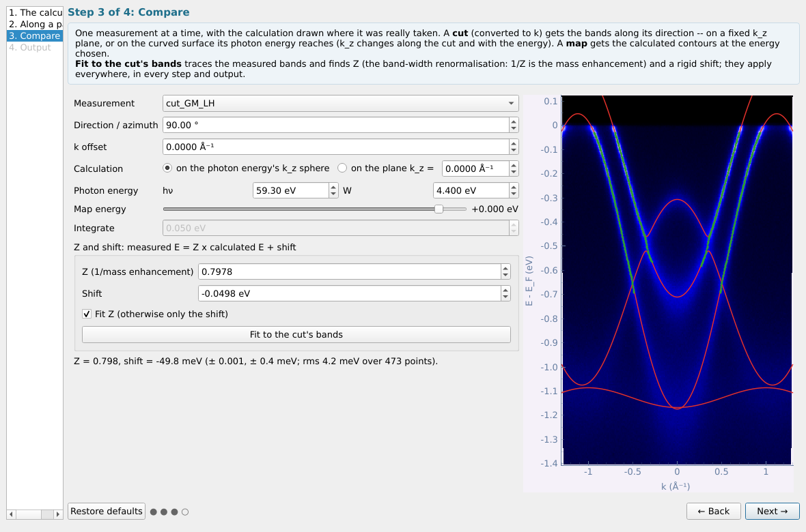

**4. Sorties.**

- **To figure composer...** crée les panneaux cochés : la mesure le long du
  chemin avec le calcul par-dessus, le calcul seul (les noms des points sur
  son axe), la coupe ou la carte comparée avec son calcul, et — avec
  **Constant-energy series at** — pour une k-map comparée, les cartes
  mesurées à chaque énergie avec les zones en pointillés (rangée du haut) et
  les contours calculés seuls (rangée du bas), colorés selon le poids choisi
  à l'étape 2 (en vert là où il dépasse la moitié).
- **Save calculation to main panel** fait du calcul un spectre (des lorentziennes de la
  largeur choisie), le long de la coupe comparée ou du chemin, qui s'ouvre
  donc dans les fenêtres de visualisation à côté des données ou s'en
  soustrait.

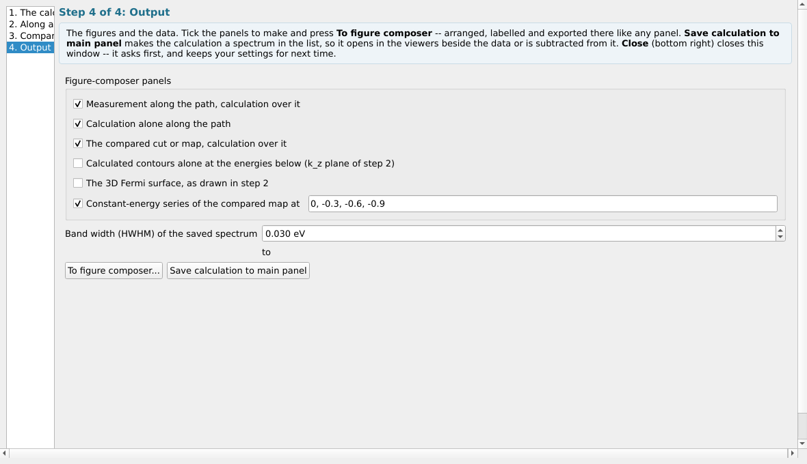

## 6.6 Exemple : du chargement des données à la figure

Des données de démonstration ([§1.3](#13-essayer-avec-des-données-de-démonstration)) à une figure de cartes à énergie
constante avec la zone de Brillouin. C'est le même chemin que l'exemple de
l'agent au [§7.7](#77-exemple--un-agent-de-la-configuration-à-la-figure), fait à la main.

1. **Charger.** **Quick add...** → `demo_bulk_bands.nxs`. La liste montre la
   carte du plan Γ `FS_map_hv59.3_Gamma_plane`, les coupes `cut_GM_LH`,
   `cut_GM_LV`, `cut_GK_LH` et le balayage en énergie de photon.
2. **Niveau de Fermi.** Sélectionnez la carte → Basic → **Fermi edge
   fit...**. Ajustez sur les données brutes, dans une fenêtre autour du
   front ; notez E_F ([§4.2](#42-ajustement-du-front-de-fermi)).
3. **En impulsion.** Basic → **k conversion (map)** : Γ en émission normale,
   E_F ajusté comme référence d'énergie. Une nouvelle ligne `… [k]` apparaît
   ([§4.9](#49-conversion-en-k-dune-carte)).
4. **La zone.** Sélectionnez la carte k → Basic → **BZ overlap...** : groupe
   d'espace 164 (P-3m1), a = 3,3 Å, c = 6 Å, plan (001) passant par Γ
   ([§4.12](#412-zone-de-brillouin)).
5. **Tranches.** Advanced → **Slice series figure...** : énergies 0, −0,2,
   −0,4 eV, ±20 meV, trois colonnes, la zone en tirets ([§5.6](#56-figure-en-série-de-tranches)). La
   figure s'ouvre dans le composeur.
6. **Mise en page et export.** Dans le composeur, réglez la largeur de la
   page, la palette et les niveaux, les lettres (a), (b), (c), puis
   **Export** en PNG et PDF et **Save** en `.afig` pour la modifier plus tard
   ([§6.1](#61-le-composeur-de-figures)).

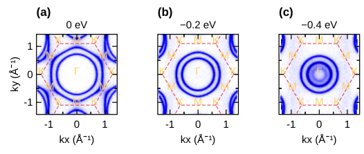

La section suivante construit de la même façon deux figures de publication
complètes.

## 6.7 Exemple complet : deux figures dans le composeur

Les deux figures ci-dessous ont été faites à partir des données de
démonstration ([§1.3](#13-essayer-avec-des-données-de-démonstration)) avec les
fenêtres du programme, puis assemblées dans le composeur de figures.
`devtools/figure_tests.py` exécute exactement ces étapes : c'est aussi un
script à lire en parallèle de cette section.

### Figure 1 : contours à énergie constante


**(a) Le cube entaillé.** Convertissez la carte du plan Γ en impulsion
([§4.9](#49-conversion-en-k-dune-carte)) ; sélectionnez la k-map → Advanced →
**Notched cube...**. *Change sampling...* : k_x, k_y dans ±1,25 Å⁻¹ et E
jusqu'à E_F ; placez l'entaille en k_x = k_y = 0 jusqu'à l'énergie la plus
basse, coin **+ − +** ; palette *blue*, inversée ; azimut −52°, élévation
24°. **To figure composer...** : une nouvelle figure. Dans le composeur,
onglet *Colour* : **Colour bar** activée, Ends *high-low*, Position *below*,
Length 60 %.

**(b) Contours mesurés et calculés.** Sélectionnez la k-map du plan Γ →
Figure → **Calculated bands...** ; ouvrez `demo_calc_hr.dat` ; à
l'étape 2 choisissez le **Weight** `Se-pxy` ; à l'étape 3 choisissez la
k-map, *Integrate* 0,050 eV, puis une coupe pour **Fit to the cut's bands**
(Z et le décalage s'appliquent aussi aux contours) ; à l'étape 4 cochez
**Constant-energy series at** `0, -0.3, -0.6, -0.9`, décochez le reste,
**To figure composer...** → la figure de (a). Huit panneaux arrivent : les
cartes mesurées avec les zones en pointillés, et les contours calculés
seuls, en rouge là où le poids est inférieur à la moitié et en vert au-delà.
Dans chacun, réglez la palette (*blue*, inversée), les plages ±1,2 et
supprimez les titres de la rangée du bas (onglet *Text*) ; ajoutez les
notes (i)…(viii) et Γ, M, K avec l'outil **Text**.

**(c) Contours empilés.** Sélectionnez la k-map → Advanced → **Stacked
slices...** ; *Layers* selon E − E_F en `0, -0.15, -0.3, -0.45, -0.6, -0.75,
-0.9`, *Integrate* 0,04, *Fade low values* 45 %, aspect z 2,2, azimut −45°,
élévation 14°. **To figure composer...** → la même figure.

**Disposition.** Faites glisser les panneaux à peu près en place (les 2 × 4
contours en deux rangées, (a) à gauche, (c) à droite), puis sélectionnez
(a), la rangée du haut de (b) et (c) et appuyez sur **⤒ Top** ;
sélectionnez une rangée de contours et **Space ↔**, et **= Height** pour
chaque rangée. Les lettres s'alignent d'elles-mêmes ; **Nudge** a déplacé
celle de (b) de 6 mm vers la gauche, à l'écart de son titre k_y. Seuls (a),
(b) et (c) portent une lettre : videz la case *Letter* des autres. **Save
as...** `example_figure_1.afig` (son dossier de données est écrit à côté),
et **PNG** / **PDF** pour l'article.


### Figure 2 : un croisement de bandes suivi selon k_z

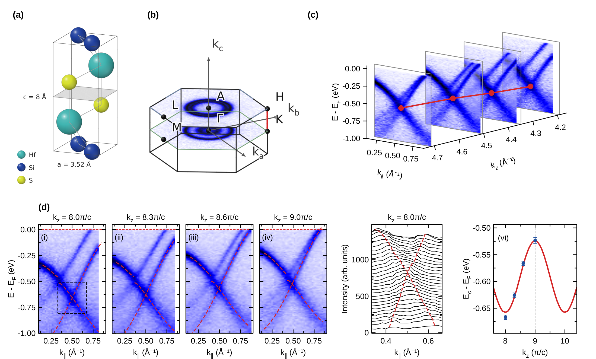

**(a) La structure cristalline.** Figure → **Crystal structure...** →
*Read a CIF file* `demo_tetragonal_crystal.cif`. Étape 2 : Hf bleu-vert, Si
bleu foncé, S jaune, brillant 85 % chacun, taille des atomes 0,52 ; *Grey,
thin bonds* ; *Lattice constants on the cell edges* (sans légende des
éléments). Étape 3 : *Draw a plane* (001) au milieu de la maille, entre les
couches de S, en gris. Tournez-la à l'azimut −68°, élévation 14°. Étape 5 :
**To figure composer...** → une nouvelle figure.

**(b) La zone avec les cartes mesurées.** Figure → **3D BZ...** → *Read a
CIF file* `demo_crystal.cif`. **Add a plane in 3D BZ** une fois (le premier
plan passe par Γ, le second au sommet de la zone) ; *map* du premier →
*Γ-plane map* à −0,65 eV, du second → *A-plane map* à −0,55 eV
(sélectionnez d'abord les deux k-maps, ou cliquez sur **↻ Maps from the
list**). *Path* `K-H` (la ligne où les deux bandes se croisent) ; *Label on
the left* `L, M`. **To figure composer...** → la figure de (a).

**(c) Les coupes empilées selon k_z.** Convertissez le balayage en énergie
de photon en impulsion ([§4.10](#410-aligner-les-niveaux-de-fermi-dune-carte-kz)),
sélectionnez-le → Advanced → **Stacked slices...** : *Layers* selon k_z aux
quatre k_z des coupes (8,0, 8,3, 8,6 et 9,0 π/c), *Fade* 30 %, **Spread** 3,
azimut 40°, élévation 12°. Dans **Mark a curve through the layers**, ajoutez
le croisement sur chaque coupe (k_z, k_∥, E) — tiré de (d) — en rouge.
**To figure composer...**.

**(d) Les coupes, leurs MDC et le croisement en fonction de k_z.**

- (i)–(iv) : dans la fenêtre de la carte k_z, **Functions → Slice → Save
  slice to the main list** à chaque k_z ; ouvrez chaque coupe dans le
  composeur (**Add panel...**). Les guides en tirets le long des deux bandes
  qui se croisent sont le calcul (Calculated bands, étape 3, sur le plan
  k_z = …), décalé par le Z et le décalage ajustés : à l'étape 4, **To figure
  composer...** avec seulement *The compared cut* coché donne la coupe avec
  eux ; réglez leur style sur *dashed* dans l'onglet *Overlays*. Tracez le
  cadre en tirets avec l'outil **Box**.
- (v) : sélectionnez la première coupe → Advanced → **Stack plot (EDC /
  MDC)...** → MDC, 40 courbes de 3 lignes chacune, sur les énergies du
  cadre ; **Send to figure composer** → cette figure. Les guides à travers
  les MDC sont les mêmes bandes calculées, à l'énergie de chaque MDC.
- (vi) : l'énergie du croisement à chaque k_z — tirée de **MDC fit** sur
  chaque coupe et de **Dispersion...**, où *Crosses band … at k = …,
  E = … ± …* la donne avec son erreur — en points avec barres d'erreur
  (*Overlays* : symboles *circle*, non reliés, **± σ as error bars**), et le
  croisement calculé en fonction de k_z en ligne rouge.

**Disposition.** (a), (b), (c) sur la première rangée : sélectionnez les
trois, **⤒ Top** et **= Height** ; les six panneaux de (d) sur la deuxième
rangée, **⤒ Top** et **= Height**. Lettres : (a), (b), (c), (d) seulement.
**Save as...** `example_figure_2.afig`.

Chaque panneau de l'une ou l'autre figure peut être modifié ensuite —
ouvrez le `.afig`, sélectionnez le panneau et utilisez les outils de
figure ; le dossier de données conserve à la fois les données telles
qu'affichées et la mesure dont elles proviennent.

---

# Partie 7 — Agents IA

Un agent IA (Claude, ou toute application capable de lire et d'écrire des fichiers ou d'appeler des outils MCP) peut piloter le programme sur votre écran, étape par étape, pendant que vous suivez et pouvez reprendre la main. Cette partie explique le principe, comment démarrer et suivre un agent, et donne un exemple de la configuration à la figure.

## 7.1 Principe, et ce qui quitte votre ordinateur

Le programme n'a pas de conversation à lui. Vous parlez à votre application
IA (l'application de bureau Claude, Claude Code ou un autre agent) en langage
courant, et le programme est l'outil de cet agent. L'agent envoie au programme
de petites étapes : lister les données, ajuster un front de Fermi, convertir
en impulsion, faire une figure. Le programme exécute chaque étape sur votre
écran ; chaque résultat apparaît comme une nouvelle ligne de la liste ou une
nouvelle fenêtre, et vous pouvez mettre l'agent en pause et travailler à la
main à tout moment.

**Ce qui reste sur votre ordinateur, et ce qui n'y reste pas :**

- Vos fichiers de données brutes restent où ils sont et sont lus et traités
  par le programme, localement. Le programme n'envoie rien.
- Ce que **l'agent lit** est envoyé au fournisseur d'IA dans la conversation :
  le texte qu'affiche une étape (noms des lignes, valeurs ajustées, étendues
  des axes) et toute image que l'agent ouvre pour juger un résultat. Avec des
  sorties compactes, la conversation contient des nombres et quelques images,
  pas vos tableaux de données.
- Que le fournisseur puisse utiliser le contenu des conversations pour
  l'entraînement dépend du fournisseur et des réglages de votre compte.
  Vérifiez-les avant de commencer.
- Gardez le code privé, les manuscrits non publiés et tout ce que vous ne
  voulez pas faire lire hors des dossiers que l'agent peut atteindre. Donnez-lui
  seulement le dossier des données (en lecture) et celui des résultats.

Comme pour toute analyse, vérifiez ce qu'un agent a produit avant de
l'utiliser.

## 7.2 Architecture : opérations, référence, voies

```
 vous ⇄ application IA (conversation)       ARPES viewer (sur votre écran)
            │                                 ┌──────────────────────────┐
            │  écrit <results>/_agent/         │  exécute chaque fichier  │
            ├──── viewer_cmd/01_….py  ───────▶ │  de commandes, ou chaque │
            │                                 │  appel MCP, avec L       │
            │  lit out/cmd_01_….log  ◀──────── │  nouvelles lignes,       │
            │  (ou les résultats MCP)          │  fenêtres, fichiers      │
            │                                 └──────────────────────────┘
```

- **Les opérations `L`.** Une cinquantaine d'opérations documentées sur les
  lignes nommées de la liste principale (`arpes_viewer/ui/common/live.py`) :
  `L.rows()`, `L.add_files(...)`, `L.fermi_edge_search(...)`,
  `L.fermi_edge(...)`, `L.map_to_k(...)`, `L.kz_to_k(...)`,
  `L.bz_overlay(...)`, `L.cut_arithmetic(...)`, `L.slice_series(...)`,
  `L.figure_render(...)` … Chacune ajoute de nouvelles lignes au lieu de
  modifier les anciennes, n'écrase jamais un fichier et n'attend jamais un
  clic. Une ligne se désigne par son nom, son numéro dans `L.rows()` ou le
  chemin de son fichier.
- **La référence `API.md`** (`arpes_viewer/agent/API.md`, dans le programme
  installé) liste toutes les opérations, les boutons du panneau d'outils, les
  outils MCP et les calculs de `tools/`, avec leurs paramètres. Elle est
  générée à partir du programme, donc toujours à jour ; l'agent la lit au
  lieu du code source. `L.help()` affiche la même liste.
- **Trois voies** vers les mêmes opérations :
  1. **Dossier de commandes** (recommandé) : l'agent écrit un petit fichier
     Python par étape dans `<results>/_agent/viewer_cmd/` ; le programme
     l'exécute et écrit ce qu'il a affiché dans `<results>/_agent/out/`. Toute
     application IA qui lit et écrit des fichiers convient, et chaque étape
     est conservée comme fichier.
  2. **MCP** : l'application IA appelle le programme par son serveur MCP
     (`arpes-viewer-mcp`) ; quand le programme est lancé avec le pont agent,
     `viewer_api` appelle les mêmes opérations.
  3. **Scripts sans écran** : les calculs de `arpes_viewer/tools/` et
     l'espace de travail sans fenêtre, pour un script à conserver.
- **Fenêtres.** Une fenêtre qu'une opération n'ouvre que pour la piloter (un
  dialogue de conversion, une figure provisoire) n'apparaît jamais à l'écran ;
  les fenêtres encore ouvertes à la fin d'une étape (une figure, une
  visualisation, un outil qui attend votre saisie) apparaissent sur l'écran du
  panneau principal, pas sur celui où vous travaillez.

## 7.3 Démarrer depuis le panneau AI assistant

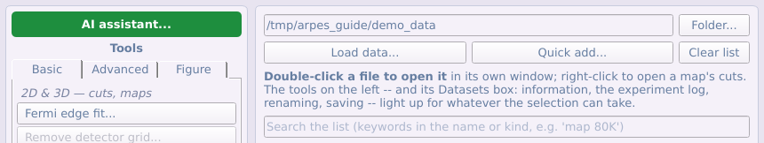

Cliquez sur **AI assistant...** en haut du panneau d'outils.

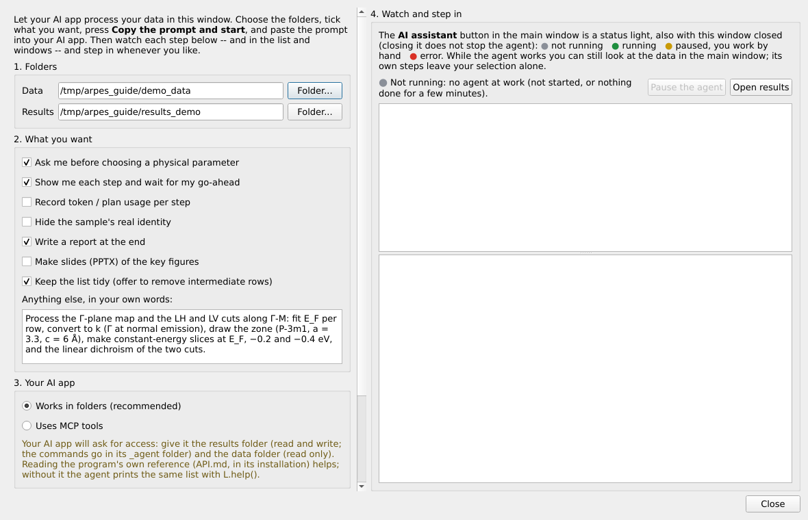

1. **Dossiers.** Le dossier des **données** (l'agent ne fait que le lire) et
   un dossier de **résultats** (tout ce que l'agent écrit y va ; ses commandes
   vont dans `<résultats>/_agent`).
2. **Ce que vous voulez.** Cochez ce qui convient :
   - *Ask me before choosing a physical parameter* : Γ, une fenêtre en
     énergie, le potentiel interne, un seuil ;
   - *Show me each step and wait for my go-ahead* ;
   - *Record token / plan usage per step* : un journal d'usage, une ligne par
     étape ;
   - *Hide the sample's real identity* dans tout ce qui est écrit ;
   - *Write a report*, *Make slides* ;
   - *Save every step as one Python script at the end* (coché par défaut) :
     l'agent écrit `agent_steps.py` dans le dossier des résultats ;
   - *Keep the list tidy* : proposer à la fin de retirer les lignes
     intermédiaires.

   Puis écrivez votre demande avec vos mots : quelles données, quelles étapes,
   quelles figures.
3. **Votre application IA.** *Works in folders* (recommandé ; rien à
   configurer) ou *Uses MCP tools* (le prompt explique comment connecter
   l'application une fois).
4. Cliquez sur **Copy the prompt and start**. Le programme se met à l'écoute
   et le prompt est dans le presse-papiers. **Show the prompt** l'affiche : les
   dossiers, l'emplacement d'`API.md`, la façon d'envoyer les étapes et les
   règles de travail ([§7.6](#76-les-règles-de-travail-de-lagent)).
5. Collez le prompt dans votre application IA et envoyez-le. Quand elle le
   demande, autorisez-la à lire le dossier des données et à lire et écrire
   celui des résultats.

## 7.4 Suivre et intervenir

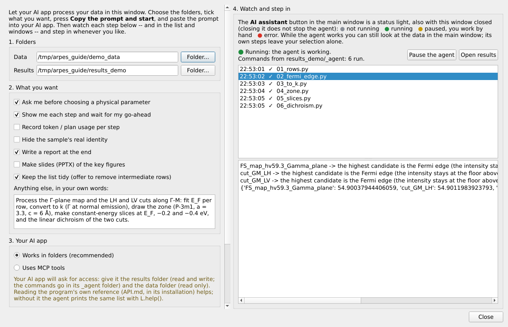

- **La liste des étapes** (à droite) : chaque étape exécutée par l'agent, avec
  son heure et ✓, ou ✗ en rouge en cas d'échec. Cliquez sur une étape pour voir
  ce qu'elle a affiché.
- **Le voyant d'état** sur le bouton **AI assistant**, même fenêtre fermée :
  gris à l'arrêt, vert en cours, jaune en pause, rouge une étape échouée ou des
  commandes qui ne sont plus exécutées. Fermer la fenêtre n'arrête pas l'agent.
- **Pause the agent** retient ses commandes suivantes (le voyant passe au
  jaune) pour que vous travailliez à la main ; **Resume** les laisse passer.
  L'agent a pour consigne d'attendre et de vous demander quand ses commandes
  sont retenues.
- **Votre travail continue.** Les étapes de l'agent laissent votre sélection
  dans la liste telle quelle, vous pouvez donc regarder des données pendant
  qu'il travaille, et les fenêtres qu'il n'ouvre que pour les piloter
  n'apparaissent jamais sur vos écrans.
- **Save the steps as a script...** écrit tout ce que l'agent a exécuté,
  dans l'ordre, en un seul fichier Python : le code de chaque étape, son
  heure, si elle a échoué (celles-là sont gardées en commentaires) et ce
  qu'elle a affiché. C'est la trace de tout le traitement, et il se
  relance : copiez-le dans `<results>/_agent/viewer_cmd` d'un programme
  démarré sur ce dossier de résultats. Les étapes envoyées par MCP ne sont
  gardées qu'en mémoire : enregistrez-les avant de fermer le programme. Les
  étapes faites à la main n'y sont pas ; elles sont dans l'historique de
  chaque jeu de données (*Experiment info*).
- **Open results** ouvre le dossier des résultats : les fichiers de commandes
  et journaux de l'agent dans `_agent`, les images et figures qu'il a écrites.

## 7.5 Autres façons de démarrer

- **Claude Code ou une autre application MCP.** Dans l'AI assistant,
  choisissez *Uses MCP tools* : le programme active son pont agent et le prompt
  contient la commande pour ajouter le serveur, pour Claude Code
  `claude mcp add arpes-viewer -- python -m arpes_viewer.agent`. Si votre
  application charge les définitions d'outils à la demande, faites-lui charger
  tous les outils arpes-viewer en une fois.
- **À la main.** Lancez le programme avec le pont activé
  (`arpes-viewer --agent-bridge`), ajoutez `arpes-viewer-mcp` aux serveurs MCP
  de l'application et indiquez `API.md` à l'agent.
- **Le dossier de commandes sans le panneau.** `agentic/launch_viewer.py`
  lance le programme à l'écoute d'un dossier de votre choix ;
  `agentic/README.md` est le guide pas à pas, avec des demandes à copier dans
  `agentic/PROMPTS.md` et des exemples exécutables dans `agentic/examples/`.
- **Un script à conserver.** Les calculs de `arpes_viewer/tools/` n'ont besoin
  d'aucune fenêtre ; `devtools/figure_tests.py` construit ainsi deux figures
  complètes à partir des données de démonstration.

Le détail du serveur MCP, pour référence :

ARPES viewer est aussi un **serveur MCP** (Model Context Protocol) : un
agent IA de n'importe quel modèle — Claude, GPT, Gemini, ou un modèle local
dans un client compatible MCP (Claude Desktop / Claude Code, Cursor,
VS Code, Cline, LM Studio…) — peut l'appeler comme un ensemble d'outils.
Tout reste sur votre machine : les fichiers sont lus et écrits localement ;
seul ce qu'un outil renvoie (nombres, texte, images) va au client.

**Mise en place.** L'installation du programme installe la commande
`arpes-viewer-mcp` (depuis une copie du dépôt : `python -m
arpes_viewer.agent`). Ajoutez-la aux serveurs MCP du client, p. ex. dans
`claude_desktop_config.json`, `.mcp.json` ou les réglages du client :

```json
{
  "mcpServers": {
    "arpes-viewer": {"command": "arpes-viewer-mcp"}
  }
}
```

(Avec une copie du dépôt plutôt que `pip install` : `"command": "python",
"args": ["-m", "arpes_viewer.agent"], "cwd": "<le dossier ARPES-viewer>"`.)
Le serveur parle MCP sur stdin/stdout et ne demande rien de plus que les
dépendances du programme.

**Outils sans fenêtre** — ils utilisent les lecteurs et les algorithmes du
programme :

| Outil | Ce qu'il fait |
|---|---|
| `find_files`, `list_loaders` | les fichiers d'un dossier qu'un lecteur reconnaît, et les lecteurs |
| `open_dataset`, `list_datasets`, `describe`, `metadata`, `close_dataset` | ouvrir un jeu de données (un identifiant, p. ex. `d1`), ses axes et ses métadonnées |
| `get_profile` | une EDC ou une MDC : les valeurs le long d'un axe, moyennées sur des plages des autres (option : CSV) |
| `get_image` | une image (PNG) d'une coupe, d'une carte à énergie constante ou d'une dispersion, avec palette et niveaux (option : PNG / CSV) |
| `fit_fermi_edge` | E_F et la résolution, avec leurs erreurs |
| `shift_energy`, `crop` | une copie en E − E_F, une copie rognée |
| `convert_cut_to_k`, `convert_map_to_k` | les conversions en k, avec les mêmes choix que leurs fenêtres (Γ, rotation ; *energy offset* seulement pour un axe non cinétique ; *output_fermi_level_eV* pour un résultat en E − E_F) |
| `save_datasets` | `.nxs` (s'ouvre dans le programme), `.itx` / `.ibw` (Igor Pro) |
| `brillouin_zone`, `read_cif` | les points de haute symétrie pour un groupe d'espace et une maille ; la maille et les sites d'un CIF |

Les axes se désignent par numéro, par nom (`x`, `y`, `k`, `z`) ou par un mot
de leur étiquette (`energy`, `slit`, `deflector`, `kx`) ; une plage s'écrit
`[lo, hi]` dans les unités de l'axe, ou un nombre pour le plan le plus
proche.

**Le programme à l'écran** — lancez-le avec le pont :

```bash
arpes-viewer --agent-bridge
```

(ou `python -m arpes_viewer --agent-bridge`, ou la variable
`ARPES_VIEWER_AGENT_BRIDGE=1`). La barre d'état indique *Agent bridge on
127.0.0.1:…*. Les outils `viewer_*` pilotent alors cette fenêtre :
`viewer_status`, `viewer_rows`, `viewer_add_files`, `viewer_select`,
`viewer_run_tool` (n'importe quel bouton du panneau d'outils pour la
sélection — `fermi`, `kcut`, `kmap`, `bz3d`, `figure`, `notch3d`,
`combine`…), `viewer_windows`, `viewer_screenshot` (une image de n'importe
laquelle de ses fenêtres, pour que l'agent vérifie ce qu'il a fait),
`viewer_figure` et `viewer_render_figure` (une figure en chiffres — page,
cadres, titres, niveaux, tailles de texte — et écrite en PNG telle qu'elle
sera imprimée), `viewer_close_window` et `viewer_python` (du Python exécuté dans le
programme, avec `A` = son module principal — pour remplir les champs d'une
fenêtre et cliquer ses boutons). Un résultat sans fenêtre rejoint la liste
par `save_datasets` vers un `.nxs` puis `viewer_add_files`.

**Sécurité.** Le pont est éteint sauf demande ; il n'écoute que sur
127.0.0.1 (pas sur le réseau) et ne répond qu'aux requêtes portant le jeton
aléatoire qu'il écrit au démarrage dans `~/.arpes_viewer/agent_bridge.json`
(lisible par vous seul) ; le fichier est effacé à la fermeture.
`viewer_python` exécute du code dans le programme — accordez-le à un agent
comme vous le laisseriez taper dans une console Python de votre ordinateur.

La voie du dossier de commandes est détaillée dans
[docs/AGENTIC_WORKFLOW_en.md](AGENTIC_WORKFLOW_en.md) ; le serveur MCP est
la même idée sans le dossier.

## 7.6 Les règles de travail de l'agent

Le prompt donne à l'agent des règles tirées de sessions réelles ; `API.md` les
répète. Vous pouvez en ajouter, ou en remplacer une, dans votre demande.

| Règle | Pourquoi |
|---|---|
| Après l'ajout des données, comparer les lignes au dossier et signaler ce qui a été laissé de côté, non reconnu ou signalé | des spectres seuls dans le dossier d'une carte, ou des fichiers qu'aucun lecteur ne prend, ne doivent pas passer inaperçus |
| Dire quelle partie d'un nom de ligne vient du nom de fichier et laquelle des métadonnées enregistrées ; marquer ce qui est deviné | tout le monde lit ces noms ensuite |
| Nommer une ligne traitée d'après sa source, plus une étiquette entre crochets par étape, prise dans le tableau de `L.naming()` (`Map80eV [norm] [E-E_F] [k]`), aussi pour ses propres noms | la liste se trie par ce qui a été fait ([§1.5](#15-types-de-données)) |
| Chercher une opération (`L.help()`, `L.tools()`, `L.functions()`) avant tout calcul propre ; ne jamais modifier les tables internes du programme ; s'il manque une opération, dire laquelle et demander | des résultats reproductibles, avec leur historique |
| Niveau de Fermi : ajuster les données brutes, ligne par ligne, sur l'axe propre de la ligne (`L.fermi_edge_search`), dessiner chaque ajustement ; les lignes de même énergie de photon et de passage doivent concorder ; quand les données ne tranchent pas, demander une fois | la chute la plus raide n'est pas toujours le front ; une seule fenêtre ne convient pas à tous les axes |
| Enchaîner les étapes en un appel (`L.map_to_k(row, ef=…, normalise_axes=(1, 2))`) pour que seules les lignes finales soient listées ; ne retirer des lignes qu'avec votre accord | une liste qui reste lisible |
| Essayer les figures dans `check/`, publier une version par figure dans `figures/FigureN/`, mettre de côté les versions remplacées | un seul fichier final par figure |
| Les grandeurs signées (dichroïsme, différences) ont une palette divergente aux niveaux symétriques | le signe doit se lire |
| Sorties compactes : `L.rows(compact=True)`, `L.profile(..., summary=True)`, tableaux dans des fichiers | moins de jetons, moins d'envoi au fournisseur |
| Ne jamais supprimer ni écraser ; demander avant chaque paramètre physique (si coché) | vos données et vos décisions restent les vôtres |

## 7.7 Exemple : un agent, de la configuration à la figure

Cet exemple suit une vraie journée de traitement de données CASSIOPEE par un
agent (cartes de surface de Fermi et coupes en plusieurs polarisations,
jusqu'aux figures de dichroïsme), refaite ici sur les données de
démonstration pour que vous puissiez la reproduire. Les changements du
programme que cette session a demandés sont dans le
[CHANGELOG](../CHANGELOG.md) (1.3.2).

**1. Configuration.** AI assistant : données `demo_data`, résultats
`results_demo` ; *ask before a physical parameter*, *step by step*, *report*
et *tidy list* cochés ; la demande : *« Process the Γ-plane map and the LH and
LV cuts along Γ-M: fit E_F per row, convert to k (Γ at normal emission), draw
the zone (P-3m1, a = 3.3, c = 6 Å), make constant-energy slices at E_F, −0.2
and −0.4 eV, and the linear dichroism of the two cuts. »* → **Copy the prompt
and start**, coller dans l'application IA.

**2. D'abord regarder.** Le premier fichier de commandes de l'agent :

```python
print(L.add_files(DATA))           # added, left_out, unrecognised, warnings
print(L.rows(compact=True))        # une ligne par jeu de données
```

Il indique ce que contient le dossier et propose un plan ; avec *step by step*,
il attend votre feu vert.

**3. Le niveau de Fermi, ligne par ligne**, chacune sur son propre axe en
énergie :

```python
found = L.fermi_edge_search(row, temperature=20)   # les fronts candidats
fit = L.fermi_edge(row, found["candidates"][0]["window"], temperature=20,
                   picture=os.path.join(HERE, "ef_" + row + ".png"))
```

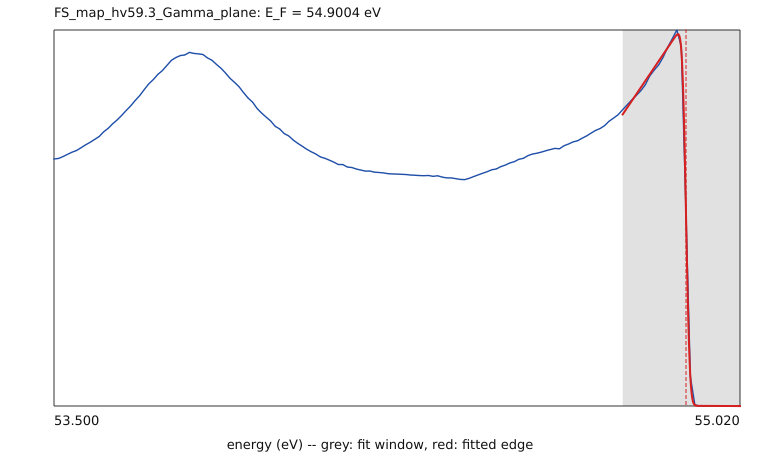

`fermi_edge_search` liste toutes les chutes de l'EDC qui dépassent le bruit,
de la plus haute énergie à la plus basse, ajuste chacune et dit laquelle est
le front de Fermi. Quand deux s'ajustent bien (une queue faible au-dessus
d'une forte chute, comme sur les vraies données à énergie de passage 20), il
le dit et l'agent vous demande une fois. Chaque ajustement est dessiné : en
gris la fenêtre, en rouge le front ajusté.

**4. En impulsion, une ligne chacune.**

```python
k = L.map_to_k(MAP, ef=EF[MAP], normalise_axes=(1, 2), new_name="map Gamma plane k")
L.cut_to_k("cut_GM_LH", ef=EF["cut_GM_LH"], new_name="cut GM LH k")
```

Le passage à E − E_F, la normalisation de chaque coupe de la carte et la
conversion se font en un appel : seule la ligne finale est listée, et son
historique enregistre les trois étapes.

**5. La zone et la figure.**

```python
L.bz_overlay("map Gamma plane k", space_group=164, a=3.3, c=6.0, hkl=(0, 0, 1), offset=0.0)
L.slice_series("map Gamma plane k", values=[0, -0.2, -0.4], half_width=0.02, cols=3,
               colormap="blue", flip=True, shared=False, percentiles=(3, 99.7),
               high_factor=1.4, zone_style="dashed", zone_color="#B8D62020",
               title="Figure 1")
L.figure_render("Figure 1", os.path.join(HERE, "..", "figures", "Figure1.png"), dpi=150)
```


**6. Dichroïsme.**

```python
L.cut_arithmetic("cut GM LH k", "cut GM LV k", operation="asymmetry", normalise="total")
```

L'arithmétique de coupes du programme, la même que la fenêtre Cut arithmetic
([§5.5](#55-arithmétique-de-coupes--dichroïsme-et-division-par-une-référence)) : LV mise à l'échelle du total de LH, (LH − LV)/(LH + LV), les
points de faible intensité masqués.

**7. Suivre.** Pendant ce temps, l'AI assistant liste chaque étape
([§7.4](#74-suivre-et-intervenir)) ; vous pouvez cliquer sur une étape pour lire sa sortie, mettre
en pause pour regarder vous-même une ligne, puis reprendre. À la fin, l'agent
écrit le rapport et, si vous êtes d'accord, retire les lignes intermédiaires ;
le dossier des résultats contient les figures, les images des ajustements et
chaque fichier de commandes, qui gardent ensemble la trace exacte de ce qui a
été fait.

## 7.8 Limites et bonnes pratiques

- **Vérifiez la physique.** Un agent peut choisir un front de Fermi, une
  position de Γ ou un potentiel interne plausibles mais faux. Cochez *Ask me
  before choosing a physical parameter* et regardez chaque image
  d'ajustement.
- **Gardez la trace.** Les fichiers de commandes de `<résultats>/_agent/` et
  l'historique des lignes montrent ce qui a été fait ; conservez-les avec les
  résultats.
- **Usage.** L'agent ne voit pas sa propre consommation de jetons ; si vous
  voulez des chiffres dans le journal d'usage, donnez-les-lui.
- **Confidentialité.** Seul ce que lit l'agent quitte votre ordinateur
  ([§7.1](#71-principe-et-ce-qui-quitte-votre-ordinateur)) ; gardez ce qui est privé hors des dossiers qu'il peut
  atteindre.
- **Encodage.** Les fichiers de commandes sont en UTF-8 ; le programme
  avertit quand le code d'une étape contient des caractères abîmés par un
  mauvais encodage (« − » pour « − »).

---

# Partie 8 — Entretien

Sauvegarde automatique et récupération, enregistrement du travail, journaux d'erreurs, versions, et que faire quand quelque chose ne va pas.

## 8.1 Sauvegarde automatique, mémoire et récupération

- **Sauvegarde automatique.** Chaque jeu de données calculé (une carte k, une
  coupe traitée, un résultat d'ajustement…) est écrit, sans compression, dans
  le dossier de la session sous `~/.arpes_viewer/sessions/` dès qu'il existe.
  Les balayages en espace réel ne le sont pas (ce sont les mesures
  elles-mêmes, et elles sont volumineuses).
- **Une fermeture normale supprime les copies automatiques.** Quand vous
  fermez la fenêtre principale et confirmez (tout ce que vous voulez garder
  est enregistré, ou *Close anyway*), les fenêtres ouvertes sont fermées et le
  dossier de la session est supprimé immédiatement. La copie d'un jeu de
  données disparaît aussi dès que vous l'enregistrez dans un fichier à vous.
- **Récupération après un plantage.** Ce n'est que si le programme ne s'est
  pas fermé normalement (plantage, arrêt forcé) que le dossier de la session
  est conservé : au démarrage suivant, ses jeux de données vous sont
  proposés, et il est supprimé au bout de trois jours.
- **Journal des opérations.** `~/.arpes_viewer/sessions/operations.log`, une
  ligne par écriture / enregistrement / suppression — pour retrouver ce qui
  était où.
- **Cadre Memory** (en bas du panneau d'outils). La mémoire du programme et celle du système, le nombre de
  fenêtres et de fichiers HDF5 ouverts, et la quantité de données calculées
  conservées. **Free RAM** abandonne les copies en cache des données
  calculées (elles sont relues depuis leur fichier de sauvegarde au besoin) ;
  **Close all** ferme toutes les fenêtres puis libère la mémoire.
- **Autosaves** (dans le cadre Memory) ouvre le dossier des
  sessions dans l'explorateur de fichiers, pour supprimer à la main les
  anciennes copies de travail. Le dossier de la session en cours (nommé dans
  la barre d'état) est utilisé : n'y touchez pas.
- **Les opérations longues** (lecture d'une grande carte, conversion,
  dégrillage, assemblage d'un dossier) tournent hors du fil de l'interface,
  avec une barre de progression et un bouton Cancel qui fonctionne.
- **La fermeture** avec des données calculées non enregistrées demande
  d'abord confirmation, en nommant les jeux de données : **Save to a
  file...**, **Close anyway** (les copies automatiques sont supprimées) ou
  **Cancel** (rien ne se passe).

## 8.2 Enregistrer et rouvrir son travail

- **Jeux de données.** Sélectionnez des lignes → boîte Datasets → **Save** :
  un fichier `.nxs` au format du programme (plusieurs jeux de données par
  fichier, avec leurs métadonnées et leur historique de traitement), que
  **Load data...** rouvre ; ou du texte Igor Pro (`.itx`). Un panneau de
  visualisation exporte ce qu'il montre ([§3.8](#38-exporter-un-panneau-et-enregistrer-des-données)).
- **Figures.** Dans le composeur, **Save** écrit un fichier `.afig` qui se
  rouvre pour être modifié, avec les données de chaque panneau à côté
  (« data for <nom> »), de sorte qu'il s'ouvre même là où les fichiers
  d'origine ne sont pas. Ne joignez pas ce dossier à ce que vous partagez.
  **Export** écrit du PNG, PDF, SVG ou TIFF.
- **Le journal d'expérience** et le **journal de session** gardent la trace de
  ce qui a été mesuré et fait ([§2.3](#23-le-journal-dexpérience)).
- Rien n'est écrasé sans demander : enregistrer sur un fichier existant pose
  d'abord la question.

## 8.3 Journaux d'erreurs et rapports de bogue

Quand quelque chose se passe mal, le programme **continue de tourner** et
enregistre l'erreur et sa trace dans
**`error_logs/errors_<date>_<heure>.txt` dans le dossier du programme** (dans
`~/.arpes_viewer/error_logs/` si ce dossier n'est pas accessible en
écriture), un fichier par session où une erreur s'est produite. Un message
l'indique.

Pour signaler un bogue, ouvrez une issue sur
<https://github.com/DingPei1995/ARPES-viewer/issues> avec :

- le journal d'erreurs : **téléversez le fichier** (glissez-le dans la zone de
  texte) **ou collez son texte**. La dernière ligne du panneau principal a
  **Copy the newest error log** et **Open the error logs** ;
- la version, lue dans la barre de titre ;
- ce que vous faisiez juste avant et, si possible, le type de fichier (ligne,
  coupe ou carte).

Si le programme ne démarre pas du tout, le journal du lanceur
`~/.arpes_viewer/launcher.log` en donne la raison.

## 8.4 Versions et mises à jour

La barre de titre et la dernière ligne du panneau principal montrent la
version et sa date (`ARPES viewer v1.3.4 (updated 2026-11-13)`). Ce qui a
changé à chaque version, et pourquoi, est dans le
[CHANGELOG](../CHANGELOG.md).

Pour mettre à jour une installation pip :

```bash
pip install --upgrade arpes-viewer
```

Pour la dernière version non publiée, `pip install
git+https://github.com/DingPei1995/ARPES-viewer` ; une copie téléchargée se met
à jour en la téléchargeant de nouveau. Les données et figures enregistrées
par une version antérieure s'ouvrent dans les suivantes.

## 8.5 Conseils et dépannage

- **Un bouton d'outil grisé** — survolez-le : l'infobulle dit pourquoi (par
  ex. l'ajustement MDC exige une coupe déjà en Å⁻¹, l'arithmétique de coupes
  deux coupes). Sélectionnez les bonnes lignes dans la liste et il s'allume.
- **Un outil manque au menu Functions d'une fenêtre** — il est dans le
  panneau d'outils (voir *Où se trouvent les choses maintenant* au
  [§2.1](#21-la-fenêtre-principale-en-un-coup-dœil)) ; regardez les trois onglets (Basic,
  Advanced, Figure).
- **Une fenêtre est plus haute que l'écran** — elle s'ouvre au plus à la
  hauteur de l'écran et son contenu défile ; les boutons Apply / Close
  restent en bas. Toutes les fenêtres se redimensionnent.
- **Aucune conversion en k n'est proposée** — le premier axe de la carte
  n'est pas un angle (énergie de photon, température…). Vérifiez *First axis
  of a map is* dans la fenêtre de chargement.
- **Conversion en k d'une coupe en E − E_F** — le décalage en énergie est
  rempli pour vous à partir de l'ajustement de Fermi ; si vous avez décalé
  l'axe autrement, saisissez dans *Energy offset* l'énergie cinétique de E_F
  (énergie de photon − travail de sortie).
- **Un fichier est mal lu** — choisissez explicitement le lecteur dans la
  fenêtre de chargement, et voyez *Assumptions worth knowing about* dans la
  [référence technique de la lecture](../arpes_viewer/loader/README.md#assumptions-worth-knowing-about)
  (ordre des axes dans les fichiers SOLEIL).
- **Le curseur est lent sur une grande carte** — une carte lue à la demande
  dans son fichier se recoupe en environ 0,1 s par fenêtre, si bien que les
  autres fenêtres attendent que la souris s'arrête. Une fois la carte lue en
  mémoire, elle suit en direct.
- **Saisie des nombres** — toutes les cases numériques prennent un point
  décimal (`0.05`), quelle que soit la langue du système ; la virgule n'est
  pas acceptée.
- **La machine utilise la mémoire d'échange** — surveillez la barre Memory
  (ambre au-delà d'un tiers de la RAM, rouge au-delà de la moitié) ; utilisez
  **Free RAM** ou **Close all**.

<!-- Generated by devtools/build_guide.py from docs/guide/fr/: edit those files, not this one. -->
