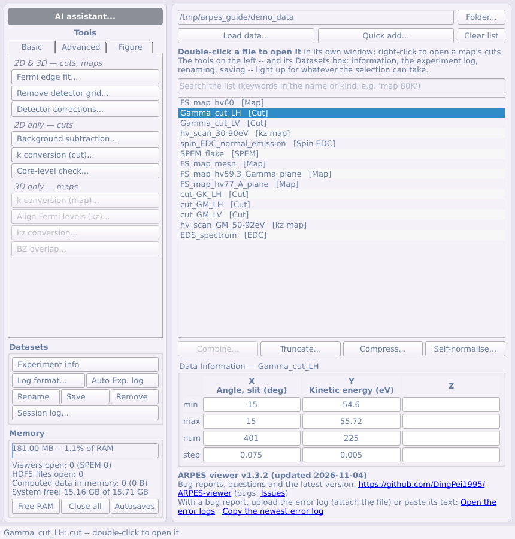
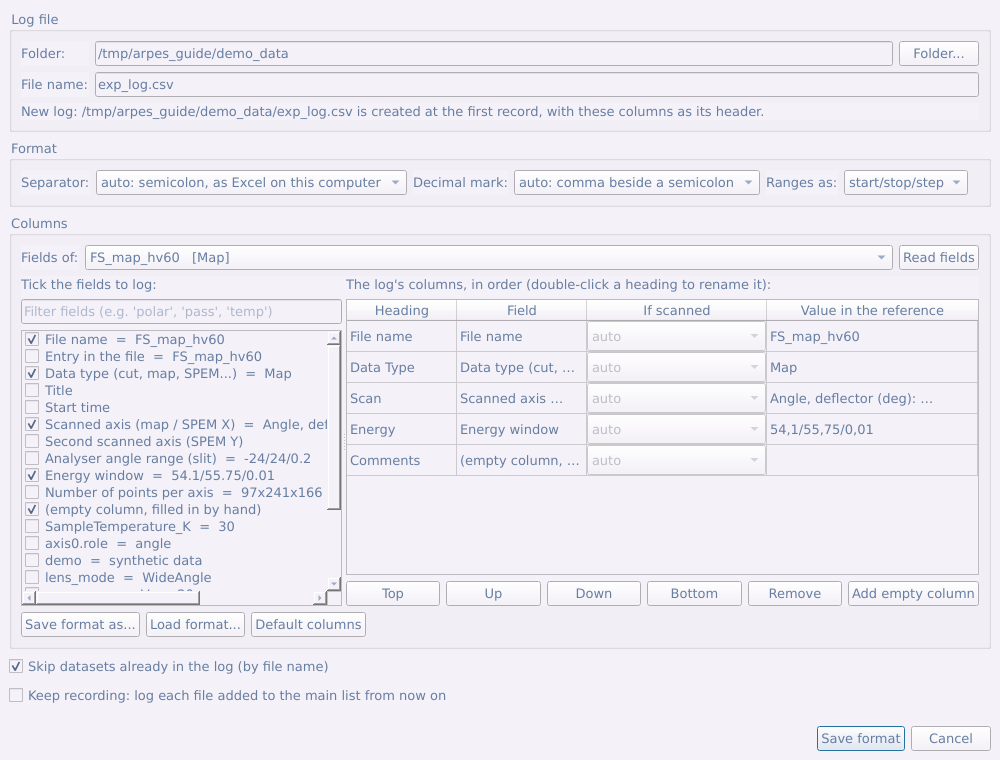

# Part 2 — The main panel

The main window is a browser of datasets. This part covers the list and everything around it except the tool panel (Parts 4–6) and the AI assistant (Part 7).

## 2.1 The main window at a glance

The main window is a **browser**: one row per *dataset*, not per file (one
`.nxs` file often holds several measurements, and each gets its own row). The
kind is written after the name: `[Cut]`, `[Map]`, `[kz map]`, `[k-map]`,
`[SPEM]`, `[EDC]`, `[Spin EDC]` …

It has three parts:

- **The tool panel** (left): the **AI assistant...** button at the top
  ([Part 7](#part-7--ai-agents)), then every analysis and processing tool as
  a button, in three tabs: **Basic**, **Advanced** and **Figure**
  ([Parts 4–6](#part-4--the-tool-panel-basic-tab)). Below the tabs, the
  **Datasets** box.
- **The list** (right), with its buttons.
- **The Memory box** (bottom left) and the version line (bottom right).

| Action | How |
|---|---|
| Open a dataset in its own window | **double-click** the row (or right-click → **Open**) |
| Run a tool on the selected rows | its button in the **tool panel** |
| Stack several cuts into one map, or join a map / kz map measured in segments | **Combine...** under the list |
| Crop to a range, bin points, normalise each spectrum to itself | **Truncate...**, **Compress...**, **Self-normalise...** under the list |
| Open a map's slit or scan-axis cut | **right-click** the row (or a selection of rows) |
| Read the metadata, write the experiment log, rename, save, remove | the **Datasets** box of the tool panel, above Memory |
| See and free memory, close every viewer, open the autosave folder | the **Memory** box, bottom left |
| See which version you are running, report a bug, get the latest version | the title bar and the last line of the window (link to GitHub) |

The four buttons under the list act on the rows selected above them, and each
makes new rows — the originals are never changed.

**The right-click menu** holds only the ways of opening the rows: **Open**,
**Open slit cut** and **Open scan-axis cut** (for a map). An entry that does
not fit the selection is greyed, with the reason in its tooltip.

**The Datasets box** (tool panel, between the tools and Memory) holds the
rest of what is done to the rows: **Experiment info**, **Log format...** and
**Auto Exp. log** side by side (see [the experiment log](#23-the-experiment-log)),
**Rename**, **Save** and **Remove** on one row, and **Session log...**. Its
buttons grey out when they do not fit the selection.

**Finding and ordering rows.** The **search box** above the list shows only
the rows whose name or kind holds every word typed (`map 80K`); clear it to
see them all. Hidden rows are deselected, so nothing out of sight is acted
on. Right-click the list → **Sort by name** (`Cut_9` before `Cut_10`) or
**Sort by data type** (grouped by the last processing tag of the name --
`[norm]`, `[E-E_F]`, `[k]` ... -- in processing order, then by kind and
name; see [§1.5](#15-data-kinds)).

## 2.2 Loading data

**Load data...** opens the loader. **Quick add...** skips it and adds the
chosen files with everything detected automatically.

1. **Files** — pick one or many (*Select file(s)...*). The file filter is built
   from what the installed readers can open.
2. **Reader** — detected automatically, and the result is shown
   (*Detected: 3 × This program's own format*). Override it only if a file is
   being misread.
3. **Datasets found** — what is inside each file, read from its *structure*
   only. This is instant even for a multi-GB scan; nothing is read until you
   open a row.
4. **Axes** — *Axis order* reorders the array's dimensions once, at the door.
   *First axis of a map is* says what was scanned: a deflector angle (the
   default), a **photon energy**, a temperature, a gate voltage, a delay… This
   keeps the right unit everywhere afterwards, and stops a k conversion being
   offered for an axis that is not an angle.

**CASSIOPEE folders.** Select any file of a numbered series
(`name_1_ROI1_.txt`, `name_2_ROI1_.txt`, …) and the whole folder is listed
once, as one assembled cube. Whether it becomes an angle map or a kz map is
read from the `_i` parameter files next to the spectra. The row is named
with the photon energy and polarisation read from those files —
`FineMap 117eV LH`, or `KzScan 40-120eV LH` for a photon-energy scan — so
repeats of the same scan at another energy or polarisation can be told
apart.

**ANTARES photon-energy (PhD) files.** A PhD `.nxs` file (one `Phd_NNNN`
entry per photon energy) is listed as one `kz map`: the frames are sorted by
photon energy and each kinetic-energy axis is referred to E_F with its own
hν (work function 4.5 eV, which the k_z conversion then uses). Each frame
still opens on its own as a cut.

## 2.3 The experiment log

Two buttons side by side in the **Datasets** box write the beamtime's log --
a CSV file, one row per measurement -- from the files' own metadata:
**Log format...** (left) sets it up once, **Auto Exp. log** (right) adds the
selected datasets to it with one click.

**Log format...**

1. **Log file.** Choose the folder and type the file name. If a log of that
   name already exists, the window shows **that log's own format**, ready
   to adjust.
2. **Format.** *Separator* and *Decimal mark* are by default what Excel
   uses on this computer. Excel splits a CSV at the system's list
   separator -- a **semicolon** wherever the decimal mark is a comma (French,
   German, Italian... settings) -- so a comma-separated file opens there
   with everything in the first column. Leave them on *auto* unless the log
   is for a computer set up differently. *Ranges as:* writes a range
   `start/stop/step` or `start:step:stop`.
3. **Columns.** *Fields of:* picks a dataset of the main list -- choose one
   of the kind you log most -- and **Read fields** lists everything it has,
   with its value: the file name, data type, start time and scanned ranges
   worked out from the data, then every metadata field and motor. **Tick**
   a field to add it as a column. In the table on the right, double-click a
   heading to rename it (`hν/Δ`, `Polar/Δ`, `Epass`...), and use **Top /
   Up / Down / Bottom** to put the columns in any order. **Add empty
   column** gives one to fill in by hand (comments). **Save format as...** /
   **Load format...** keep one format per beamline.
4. **If scanned.** What a position or angle column says depends on the
   measurement:
   - a **cut**: the sample stood still -- the motor's value;
   - a **SPEM** scan: the scanned stage axis as `start/stop/step`
     (choose *SPEM: scanned X* / *Y* for the stage columns);
   - a **map** taken with the manipulator rather than the deflector: the
     angle as `start/stop/step` (*map: scanned angle*), and a sample
     position the beamline corrected along with the angle as
     `first..last`;
   - a **kz map**: the photon energy range (*kz map: photon energy*).

   *auto* (the default) recognises the scanned motor by name, and a
   position that moved by its values. Any other measurement gets the
   field's own value.
5. **Save format.** If the log already holds records and you changed its
   format, it is **rewritten under the new header**: each record moves with
   its columns (renamed or moved columns are followed), new columns are
   empty for the old records, and columns you took out are named first,
   since what they hold goes. The header stays the only first row.

*Skip datasets already in the log* leaves out files whose name is already in
the log's file-name column. **Keep recording** logs every file you add to the
list from then on, until the program is closed: during a beamtime, add each
file as it is measured and the log keeps itself.

**Auto Exp. log** adds the selected rows to the log, after its last record,
without opening anything; the status bar says how many were added. The very
first time, it opens *Log format...* first.

If the log is open in Excel, Windows will not let it be written: close it
there and click again.

## 2.4 Combining datasets: stacking, joining and summing

**Combine...** (under the list) does two different things, and asks which:

- **Stack** — *cuts only*. Each cut becomes one slice of a new map, along an
  axis you name: a temperature series, a gate-voltage series, one cut per
  photon energy. The result is looked at like any map — sliced at constant
  energy, or along the new axis.
- **Join** — *cuts, maps, kz maps or k-maps, all of one kind*. The pieces of
  one measurement that was taken in segments are put back end to end along
  one of their own axes: a map whose deflector range was scanned in two
  parts, a kz map whose photon-energy range was split over several runs, a
  cut whose energy window was taken in two halves.

**Stacking cuts**

1. Select the cuts in the list (Ctrl/Shift-click) and press
   **Combine...**. Stacking needs one axis the same point for point (same
   number of points, same values, same units). If the **other** axis
   differs — typically energy windows a little apart between the cuts —
   the cuts are still stacked: that axis is **truncated** to the range all
   of them cover and each cut resampled onto the first cut's points there
   (the dialog says so, with the range). If both axes differ, or the ranges
   do not overlap, *Stack* is greyed with the reason, and *Join* is offered
   instead.
2. It asks whether to combine them **in the list's order**. *Yes* keeps that
   order; *No* lets you choose it.
3. Choose **Stack**, then set the new axis: **New axis is** (temperature,
   gate voltage, photon energy, delay, position, other — this fills in
   *Name* and *Unit*, which you can change), **Start** and **Step**. Each
   cut is listed with the value it gets. If you chose to reorder, **drag**
   the rows (or use **Move up** / **Move down** / **Reverse**). Press
   **Combine**.

A photon-energy series of angle cuts becomes a `kz map`, so *Align Fermi
levels (kz map)* and *Convert to momentum (kz, k∥)* take it (see
[§4.10](#410-aligning-the-fermi-levels-of-a-kz-map)); any other axis gives a `map` whose first
axis is marked as not an angle, so no k conversion is offered for it.

**Joining pieces of a measurement**

1. Select the pieces (all maps, or all kz maps, or all cuts …) and press
   **Combine...**. Maps and kz maps go straight to *Join*.
2. **Join along**: the axis the measurement was split along. It starts on
   the axis whose range differs between the pieces — a map's deflector
   axis, a kz map's photon energy, or the energy of cuts taken in two
   energy windows — so it is usually right already.
3. **Where pieces overlap**: *Average them*, or keep the earlier / later
   piece in the order shown (drag the rows to change it).
4. The dialog lists each piece's range and shows the **Result** — the joined
   range and the number of points — with notes on anything it had to do.
   Press **Combine**.

How the axes are handled:

- Pieces on one common grid (same step, ranges that meet or overlap by whole
  points — the usual case) are **copied as measured**, nothing
  interpolated.
- A piece with a different step or a half-step offset is **interpolated**
  onto the common axis (the first piece's step), and the dialog says so.
- If the **other axes** differ — an energy window a few meV different
  between runs, a different number of slit channels — every piece is
  resampled onto the range they **all** cover, and the dialog says so.
- A stretch that no piece covers is a **gap**, left at zero and reported.
- A joined kz map is still a `kz map`: run *Align Fermi levels (kz map)*
  on the joined result rather than on the pieces (per-photon-energy fit
  results of the pieces are not carried over).

### Summing repeated scans

For a fine cut or map taken as many short scans so that an ageing sample can
be caught. Select the scans (two or more of one kind) → **Combine...** →
**Sum repeated scans** → **Combine**, which opens the repeated-scans window:

1. **Are these repeats?** Each scan's grid and recorded conditions (photon
   energy, polarisation, angles, position, temperature, pass energy, lens
   mode); orange marks a value that differs from the first scan.
2. **Has the sample changed?** Press **Compare the scans**. Each scan is
   compared with the sum of the others: *χ² / point* is about the same for
   scans that differ only by counting noise and grows when the spectrum
   changed; scans well above the rest are marked **changed**. The energy
   shift of each scan's EDC and its count rate are listed; click a row to
   see its EDC against the rest.
3. **Sum.** Tick the scans to keep (changed ones start unticked), choose
   whether to undo the energy shifts, **Sum** or **Mean**, and **Sum to
   list**.

## 2.5 Step-by-step windows

The tools that take several decisions open as **numbered steps** (sum
repeated scans, detector corrections, tight-binding fit, crystal structure,
calculated bands): the title says *Step 2 of 4: …*, a blue box says what
the step is for and what to do, **Next →** stays greyed (with the reason
beside it) until the step is done, and **← Back** or the list of steps on
the left goes back.
