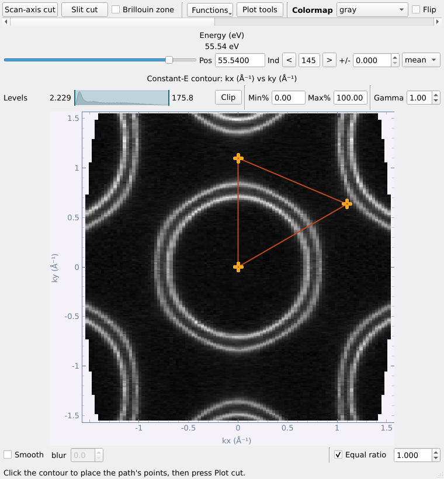
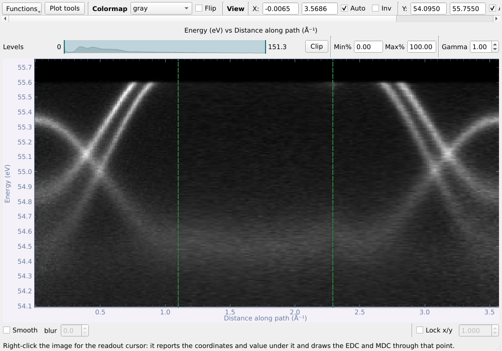
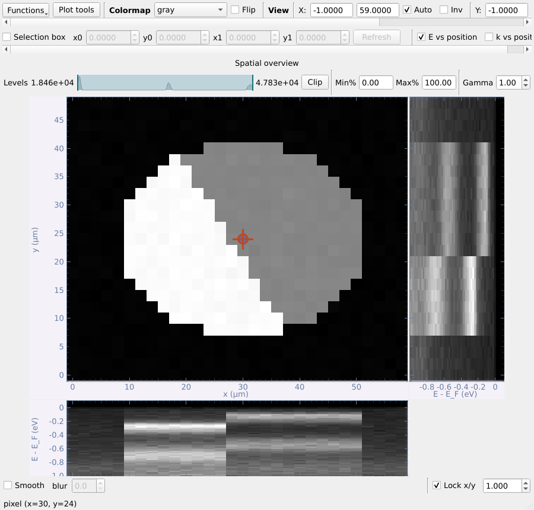
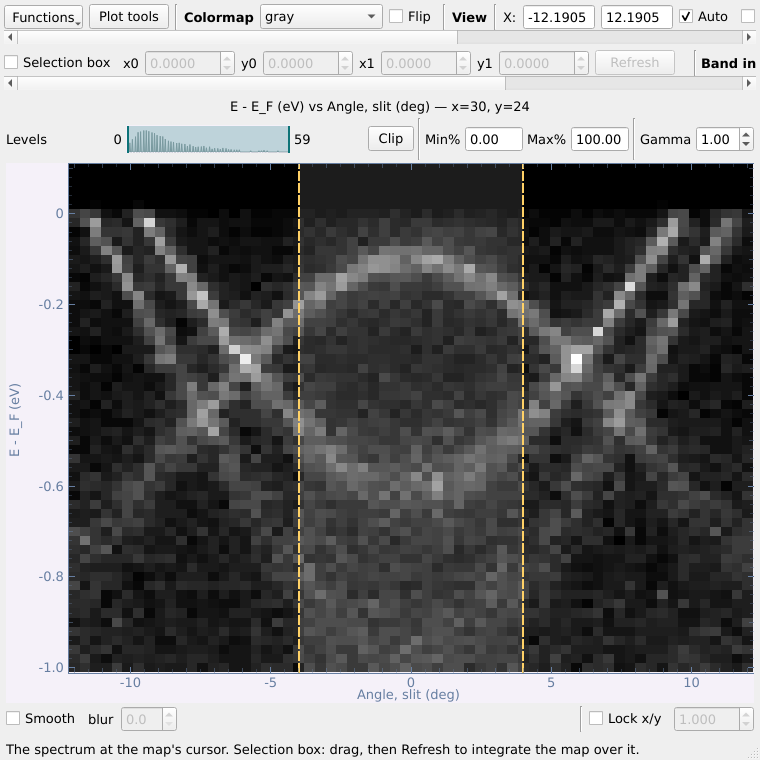
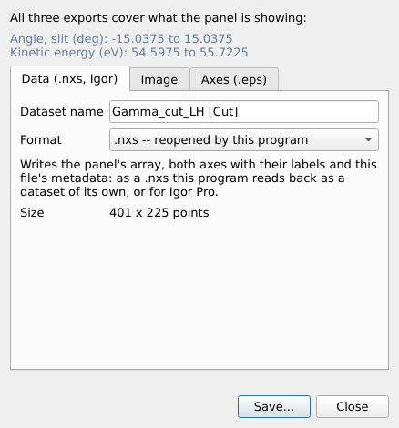

# Part 3 — The data viewers

Each dataset opens in a viewer window of its own. This part covers what all viewers share, then each kind of data in turn.

## 3.1 What the viewers have in common

Each dataset opens in its own window, so you can put a map, its cuts and
another file side by side.

- **The top row**: the **Functions** menu (everything the window can do),
  **Plot tools** (guide lines and labels on this plot — see below), the
  colormap (per window) with **Flip**, and the view controls — axis ranges,
  **Auto**, **Inv** (invert), **Reset**, **Grid**.
- **Above each image**: the **Levels** bar (drag the two handles, or type
  **Min%/Max%** percentiles; **Clip** applies them) and **Gamma**. A min/max
  you set is kept while you move the slice (the energy of a contour, the
  angle of a cut, the cursor of a spatial map), so every position is on the
  same colour scale; drag the handles back to both ends, or set 0%–100%, to
  follow each frame's own range again.
- **Under each image**: **Smooth** (display only, does not change the data)
  and **Lock x/y** (aspect ratio).
- **Readout cursor** — right-click the image → *Readout cursor*. It reports
  the value under it and, on a cut, draws the **EDC** (right) and **MDC**
  (below) through that point. **EDC ±** / **MDC ±** integrate over a window,
  shown as a shaded band on the image. Type a position into the **Cursor**
  row and press Enter to put it exactly there.
- **EDC → list** / **MDC → list** put the curve on screen in the main list as
  a dataset of its own (see [§3.5](#35-curves-edcs-mdcs-and-the-curve-fit)).
- **Right-click the image → Export** saves what the panel shows — data
  (`.nxs`), an image, or vector axes (`.eps`); see [§6.1](#61-the-figure-composer).
- **Functions → Slice → Save slice to the main list / Freeze slice in a new
  window** keeps a copy of the slice on screen. The frozen window (and *Open
  this position in a new window* on a spatial map) opens with the panel's
  min/max and gamma, so the two can be compared directly. It has its own
  **Plot tools**, and a **Figure composer...** button to make a figure of it
  ([§6.1](#61-the-figure-composer)).

The **Functions** menu now holds only what works on the window itself —
the tools that take a dataset are in the launcher's tool panel
([§2.1](#21-the-main-window-at-a-glance)):

| Viewer | Functions |
|---|---|
| map / kz map / k-map (contour) | Arbitrary cut; Slice: save / freeze the slice |
| cut | Straighten bands (FS correction); Slice: save / freeze |
| a map's slit cut | Straighten bands (FS correction) for the whole cube; Show the map |
| curve | Curve fit, Spin analysis; Crop, Bin, Normalise, Background, Shift axis, Add √N errors |

An entry that applies but cannot run yet is greyed, with the reason in its
tooltip.

**Brillouin zone tick box.** A k-map or converted kz map on which a zone has
been plotted ([§4.11](#411-brillouin-zone)) keeps it: its viewer has a
**Brillouin zone** tick box on the top row that shows or hides it.

### Plot tools: guide lines and labels on the plot

**Plot tools** on the top row of every viewer (cuts, maps, spatial scans,
curves, frozen slices) opens a small window that draws **on the plot in
front of you**:

|  | |
|---|---|

- **Type**: *Vertical line*, *Horizontal line*, *Line at an angle* (through a
  point; the angle is in the plot's own units, i.e. the slope is tan(angle)
  y-units per x-unit), or *Text label*.
- **Position** (x, y), **Angle**, an optional **Label** (shown on the line,
  e.g. `E_F`, `Γ`), a **Colour** (nine one-click colours, or **More...**),
  **Width**, **Style** (solid, dashed, dotted, dash-dot) and **Text size**.
- **Add** draws it at the position typed (**Centre of view** fills that in);
  **Place by clicking** draws one wherever you click on the plot.
- **Drag** a line on the plot to move it; the window follows. Select a guide
  in the list to **edit** it — every change shows at once — or **Remove** it;
  **New guide** stops editing; **Remove all** clears the plot.
- In a window with more than one panel, **Draw on** chooses which.
- Guides stay while the slice moves (an E_F line stays at E_F as you scroll
  through a map) and while the Plot tools window is closed. The panel's
  **Export → Image** draws them too (*Include the Plot tools guides*).

*Plot tools* are for looking at the data. To make a figure for a paper, use
the **figure composer** and its **Figure tools** ([§6.1](#61-the-figure-composer)).

## 3.2 Maps: the contour and its two cuts

A map opens on its **constant-energy contour**. The slider at the top picks
the energy (**Pos** in eV, or **Ind** as an index; **±** integrates over a
window, **mean** or **sum**). **Scan-axis cut** and **Slit cut** open the two
orthogonal cuts, each in its own window. (The scan axis is whatever was
scanned to make the map — usually the deflector angle, but a manipulator
rotation or, for a kz map, the photon energy — so the button is named for
that.)

| Slit cut (slit angle vs energy) | Scan-axis cut (deflector angle vs energy) |
|---|---|
|  |  |

**One cursor for all three windows.** Switching the readout cursor on in any
of them switches it on in the others, and moving it anywhere re-slices the
others through the new point. The axes keep one colour each everywhere:
**deflector red, slit green, energy blue**. A cursor line has the colour of
the axis it holds constant, and the EDC or MDC it feeds is drawn in the same
colour. Integration widths (the ± boxes) belong to each window and are never
shared.

From the list you can also open a map's cut straight away (right-click →
**Open slit cut** / **Open scan-axis cut**); the contour then stays hidden
until you ask for it (*Functions → Show the map*).

## 3.3 Arbitrary cuts and Fermi-surface correction

### Arbitrary cut

*Functions → Arbitrary cut...* on any contour: click up to six points (or type
them) and the cut runs through them in order — here Γ → M → K → Γ on the
k-map. **One dataset per segment** lists each leg separately.

| Path on the contour | Points |
|---|---|
|  |  |

The result is a cut against the distance along the path; the corners of the
path are marked with dashed green lines, so a kink there is not mistaken for
physics.

### Fermi-surface (FS) correction

*Functions → Straighten bands (FS correction)...* on a cut (or a map's slit cut) straightens a
feature that should be flat — usually the Fermi edge, which curves across the
analyser angle. Click along the feature; a polynomial (order 2 by default) is
fitted and every angle column is shifted in energy. **From a reference
(Au)...** takes the curve from a gold spectrum in the list instead. On a
map's slit cut the same shift is applied to the whole cube.

## 3.4 kz maps and k-maps

A **kz map** (photon-energy scan) opens like an angle map: its contour shows
photon energy against the analyser angle at the energy chosen by the slider,
and its two cuts are the spectrum at one photon energy and the
photon-energy dispersion at one angle. Align its Fermi levels and convert it
to (k_z, k∥) from the Basic tab ([§4.9](#49-aligning-the-fermi-levels-of-a-kz-map),
[§4.10](#410-converting-a-kz-map-to-momentum)).

A **k-map** (a map converted to momentum, [§4.8](#48-converting-a-map-to-momentum))
and a **converted kz map** open in the same contour viewer, on momentum axes.
When a Brillouin zone has been drawn on them ([§4.11](#411-brillouin-zone)),
they keep it, and a **Brillouin zone** tick box on the top row shows or hides
it. Slice series ([§5.6](#56-slice-series-figure)) and exports draw it too.

## 3.5 Curves: EDCs, MDCs and the curve fit

**EDC → list** / **MDC → list** under any image, or a spin-resolved file,
give a curve dataset, which opens in the **curve viewer**:

Channels can be hidden, offset into a waterfall (**Offset**), shown with
**Error bars** (from a σ channel), and **Range** marks an x window used by
the operations. *Functions → Transform* gives **Crop**, **Bin**,
**Normalise**, **Subtract a background** (constant, linear, Shirley),
**Shift the axis** and **Add counting errors (√N)**; each makes a new dataset
and propagates σ correctly.

### Curve fit

*Functions → Curve fit...*: **Peaks on a background** (Lorentzian, Gaussian
or Voigt peaks placed by clicking or **Find peaks**; none / constant /
linear / Shirley background; instrumental resolution; optional **× Fermi
edge**), or the **Fermi edge** itself. Weighting is the channel's own σ,
√N, or uniform. Every parameter comes with its error; the residual is shown
in units of σ.

**Fit to list** keeps data, fit, residual and components; **Copy results**
copies a tab-separated table. A Fermi-edge fit can **List a copy with
E_F = 0**.

## 3.6 Spin-resolved data

A spin EDC opens with one curve per spin channel:

*Functions → Spin analysis...*:

- The table reads each channel's label (manipulator setting, target
  magnetisation, axis and sign counted as "up"); **Axis** and **Counts as**
  can be overridden.
- **Cross ratio** (default when the channels allow it) cancels both the
  transmission and the target reflectivity exactly; **one pair** is available
  but carries the instrumental asymmetry, which is measured and reported (ε).
- **S_eff** (Sherman function, default 0.2), **Bin**, optional **Zero
  reference** window.
- Plots: raw channels, P with its error bars, and I↑ / I↓ with errors.
- **P to list**, **I↑ / I↓ to list**, **As a figure** (opens the figure composer).

## 3.7 Spatially resolved scans (nano-ARPES)

A real-space scan opens in **two windows**: the **spatial map** (the total
intensity at each position) and, beside it, the **E vs k spectrum at the
cursor** in the cut viewer — with the cut viewer's own tools (Functions, the
readout cursor with EDC/MDC, Export). Drag the red target to read the
spectrum at another point. Closing either window closes both.

**Selection box** — in the row above each picture. Tick it, drag the box
(or type its corners **x0 y0 x1 y1**), then press **Refresh** (or Enter);
nothing is computed until then, so a large scan is read only when you ask:

- on the map, the spectrum window shows the spectra **summed over the box**.
  While the box is ticked the spectrum stays the box's sum; untick it to
  follow the cursor again;
- on the spectrum, the map shows the intensity of the chosen **(k, E)
  window** across the sample — how a domain or a flake edge is found.
  Untick it to get the full map back.

**E vs position / k vs position** — two tick boxes above the map (one at a
time). They draw, **beside and under the map**, the spectrum through the
cursor against each spatial axis: energy (or k) against position, sharing
the map's axes. Two **dashed lines** appear on the spectrum: the band of k
(for E vs position) or of energy (for k vs position) the picture is
integrated over. Drag them, or type **from / to** in the **Band** boxes
above the spectrum.

## 3.8 Exporting a panel and saving data

Right-click any image → **Export** → **Data (.nxs, Igor)...**, **Image...** or
**Axes only (.eps)...**. It always exports exactly what the panel shows
(range and all): the data as a dataset this program reads back, or for
Igor Pro (`.itx` text or `.ibw` binary wave, with the axes scaled, the units
set and the metadata in the wave note); an image
with the colormap applied (PNG, TIFF or JPEG, at a chosen size and dpi, with
or without the axes, with the Plot tools guides if there are any, and with
the Brillouin zone if the dataset has one); or the frame, ticks and labels as
vector PostScript to place the image in, in Illustrator (optionally with the
Brillouin zone drawn in the box — see [§4.11](#411-brillouin-zone)).

**Save** (tool panel, Datasets box) writes the selected datasets to a
`.nxs` file of your own -- several selected rows go into one file -- or, by
choosing the file type, for Igor Pro: one `.itx` holding them all, or one
`.ibw` per dataset. An Igor file is a copy; the rows stay as they were.
