# Part 4 — The tool panel: Basic tab

The **Basic** tab holds the steps nearly every dataset goes through: the Fermi level, the detector, the background, the conversions to momentum, the core levels and the Brillouin zone.

## 4.1 How the tool buttons work

Each tab groups its tools by the data they take: *2D & 3D — cuts, maps*,
*2D only — cuts*, *3D only — maps*. **A button lights up only when the rows
selected in the list are what it takes**: a k conversion (cut) needs one
angle cut, cut arithmetic exactly two cuts, a 3-D view a map. Hover over a
greyed button to see why it is greyed.

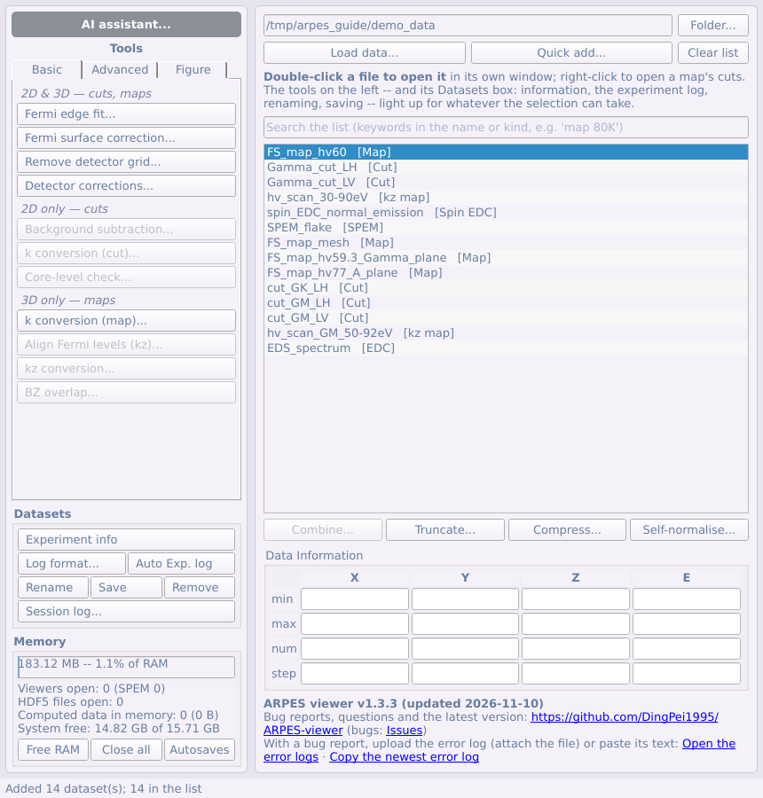

A tool never changes the rows it was given: its result is a new row in the
list, named after the original with what was done (`cut1 [k]`), and its
history records the step and its parameters (*Experiment info* shows it).
Tools that take several decisions open as numbered steps
([§2.5](#25-step-by-step-windows)).

## 4.2 Fermi edge fit

The usual order for a single cut is: **Fermi edge fit → offset the energy axis →
convert to momentum → MDC/EDC fit**. Each step is a button of the tool panel:
select the cut in the list and press it.

Tool panel → Basic → **Fermi edge fit...** fits a Fermi edge (Fermi–Dirac ×
linear DOS, convolved with a Gaussian resolution) to the EDC summed over a
box. It opens the cut's viewer together with the fit window; the two belong
together, and closing either closes the other. The window has two columns:
on the left everything that is set (the region, the parameters, the
buttons), on the right the fit — the EDC and the fitted curve, always shown
whole (the plot does not zoom or pan), and the summary under it.

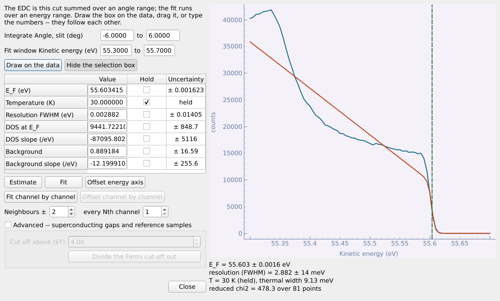

1. Set the region: press **Draw on the data** and drag a box on the cut —
   its width is the angle range summed, its height the energy window
   fitted — or **Show the selection box** and drag it, or type the ranges.
   The three follow each other.

   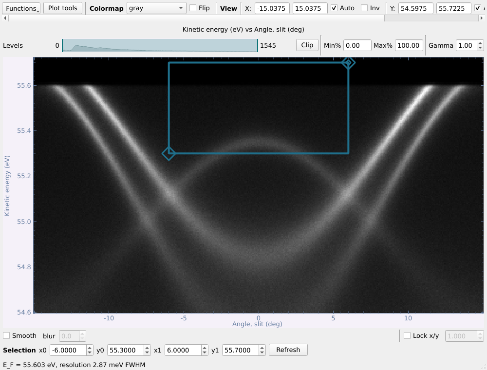

2. **Estimate**, then **Fit**. Tick **Hold** to keep a parameter fixed
   (the temperature is held at the recorded value by default). Every
   parameter is reported with its uncertainty.
3. **Offset energy axis** lists a copy of the cut on **E − E_F**.

**Channel by channel.** On the row under Fit, **Fit channel by channel**
fits the edge in every detector channel over the fit window
(**Neighbours ±** adds channels on each side first, **every Nth channel**
samples the detector) and draws E_F against angle on the cut — the
curvature of the Fermi edge, measured. Blank channels at the two ends of
the cut (no counts, or NaN, as some detectors leave) are cut off, not
fitted. **Offset channel by channel**, beside it, lists a copy with every
channel on its own **E − E_F** (on a map's slit cut: the whole map, along
the slit), the blank borders cut off.

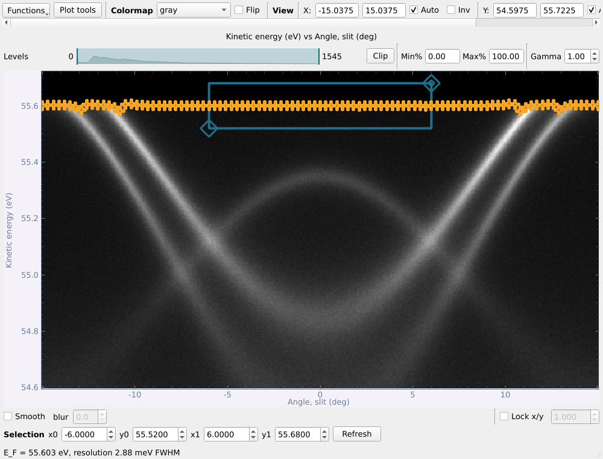

Both fits are kept with the dataset's row: that row is then a **reference**
for the Fermi surface correction ([§4.3](#43-fermi-surface-correction)).

The *Advanced* corner divides the Fermi cut-off out (for gaps and reference
samples).

**On a map.** Select a map (angle map or k-map) and press the same button:
the map's **slit cut** opens with the fit window, and the slit cut's slider
picks which cut is fitted. After a fit, **Offset energy axis** asks whether
to shift **the whole map by this cut's E_F** (*Yes*) or to fit **one E_F per
cut** (*No*). With one per cut, the **Fitted cuts** list on the right fills
as you go: move the slider, press **Fit**, repeat. A second fit at the same
place replaces the first, and every E_F in the list can be edited by hand.
Cuts between two fitted ones are shifted by a straight line between their
neighbours (beyond the first and the last, by the nearest fit), shown in the
plot under the list. **Offset energy axis by these fits** lists the
corrected map.

## 4.3 Fermi surface correction

The analyser bends the Fermi edge: at the ends of the slit it sits a few
tens of meV lower than in the middle, so a band that should be flat comes
out curved. Tool panel → Basic → **Fermi surface correction...** straightens
it: the curve of the Fermi edge is fitted with a polynomial, and every angle
column is shifted in energy so that it comes out flat. Correct it before a
k conversion.

Select a **cut**, or a **map** (or kz map) still in angle, and press the
button. A cut opens in its viewer; a map opens on its **slit cut**, and the
correction is applied to the whole cube. The viewer and the correction
window belong together: closing either closes the other. The window leads
through the steps (**Back** and **Next** move between them).

**Step 1 — how to find the Fermi edge.** Choose one:

- **By hand**: click the Fermi edge on the data viewer (three steps);
- **From a reference**: apply the Fermi edge fit of another cut or map of
  the main list (two steps). Only rows whose Fermi edge has been fitted
  with the Fermi edge fit ([§4.2](#42-fermi-edge-fit)) are offered; until
  there is one, this choice is greyed.

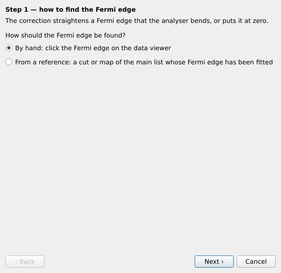

**Step 2, by hand — click the Fermi edge on the data viewer.** Click on the
picture in the data viewer where the Fermi edge is, at several angles
spread across the whole edge, ends included. Each click puts an orange
cross on the picture and a row in the table of points; the fitted curve is
drawn dashed as you go. A point placed badly can be retyped in the table,
or removed (**Remove selected**, **Clear**). Clicks count only while
picking by hand. **Back** to step 1 erases the points picked.

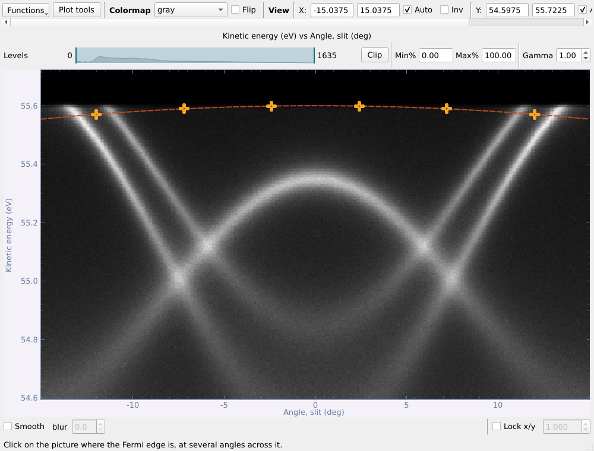

**Step 3, by hand — check the fit and correct.** The fitted curve is drawn
dashed over the data; check that it follows the Fermi edge and remove a
stray point if it does not. **Fit order** sets the polynomial (2, a
parabola, is what the analyser's curvature normally looks like; an order-n
fit needs n+1 points), **Name** the result's. **Correct** shifts every angle
column to flatten the curve and lists the result (`[FS corr]`); the energy
axis grows by the curve's span, and the bins no column reaches are left
empty.

**Step 2 of 2, from a reference — the reference, and how to apply it.**
**Reference** lists the other rows whose Fermi edge has been fitted (never
the data itself). Their fit parameters are read from them and shown —
nothing is fitted here. Then choose how the fit is applied, matching the
two ways of the Fermi edge fit:

- **One offset**: the whole data is shifted by the reference's E_F (its
  *Fit*, the whole edge). The result is on E − E_F, every channel alike.
- **Channel by channel**: every channel is shifted by the reference's E_F
  in that channel (its *Fit channel by channel*). Channels outside those
  the reference fitted — its blank borders included — are cut off, as are
  this data's own blank borders.

The reference's edge is drawn dashed on the data, to compare with the edge
seen there. **Correct** lists the result (`[E-E_F]`, or `[E-E_F ch]`
channel by channel).

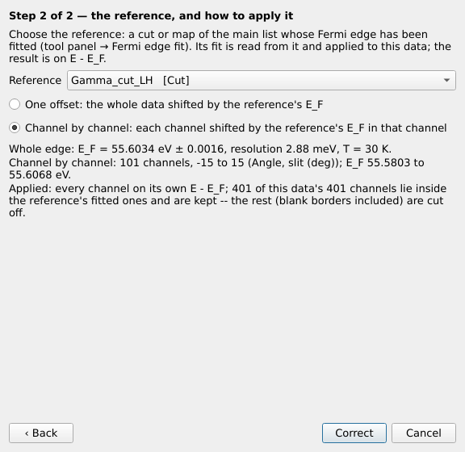

## 4.4 Removing the detector grid

MCP (hexagonal) and mesh (square) patterns print on every image. **Do it
first**: only data still on the detector's pixels can be de-gridded, so the
button refuses anything already converted, corrected or smoothed, and says
why.

Select a map (or kz map) or a cut and press tool panel → Basic → **Remove
detector grid...**. For a map, no reference is needed — the grid stays on the same pixels in
every slice while the photoemission moves. **Find and remove the grid**:

- **Before / After** a chosen slice on one colour scale (tick **Show
  −∂²I/∂E²** to make any grid obvious).
- **The grid found**, its **k-space regions** (in red), and the **contrast
  and shift** fitted for every slice.
- The power left in the grid regions (1 = no grid left).
- **Also list the grid pattern** keeps a `[grid]` dataset, which a cut taken
  later with the same lens mode and pass energy will find and use.

## 4.5 Detector corrections

On a cut, map or kz map as measured:

1. **Keystone** -- tick *Correct a trapezoidal image* and drag the four
   yellow corners onto the lit area; the right picture shows it made
   rectangular, each line's counts kept.
2. **Bad regions** -- **Add a region** and drag it over a dead or hot spot,
   or **Find bad pixels**; fill *smooth* (best for a spot) or *linear
   along* an axis (for a stripe).
3. **Apply** -- **Apply to list**. Do the grid removal, Fermi level and k
   conversion on the result.

## 4.6 Background subtraction

Tool panel → Basic → **Background subtraction...** (cuts) removes the
intensity that is not the bands: a **Shirley** or **Tougaard** inelastic
background, a floor common to every angle (a percentile of each energy
row), a smooth **polynomial** — or it divides out the **Fermi cut-off**
(Fermi–Dirac at the temperature and resolution the file records, starting
at the E_F it records or else at the steepest fall of the angle-integrated
EDC). The window is the same as the Advanced tab's processing windows —
source and result side by side, live preview, **Apply** lists the result —
described in [§5.1](#51-smoothing-derivatives-curvature-and-symmetrising).

## 4.7 Converting a cut to momentum

Tool panel → Basic → **k conversion (cut)...** converts the angle axis to k∥
(Å⁻¹). A **vertical line** is drawn on the cut: drag it to the slit angle of
Γ. The cut is then taken to run through Γ — not exact if it misses Γ, but
the only choice when only this cut was measured.

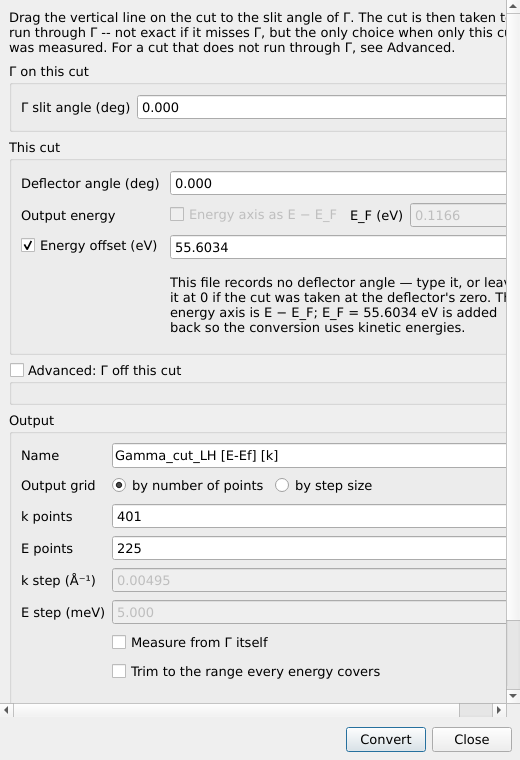

- **Advanced: Γ off this cut** is for a cut that does not run through Γ: type
  the deflector and slit angles of Γ, or **From a converted map...** to
  inherit them from a map of the same sample already converted.
- **Output energy — Energy axis as E − E_F** (off by default): tick it and
  type where E_F is on the cut's own energy axis; the result's energy axis
  is then E − E_F. The momenta do not change — the conversion still uses
  kinetic energies.
- **Energy offset** (a tick box, off by default) is *not* the Fermi level:
  ticked, its value is added to the energy axis before converting, for an
  axis that is not a true kinetic energy. If the cut is already on E − E_F,
  it is ticked and filled in with the E_F that was subtracted (the note
  under it says so): the conversion uses true kinetic energies, and the
  result stays on E − E_F.
- **Remembered settings.** The dialog starts from the last conversion of a
  cut of the same size (same number of points on each axis) — the usual case
  for a series of cuts of one sample. The map and kz conversions do the same.

## 4.8 Core-level check

A wide scan of the core levels is listed as a cut too. Select it and press
tool panel → Basic → **Core-level check...** to find out what its peaks are.

1. Type the sample's elements — `NbSCl` or `Nb, S, Cl` — and press **Next**.
   *Match within* (0.5 eV) is how close a peak must be to a tabulated level
   to count as the sample's.

   

2. Check the energy reference. E_F is fitted when the window holds the
   Fermi edge, otherwise put at hν − W. Change the photon energy, the work
   function or E_F if they are wrong (the green line can be dragged); a
   hν − E_F far from 4–5 eV means the photon energy is off. Press
   **Analyse**.

   

3. The results: the EDC on a binding-energy axis, each peak marked —
   green *sample* (orbital named), orange *uncertain* (a level of the
   sample within 2 eV: chemical shift or charging — your call), red *not
   the sample* (common elements that could explain it: contamination,
   higher-order light, Auger lines). Click a row for the full list of
   candidates. Type your own assignment in the *Assignment* column.

   

**Weak lines and peaks by hand.** Tick **Log counts** to see weak lines next
to a strong one; **Min height** (default 0.2 % of the strongest) sets how
small a found peak may be. To add a peak the search missed, press **Click to
add peak** and click the plot (a double-click always works), or type its
binding energy after *or at* and press **Add**: its position is refined by a
local fit, it is marked ◆, and it is named with every tabulated level within
±2 eV. **Remove selected** drops peaks; **Reset peaks** brings back the found
ones and forgets those added by hand. Assignments you typed survive a
**Re-analyse**.

**Peak table...** lists every tabulated level, filtered by element and
binding-energy range: look a peak up, show a level on the plot, or add it as
a peak with that level as its assignment. **Select range** shows a band you
drag over a region; **Zoom window...** opens it (or the current view) in a
window of its own with a cursor, a Gaussian fit at the cursor, and the
negative second derivative divided by the intensity — which shows a shoulder
or a weak line beside a strong one as clearly as the strong one.

If every peak is off by the same amount, the notes say so and **Apply
suggested shift** corrects it (a charged sample, or a wrong E_F). **Add EDC
to list** lists the EDC on the binding-energy scale; **Copy report** copies
the whole result as text. Measuring at a second photon energy settles what
stays doubtful: core levels stay put in binding energy, Auger lines and
higher-order light move.

## 4.9 Converting a map to momentum

Select an angle map and press tool panel → Basic → **k conversion (map)...**.
The map opens on a bare constant-energy contour — no cuts, no other
functions, just the picture — next to the conversion window; the two close
together. Drag the readout cursor to the point that should become
**k = (0, 0)** — the dialog follows it — then **Convert**. The result is a
new `k-map` row in the list.

| The contour for picking Γ | The conversion |
|---|---|
|  | 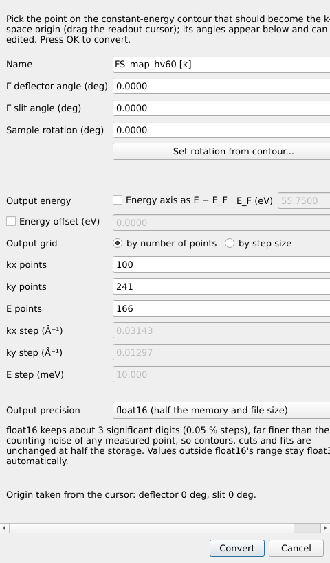 |

- **Γ deflector angle / Γ slit angle**: the angles of the point that becomes
  k = (0, 0), filled in from the cursor.
- **Sample rotation** turns the map about the surface normal; **Set rotation
  from contour...** reads it off a direction you click on the contour (two
  points along a mirror line, say).
- **Output grid**: number of points, or resolution (Å⁻¹, meV). The
  numbers of points start at the measured ones — as many kx points as
  deflector angles, ky points as slit angles, E points as energies.
- **Output energy — Energy axis as E − E_F** (off by default): tick it and
  type E_F as it is on the map's energy axis; the k-map then comes out on
  E − E_F. The momenta are the same either way.
- **Energy offset** (a tick box, off by default) is not the Fermi level:
  ticked, it is added to the energy axis before converting, for an axis
  that is not a true kinetic energy (ticked and filled in automatically for
  a map on E − E_F).
- The settings start from the last conversion of a map of the same size, so
  a second map of a series needs no retyping.

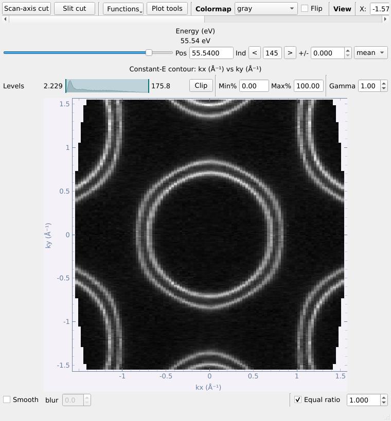

## 4.10 Aligning the Fermi levels of a kz map

A photon-energy scan is listed as a `kz map`; its contour is photon energy
against angle at one energy.

Nothing in the files says where each spectrum's Fermi level really is.
Tool panel → Basic → **Align Fermi levels (kz)...** measures it from the
spectra themselves; the kz map's slit cut opens with it, and the two close
together.

1. The slit cut opens with a box on it. Drag the box over a Fermi edge — the
   angle range sets the channels summed, the energy range the fit window.

   

2. **Fit and assemble**: the same box (by detector index) is used for every
   spectrum; each is shifted to put its own edge at zero; the cube is cropped
   to the range they all cover; and, by default, each spectrum is
   **normalised by its total intensity**, which divides out the photon flux.

E_F against photon energy is plotted. A smooth curve means the fits are
sound; points whose fit is not believed are marked and filled in from their
neighbours.

## 4.11 Converting a kz map to momentum

Tool panel → Basic → **kz conversion...** converts the scan to (k_z, k∥). It
starts from the last conversion of a scan of the same size.

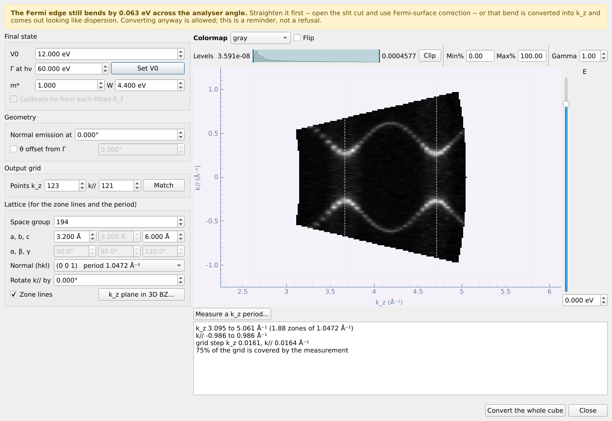

- **Inner potential V0** is the unknown: the preview reconverts one energy
  slice as you change it, in milliseconds. It may be negative (down to
  −30 eV; the report then says so). **Γ at hν → Set V0** gives the V0 that
  puts Γ at normal emission at the photon energy you name (the zone order
  nearest the present V0 is shown).
- **Manipulator theta** is off by default: a kz map is taken with the slit
  through Γ. Tick *Correct a manipulator theta offset from Γ* only to
  correct an offset, and type it **relative to normal emission** — the
  motor's absolute reading in the file is shown in the tooltip, not used.
- **Output grid**: by default k∥ gets one point per analyser angle channel
  and k_z the number that makes its step the same (*Match the measurement*
  sets it again); the steps are in the report.
- The energy of the preview is the **slider** beside it; above it are the
  data viewers' colour controls: colour map, *Flip*, and the level bar
  (levels, *Clip*, percentages, *Gamma*).
- **Calibrate hν from each fitted E_F** (optional, off by default): after the
  Fermi level has been fitted per photon energy (kz map → align E_F), uses
  hν − E_kin(E_F) measured at each photon energy instead of the single work
  function — for a monochromator whose hν is off. The default is the single
  work function, with E_F already flattened.
- With the **lattice** (space group, a, b, c), the **surface normal** and
  **Rotate k// by** (the slit direction as a turn about the normal from a*,
  or the first reciprocal axis not along the normal — any angle, since the
  slit need not run along a high-symmetry direction), the zone boundaries
  are drawn over the preview.
- **Measure a k_z period...**: click two points that are the same feature one
  zone apart; the matching reciprocal-lattice planes are listed.
- **Show the k_z plane in the 3D BZ...**: the BZ overlap tool's turnable
  cut-plane view, with the plane this map measures (surface normal and k∥
  direction, through Γ), the high-symmetry points it holds, and the measured
  k_z range in zone periods; it follows the settings as they change.
- The yellow banner warns when the Fermi edge still bends across the analyser
  angle — correct it first (Fermi surface correction, [§4.3](#43-fermi-surface-correction)).
  The bend is a parabola fitted through the edge of blocks of neighbouring
  channels, the weak channels at the slit ends left out, so one noisy
  channel or a band crossing E_F does not set it.
- **Convert the whole cube** lists a `kz map (k)`.

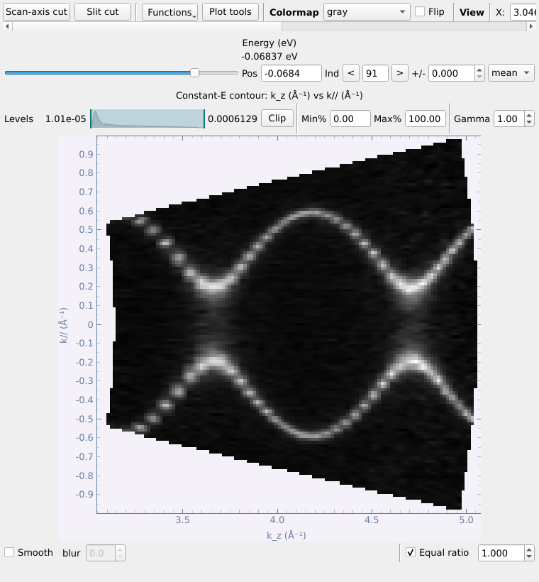

## 4.12 Brillouin zone

Select a k-map (or a converted kz map) and press tool panel → Basic →
**BZ overlap...**. Like the map conversion, it opens a contour of its
own with the zone window, and the two close together.

1. **Space group** first (1–230); the lattice parameters it fixes are greyed
   and follow the free ones. Or switch to **2D layer** for a surface lattice.
2. **Cut plane**: the surface normal (hkl) and an offset along it — the cut of
   the 3-D zone by that plane is drawn, for any surface, not only (001).
   **Through point** lists the offsets at which the plane passes through a
   high-symmetry point (Γ, Z, L, F ... for a rhombohedral crystal); choose
   one rather than working the number out. **Show cut plane in 3D...**
   previews it, with the named points marked and the ones in the plane
   ringed; **Label high-symmetry points** writes them on the contour, which
   is the quickest way to set the azimuth. The dialog opens on the last
   crystal you used, so a second map of the same sample needs no retyping.
3. **Conventional** or **Irreducible** zone; **Azimuth** (or **Pick
   direction from contour...**); **Repeat across the field of view**.
4. **Moiré** adds a second, twisted or mismatched layer and its moiré zone.
5. **Plot**.

The window is tall; it scrolls, and can be resized like every other window.

**The zone stays with the dataset.** Once plotted, it is a property of the
k-map: it is saved with it into a `.nxs` file, and its viewer shows it with
the **Brillouin zone** tick box on the top row. **Clear overlay** removes it.

Its exports can draw it too: **Export → Image...** has **Include the
Brillouin zone**, and **Axes only (.eps)...** has **Draw the Brillouin zone in
the box**, so the zone comes out as vector lines over the image in
Illustrator.

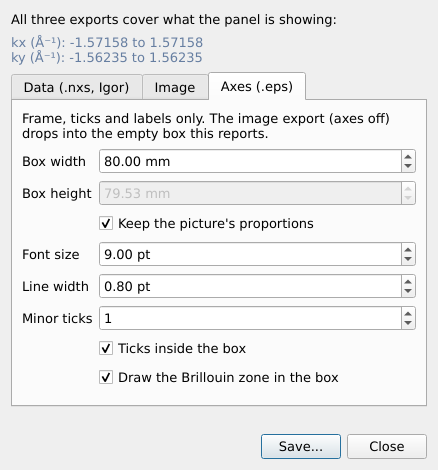
