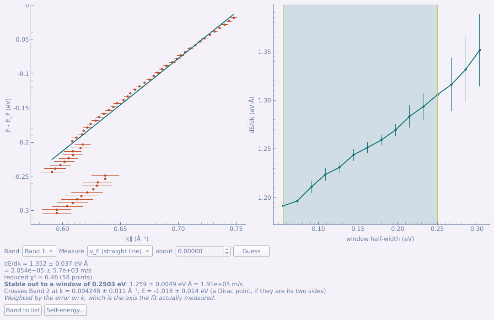
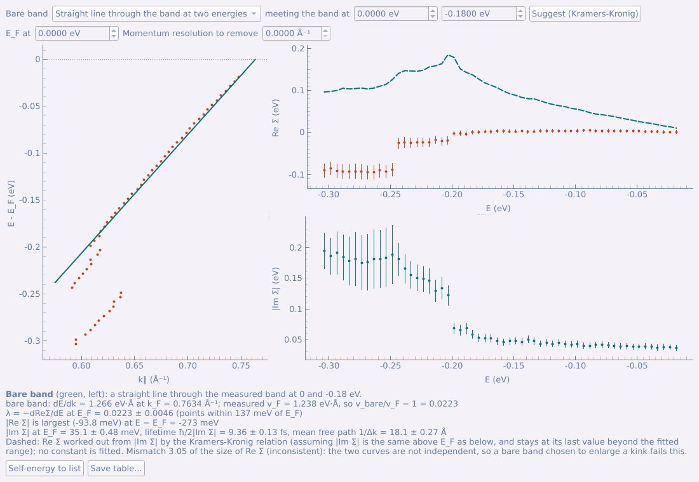
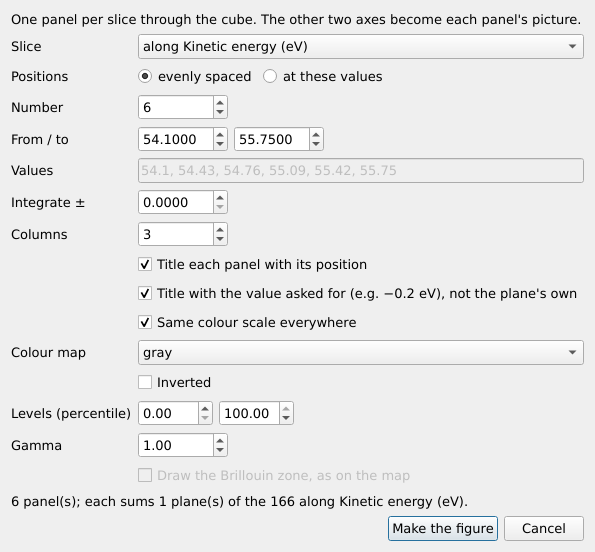
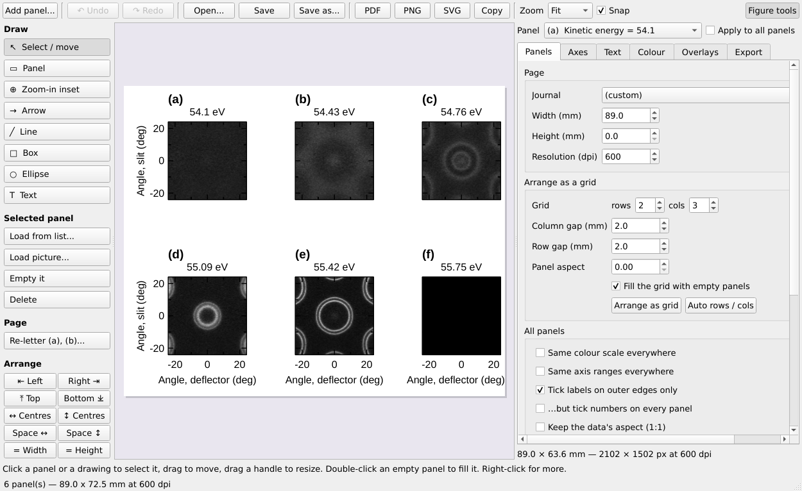
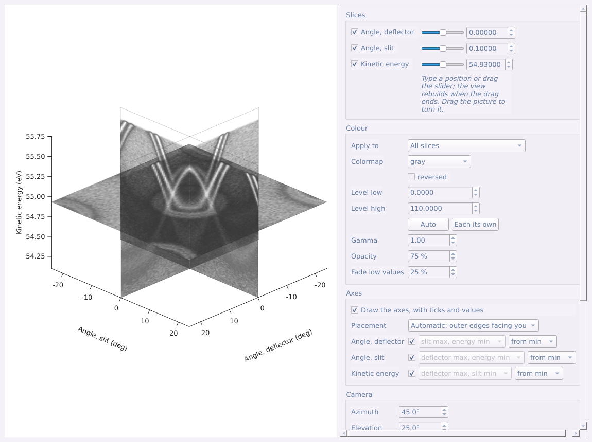
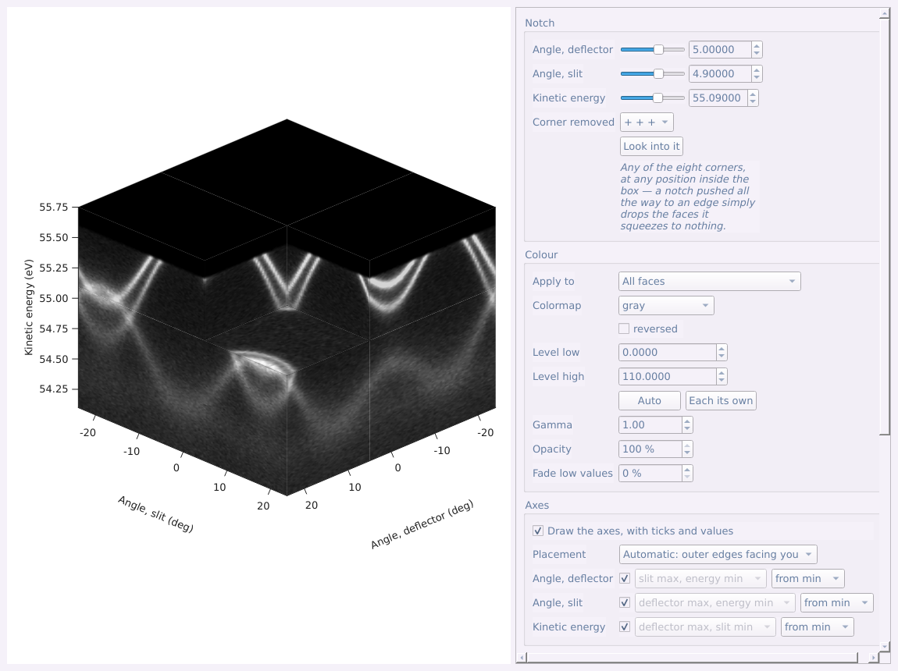
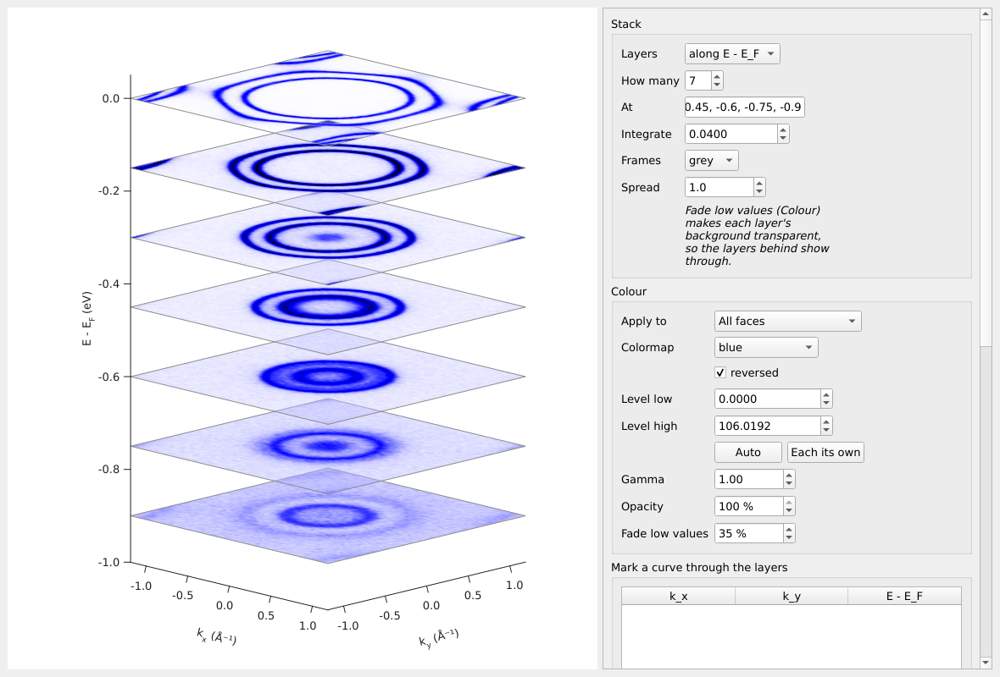
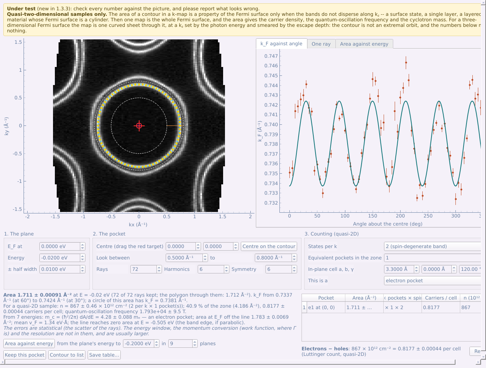

# Part 5 — The tool panel: Advanced tab

The **Advanced** tab holds the analysis that follows: band-sharpening filters and symmetrising, ridge detection, stack plots, MDC and EDC fits with the self-energy, cut arithmetic, the slice series figure, the 3-D views, and the Fermi-pocket analysis for quasi-two-dimensional samples (under test).

## 5.1 Smoothing, derivatives, curvature and symmetrising

Each filter has a window of its own, opened from the tool panel with one or
more cuts (or maps) selected:

| Tab | Button | What it does |
|---|---|---|
| Basic | **Background subtraction...** | removes the intensity that is not the bands: Shirley or Tougaard inelastic background, a floor common to every angle, a smooth polynomial — or divides out the Fermi cut-off |
| Advanced | **Smooth...** | Gaussian, Savitzky–Golay or moving average, with optional spike removal |
| Advanced | **Second derivative...** | −d²I/dE² or −d²I/dk² after a pre-smooth, to sharpen the bands |
| Advanced | **Curvature...** | 1-D or 2-D curvature (Zhang et al.), which follows the band better than a second derivative |
| Advanced | **Minimum gradient...** | I/\|∇I\|: bands as the valleys of the intensity's gradient — first derivatives only, so less noise; shoulders show |
| Advanced | **Symmetrise...** | mirror a cut about a line; for a map, mirror or rotate its constant-energy planes |

Every result is a new dataset carrying the steps that made it.

**Minimum gradient.** Along a band's crest the intensity is flat, so the
modulus of its gradient |∇I| is smallest there (He, Wang and Shen, Rev.
Sci. Instrum. 88, 073903 (2017)). The window shows that valley in one of
three ways: **I / |∇I|** (the one to use: an intensity that varies slowly
along the band cancels, and empty regions stay dark), **1 / |∇I|**, or
**|∇I|** itself (bands as dark lines; nothing is divided, so it is the
check on the other two). It needs first derivatives only, so it is less
noisy than a second derivative or the curvature; it favours neither axis,
so a band is followed through its turning point; and a shoulder shows.
**Floor** caps how bright a perfectly flat patch can get (lower it on
smoothed data for a sharper line). It marks *every* flat place — also the
floor between two bands — so read it beside the data, and take numbers
from a fit.

- **Source** and **Result** are shown side by side on the same scale, so you
  can see when a setting has eaten the band. They pan and zoom together.
- **Smooth first.** The second-derivative and curvature windows open with a
  tip: both amplify noise, so they usually work better on data smoothed
  first — run **Smooth...**, select its result in the list, and open the
  filter on that, or raise the pre-smooth widths in the window itself.
  A smoothed result carries the tag **‹smoothed›** in the list (and so does
  anything made from it); on such data the tip is replaced by a short
  "already smoothed" line and the pre-smooth widths start at 0.
- **Shape**: *Square pixels* (one data point is square — undistorted for an
  angle-vs-energy cut), *Equal axes* (one unit is the same length on both
  axes — right for angle-vs-angle or k-vs-k; chosen automatically when both
  axes have the same unit), or *Fill the box*.
- **Live preview** re-computes as you change a value; **Apply** lists the
  result.
- Starting values: **Symmetrise** mirrors about a vertical line through
  angle (or k) = 0, i.e. k → −k; the **Fermi cut-off** under *Background
  subtraction* starts at the E_F the file records, or else at the steepest
  fall of the angle-integrated EDC, with the file's temperature and
  resolution.

For a map the window works plane by plane, and asks **which planes** first —
constant-energy maps or dispersions — since the curvature of a contour and
the curvature of a cut are different quantities. **Preview at** picks the
plane shown; **Apply to the whole cube** runs it on every plane. The
operations and widths are named after the chosen plane's own axes
(*Second derivative along Kinetic energy*…), and the smoothing widths start
at 1/100 of each axis.

**Truncate...**, **Compress...** and **Self-normalise...** (under the list)
change the grid or the scale of one or several datasets at once — as long as
they have the same kind and the same number of points on every axis:
**Truncate** crops to a range, **Compress** bins points together,
**Self-normalise** divides each spectrum by its own total.

**Self-normalise** divides each piece of the data by its own total (or peak):

- **Normalise** picks the piece in ARPES terms, and starts on the usual
  one: *each EDC* for a cut, *each cut (slit × energy at one scan step)*
  for a map, k-map or kz map — this takes a flux or beam-current drift
  along the scan out. Other choices: each MDC, each EDC of a map, each
  constant-energy map, or *custom*.
- **Summed over** shows the axes this sums over; the ticks can be changed by
  hand, and the sentence under them says what the current ticks do ("Each
  plane over Angle, slit × Kinetic energy is divided by its own total — one
  factor for every Angle, deflector").
- **Sum only over** restricts the sum to a window on one of the summed axes
  — the energy by default — for example the energies of a core level.

## 5.2 Ridge detection

Tool panel → Advanced → **Ridge detection...** (cuts or maps) traces bands
as ridges of the intensity, each point to a fraction of a pixel, which is
sharper than a second derivative and draws no false double lines.

- **Smoothing** along each axis, in its own unit — about the band's width.
- **Threshold**: raise it until only the bands are left (yellow points on
  the source).
- **Result to list** — the ridge image (a map plane by plane, on the planes
  chosen); **Save ridge points...** — a CSV that the tight-binding fit
  ([§6.4](#64-tight-binding-fit)) reads.

## 5.3 Stack plots

**Stack plot (EDC / MDC)...** (tool panel → Advanced, with a cut selected): a
waterfall of EDCs or MDCs, with the number of curves, binning,
normalisation, offset, shear and colouring controls; **Send to figure
composer** makes it a figure panel.

## 5.4 MDC fit and EDC fit

Two tools of the tool panel's Advanced tab fit peaks line by line:

- **MDC fit (k-cut only)...** fits the momentum distribution curves and reads
  the band off the fitted centres: Fermi velocity, effective mass,
  self-energy. It only takes a cut whose axis is already in Å⁻¹ — a velocity
  in eV·deg would be meaningless — and its button is greyed otherwise.
- **EDC fit...** fits the energy distribution curves, on any cut, optionally
  with the Fermi cut-off in the model. v_F and m\* from the fitted band need a
  cut in momentum.

**Guided fit (step by step)**, at the top of the panel, walks through the
whole fit beside the controls, one step at a time, saying what each step is
for and outlining the part of the panel it uses: what an MDC (EDC) fit
does, the line shape, the range (*Start here* / *End here* at the blue
line), the bands, the seeds (the guide moves the line to five places in the
range — click the band's peak on the curve at each), one test line, the
series, and the result. *Next* waits until a step has what the fit needs.

The pictures and the controls share the window with a handle between them,
so the settings are always in sight; the mouse wheel over a picture scrolls
the window when it is too short for everything (Ctrl + wheel zooms the
picture).

By hand:

1. **Bands** tab: **Add band** for each branch; select a band, press **Place
   a seed** and click the peak on the curve (right). Four or five seeds down a
   band are enough; **Line at** moves the line being looked at.
2. **Try this line** shows the fit of the current line (dashed: the guess).
3. **Fit settings** tab: peak shape (Lorentzian, Gaussian, Voigt),
   background, step, then **Fit the series**. Fitted positions are drawn on
   the image, sized by amplitude.
4. **Dispersion...** fits the band: **v_F** (straight line), **m\*** (parabola)
   — and checks how far out the fit is stable. **Self-energy...** opens the
   window described below.

**Save table...** writes every fitted line; **Band to list** puts a band in
the main list.

**Where two straight branches cross.** In the **Dispersion...** window, with
*v_F* (a straight line) chosen, each other fitted band is fitted the same way
and the point where the two lines meet is given with its uncertainty
(propagated from both fits): the Dirac point of a cone fitted as its two
sides, or any crossing of two bands. A single fitted line whose error
collapsed (a peak fit that went to zero width) no longer takes the whole
weight of the dispersion fit: no point counts for more than ten typical
ones.

### Self-energy

**Self-energy...** (Dispersion window, MDC fits only) turns one fitted band
into **Re Σ** and **|Im Σ|** against energy: Re Σ is the distance of the
measured band from a *bare band*, and |Im Σ| half the fitted width times
the bare band's slope.

- **Bare band** — the one assumption everything rests on, so it is chosen
  here and written into the result: a **straight line through the band at
  two energies** (E_F and the deepest fitted energy to start with), a
  **straight line of a given velocity** through the measured k_F (from a
  calculation, say), or **the Dispersion window's fit**.
- **Suggest (Kramers-Kronig)** finds the bare velocity for which Re Σ and
  the Kramers-Kronig transform of |Im Σ| agree best. Both depend on that
  one number, so requiring them to be a pair fixes it without a
  calculation. Trust it only when the fitted range reaches well past the
  kink, to where |Im Σ| has levelled off.
- **E_F at** and **Momentum resolution to remove** (from the widths, in
  quadrature; leave 0 if the fit had the resolution in its line shape).
- **Dashed line**: Re Σ worked out from |Im Σ| by the Kramers-Kronig
  relation, taking |Im Σ| as the same above E_F as below and constant
  beyond the fitted range. No constant is fitted, so the comparison tests
  the bare band: one chosen to enlarge a kink fails it.
- **Under the plots**: the measured k_F and v_F, v_bare/v_F − 1, the
  coupling λ = −dRe Σ/dE at E_F, the energy where |Re Σ| is largest (the
  kink), |Im Σ| at E_F with the lifetime and the mean free path.
- **Self-energy to list** adds the curves to the main list; **Save
  table...** writes them as CSV with the bare band in the header.

## 5.5 Cut arithmetic: dichroism and reference division

Two cuts combined into a third: linear dichroism (LH − LV), circular
dichroism, dividing by a gold reference, or plain differences, ratios and
sums. Select two cuts in the list and press tool panel → Advanced → **Cut
arithmetic (two cuts)...** (the first selected is A; the window can swap
them). The button is greyed until exactly two cuts are selected.

- **The table at the top** compares what the two measurements recorded
  (polarisation, photon energy, angles, sample position, temperature, pass
  energy, lens mode). Rows in orange differ beyond a tolerance — a dichroism
  map between two spots on the sample is a map of *that* difference.
- **Purpose** presets: *Linear dichroism* (A − B, B scaled to the same total
  intensity), *Circular dichroism* ((A − B)/(A + B)), *Divide by a reference*,
  *Custom*. Warnings appear if the polarisations look swapped (**Swap A ↔ B**).
- **Scale B to A** by total intensity or by a region; **Hide where A+B below**
  blanks the background.
- A and B are drawn on one colour scale; the result on a red-white-blue scale
  symmetric about zero. With raw counts on both, the Poisson uncertainty is
  propagated and summarised under the plot.
- **Result to list**, **Uncertainty to list**, **All three as a figure**.

## 5.6 Slice series figure

Select a map → tool panel → Advanced → **Slice series figure...** lays out a
page of flat 2-D slices through the cube as one figure for a paper —
constant-energy contours at a series of energies, or cuts at a series of
angles or momenta — evenly spaced or at chosen values, with integration,
one shared colour scale, and labels on the outer edges only. (Not to be
confused with **3D slices**, which draws three planes in a 3-D view.)

- Panels are titled with the value asked for (−0.2 eV), not the recorded
  plane's own (−0.2022 eV); the plane used and the window are kept in each
  panel's information.
- The colour map, its inversion, the levels (as percentiles) and the gamma
  are set in the dialog, for every panel at once.
- **Draw the Brillouin zone, as on the map** puts the zone drawn with BZ
  overlap on every constant-energy panel, each edge once.
- From a script or an agent, `contour.slice_figure(values=[0, -0.1, -0.2],
  half_width=0.02)` (or `A.open_slice_series(values=...)` on the selected
  row) makes the figure without the dialog.

| Settings | Result |
|---|---|
|  |  |

## 5.7 The 3-D views

Four tools of the Advanced tab show a map in 3-D, each in a window of its
own — drag the picture to turn it:

- **3D slices...** — the three orthogonal planes through the cube, each
  placed where you choose (tick box, slider or typed position per axis).
- For a **k-map**, the 3-D views start at the first k_x and k_y planes that
  are filled with data: the converted cube is the box around a light cone
  that narrows away from E_F, and its outermost planes drew as blank faces.
  *Change sampling... → Whole range* shows everything again.
- **Notched cube...** — the cube with one corner cut away: a constant-energy
  map and two dispersions in one picture.
- **Volume projection...** — the whole volume projected along the view:
  maximum intensity, sum, alpha composite, or a shaded isosurface.
- **Stacked slices...** — parallel slices stacked in 3-D (below).

| 3D slices | Notched cube |
|---|---|
|  |  |

- **Sampling.** Every frame resamples the cube, so each window opens at
  *Balanced* sampling, which keeps up with the mouse. The current sampling is
  written under **Save the view...**; **Change sampling...** picks the region
  and *Fast*, *Balanced* or *Fine*, and redraws from the full cube.

  

- **Colour.** *Apply to* sets the colours of **all slices** at once or of
  one orientation (the energy plane in one colormap, the dispersions in
  another): colormap (and *reversed*), levels (**Auto**, or **Each its own**
  for one scale per slice), gamma, **Opacity** and **Fade low values**, which
  makes the weak intensity see-through so the planes behind show.
- **Axes.** **Draw the axes, with ticks and values**. *Placement* is
  automatic — on the outer edges facing you, following the view as it turns —
  or chosen: for each axis, the edge of the cube it runs along and whether it
  counts **from min** or **from max**.
- **Camera**: azimuth, elevation, depth aspect; **Look into it** faces a
  chosen plane. **Outline the faces** and an **Orientation tripod** are
  optional.
- **Save the view...** exports the picture through the same export window as
  any panel (PNG, TIFF, JPEG at a chosen size and dpi). **To figure
  composer...** adds the view as a panel of a figure.

### Stacked slices

**Stacked slices...** (tool panel → Advanced → 3D only) draws parallel
slices of the cube stacked in 3-D: constant-energy maps one above another
up the energy axis, or cuts one behind another along k_z (or the photon
energy) — the usual picture of how a band evolves.

- **Layers** — the axis they are stacked along; **How many** spreads them
  evenly, or type the positions in **At** (comma-separated, in the axis's
  units); **Integrate** averages each layer over that width.
- **Frames** — an outline round every layer (grey, black or none).
- **Spread** stretches the box along the stacking axis, so that layers seen
  from an oblique view stand apart instead of covering one another: for a
  few cuts stacked along k_z, *Spread* 3 with the azimuth at about 40° shows
  each cut almost whole.
- **Fade low values** (*Colour*) starts at 35 % here: each layer's background
  is transparent, so the layers behind show through.
- **Mark a curve through the layers** — points in the data's own units (one
  per layer, say the crossing of two bands), joined by a red, black, blue…
  curve drawn over the stack, with an optional label at the first point.
- The axes of all 3-D views now fit the picture *and* its labels to the
  window or figure panel (no fixed margin), thin their ticks to the room
  each axis has, and write sub- and superscripts in the axis titles
  (`E - E_F`, `k_x`).

## 5.8 Fermi pocket (quasi-2D, under test)

> **Under test** (new in 1.3.3): check every number against the picture,
> and please report what looks wrong.
>
> **Quasi-two-dimensional samples only.** The area of a contour in a k-map
> is a property of the Fermi surface only when the bands do not disperse
> along k_z — a surface state, a single layer, a layered material whose
> Fermi surface is a cylinder. Then one map is the whole Fermi surface. For
> a three-dimensional Fermi surface the map is one curved sheet through it,
> at a k_z set by the photon energy and smeared by the escape depth: the
> contour is not an extremal orbit, and the numbers below mean nothing. The
> program cannot tell the two cases apart.

Select a map converted to momentum (a k-map, on E − E_F) and press tool
panel → Advanced → **Fermi pocket (quasi-2D)...**.

1. **The plane.** The energy the contour is traced on (E_F to start with)
   and the half width it is averaged over.
2. **The pocket.** Drag the red target to a point inside the pocket (or
   type it), and set **Look between** so that the two dashed circles hold
   this pocket's band and no other. A ray goes out from the centre at each
   of **Rays** angles, and a peak fitted along it gives k_F there (yellow
   points; red crosses are rays dropped, and the **One ray** tab shows any
   ray with its fit). The contour (blue) is a Fourier series of the radius
   against the angle, up to **Harmonics**; **Symmetry** keeps only the
   harmonics an n-fold axis through the centre allows, which also bridges
   gaps in the data. **Centre on the contour** moves the centre to the
   contour's middle; the area does not depend on the centre.
3. **Counting.** *States per k* (2 for a spin-degenerate band, 1 when each
   spin has its own contour), the number of *equivalent pockets in the
   zone*, the *in-plane cell* a, b, γ (for carriers per cell), and whether
   this is an electron or a hole pocket.

What comes out, under the pictures:

- the **area** with its error, the range of k_F round the contour, and the
  number of rays kept;
- for a quasi-2D sample: the **carrier density** n = g N A/(2π)², the
  fraction of the Brillouin zone and the **carriers per cell** (what
  Luttinger's theorem counts), and the **quantum-oscillation frequency**
  F = (ħ/2πe) A;
- **Area against energy** traces the same pocket at a range of energies and
  fits a line: the **cyclotron mass** m_c = (ħ²/2π) dA/dE — positive for an
  electron pocket, which grows with energy, negative for a hole pocket —
  the area at E_F read off the line (free of the bias the Fermi cut-off
  gives a plane taken at E_F itself), the mean Fermi velocity, and the
  energy at which the line reaches zero area.

**Keep this pocket** adds it to a table that counts several pockets
together, electrons minus holes. **Contour to list** adds k_F against angle
(and the area against energy) to the main list as curves; **Save table...**
writes everything as CSV.

The errors given are statistical (the scatter of the rays). The energy
window, the momentum conversion (work function, where Γ is) and the
resolution are not in them, and are usually larger.
