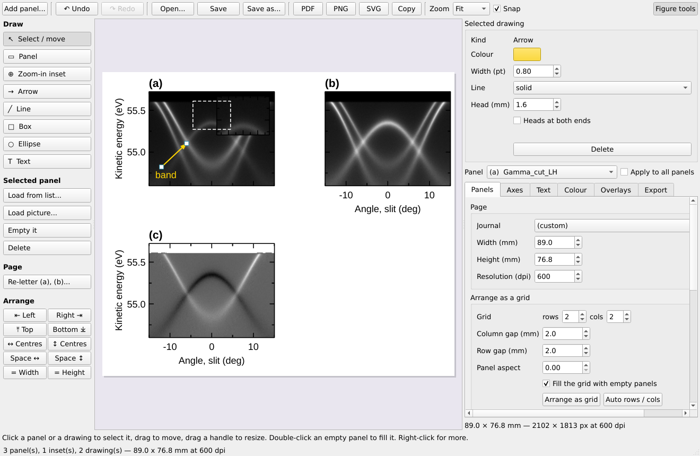
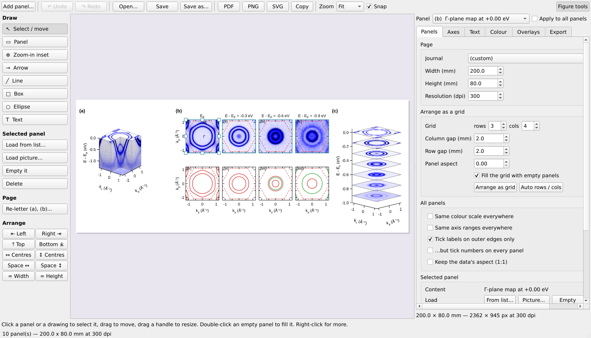
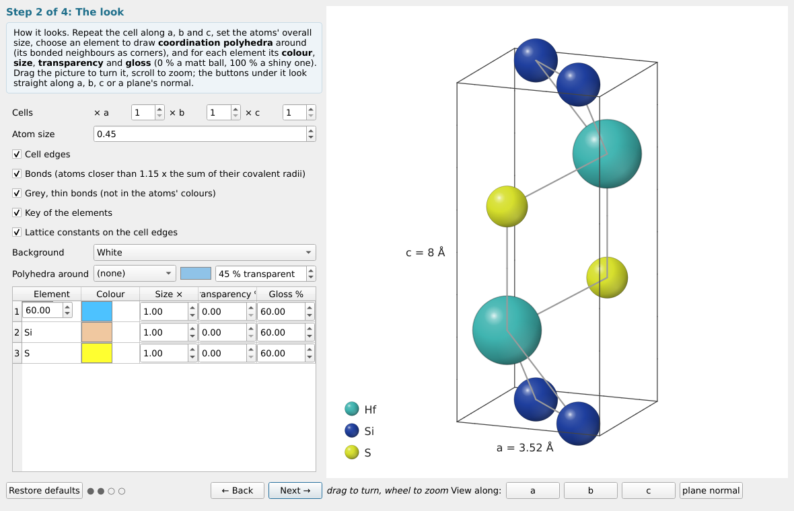
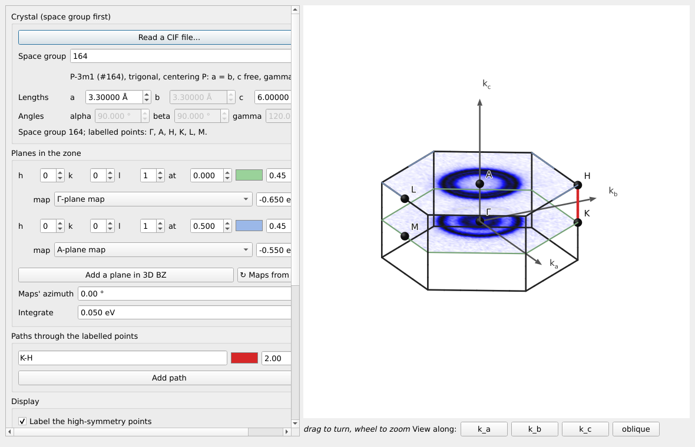
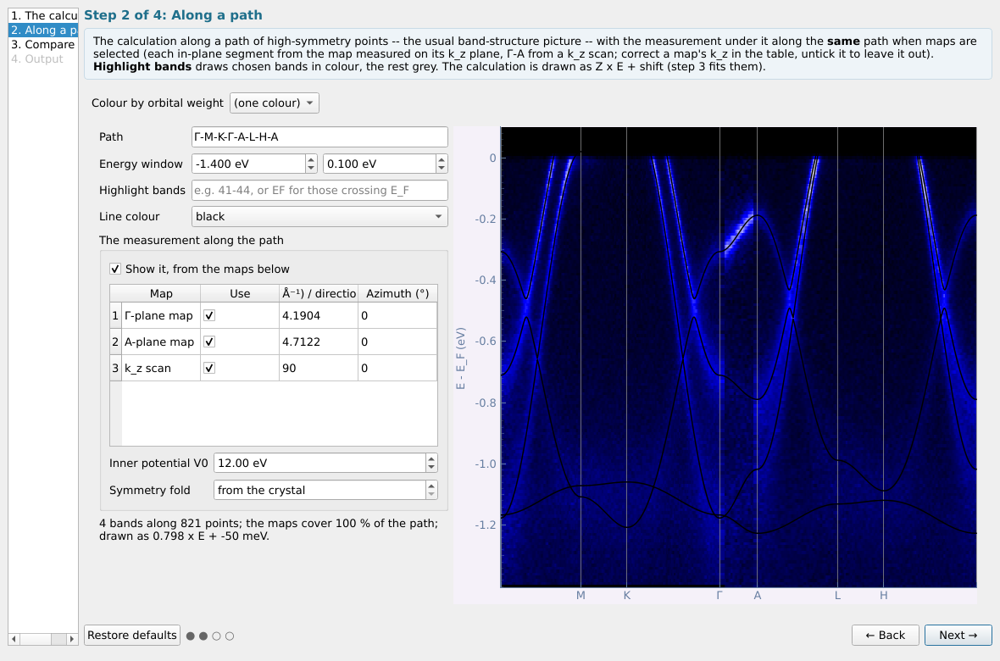
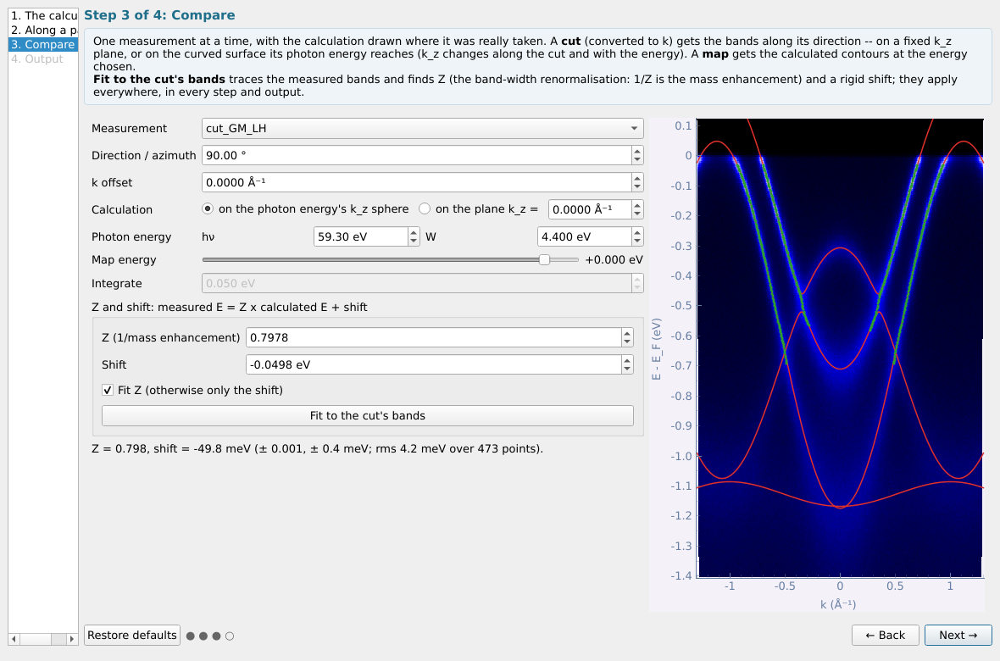
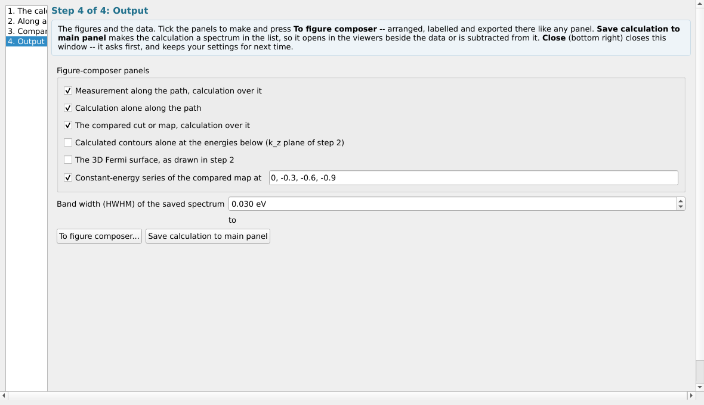
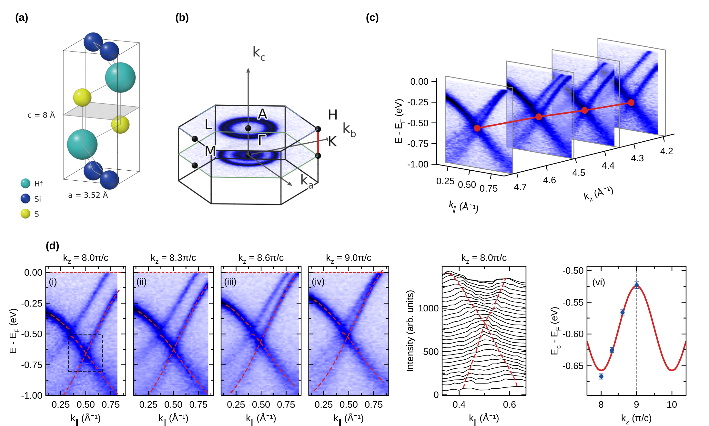

# Part 6 — The tool panel: Figure tab

The **Figure** tab holds the figure composer and what is worked out rather than measured: the crystal, its Brillouin zone in 3-D, tight-binding fits and calculated band structures. It ends with an example from loading data to a finished figure.

## 6.1 The figure composer

Tool panel → Figure → **Figure composer...** (the top of the tab) with
**nothing selected**
opens a blank page, like a figure of a manuscript: four empty panels (a),
(b), (c), (d) at a journal's column width. With cuts (or curves) selected,
each becomes a panel (so does a frozen slice's **Figure composer...**
button; a stack plot or a 3-D view has its own **To figure composer**
button).



- **Lay out the page.** Click a panel to select it; drag it to move it and
  drag its handles to resize it (Shift on a corner keeps its shape). Panels
  snap to each other's edges and to a 0.5 mm grid (**Snap**); the arrow keys
  nudge by 0.5 mm (Shift: 5 mm). *Arrange as grid* (figure tools, Panels
  tab) puts them back on rows × columns; a panel can take several cells
  (*Grid cells (rows / cols)* of the selected panel — a schematic beside a
  row of data panels), and a picture keeps its own shape in them. The page
  height follows the panels when they are moved by hand. **Re-letter**
  names them (a), (b)… in reading order.
- **Fill a panel.** Double-click an empty panel, or use **Load from
  list...** / **Load picture...** on the left: a dataset from the main list,
  or a picture from a file (PNG, JPEG, TIFF… — a sketch or a figure made
  elsewhere; it keeps its shape and has no axes).
- **Insets.** **Zoom-in inset**: drag out a region of a panel — a small
  panel magnifying it appears in the corner and the region is outlined.
  **Panel** drawn inside another panel makes an inset to fill with another
  dataset. Insets take no letter and move with their panel.
- **Draw.** **Arrow**, **Line**, **Box**, **Ellipse**, **Text**: drag (or
  click, for text) on the page. A selected drawing can be moved, its ends
  or corners dragged, and its colour, width, line style, fill and text set
  above the figure tools. Double-click a text to edit it; Del removes the
  selection; right-click for more (bring to front, delete…).
- **Axes and fonts.** The figure tools beside the page act on the selected
  panel (or all of them): ranges, ticks, labels, which edges carry numbers,
  the panel's own font size, colour map, colour bar, reference lines. With
  *Tick labels on outer edges only*, *…but tick numbers on every panel*
  keeps the numbers on the inner panels and leaves only the axis names to
  the edges.
- **Undo / Redo** (Ctrl+Z / Ctrl+Y) cover every change. **PDF**, **PNG**,
  **SVG** export, **Copy** puts it on the clipboard; empty panels are never
  written. The composer's **Figure tools** are not a viewer's **Plot
  tools**, which draw guides on the live plot.

### Arranging panels

Click a panel, then **Ctrl+click** (or Shift+click) the others to select
several. The **Arrange** buttons on the left then:

| Button | What it does |
|---|---|
| ⇤ Left, Right ⇥, ⤒ Top, Bottom ⤓ | line up their left / right / top / bottom edges (at the outermost one) |
| ↔ Centres, ↕ Centres | put their centres on one vertical / horizontal line (the first-selected panel's) |
| Space ↔, Space ↕ | equal gaps between them, left to right / top to bottom (three or more) |
| = Width, = Height | the first-selected panel's width / height for all |



### Letters and colour bars

- **Letters in line** (*Text* tab, on by default): the letters of panels
  side by side sit at one height and those of panels one above another at
  one left edge, whatever titles or axes each panel has. **Nudge (mm)**
  moves one panel's letter (clear of a long axis title, say);
  **Re-letter** names them (a), (b)… in reading order.
- **Colour bar** (*Colour* tab): **Ends** writes the levels, the words
  *High* / *Low*, or nothing; **Length (%)** of the panel's height or width;
  **Position** *right* (upright beside the panel) or *below* (lying under
  it, centred). A 3-D view's bar is sized to the cube as drawn, not to the
  whole frame round it.


### Curves: lines, symbols and error bars

*Overlays* tab, **Curves drawn on the panel**: select curves in the list (or
none, for all), then set their **colour**, **width**, **style** (solid,
dashed, dotted…), **symbols** (circle, square, triangles, diamond, with a
size) and whether they are **joined by a line**; **± σ as error bars**
turns a curve's two dotted ±σ curves into error bars at its points. **Apply
to the curves**. A curve with gaps (NaN) is drawn in pieces.

### Saving a figure to edit later, with its data

**Save** / **Save as...** write the figure in the program's own format,
`fig1.afig`: the page, its drawings and every panel with its data and
settings — open it again with **Open...** (or pick it in **Load data...**
in the main window) and go on editing exactly where you stopped. A 3-D view
is kept as the picture it shows.

Beside it, **`data for fig1/`** gets one folder per panel (`a`, `b`, …):

```
data for fig1/
  a/  processed/  what the panel shows: the image as a .nxs cut (opens in the
                  viewer again), its lines (calculated bands, contours,
                  curves) as lines.csv, a picture as .png
      original/   what it was made from: the first measurement file (a
                  k-converted, symmetrised, cut-out plane traces back to the
                  file it was first read from), the calculation with the
                  files it is read with (.win, POSCAR...), the picture file
                  or the CIF
      sources.txt which entry of the file, and the processing in between
  b/  ...
```

The original file is copied even when the panel shows something computed
from it many steps later: every dataset remembers the file it began as. A
figure opened again whose original files have moved reuses the copies in
its own earlier data folder.

## 6.2 Crystal structure

Tool panel → Figure → **Crystal structure...** (needs nothing
selected). Four steps (the Brillouin zone is the tool of its own **3D
BZ...**, [§6.2](#63-3d-bz-the-brillouin-zone-in-three-dimensions)):



1. **The structure** — **Read a CIF file...** (the button at the top)
   fills the space group, cell and atoms from a file, applies its symmetry
   operations and redraws the crystal at once; everything stays editable.
   Or type it in, like the BZ overlap cell: the **space group first** (the
   cell parameters it fixes are greyed and follow the free ones), then the
   cell and the atoms of the basis (the centering copies are added). CIFs with several data
   blocks (FullProf's, which open on a block of journal fields) are read
   from the block that holds the structure.
2. **The look**
   - cells along a, b, c, the atoms' overall size, cell edges and bonds
     (in the atoms' colours, or *grey, thin*);
   - per element its **colour**, **size**, **transparency** and **gloss**
     (0 %: a matt ball, 100 %: a shiny one with a sharp highlight);
   - **Polyhedra around** an element: its coordination polyhedra (its
     bonded neighbours as corners) in a colour and transparency of their
     own — the TiSe₆ octahedra, the CuS₄ tetrahedra;
   - **Key of the elements** (a ball and its name for each), **Lattice
     constants on the cell edges** (`a = 3.52 Å`, `c = 8 Å`).

   Drag the picture to turn it, wheel to zoom; *View along* a, b, c or the
   plane normal.
3. **Cleavage plane** — tick *Draw a plane*, give (hkl), slide it, or
   double-click an **atomic layer** in the list to put it there; *Hide the
   atoms above* shows the termination; atoms in the plane are ringed red.
4. **Export** — the crystal: **Save picture...** (PNG at any
   size, drawn again at that size) or **To figure composer...**. A picture
   from a CIF names the CIF as its source, so the figure's data folder keeps
   it ([§6.1](#61-the-figure-composer)).

## 6.3 3D BZ: the Brillouin zone in three dimensions

Tool panel → Figure → **3D BZ...** (needs nothing selected). It was step 4
of the crystal-structure window.



- **Crystal**: the **space group first**, then the cell — the parameters the
  space group fixes are greyed and follow the free ones, as in BZ overlap.
  **Read a CIF file...** fills them from a file. It starts from BZ
  overlap's last 3-D crystal.
- **Planes in the zone**: **Add a plane in 3D BZ** as often as you like.
  Each has its own normal (h k l), its height along it (in units of G(hkl):
  0 through Γ, 0.5 at the zone top), colour and opacity, and ✕ to remove
  it.
- **Measured maps on the planes**: *any* plane can carry a k-map's
  constant-energy map — choose it in the plane's *map* list and give the
  energy (E − E_F). The list offers the k-maps selected when the window
  was opened and every k-map in the main list (**↻ Maps from the list**
  brings in ones added since); a map is read only when it is chosen. The
  map's kx, ky lie along the plane's own in-plane axes — k_a, k_b for a
  plane normal to k_c — turned by *Maps' azimuth*, averaged over
  *Integrate*, and cut to the zone.
- **Paths**: **Add path** as often as you like, each through the labelled
  points (`Γ-M-K-Γ`, `A-L-H-A`; `|` for a jump) in a colour and width of its
  own.
- **Display**: labels of the high-symmetry points, the axes, and *Label on
  the left* (those points labelled at their leftmost equivalent, clear of
  the paths and axes).
- **Axes**: the crystal's own, **k_a, k_b, k_c** (Cartesian axes of the
  cell: k_a along a, k_c normal to the a–b plane), by default; or **the
  sample's, as the data has them — k_x, k_y, k_z**: k_z along the normal of
  the *Cleavage plane (hkl)*, k_x along the maps' k_x (turned by *Maps'
  azimuth*). One symbol never names two directions. The *View along*
  buttons follow the frame shown.
- **Export**: **Save picture...** at any size, or **To figure composer...**.
  *Labels: panel width / text* sizes the labels for the width the picture
  will have in the figure (8 pt in a 30 mm panel), whatever its size in
  pixels; off, they scale with the picture as on screen.

## 6.4 Tight-binding fit

> **One band, or two hybridised bands — chosen in step 1 (*Bands*).**
> **One band** is a single band on a Bravais lattice (one orbital per
> site): E(k) = e0 + Σ t_n Σ cos(k·R). It cannot describe two bands, their
> crossing or a hybridisation gap; fit each band on its own and read its
> hoppings as that band's effective parameters, not as microscopic
> orbital-to-orbital hoppings.
>
> **Two bands, hybridised** fits two such bands, ε_a(k) and ε_b(k), and the
> coupling V(k) = v0 + Σ v_n S_n(k) between them at once; the measured
> bands are E± = (ε_a+ε_b)/2 ± √(((ε_a−ε_b)/2)² + V²). Use it for an
> anticrossing, a hybridisation gap, or a bilayer splitting (t_⊥). V has the
> lattice's full symmetry (two orbitals of the same parity); an odd
> coupling such as s–p is not this form.

**Two bands, step by step.** In step 1 set the shells of band a (*Shells
of neighbours*), of band b (*Shells, band b*) and of the coupling beyond
v0 (*Coupling shells*, 0 for a constant V). In step 2 trace both bands at
two or more energies with *New points on* left at *either band*, then
click a few points of each band with it set to *the lower band* or *the
upper band* (blue / pink); a points file may carry a `branch` column
(`lower` / `upper` / blank). In step 3 the fit — nonlinear, started from
many models and refined — gives band a, band b and v0, v1… with errors,
draws both bands (red, orange), says which band each point went to, and
gives the **smallest gap** between the bands and where it is: 2|V| where
the bare bands cross. *Model to list* holds both bands; *Save parameters*
writes the three sets of parameters, their shells and the gap.

**Shells are symmetry orbits.** Each hopping t_n belongs to one set of
neighbours that symmetry makes equivalent: the space group's point group
(with inversion) for a 3-D crystal, the lattice's own symmetry for a 2-D
layer. Two inequivalent neighbours at the same distance — an in-plane and
an out-of-plane one, say — get a hopping each. Step 1 lists every shell with
its count, distance and a representative vector in lattice coordinates
(⟨1 0 0⟩), and **Save parameters...** writes all the vectors of each shell.

With a k-map selected (or nothing, to use a file of points):

1. **The lattice** -- a 2-D layer (a, b, γ) or a 3-D crystal (the **space
   group first**, then the cell parameters it leaves free -- the others are
   greyed and follow), or **Take the crystal from the Brillouin-zone tool**; the azimuth of a against kx; how
   many shells of neighbours.
2. **Band points** -- on **one band** only (a few stray points are set
   aside as outliers; many spoil the fit). Move to an energy and press **Trace this energy**
   (ridge detection), or tick *Click* and click on the band, or **Read
   points from a file**. Two or three energies are better than one: one
   contour fixes the band's shape but not its energy scale.
3. **Fit** -- the hoppings with their errors and the rms misfit; the model's
   contour is drawn in red on the plane of step 2. With one energy, hold
   t1; *Refine the azimuth* if the orientation is known only roughly. An
   orange note means the points cannot tell the shells apart: use fewer.
4. **Use the model** -- **Model to list** (its spectral function, as a map
   beside the data), **Save parameters...**, **Copy results**.

## 6.5 Calculated bands

Tool panel → Figure → **Calculated bands...** puts a band-structure
calculation beside the measurement. Select what to compare it with — k-maps,
kz maps in momentum and cuts in momentum — or nothing, to look at the
calculation alone. Four steps.

Like every step-by-step window (Crystal structure, Tight-binding fit, Sum
repeated scans, Detector corrections), it **asks before closing** — the last
step's Close sits where Next was, so a quick double click no longer loses the
work; the title bar's close and Esc ask too. **Enter in a field takes its
value** (and redraws what depends on it) — in every window of the program it
never presses Next, Close or any other button, whatever the value set going
(even a computation with a progress bar); only a button that has the focus
answers Enter. Where a window redraws only on a button — the Brillouin-zone
tool's **Plot**, a viewer's selection-box **Refresh**, the core-level zoom's
**Show** — Enter in its fields does that redraw, and nothing else. What you set is **kept**: the window opens as you left
it (**Restore defaults** at the bottom left starts afresh).

**1. The calculation.** First say **what you want to see**:

- **E–k dispersion** — the bands along a path, or along your measured cut.
  Any calculation works.
- **Constant-energy contours** — to compare with a k-map (Fermi-surface
  map).
- **3D Fermi surface.**

The last two need the bands **everywhere in the zone** (a band grid or a
Hamiltonian); a band structure along a path cannot give them, and the window
says so rather than going on. The choice also sorts the file list of
**Open calculation...**: its first filter shows only the kinds of file that
can give what you want. Selected k-maps choose contours for you, selected
cuts the dispersion. A file can also be dropped on the window; **Reopen …**
opens last time's file again.

| File | Written by | What it holds | Can show |
|---|---|---|---|
| `.bxsf` (XCrySDen band grid) | Wien2k, Quantum ESPRESSO, VASP, Wannier90 | the bands everywhere in the zone, interpolated | all three |
| `_hr.dat` (+ `.win` beside it) | Wannier90, any tight-binding model | a Hamiltonian, diagonalised exactly at each k; orbital weights | all three |
| `wannier90_hr_fplo.dat` (+ `KPOINTS`, `wannier_name_center.txt`) | FPLO's Wannier Hamiltonian | as `_hr.dat`; weights per Wannier function, per shell ("Cr 3d") and per spin | all three |
| `band.dat` with rows `k1 k2 k3 E1 E2 …` (+ `KPOINTS`) | FPLO + Wannier tools | a 3-D band grid | all three |
| MATLAB `.mat` holding `Ek_3D` (+ `KPOINTS`) | the theory side's MATLAB, from that 3-D `band.dat` | a 3-D band grid | all three |
| `EIGENVAL` (+ `POSCAR`, `PROCAR`) | VASP | bands along a path or on a grid; atomic and orbital weights | a grid: all three |
| `_band.dat` (+ `labelinfo`) | Wannier90 | bands along a path | dispersion |
| `.spaghetti_ene` (+ `.klist_band`) | Wien2k | bands along a path | dispersion |
| `band.dat`, `Eigenvalue.dat` (+ `KPOINTS`, `orbital.dat`) | FPLO + Wannier tools (`k_path.exe`, `H.exe`, `plot.exe`) | bands along a path (a third column is a weight) | dispersion |

Files are recognised by their **content**, not their name: a standard file
renamed on the way (`hamiltonian.txt` that is really an `_hr.dat`) opens all
the same. The FPLO tools' `KPOINTS` (first line "segments
points-per-segment", then the direct and reciprocal vectors, then each
segment's ends with `! label`) gives the cell and the labels — keep it beside
the band file; without one, the cell is taken from the Brillouin-zone tool's
crystal. Long reads (a 3-D `band.dat` of 101³ points and 136 bands is about
2 GB; a large `_hr.dat`) show a **progress bar** with Cancel; a big grid
keeps only the bands near E_F (*Reading options ▸ Big grids*).

**Which file? ...** helps when you do not know which of a dozen files is the
calculation: choose the folder the theory side sent, and every file in it is
read and said in plain words — what it is, what it can show, what reading it
lacks (the cell, the labels), whether it is a standard file under another
name, or one file **cut into pieces** (`band.dat.1, band.dat.2`,
`band_part1.dat …`, `xaa, xab` — as files are split to pass an upload
limit). Green rows open for what you want to see; **Join the pieces, then
open** writes the pieces back into one file beside them.

*Reading options ▸* (usually nothing to change): *Set E_F myself* overrides
the file's Fermi level; *bxsf k units* is for a grid written without 2π; *Big
grids: keep bands from … to …* of E_F.

**The crystal.** The cell (a, b, c, α, β, γ) is read from the calculation
and the **space group** that names the zone's points is guessed from its
shape. Once read, both are **locked** — as are *From the Brillouin-zone
tool* — so a stray click cannot change the calculation's lattice. Tick
**Change the lattice parameters** to change them on purpose: typing a new
cell (or taking the Brillouin-zone tool's) scales the calculation to it —
its bands, held in fractional coordinates, stretch with the zone.

**A calculation in another format.** When the theory side's files are none of
these, the safest route is to ask for (or convert to) one of the standard
ones: a `.bxsf` for bands everywhere, `_hr.dat` + `.win` for a Hamiltonian,
or a two-column `_band.dat` (distance, energy; a blank line between bands)
with its `_band.labelinfo.dat` for a path. What to ask them: which columns,
which order of k, the units of k (with or without 2π, fractional or
Cartesian) and whether energies are already relative to E_F.

**2. What it looks like** — by what you chose in step 1:

- **Along a path** (dispersion). The calculation through the high-symmetry
  points (`Γ-M-K-Γ-A-L-H-A`; `G` for Γ, `|` for a jump), over the
  **measurement along the same path**, assembled from the selected maps: each
  in-plane segment from the map measured on its k_z plane (Γ-M-K-Γ from the
  Γ-plane map, A-L-H-A from the zone-top one), Γ-A from a kz map. Each map's
  k_z comes from its photon energy and the inner potential V0; correct it in
  the table if needed, untick a map to leave it out, and give the azimuth of
  the crystal's a axis on the map. **Highlight bands** draws chosen bands
  thick and in colour, the others grey — their numbers as the file counts
  them (`41-44`), or `EF` for every band crossing E_F (step 1 lists them).
- **Constant-energy contours.** The calculated contours at one energy on any
  plane of k-space, set as in the Brillouin-zone tool: its **normal (hkl)**
  (conventional reciprocal axes; (001) gives k_x-k_y), and **k⊥**, how far it
  sits from Γ along that normal — **Through point** puts it through a
  high-symmetry point (Γ K M at 0, A H L at π/c for (001)); **In-plane
  rotation** turns the two drawn axes about the normal (to match a measured
  map's azimuth, say). The **k⊥
  integration window** sums the bands over a range of k⊥ about the plane —
  along the (hkl) normal, not the absolute k_z — as a map with a finite k⊥
  resolution does; the integrated intensity is drawn grey under the
  contours of the middle plane. **Show the plane in the Brillouin zone...**
  opens a turnable 3-D view of the zone with the plane in it (red), the
  faces of its k⊥ window (light red) and the named points it holds; it
  follows the plane as you change it. The zones' outlines on the plane are
  dashed grey.
- **3D Fermi surface.** The surfaces where the bands cross the energy,
  inside the first zone, with the zone's edges and named points. Drag to
  turn, wheel to zoom; Enter in *Energy* redraws it; *Detail* trades speed
  for smoothness (a Hamiltonian is diagonalised on a grid first, with a
  progress bar). **Open in its own window** shows it large, with *Save
  picture*; the energy, detail and bands are still set here. With this goal
  there is nothing to compare, so the Compare step is left out.

Each band's **colour** (from the list, or *Other colour...*), and for a
surface its **opacity**, and whether it is **shown**, are set in the band
table. Several bands may share one colour — to group the electron pockets
in one colour and the hole pockets in another, say — and a band keeps its
colour from the contours to the 3-D view.

**Colour by orbital weight** draws fat bands along a path, or splits the
contours where the chosen orbital's weight exceeds one half.



**3. Compare.** One measurement at a time, with the calculation drawn where
it was really taken: a **cut** gets the bands along its direction — on a
fixed k_z plane, or on the curved surface its photon energy reaches (k_z
changes along the cut and with the energy); a **map** gets the calculated
contours at the energy chosen. **Fit to the cut's bands** traces the
measured bands (ridge detection) and finds **Z** — the band-width
renormalisation, measured E = Z × calculated E + shift — and the **shift**,
each point matched to its nearest band, robustly. Z and the shift apply in
every step and every output. On the demo cut it finds Z = 0.798 and a shift
of −49.8 meV, the values the demo was made with (0.8 and −50 meV).



**4. Output.** With no measurement selected, step 3 says so: press Next.

- **To figure composer...** makes the panels ticked — ticked for you by
  what you chose in step 1: the measurement along the path with the
  calculation over it, the calculation alone (the points' names on its axis),
  the compared cut or map with its calculation, the calculated contours alone
  at the energies listed (no map needed), the 3D Fermi surface as drawn in
  step 2, and — with **Constant-energy series of the compared map** — the
  measured maps at each energy with the zones dashed (top row) and the
  calculated contours (bottom row).
- **Save … to main panel** (beside it) puts the calculation in the list as
  data the main panel's viewers open, and what it saves follows step 1:
  - *dispersion* — a cut: the bands as a spectrum (Lorentzians of the width
    set) along the compared cut or along the path. A cut along a path keeps
    its high-symmetry points: the cut viewer shows their names along the
    top, with a dashed line at each (**High-symmetry points**, ticked; the k
    values stay on the bottom axis), and the figure composer puts them on
    the k axis.
  - *contours* — **Save calculated map to main panel**: a k-map of the
    calculated intensity on the plane of step 2 (its (hkl), k⊥, in-plane
    rotation and k⊥ window) at every energy of *Energies of the saved map*, to slice and
    compare like a measured map.
  - *3D Fermi surface* — greyed out: the viewers open cuts and maps, not a
    surface; the figure composer (or *Save picture*) takes it.



## 6.6 Worked example: from loading data to a figure

From the demo data ([§1.3](#13-trying-it-with-demo-data)) to a figure of
constant-energy maps with the Brillouin zone. This is the same path as the
agent's example in [§7.7](#77-worked-example-an-agent-from-set-up-to-figure),
done by hand.

1. **Load.** **Quick add...** → `demo_bulk_bands.nxs`. The list shows the
   Γ-plane map `FS_map_hv59.3_Gamma_plane`, the cuts `cut_GM_LH`,
   `cut_GM_LV`, `cut_GK_LH` and the photon-energy scan.
2. **Fermi level.** Select the map → Basic → **Fermi edge fit...**. Fit on
   the raw data, in a window around the edge; note E_F
   ([§4.2](#42-fermi-edge-fit)).
3. **To momentum.** Basic → **k conversion (map)**: Γ at normal emission,
   the fitted E_F as the energy reference. A new row `… [k]` appears
   ([§4.9](#49-converting-a-map-to-momentum)).
4. **The zone.** Select the k-map → Basic → **BZ overlap...**: space group
   164 (P-3m1), a = 3.3 Å, c = 6 Å, plane (001) through Γ
   ([§4.12](#412-brillouin-zone)).
5. **Slices.** Advanced → **Slice series figure...**: energies 0, −0.2,
   −0.4 eV, ±20 meV, three columns, the zone dashed
   ([§5.6](#56-slice-series-figure)). The figure opens in the composer.
6. **Lay out and export.** In the composer set the page width, colour map
   and levels, letters (a), (b), (c), then **Export** a PNG and a PDF and
   **Save** an `.afig` to edit later ([§6.1](#61-the-figure-composer)).


The next section builds two complete publication figures in the same way.

## 6.7 Worked example: two figures in the figure composer

The two figures below were made from the demo data
([§1.3](#13-trying-it-with-demo-data)) with the program's windows and put
together in the figure composer. `devtools/figure_tests.py` runs exactly
these steps, so it is also a script to read alongside this section.

### Figure 1: constant-energy contours


**(a) The notched cube.** Convert the Γ-plane map to momentum
([§4.9](#49-converting-a-map-to-momentum)); select the k-map → Advanced →
**Notched cube...**. *Change sampling...* to k_x, k_y within ±1.25 Å⁻¹ and E
up to E_F; put the notch at k_x = k_y = 0 down to the lowest energy, corner
**+ − +**; colormap *blue*, reversed; azimuth −52°, elevation 24°. **To
figure composer...**: a new figure. In the composer, *Colour* tab: **Colour
bar** on, Ends *high-low*, Position *below*, Length 60 %.

**(b) Measured and calculated contours.** Select the Γ-plane k-map →
Figure → **Calculated bands...**; open `demo_calc_hr.dat`; in step 2
choose the **Weight** `Se-pxy`; in step 3 choose the k-map, *Integrate*
0.050 eV, then a cut to **Fit to the cut's bands** (Z and the shift apply to
the contours too); in step 4 tick **Constant-energy series at** `0, -0.3,
-0.6, -0.9`, untick the others, **To figure composer...** → the figure of
(a). Eight panels arrive: the measured maps with the zones dashed, and the
calculated contours alone, red where the weight is below one half and green
above. In each, set the colormap (*blue*, reversed), the ranges ±1.2 and
drop the titles of the bottom row (*Text* tab); add the (i)…(viii) and Γ, M,
K notes with the **Text** tool.

**(c) Stacked contours.** Select the k-map → Advanced → **Stacked
slices...**; *Layers* along E − E_F at `0, -0.15, -0.3, -0.45, -0.6, -0.75,
-0.9`, *Integrate* 0.04, *Fade low values* 45 %, z aspect 2.2, azimuth −45°,
elevation 14°. **To figure composer...** → the same figure.

**Arranging.** Drag the panels roughly into place (the 2 × 4 contours in
two rows, (a) left, (c) right), then select (a), the top row of (b) and (c)
and press **⤒ Top**; select a row of contours and **Space ↔**, and **=
Height** for each row. The letters line up by themselves; **Nudge** moved
(b)'s 6 mm left, clear of its k_y title.


 Only (a), (b) and (c) carry a
letter: clear the others' *Letter* box. **Save as...** `example_figure_1.afig`
(its data folder is written beside it), and **PNG** / **PDF** for the paper.

### Figure 2: a band crossing followed through k_z



**(a) The crystal structure.** Figure → **Crystal structure...** →
*Read a CIF file* `demo_tetragonal_crystal.cif`. Step 2: Hf teal, Si dark
blue, S yellow, gloss 85 % each, atom size 0.52; *Grey, thin bonds*;
*Lattice constants on the cell edges* (no key of the elements). Step 3:
*Draw a plane* (001) at the middle of the cell, between the S layers, in
grey. Turn it to azimuth −68°, elevation 14°. Step 5: **To figure
composer...** → a new figure.

**(b) The zone with the measured maps.** Figure → **3D BZ...** → *Read a
CIF file* `demo_crystal.cif`. **Add a plane in 3D BZ** once (the first
plane is through Γ, the second at the zone top); the first plane's *map* →
*Γ-plane map* at −0.65 eV, the second's → *A-plane map* at −0.55 eV
(select the two k-maps first, or press **↻ Maps from the list**). *Path*
`K-H` (the line where the two bands cross); *Label on the left* `L, M`.
**To figure composer...** → the figure of (a).

**(c) The cuts stacked along k_z.** Convert the photon-energy scan to
momentum ([§4.10](#410-aligning-the-fermi-levels-of-a-kz-map)), select it → Advanced →
**Stacked slices...**: *Layers* along k_z at the four k_z of the cuts
(8.0, 8.3, 8.6 and 9.0 π/c), *Fade* 30 %, **Spread** 3, azimuth 40°,
elevation 12°. In **Mark a curve through the layers**, add the crossing on
each cut (k_z, k_∥, E) — from (d) — in red. **To figure composer...**.

**(d) The cuts, their MDCs and the crossing against k_z.**

- (i)–(iv): in the k_z map's viewer, **Functions → Slice → Save slice to the
  main list** at each k_z; open each cut in the figure composer (**Add
  panel...**). The dashed guides along the two crossing bands are the
  calculation (Calculated bands, step 3, on the plane k_z = …), shifted by
  the fitted Z and shift: in step 4, **To figure composer...** with only
  *The compared cut* ticked gives the cut with them; set their style to
  *dashed* in the *Overlays* tab. Draw the dashed box with the **Box** tool.
- (v): select the first cut → Advanced → **Stack plot (EDC / MDC)...** →
  MDCs, 40 curves of 3 rows each, over the box's energies; **Send to figure
  composer** → this figure. The guides through the MDCs are the same
  calculated bands, at each MDC's energy.
- (vi): the crossing energy at each k_z — from **MDC fit** on each cut and
  **Dispersion...**, where *Crosses band … at k = …, E = … ± …* gives it
  with its error — as points with error bars (*Overlays*: symbols *circle*,
  not joined, **± σ as error bars**), and the calculated crossing through
  k_z as the red line.

**Arranging.** (a), (b), (c) in the first row: select the three, **⤒ Top**
and **= Height**; the six panels of (d) in the second row, **⤒ Top** and
**= Height**. Letters: (a), (b), (c), (d) only. **Save as...**
`example_figure_2.afig`.

Each panel of either figure can be changed afterwards — open the `.afig`,
select the panel, and use the figure tools; the data folder keeps both the
data as shown and the measurement it came from.
