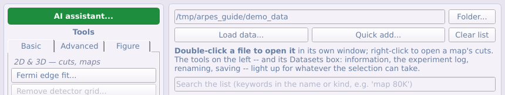
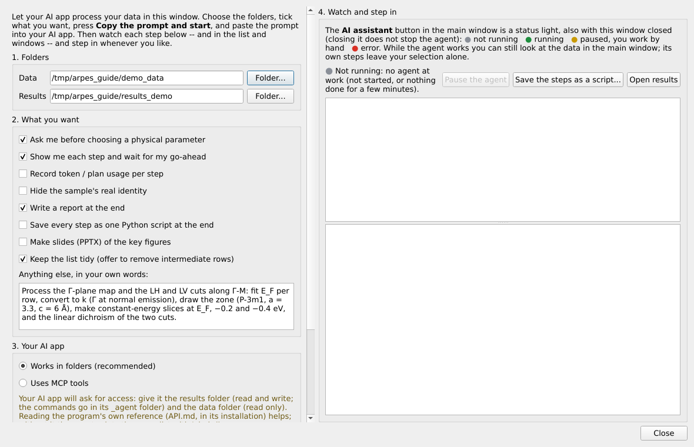
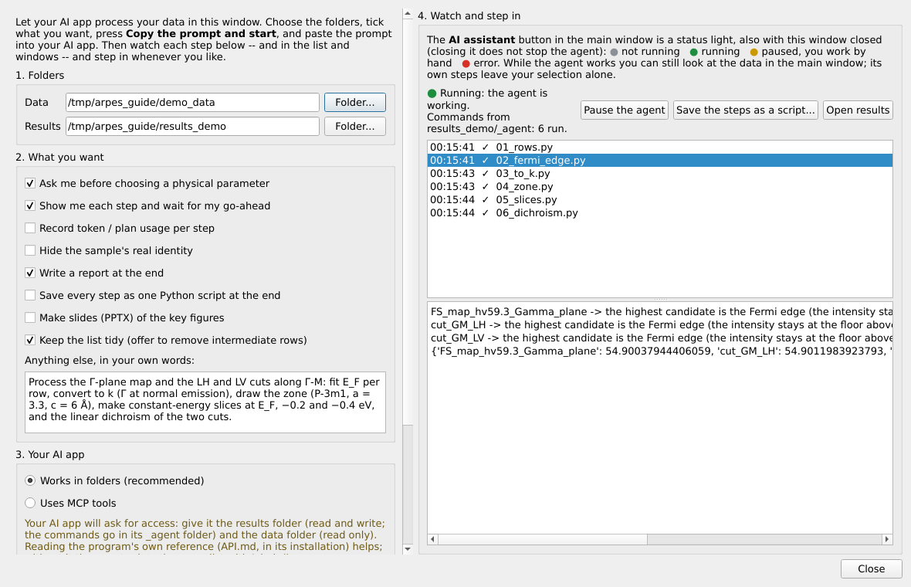
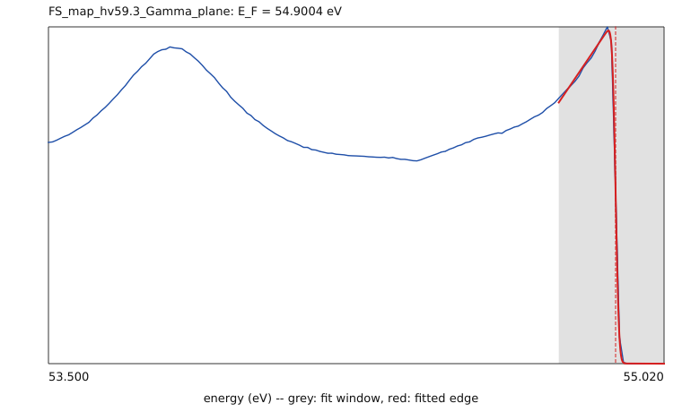

# Part 7 — AI agents

An AI agent (Claude, or any app that can read and write files or call MCP tools) can drive the program on your screen, step by step, while you watch and can take over. This part explains how that works, how to start and watch an agent, and gives an example from set-up to figure.

## 7.1 How it works, and what leaves your computer

The program has no chat of its own. You talk to your AI app (the Claude
desktop app, Claude Code, or another agent) in plain words, and the program
is that agent's tool. The agent sends the program small steps: list the
data, fit a Fermi edge, convert to momentum, make a figure. The program runs
each step on your screen, so you see every result as a new row in the list
or a new window, and you can pause the agent and work by hand at any time.

**What stays on your computer, and what does not:**

- Your raw data files stay where they are and are read and processed by the
  program, locally. The program does not upload anything.
- What the **agent reads** is sent to the AI provider as part of the
  conversation: the text a step prints (row names, fitted values, axis
  ranges), and any picture the agent opens to judge a result. Ask for
  compact outputs, and the conversation holds numbers and a few pictures,
  not your data arrays.
- Whether the provider may use conversation content for training depends
  on the provider and your account settings. Check them before you start.
- Keep private code, unpublished manuscripts and anything you do not want
  read out of the folders the agent can reach. Give it the data folder
  (read only) and the results folder only.

As with any analysis, check what an agent produced before you use it.

## 7.2 Architecture: operations, reference, routes

```
 you  ⇄  AI app (chat)                       ARPES viewer (on your screen)
            │                                 ┌──────────────────────────┐
            │  writes <results>/_agent/        │  runs each command file, │
            ├──── viewer_cmd/01_….py  ───────▶ │  or each MCP call, with  │
            │                                 │  L = its operations      │
            │  reads out/cmd_01_….log  ◀────── │  new rows, windows, files│
            │  (or MCP tool results)           └──────────────────────────┘
```

- **The operations `L`.** About fifty documented operations on the named
  rows of the main list (`arpes_viewer/ui/common/live.py`): `L.rows()`,
  `L.add_files(...)`, `L.fermi_edge_search(...)`, `L.fermi_edge(...)`,
  `L.map_to_k(...)`, `L.kz_to_k(...)`, `L.bz_overlay(...)`,
  `L.cut_arithmetic(...)`, `L.slice_series(...)`, `L.figure_render(...)` …
  Each one adds new rows rather than changing old ones, never overwrites a
  file, and never waits for a click. A row can be named by its name, its
  number in `L.rows()` or the path of its file.
- **The reference `API.md`** (`arpes_viewer/agent/API.md`, inside the
  installed program) lists every operation, the tool-panel buttons, the MCP
  tools and the computations in `tools/`, with their parameters. It is
  generated from the program, so it is always current; the agent reads it
  instead of the source. `L.help()` prints the same list.
- **Three routes** to the same operations:
  1. **Command folder** (recommended): the agent writes one small Python
     file per step into `<results>/_agent/viewer_cmd/`; the program runs it
     and writes what it printed to `<results>/_agent/out/`. Any AI app that
     can read and write files works, and every step is kept as a file.
  2. **MCP**: the AI app calls the program through its MCP server
     (`arpes-viewer-mcp`); with the program started with the agent bridge,
     `viewer_api` calls the same operations.
  3. **Scripts without a screen**: the computations in `arpes_viewer/tools/`
     and the headless workspace, for a script to keep.
- **Windows.** A window an operation opens only to drive it (a conversion
  dialog, a temporary figure) never appears on screen; the windows still
  open when a step ends (a figure, a viewer, a tool waiting for you) appear
  on the screen of the main panel, not on the screen you are working on.

## 7.3 Starting from the AI assistant panel



Press **AI assistant...** at the top of the tool panel.



1. **Folders.** The **data** folder (the agent only reads it) and a
   **results** folder (everything the agent writes goes there; its commands
   go in `<results>/_agent`).
2. **What you want.** Tick what applies:
   - *Ask me before choosing a physical parameter*: Γ, an energy window,
     the inner potential, a threshold;
   - *Show me each step and wait for my go-ahead*;
   - *Record token / plan usage per step*: a usage log, one line per step;
   - *Hide the sample's real identity* in everything written;
   - *Write a report*, *Make slides*;
   - *Save every step as one Python script at the end* (on by default):
     the agent writes `agent_steps.py` in the results folder;
   - *Keep the list tidy*: offer to remove intermediate rows at the end.

   Then write your request in your own words: which data, which steps,
   which figures.
3. **Your AI app.** *Works in folders* (recommended; nothing to set up) or
   *Uses MCP tools* (the prompt says how to connect the app once).
4. Press **Copy the prompt and start**. The program starts listening and the
   prompt is on the clipboard. **Show the prompt** shows it: the folders,
   where `API.md` is, how to send steps, and the working rules
   ([§7.6](#76-the-working-rules-the-agent-follows)).
5. Paste the prompt into your AI app and send it. Allow the app to read the
   data folder and to read and write the results folder when it asks.

## 7.4 Watching and stepping in



- **The list of steps** (right): each step the agent ran, with its time and
  ✓, or ✗ in red if it failed. Click a step to see what it printed.
- **The status light** on the **AI assistant** button, also with the window
  closed: grey not running, green running, yellow paused, red a failed step
  or commands no longer being run. Closing the window does not stop the
  agent.
- **Pause the agent** holds its next commands (the light turns yellow), so
  you can work by hand; **Resume** lets them through. The agent is told to
  wait and ask you when its commands are held.
- **Your work goes on.** The agent's steps leave your selection in the list
  as it was, so you can look at data while it works, and windows it opens
  only to drive them never appear on your screens.
- **Save the steps as a script...** writes everything the agent ran, in
  order, as one Python file: each step's code, when it ran, whether it
  failed (those are kept as comments) and what it printed. It is the record
  of the whole processing, and it runs again: copy it into
  `<results>/_agent/viewer_cmd` of a program started on that results
  folder. Steps sent through MCP are kept in memory only, so save them
  before closing the program. Steps you did by hand are not in it; they are
  in each dataset's history (*Experiment info*).
- **Open results** opens the results folder: the agent's command files and
  logs in `_agent`, the pictures and figures it wrote.

## 7.5 Other ways to start

- **Claude Code or another MCP app.** In the AI assistant choose *Uses MCP
  tools*: the program turns its agent bridge on and the prompt holds the
  command to add the server, for Claude Code
  `claude mcp add arpes-viewer -- python -m arpes_viewer.agent`. If your app
  loads tool definitions on demand, have it load all the arpes-viewer tools
  at once.
- **By hand.** Start the program with the bridge on
  (`arpes-viewer --agent-bridge`), add `arpes-viewer-mcp` to the app's MCP
  servers, and point the agent to `API.md`.
- **The command folder without the panel.** `agentic/launch_viewer.py`
  starts the program listening on a folder of your choice;
  `agentic/README.md` is the step-by-step guide, with requests to copy in
  `agentic/PROMPTS.md` and runnable examples in `agentic/examples/`.
- **A script to keep.** The computations in `arpes_viewer/tools/` need no
  window; `devtools/figure_tests.py` builds two complete figures from the
  demo data that way.

The details of the MCP server, for reference:

ARPES viewer is also an **MCP server** (Model Context Protocol), so an AI
agent of any model — Claude, GPT, Gemini, or a local model in an
MCP-capable client (Claude Desktop / Claude Code, Cursor, VS Code, Cline,
LM Studio…) — can call it as a set of tools. Everything stays on your
machine: files are read and written locally; only what a tool returns
(numbers, text, pictures) goes to the client.

**Set it up.** Installing the program installs the command
`arpes-viewer-mcp` (from a checkout: `python -m arpes_viewer.agent`). Add it
to the client's MCP servers, e.g. in a `claude_desktop_config.json`,
`.mcp.json`, or the client's settings:

```json
{
  "mcpServers": {
    "arpes-viewer": {"command": "arpes-viewer-mcp"}
  }
}
```

(With a checkout instead of `pip install`: `"command": "python", "args":
["-m", "arpes_viewer.agent"], "cwd": "<the ARPES-viewer folder>"`.) The
server speaks MCP over stdin/stdout and needs nothing beyond the program's
own requirements.

**Headless tools** — no window needed; they use the program's own readers
and algorithms:

| Tool | What it does |
|---|---|
| `find_files`, `list_loaders` | the data files in a folder that a reader recognises, and the readers |
| `open_dataset`, `list_datasets`, `describe`, `metadata`, `close_dataset` | open a dataset (gives an id, e.g. `d1`), its axes and metadata |
| `get_profile` | an EDC or MDC: values along one axis, averaged over ranges of the others (optionally saved as CSV) |
| `get_image` | a picture (PNG) of a cut, a constant-energy map or a dispersion, with colour map and levels (optionally saved as PNG / CSV) |
| `fit_fermi_edge` | E_F and the resolution, with errors |
| `shift_energy`, `crop` | a copy on E − E_F, a copy cut to ranges |
| `convert_cut_to_k`, `convert_map_to_k` | the k conversions, with the same choices as their windows (Γ, rotation; *energy offset* only for an axis that is not kinetic; *output_fermi_level_eV* for an E − E_F result) |
| `save_datasets` | `.nxs` (opens in the program), `.itx` / `.ibw` (Igor Pro) |
| `brillouin_zone`, `read_cif` | the zone's high-symmetry points for a space group and cell; a CIF's cell and sites |

Axes are named by number, by slot (`x`, `y`, `k`, `z`) or by a word of their
label (`energy`, `slit`, `deflector`, `kx`); ranges are `[lo, hi]` in the
axis's own units, or one number for the nearest plane.

**The program on screen** — start it with the bridge on:

```bash
arpes-viewer --agent-bridge
```

(or `python -m arpes_viewer --agent-bridge`; or set
`ARPES_VIEWER_AGENT_BRIDGE=1`). The status bar says *Agent bridge on
127.0.0.1:…*. The `viewer_*` tools then drive that window: `viewer_status`,
`viewer_rows`, `viewer_add_files`, `viewer_select`, `viewer_run_tool` (any
tool-panel button for the selection — `fermi`, `kcut`, `kmap`, `bz3d`,
`figure`, `notch3d`, `combine`…), `viewer_windows`, `viewer_screenshot`
(a picture of any of its windows, so the agent can check what it did),
`viewer_api_help` and `viewer_api` (the documented operations above: list
them, call one), `viewer_figure` and `viewer_render_figure` (a figure window in numbers —
page, frames, titles, levels, text sizes — and written as the PNG it will
print as), `viewer_close_window` and `viewer_python` (Python run inside the program,
with `A` = the program's main module — for setting a dialog's fields and
pressing its buttons). A headless result reaches the list with
`save_datasets` to a `.nxs` and `viewer_add_files`.

**Safety.** The bridge is off unless asked for; it listens on 127.0.0.1
only (not on the network) and answers only requests carrying the random
token it writes, at start, to `~/.arpes_viewer/agent_bridge.json`
(readable by you alone); the file is removed when the program closes.
`viewer_python` runs code in the program — let an agent use it as you would
let it type in a Python console on your computer.

The command-folder route is described in more detail in
[docs/AGENTIC_WORKFLOW_en.md](../../AGENTIC_WORKFLOW_en.md); the MCP server
is the same idea without the folder.

## 7.6 The working rules the agent follows

The prompt gives the agent rules learnt from real sessions; `API.md`
repeats them. You can add your own, or override one, in your request.

| Rule | Why |
|---|---|
| After adding the data, compare the rows with the folder and report what was left out, not recognised or warned about | single spectra in a map's folder, and files no reader takes, must not pass unnoticed |
| Say which part of a row name comes from the file name and which from recorded metadata; mark guesses | names are what everyone reads afterwards |
| Name a processed row after its source plus one tag in square brackets per step, from the table of `L.naming()` (`Map80eV [norm] [E-E_F] [k]`), also for names of its own | the list sorts by what was done ([§1.5](#15-data-kinds)) |
| Look for an operation (`L.help()`, `L.tools()`, `L.functions()`) before computing anything; never edit the program's internal tables; if an operation is missing, say which and ask | results stay reproducible, with their history |
| Fermi level: fit raw data, per row, on that row's own axis (`L.fermi_edge_search`), draw each fit; rows of the same photon and pass energy must agree; when the data cannot decide, ask once | the steepest drop is not always the edge; one window does not fit every axis |
| Chain steps in one call (`L.map_to_k(row, ef=…, normalise_axes=(1, 2))`) so only final rows are listed; remove rows only when you agree | a list you can still read |
| Try figures in `check/`, publish one version per figure in `figures/FigureN/`, move superseded versions aside | one final file per figure |
| Signed quantities (dichroism, differences) get a diverging colour map with symmetric levels | a sign must be readable |
| Small outputs: `L.rows(compact=True)`, `L.profile(..., summary=True)`, arrays to files | fewer tokens, less sent to the provider |
| Never delete or overwrite; ask before each physical parameter (if ticked) | your data and your decisions stay yours |

## 7.7 Worked example: an agent from set-up to figure

This example follows a real day of processing CASSIOPEE data with an agent
(Fermi-surface maps and cuts in several polarisations, up to dichroism
figures), redone here on the demo data so you can repeat it. The program
changes that day's session asked for are in the
[CHANGELOG](../../../CHANGELOG.md) (1.3.2).

**1. Set-up.** AI assistant: data `demo_data`, results `results_demo`;
*ask before a physical parameter*, *step by step*, *report* and *tidy list*
ticked; the request: *"Process the Γ-plane map and the LH and LV cuts along
Γ-M: fit E_F per row, convert to k (Γ at normal emission), draw the zone
(P-3m1, a = 3.3, c = 6 Å), make constant-energy slices at E_F, −0.2 and
−0.4 eV, and the linear dichroism of the two cuts."* → **Copy the prompt and
start**, paste into the AI app.

**2. Looking first.** The agent's first command file:

```python
print(L.add_files(DATA))           # added, left_out, unrecognised, warnings
print(L.rows(compact=True))        # one line per row
```

It reports what is in the folder and proposes a plan; with *step by step*
it waits for your go-ahead.

**3. The Fermi level, per row.** For each row, on its own energy axis:

```python
found = L.fermi_edge_search(row, temperature=20)   # the candidate edges
fit = L.fermi_edge(row, found["candidates"][0]["window"], temperature=20,
                   picture=os.path.join(HERE, "ef_" + row + ".png"))
```



`fermi_edge_search` lists every drop of the EDC that stands above the noise,
highest energy first, fits each and says which is the Fermi edge. When two
fit (a weak tail above a strong drop, as on the real pass-energy-20 data),
it says so and the agent asks you once. Each fit is drawn: grey the window,
red the fitted edge.

**4. To momentum, one row each.**

```python
k = L.map_to_k(MAP, ef=EF[MAP], normalise_axes=(1, 2), new_name="map Gamma plane k")
L.cut_to_k("cut_GM_LH", ef=EF["cut_GM_LH"], new_name="cut GM LH k")
```

The shift to E − E_F, the normalisation of every cut of the map and the
conversion are one call: only the final row is listed, and its history
records the three steps.

**5. The zone and the figure.**

```python
L.bz_overlay("map Gamma plane k", space_group=164, a=3.3, c=6.0, hkl=(0, 0, 1), offset=0.0)
L.slice_series("map Gamma plane k", values=[0, -0.2, -0.4], half_width=0.02, cols=3,
               colormap="blue", flip=True, shared=False, percentiles=(3, 99.7),
               high_factor=1.4, zone_style="dashed", zone_color="#B8D62020",
               title="Figure 1")
L.figure_render("Figure 1", os.path.join(HERE, "..", "figures", "Figure1.png"), dpi=150)
```


**6. Dichroism.**

```python
L.cut_arithmetic("cut GM LH k", "cut GM LV k", operation="asymmetry", normalise="total")
```

The program's own cut arithmetic, the same as the Cut arithmetic window
([§5.5](#55-cut-arithmetic-dichroism-and-reference-division)): LV scaled to
LH's total, (LH − LV)/(LH + LV), points of low intensity masked.

**7. Watching.** Meanwhile the AI assistant lists each step
([§7.4](#74-watching-and-stepping-in)); you can click one to read its
output, pause to look at a row yourself, and resume. At the end the agent
writes the report and, if you agree, removes intermediate rows; the results
folder holds the figures, the fit pictures and every command file, which
together record exactly what was done.

## 7.8 Limitations and good practice

- **Check the physics.** An agent can choose a plausible but wrong Fermi
  edge, Γ position or inner potential. Tick *Ask me before choosing a
  physical parameter*, and look at each fit picture.
- **Keep the record.** The command files in `<results>/_agent/` and the rows'
  histories show what was done; keep them with the results.
- **Usage.** The agent cannot see its own token use; if you want a usage
  log with numbers, give them to it.
- **Privacy.** Only what the agent reads leaves your computer
  ([§7.1](#71-how-it-works-and-what-leaves-your-computer)); keep anything
  private out of the folders it can reach.
- **Encoding.** Command files are UTF-8; the program warns when a step's
  code holds characters garbled by a wrong encoding ("−" for "−").
