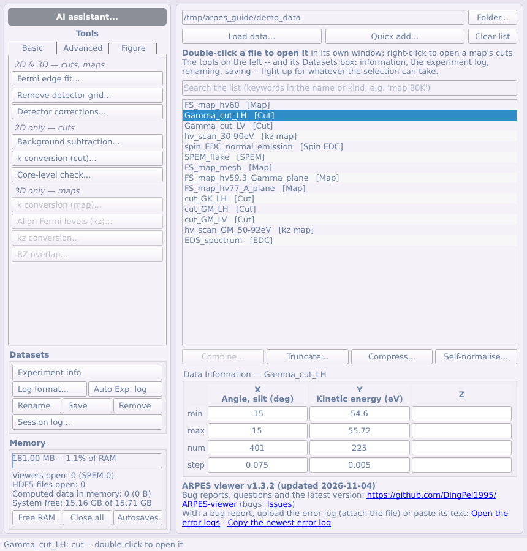
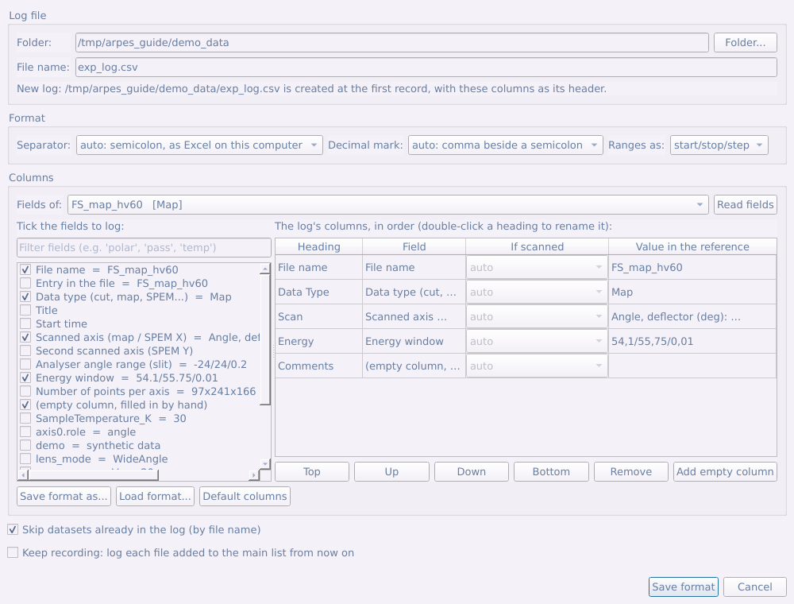

# Partie 2 — Le panneau principal

La fenêtre principale est un navigateur de jeux de données. Cette partie présente la liste et tout ce qui l'entoure, sauf le panneau d'outils (parties 4 à 6) et l'AI assistant (partie 7).

## 2.1 La fenêtre principale en un coup d'œil

La fenêtre principale est un **navigateur** : une ligne par *jeu de
données*, et non par fichier (un fichier `.nxs` contient souvent plusieurs
mesures, chacune sur sa propre ligne). Le type est indiqué après le nom :
`[Cut]`, `[Map]`, `[kz map]`, `[k-map]`, `[SPEM]`, `[EDC]`, `[Spin EDC]`…

Elle a trois parties :

- **Le panneau d'outils** (à gauche) : le bouton **AI assistant...** en haut
  ([partie 7](#partie-7--agents-ia)), puis tous les outils d'analyse et de traitement sous
  forme de boutons, en trois onglets **Basic**, **Advanced** et **Figure**
  ([parties 4 à 6](#partie-4--le-panneau-doutils--onglet-basic)). Sous les onglets, le cadre **Datasets**.
- **La liste** (à droite), avec ses boutons.
- **Le cadre Memory** (en bas à gauche) et la ligne de version (en bas à
  droite).

| Action | Comment |
|---|---|
| Ouvrir un jeu de données dans sa propre fenêtre | **double-clic** sur la ligne (ou clic droit → **Open**) |
| Lancer un outil sur les lignes sélectionnées | son bouton dans le **panneau d'outils** |
| Empiler plusieurs coupes en une carte, raccorder une carte / carte kz mesurée en plusieurs morceaux, ou additionner des mesures répétées | **Combine...** sous la liste |
| Chercher et trier dans la liste | la **recherche** au-dessus de la liste ; clic droit → **Sort by name** / **Sort by data type** |
| Rogner à un intervalle, regrouper des points, normaliser chaque spectre sur lui-même | **Truncate...**, **Compress...**, **Self-normalise...** sous la liste |
| Ouvrir la coupe le long de la fente ou de l'axe balayé d'une carte | **clic droit** sur la ligne (ou sur une sélection de lignes) |
| Lire les métadonnées, écrire le journal d'expérience, renommer, enregistrer, retirer | le cadre **Datasets** du panneau d'outils, au-dessus de Memory |
| Voir et libérer la mémoire, fermer toutes les fenêtres, ouvrir le dossier de sauvegarde | le cadre **Memory**, en bas à gauche |
| Voir quelle version est utilisée, signaler un bogue, obtenir la dernière version | la barre de titre et la dernière ligne de la fenêtre (lien GitHub) |

Les quatre boutons sous la liste agissent sur les lignes sélectionnées
au-dessus et créent de nouvelles lignes — les originaux ne sont jamais
modifiés.

**Le menu contextuel** contient les façons d'ouvrir les lignes :
**Open**, **Open slit cut** et **Open scan-axis cut** (pour une carte), et
deux façons d'ordonner toute la liste : **Sort by name** (`Cut_9` avant
`Cut_10`) et **Sort by data type** (groupées par la dernière étiquette de
traitement du nom -- `[norm]`, `[E-E_F]`, `[k]`… -- dans l'ordre du
traitement, puis par type et nom ; voir [§1.5](#15-types-de-données)). Une entrée qui ne convient pas à la sélection est grisée, et son
infobulle en donne la raison.

**La recherche** (au-dessus de la liste) n'affiche que les lignes dont le
nom ou le type contient chacun des mots tapés (`map 80K`, sans tenir compte
des majuscules) ; videz-la pour tout revoir. Les lignes cachées sont
désélectionnées : rien d'invisible n'est traité.

**Le cadre Datasets** (panneau d'outils, entre les outils et Memory) contient
le reste de ce qui se fait aux lignes : **Experiment info**, **Log format...**
et **Auto Exp. log** côte à côte (voir [le journal d'expérience](#23-le-journal-dexpérience)),
**Rename**, **Save** et **Remove** sur une ligne, et **Session log...**. Ses
boutons se grisent quand ils ne conviennent pas à la sélection.

## 2.2 Charger des données

**Load data...** ouvre la fenêtre de chargement. **Quick add...** la saute et
ajoute les fichiers choisis avec la détection automatique.

1. **Files** — choisir un ou plusieurs fichiers (*Select file(s)...*). Le
   filtre de fichiers est construit à partir de ce que les lecteurs installés
   savent ouvrir.
2. **Reader** — détecté automatiquement, et le résultat est affiché
   (*Detected: 3 × This program's own format*). À ne changer que si un
   fichier est mal lu.
3. **Datasets found** — le contenu de chaque fichier, lu à partir de sa seule
   *structure*. C'est instantané même pour un balayage de plusieurs Go ; rien
   n'est lu avant d'ouvrir une ligne.
4. **Axes** — *Axis order* réordonne une fois pour toutes les dimensions du
   tableau, dès le chargement. *First axis of a map is* indique ce qui a été
   balayé : un angle de déflecteur (par défaut), une **énergie de photon**, une
   température, une tension de grille, un délai… L'unité reste ainsi correcte
   partout ensuite, et aucune conversion en k n'est proposée pour un axe qui
   n'est pas un angle.

**Dossiers CASSIOPEE.** Sélectionnez n'importe quel fichier d'une série
numérotée (`nom_1_ROI1_.txt`, `nom_2_ROI1_.txt`, …) : tout le dossier est
listé une seule fois, comme un cube assemblé. Qu'il devienne une carte en
angle ou une carte kz est déterminé à partir des fichiers de paramètres `_i`
placés à côté des spectres. La ligne porte l'énergie de photon et la
polarisation lues dans ces fichiers — `FineMap 117eV LH`, ou
`KzScan 40-120eV LH` pour un balayage en énergie de photon — pour distinguer
les répétitions d'un même balayage à une autre énergie ou polarisation.

**Fichiers ANTARES en énergie de photon (PhD).** Un fichier `.nxs` PhD (une
entrée `Phd_NNNN` par énergie de photon) est listé comme une seule `kz map` :
les images sont triées par énergie de photon et chaque axe en énergie
cinétique est rapporté à E_F avec son propre hν (travail de sortie 4,5 eV,
que la conversion k_z utilise ensuite). Chaque image s'ouvre encore seule
comme une coupe.

## 2.3 Le journal d'expérience

Deux boutons côte à côte dans le cadre **Datasets** écrivent le journal du
temps de faisceau -- un fichier CSV, une ligne par mesure -- à partir des
métadonnées des fichiers : **Log format...** (à gauche) le prépare une fois,
**Auto Exp. log** (à droite) y ajoute les jeux sélectionnés d'un clic.

**Log format...**

1. **Log file.** Choisissez le dossier et tapez le nom du fichier. Si un
   journal de ce nom existe déjà, la fenêtre montre **son propre format**,
   à ajuster.
2. **Format.** *Separator* et *Decimal mark* sont par défaut ceux d'Excel
   sur cet ordinateur. Excel découpe un CSV au séparateur de liste du
   système -- un **point-virgule** partout où la virgule est le séparateur
   décimal (réglages français, allemands, italiens...) -- et un fichier
   séparé par des virgules s'y ouvre avec tout dans la première colonne.
   Laissez-les sur *auto*, sauf si le journal est destiné à un ordinateur
   réglé autrement. *Ranges as:* écrit un intervalle `start/stop/step` ou
   `start:step:stop`.
3. **Columns.** *Fields of:* choisit un jeu de données de la liste -- du
   type que vous consignez le plus -- et **Read fields** liste tout ce qu'il
   contient, avec sa valeur : nom du fichier, type, heure de début et
   intervalles balayés tirés des données, puis chaque champ de métadonnées
   et chaque moteur. **Cochez** un champ pour en faire une colonne. Dans le
   tableau de droite, double-cliquez un titre pour le renommer, et rangez
   les colonnes dans l'ordre voulu avec **Top / Up / Down / Bottom**. **Add
   empty column** ajoute une colonne à remplir à la main (commentaires).
   **Save format as...** / **Load format...** en gardent un par ligne de
   lumière.
4. **If scanned.** Ce qu'écrit une colonne de position ou d'angle dépend de
   la mesure :
   - une **coupe** : l'échantillon n'a pas bougé -- la valeur du moteur ;
   - un balayage **SPEM** : l'axe de platine balayé, `start/stop/step`
     (*SPEM: scanned X* / *Y* pour les colonnes de la platine) ;
   - une **carte** prise au manipulateur plutôt qu'au déflecteur : l'angle
     en `start/stop/step` (*map: scanned angle*), et une position de
     l'échantillon corrigée avec l'angle en `début..fin` ;
   - une **carte kz** : l'intervalle d'énergie de photon (*kz map: photon
     energy*).

   *auto* (par défaut) reconnaît le moteur balayé à son nom, et une position
   qui a bougé à ses valeurs. Toute autre mesure reçoit la valeur du champ.
5. **Save format.** Si le journal contient déjà des lignes et que son format
   a changé, il est **réécrit sous le nouvel en-tête** : chaque ligne suit
   ses colonnes (renommées ou déplacées), les nouvelles colonnes restent
   vides pour les anciennes lignes, et les colonnes retirées sont nommées
   d'abord, car leur contenu disparaît. L'en-tête reste la seule première
   ligne.

*Skip datasets already in the log* omet les fichiers dont le nom figure déjà
dans la colonne des noms. **Keep recording** consigne chaque fichier ajouté
ensuite à la liste, jusqu'à la fermeture du programme : pendant le temps de
faisceau, ajoutez chaque fichier mesuré et le journal se tient à jour.

**Auto Exp. log** ajoute les lignes sélectionnées après la dernière ligne du
journal, sans rien ouvrir ; la barre d'état dit combien. La toute première
fois, il ouvre d'abord *Log format...*.

Si le journal est ouvert dans Excel, Windows refuse de l'écrire : fermez-le
dans Excel et cliquez à nouveau.

## 2.4 Combiner des jeux de données : empiler, raccorder, additionner

**Combine...** (sous la liste) fait trois choses différentes, et demande
laquelle :

- **Stack (empiler)** — *coupes seulement*. Chaque coupe devient une tranche
  d'une nouvelle carte, le long d'un axe que vous nommez : série en
  température, en tension de grille, une coupe par énergie de photon. Le
  résultat s'examine comme n'importe quelle carte.
- **Join (raccorder)** — *coupes, cartes, cartes kz ou cartes k, toutes du
  même type*. Les morceaux d'une mesure prise en plusieurs fois sont remis
  bout à bout le long de l'un de leurs propres axes : une carte dont la plage
  du déflecteur a été balayée en deux parties, une carte kz dont la plage
  d'énergie de photon a été répartie sur plusieurs acquisitions, une coupe
  dont la fenêtre d'énergie a été prise en deux moitiés.
- **Sum repeated scans (additionner)** — la même mesure prise plusieurs
  fois : **Combine** ouvre la fenêtre des mesures répétées (voir
  [ci-dessous](#additionner-des-mesures-répétées)).

**Empiler des coupes**

1. Sélectionnez les coupes dans la liste (Ctrl/Maj-clic) et cliquez sur
   **Combine...**. L'empilement exige un axe identique point par point
   (même nombre de points, mêmes valeurs, mêmes unités). Si **l'autre** axe
   diffère — des fenêtres d'énergie un peu décalées d'une coupe à l'autre,
   en général — les coupes sont empilées quand même : cet axe est d'abord
   **tronqué** à la plage que toutes couvrent, et chaque coupe rééchantillonnée
   sur les points de la première dans cette plage (la fenêtre l'indique).
   Si la plage commune fait moins de la moitié de celle d'une coupe, ce sont
   plutôt les morceaux d'une mesure : utilisez *Join*. Si les deux axes
   diffèrent, ou si les plages ne se recouvrent pas, *Stack* est grisé avec
   la raison, et *Join* est proposé à la place.
2. Il demande s'il faut les combiner **dans l'ordre de la liste**. *Yes* garde
   cet ordre ; *No* permet de le choisir.
3. Choisissez **Stack**, puis définissez le nouvel axe : **New axis is**
   (température, tension de grille, énergie de photon, délai, position,
   autre — ce choix remplit *Name* et *Unit*, modifiables), **Start** et
   **Step** (le pas). Chaque coupe est affichée avec la valeur qu'elle reçoit.
   Si vous avez choisi de réordonner, **faites glisser** les lignes (ou
   utilisez **Move up** / **Move down** / **Reverse**). Cliquez sur
   **Combine**.

Une série en énergie de photon de coupes en angle devient une `kz map`, que
*Align Fermi levels (kz map)* et *Convert to momentum (kz, k∥)* acceptent
(voir [§4.10](#410-aligner-les-niveaux-de-fermi-dune-carte-kz)) ; tout autre axe donne une
`map` dont le premier axe est marqué comme n'étant pas un angle, si bien
qu'aucune conversion en k n'est proposée.

**Raccorder les morceaux d'une mesure**

1. Sélectionnez les morceaux (toutes des cartes, ou toutes des cartes kz, ou
   toutes des coupes …) et cliquez sur **Combine...**. Les cartes et
   cartes kz passent directement à *Join*.
2. **Join along** : l'axe selon lequel la mesure a été découpée. Il part de
   l'axe dont l'étendue diffère d'un morceau à l'autre — l'axe déflecteur
   d'une carte, l'énergie de photon d'une carte kz, ou l'énergie de coupes
   prises en deux fenêtres d'énergie — et il est donc en général déjà juste.
3. **Where pieces overlap** : *Average them* (moyenne), ou garder le morceau
   le plus tôt / le plus tard dans l'ordre affiché (faites glisser les lignes
   pour le changer).
4. La boîte de dialogue donne l'intervalle de chaque morceau et le
   **Result** — l'intervalle raccordé et le nombre de points — avec des notes
   sur ce qu'il a fallu faire. Cliquez sur **Combine**.

Traitement des axes :

- Des morceaux sur une même grille (même pas, intervalles qui se touchent ou
  se recouvrent d'un nombre entier de points — le cas habituel) sont
  **copiés tels quels**, sans interpolation.
- Un morceau de pas différent ou décalé d'un demi-pas est **interpolé** sur
  l'axe commun (au pas du premier morceau), et la boîte de dialogue le dit.
- Si les **autres axes** diffèrent — une fenêtre en énergie décalée de
  quelques meV entre deux acquisitions, un nombre différent de canaux de
  fente — tous les morceaux sont rééchantillonnés sur l'intervalle que
  **tous** couvrent, et la boîte de dialogue le dit.
- Un intervalle couvert par aucun morceau est un **trou**, laissé à zéro et
  signalé.
- Une carte kz raccordée reste une `kz map` : lancez *Align Fermi levels (kz
  map)* sur le résultat plutôt que sur les morceaux (les ajustements par
  énergie de photon des morceaux ne sont pas repris).

### Additionner des mesures répétées

Pour une coupe ou une carte fine prise en plusieurs balayages courts, afin de
repérer un échantillon qui vieillit. Sélectionnez les balayages (au moins
deux, d'un même type) → **Combine...** → **Sum repeated scans** →
**Combine**, qui ouvre la fenêtre des mesures répétées :

1. **Est-ce bien la même mesure ?** La grille et les conditions enregistrées
   de chaque balayage (énergie de photon, polarisation, angles, position,
   température, énergie de passage, mode de lentille) ; en orange ce qui
   diffère du premier.
2. **L'échantillon a-t-il changé ?** Cliquez sur **Compare the scans**.
   Chaque balayage est comparé à la somme des autres : le *χ² / point* est à
   peu près le même pour des balayages qui ne diffèrent que par le bruit de
   comptage et augmente quand le spectre change ; ceux qui ressortent sont
   marqués **changed**. Le décalage en énergie de l'EDC de chacun et son taux
   de comptage sont donnés ; cliquez une ligne pour voir son EDC face aux
   autres.
3. **Additionner.** Cochez les balayages à garder (les *changed* sont
   décochés au départ), choisissez de corriger ou non les décalages, **Sum**
   ou **Mean**, puis **Sum to list**.

## 2.5 Fenêtres pas à pas

Les outils qui demandent plusieurs décisions s'ouvrent en **étapes numérotées**
(additionner des mesures répétées, corrections du détecteur, ajustement de
liaisons fortes, structure cristalline, bandes calculées) : le titre indique
*Step 2 of 4: …*, un encadré bleu dit à quoi sert l'étape et quoi faire,
**Next →** reste grisé (avec la raison à côté) tant que l'étape n'est pas
terminée, et **← Back** ou la liste des étapes à gauche permet de revenir.
