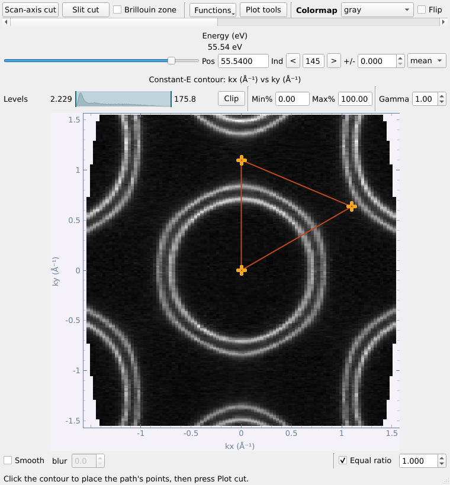
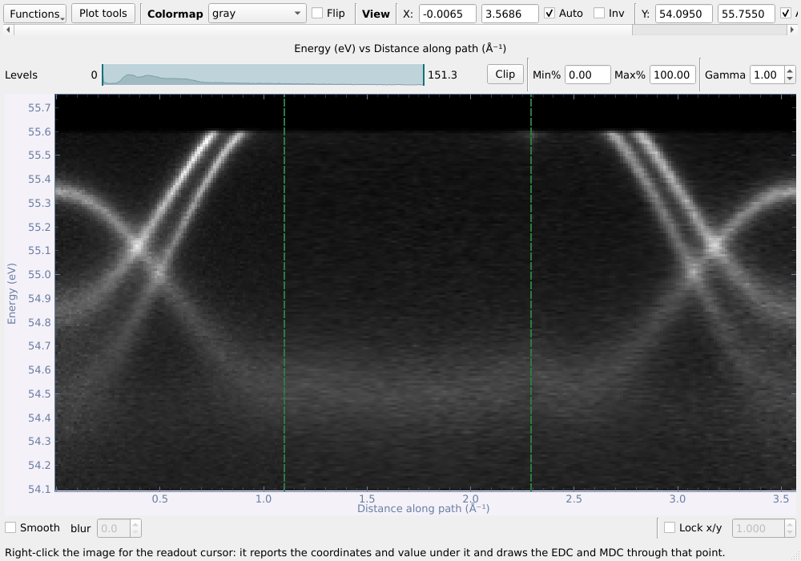
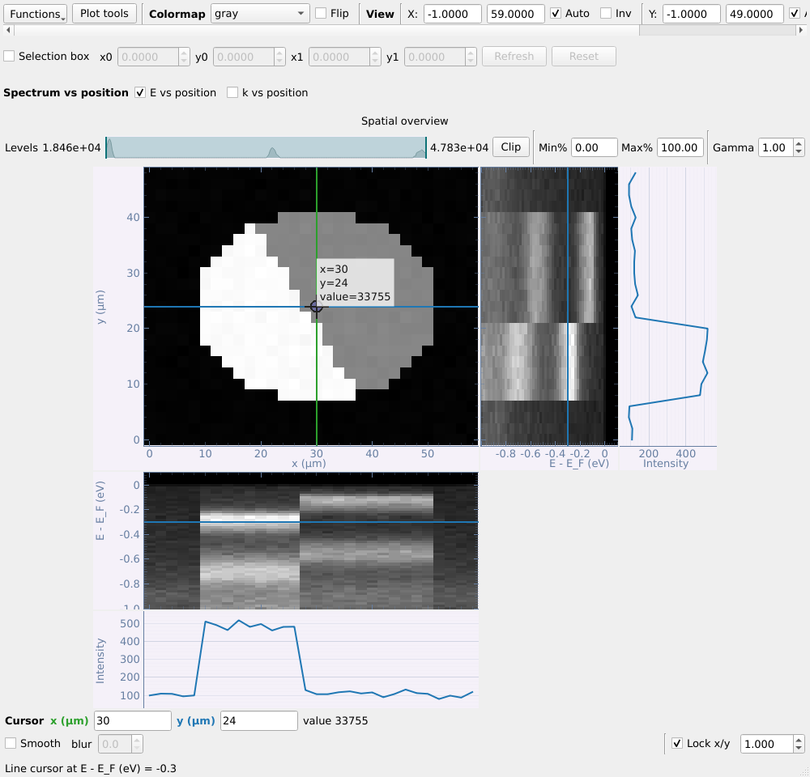
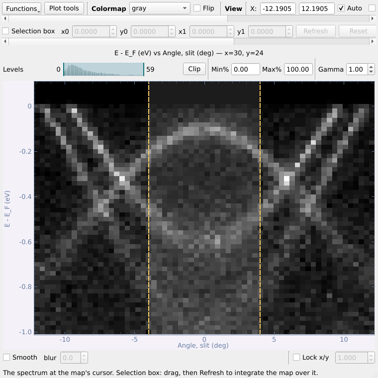
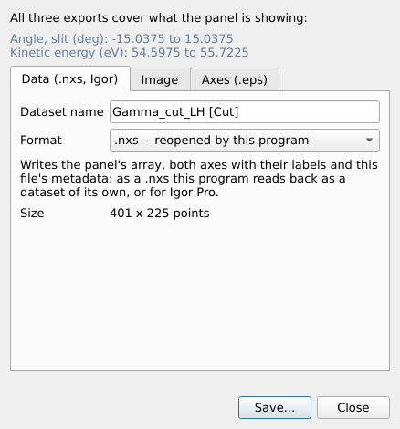

# Partie 3 — Les fenêtres de visualisation

Chaque jeu de données s'ouvre dans sa propre fenêtre de visualisation. Cette partie présente d'abord ce que toutes ces fenêtres ont en commun, puis chaque type de données.

## 3.1 Ce que les fenêtres de visualisation ont en commun

Chaque jeu de données s'ouvre dans sa propre fenêtre : on peut placer côte à
côte une carte, ses coupes et un autre fichier.

- **La ligne du haut** : le menu **Functions** (tout ce que la fenêtre sait
  faire), **Plot tools** (lignes guides et étiquettes sur ce graphique — voir
  plus bas), la palette de couleurs (propre à chaque fenêtre) avec **Flip**, et
  les réglages de vue — étendue des axes, **Auto**, **Inv** (inverser),
  **Reset**, **Grid**.
- **Au-dessus de chaque image** : la barre **Levels** (faire glisser les deux
  poignées, ou saisir des centiles **Min%/Max%** ; **Clip** les applique) et
  **Gamma**. Un min/max que vous fixez est conservé quand la tranche se
  déplace (l'énergie d'un contour, l'angle d'une coupe, le curseur d'une
  carte spatiale), si bien que toutes les positions partagent la même échelle
  de couleurs ; ramenez les poignées aux deux extrémités, ou réglez 0 %–100 %,
  pour suivre de nouveau la plage propre à chaque image.
- **Sous chaque image** : **Smooth** (affichage seulement, les données ne
  changent pas) et **Lock x/y** (rapport d'aspect).
- **Curseur de lecture** — clic droit sur l'image → *Readout cursor*. Il
  donne la valeur sous le curseur et, sur une coupe, trace l'**EDC** (à
  droite) et la **MDC** (en dessous) passant par ce point. **EDC ±** /
  **MDC ±** intègrent sur une fenêtre, affichée comme une bande ombrée sur
  l'image. Saisissez une position dans la ligne **Cursor** et appuyez sur
  Entrée pour l'y placer exactement.
- **EDC → list** / **MDC → list** ajoutent la courbe affichée à la liste
  principale comme jeu de données à part entière (voir
  [§3.5](#35-courbes--edc-mdc-et-ajustement-de-courbes)).
- **Clic droit sur l'image → Export** enregistre ce que montre le panneau —
  données (`.nxs`), image, ou axes vectoriels (`.eps`) ; voir
  [§6.1](#61-le-composeur-de-figures).
- **Functions → Slice → Save slice to the main list / Freeze slice in a new
  window** conserve une copie de la tranche affichée. La fenêtre figée (et
  *Open this position in a new window* sur une carte spatiale) s'ouvre avec le
  min/max et le gamma du panneau, pour une comparaison directe. Elle a ses
  propres **Plot tools**, et un bouton **Figure composer...** pour en faire
  une figure ([§6.1](#61-le-composeur-de-figures)).

Le menu **Functions** ne contient plus que ce qui agit sur la fenêtre
elle-même — les outils qui prennent un jeu de données sont dans le panneau
d'outils de la fenêtre principale ([§2.1](#21-la-fenêtre-principale-en-un-coup-dœil)) :

| Fenêtre | Functions |
|---|---|
| carte / carte kz / carte k (contour) | Arbitrary cut ; Slice : enregistrer / figer la tranche |
| coupe | Straighten bands (FS correction) ; Slice : enregistrer / figer |
| coupe selon la fente d'une carte | Straighten bands (FS correction) pour tout le cube ; Show the map |
| courbe | Curve fit, Spin analysis ; Crop, Bin, Normalise, Background, Shift axis, Add √N errors |

Une entrée qui s'applique mais ne peut pas encore être lancée est grisée, et
son infobulle en donne la raison.

**Case Brillouin zone.** Une carte k ou une carte kz convertie sur laquelle
une zone a été tracée ([§4.11](#411-zone-de-brillouin)) la garde : sa fenêtre a
une case **Brillouin zone** sur la ligne du haut pour l'afficher ou la
masquer.

### Plot tools : lignes de repère et textes sur le graphique

**Plot tools**, sur la ligne du haut de chaque fenêtre de visualisation
(coupes, cartes, balayages spatiaux, courbes, tranches figées), ouvre une
petite fenêtre qui dessine **sur le graphique que vous avez sous les yeux** :

|  | |
|---|---|

- **Type** : *Vertical line*, *Horizontal line*, *Line at an angle* (passant
  par un point ; l'angle est dans les unités du graphique, la pente vaut donc
  tan(angle) unités y par unité x), ou *Text label*.
- **Position** (x, y), **Angle**, une **Label** facultative (affichée sur la
  ligne, p. ex. `E_F`, `Γ`), une **Colour** (neuf couleurs en un clic, ou
  **More...**), **Width**, **Style** (plein, tirets, pointillés, tiret-point)
  et **Text size**.
- **Add** la dessine à la position saisie (**Centre of view** la remplit) ;
  **Place by clicking** en dessine une là où vous cliquez sur le graphique.
- **Faites glisser** une ligne sur le graphique pour la déplacer ; la fenêtre
  suit. Sélectionnez un repère dans la liste pour le **modifier** — chaque
  changement s'affiche aussitôt — ou **Remove** pour le supprimer ; **New
  guide** arrête la modification ; **Remove all** vide le graphique.
- Dans une fenêtre à plusieurs panneaux, **Draw on** choisit lequel.
- Les repères restent quand la tranche se déplace (une ligne E_F reste à E_F
  quand on parcourt une carte) et quand la fenêtre Plot tools est fermée.
  **Export → Image** du panneau les dessine aussi (*Include the Plot tools
  guides*).

Les *Plot tools* servent à regarder les données. Pour faire une figure
d'article, utilisez le **composeur de figures** et ses **Figure tools**
([§6.1](#61-le-composeur-de-figures)).

## 3.2 Les cartes : le contour et ses deux coupes

Une carte s'ouvre sur son **contour à énergie constante**. Le curseur du haut
choisit l'énergie (**Pos** en eV, ou **Ind** en indice ; **±** intègre sur une
fenêtre, en **mean** ou **sum**). **Scan-axis cut** et **Slit cut** ouvrent
les deux coupes orthogonales, chacune dans sa fenêtre. (L'axe de balayage
est ce qui a été balayé pour faire la carte — en général l'angle du
déflecteur, mais aussi une rotation du manipulateur ou, pour une carte kz,
l'énergie de photon — d'où le nom du bouton.)

| Coupe selon la fente (angle de fente vs énergie) | Coupe selon le déflecteur (angle de déflecteur vs énergie) |
|---|---|
|  |  |

**Un seul curseur pour les trois fenêtres.** Activer le curseur de lecture
dans l'une l'active dans les autres, et le déplacer n'importe où recoupe les
autres en ce nouveau point. Chaque axe garde sa couleur partout :
**déflecteur en rouge, fente en vert, énergie en bleu**. Une ligne de curseur
a la couleur de l'axe qu'elle maintient constant, et l'EDC ou la MDC qu'elle
alimente est tracée de la même couleur. Les largeurs d'intégration (les
champs ±) appartiennent à chaque fenêtre et ne sont jamais partagées.

On peut aussi ouvrir directement une coupe d'une carte depuis la liste (clic
droit → **Open slit cut** / **Open scan-axis cut**) ; le contour reste alors
caché jusqu'à ce qu'on le demande (*Functions → Show the map*).

## 3.3 Coupes arbitraires et correction de la surface de Fermi

### Coupe arbitraire

*Functions → Arbitrary cut...* sur n'importe quel contour : cliquez jusqu'à
six points (ou saisissez-les) ; la coupe les parcourt dans l'ordre — ici
Γ → M → K → Γ sur la carte k. **One dataset per segment** crée un jeu de
données par segment.

| Chemin sur le contour | Points |
|---|---|
|  |  |

Le résultat est une coupe en fonction de la distance le long du chemin ; les
coins du chemin sont marqués par des tirets verts, pour qu'un coude à cet
endroit ne soit pas pris pour de la physique.

### Correction de la surface de Fermi (FS)

*Functions → Straighten bands (FS correction)...* sur une coupe (ou sur la coupe selon la fente
d'une carte) redresse une structure qui devrait être plate — en général le
front de Fermi, courbé en fonction de l'angle de l'analyseur. Cliquez le long
de la structure : un polynôme (d'ordre 2 par défaut) est ajusté et chaque
colonne d'angle est décalée en énergie. **From a reference (Au)...** prend
plutôt la courbe sur un spectre d'or présent dans la liste. Sur la coupe
selon la fente d'une carte, le même décalage est appliqué à tout le cube.

## 3.4 Cartes kz et cartes k

Une **carte kz** (balayage en énergie de photon) s'ouvre comme une carte en
angle : son contour montre l'énergie de photon en fonction de l'angle de
l'analyseur à l'énergie choisie par le curseur, et ses deux coupes sont le
spectre à une énergie de photon et la dispersion en énergie de photon à un
angle. Alignez ses niveaux de Fermi et convertissez-la en (k_z, k∥) depuis
l'onglet Basic ([§4.9](#49-aligner-les-niveaux-de-fermi-dune-carte-kz), [§4.10](#410-convertir-une-carte-kz-en-impulsion)).

Une **carte k** (une carte convertie en impulsion, [§4.8](#48-conversion-en-k-dune-carte)) et une
**carte kz convertie** s'ouvrent dans la même fenêtre de contour, sur des axes
en impulsion. Quand une zone de Brillouin y a été tracée ([§4.11](#411-zone-de-brillouin)),
elles la gardent, et une case **Brillouin zone** sur la barre du haut l'affiche
ou la masque. Les séries de tranches ([§5.6](#56-figure-en-série-de-tranches)) et les exports la
dessinent aussi.

## 3.5 Courbes : EDC, MDC et ajustement de courbes

**EDC → list** / **MDC → list** sous n'importe quelle image, ou un fichier
résolu en spin, donnent un jeu de données de courbes, qui s'ouvre dans la
**fenêtre de courbes** :

Les canaux peuvent être masqués, décalés en cascade (**Offset**), affichés
avec des **Error bars** (à partir d'un canal σ), et **Range** délimite une
fenêtre en x utilisée par les opérations. *Functions → Transform*
propose **Crop**, **Bin**, **Normalise**, **Subtract a background**
(constant, linéaire, Shirley), **Shift the axis** et **Add counting errors
(√N)** ; chacune crée un nouveau jeu de données et propage correctement σ.

### Ajustement de courbes

*Functions → Curve fit...* : **Peaks on a background** (pics lorentziens,
gaussiens ou de Voigt, placés par clic ou par **Find peaks** ; fond nul /
constant / linéaire / Shirley ; résolution instrumentale ; **× Fermi edge**
facultatif), ou le **Fermi edge** lui-même. La pondération est le σ propre au
canal, √N, ou uniforme. Chaque paramètre est donné avec son erreur ; le
résidu est affiché en unités de σ.

**Fit to list** conserve les données, l'ajustement, le résidu et les
composantes ; **Copy results** copie un tableau séparé par des tabulations.
Un ajustement du front de Fermi permet **List a copy with E_F = 0**.

## 3.6 Données résolues en spin

Une EDC de spin s'ouvre avec une courbe par canal de spin :

*Functions → Spin analysis...* :

- Le tableau lit l'étiquette de chaque canal (réglage du manipulateur,
  aimantation de la cible, axe et signe comptés comme « haut ») ; **Axis** et
  **Counts as** peuvent être modifiés.
- Le **Cross ratio** (par défaut quand les canaux le permettent) élimine
  exactement à la fois la transmission et la réflectivité de la cible ; une
  **seule paire** est disponible mais porte l'asymétrie instrumentale, qui est
  mesurée et indiquée (ε).
- **S_eff** (fonction de Sherman, 0,2 par défaut), **Bin**, fenêtre **Zero
  reference** facultative.
- Graphiques : canaux bruts, P avec ses barres d'erreur, et I↑ / I↓ avec
  leurs erreurs.
- **P to list**, **I↑ / I↓ to list**, **As a figure** (ouvre le composeur de figures).

## 3.7 Balayages résolus spatialement (nano-ARPES)

Un balayage en espace réel s'ouvre dans **deux fenêtres** : la **carte
spatiale** (l'intensité totale en chaque position) et, à côté, le **spectre
E-k au curseur** dans la visionneuse de coupe — avec ses propres outils
(Functions, curseur de lecture avec EDC/MDC, Export). Sur la carte, le
**curseur de lecture** (actif dès l'ouverture) choisit le point : faites-le
glisser, ou tapez une position dans la ligne **Cursor** sous la carte. Fermer
l'une des fenêtres ferme les deux.

**Selection box** — dans la ligne au-dessus de chaque image. Cochez-la,
faites glisser le cadre (ou tapez ses coins **x0 y0 x1 y1**), puis appuyez
sur **Refresh** (ou Entrée) ; rien n'est calculé avant, si bien qu'un gros
balayage n'est lu que lorsque vous le demandez. Décocher le cadre le masque
mais garde ses coins — recochez-le, il revient à la même place — et garde le
**résultat** : l'intégration reste affichée jusqu'à **Reset** (à côté de
Refresh).

- sur la carte, la fenêtre du spectre montre les spectres **sommés sur le
  cadre**. Le spectre reste cette somme, cadre coché ou non, jusqu'à
  **Reset** ; il suit alors de nouveau le curseur ;
- sur le spectre, la carte montre l'intensité de la **fenêtre (k, E)**
  choisie sur l'échantillon — c'est ainsi qu'on repère un domaine ou le bord
  d'un flocon. **Reset** redonne la carte complète.

**E vs position / k vs position** — deux cases sur la ligne sous la
Selection box (une à la fois). Elles tracent, **à droite et sous la carte**, le spectre passant par
le curseur en fonction de chaque axe spatial : l'énergie (ou k) en fonction de
la position, sur les mêmes axes que la carte. Deux **lignes pointillées**
apparaissent sur le spectre : la bande de k (pour E vs position) ou d'énergie
(pour k vs position) sur laquelle l'image est intégrée. Faites glisser les
lignes (la bande ombrée entre elles ne prend pas la souris : un cadre de
sélection dessous reste déplaçable), ou tapez **from / to** dans les cases
**Band** au-dessus du spectre. La fenêtre s'agrandit pour faire place aux
images à droite et sous la carte, qui garde ainsi sa taille, et se réduit
quand elles disparaissent.

**Line cursor** — clic droit sur l'image à droite ou sous la carte →
*Line cursor*. Une ligne à une énergie (ou un k) apparaît sur cette image, et
l'intensité le long de cette ligne est tracée en fonction de la position
**plus à droite** (pour l'image à droite de la carte) ou **plus bas** (pour
celle du dessous). Faites glisser la ligne pour la déplacer ; décochez
l'entrée pour la retirer.

## 3.8 Exporter un panneau et enregistrer des données

Clic droit sur n'importe quelle image → **Export** → **Data (.nxs, Igor)...**,
**Image...** ou **Axes only (.eps)...**. L'exportation reprend toujours
exactement ce que montre le panneau (étendue comprise) : les données, comme
un jeu de données que ce programme sait relire, ou pour Igor Pro (`.itx`
texte ou onde binaire `.ibw`, axes étalonnés, unités et métadonnées dans la
note de l'onde) ; une image avec la palette
appliquée (PNG, TIFF ou JPEG, à la taille et à la résolution choisies, avec
ou sans les axes, avec les guides des Plot tools s'il y en a, et avec la zone
de Brillouin si le jeu de données en a une) ; ou le cadre, les graduations et
les étiquettes en PostScript vectoriel, pour y placer l'image dans
Illustrator (avec, au choix, la zone de Brillouin tracée dans le cadre — voir
[§4.11](#411-zone-de-brillouin)).

**Save** (panneau d'outils, cadre Datasets) écrit les jeux de données
sélectionnés dans un fichier `.nxs` de votre choix -- plusieurs lignes
sélectionnées vont dans un même fichier -- ou, selon le type de fichier
choisi, pour Igor Pro : un `.itx` qui les contient tous, ou un `.ibw` par jeu
de données. Un fichier Igor est une copie ; les lignes restent inchangées.
