# Partie 4 — Le panneau d'outils : onglet Basic

L'onglet **Basic** regroupe les étapes par lesquelles passe presque chaque jeu de données : le niveau de Fermi, le détecteur, le fond, les conversions en impulsion, les niveaux de cœur et la zone de Brillouin.

## 4.1 Comment fonctionnent les boutons d'outils

Chaque onglet regroupe ses outils selon les données qu'ils prennent :
*2D & 3D — cuts, maps*, *2D only — cuts*, *3D only — maps*. **Un bouton ne
s'allume que si les lignes sélectionnées dans la liste conviennent** : une
conversion k (coupe) demande une coupe en angle, l'arithmétique de coupes
exactement deux coupes, une vue 3D une carte. Survolez un bouton grisé pour
savoir pourquoi.

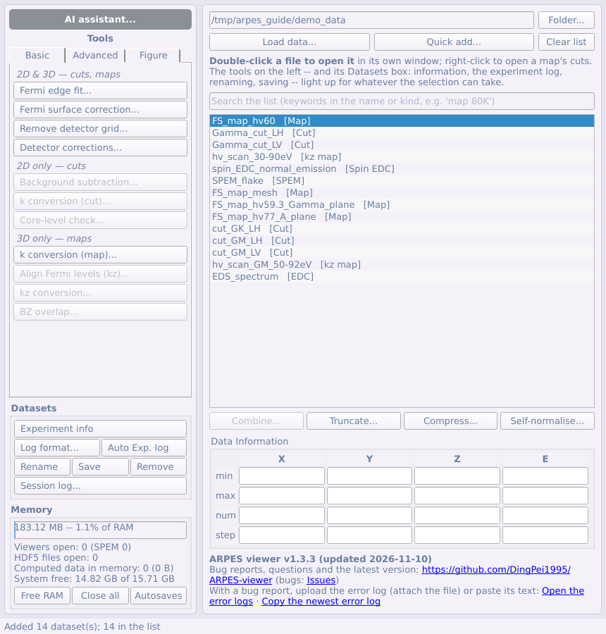

Un outil ne modifie jamais les lignes qu'on lui donne : son résultat est une
nouvelle ligne de la liste, nommée d'après l'originale et l'opération
(`cut1 [k]`), et son historique enregistre l'étape et ses paramètres
(*Experiment info* l'affiche). Les outils qui demandent plusieurs décisions
s'ouvrent en étapes numérotées ([§2.5](#25-fenêtres-pas-à-pas)).

## 4.2 Ajustement du front de Fermi

L'ordre habituel pour une coupe est : **ajustement du front de Fermi → décaler
l'axe en énergie → conversion en impulsion → ajustement MDC/EDC**. Chaque
étape est un bouton du panneau d'outils : sélectionnez la coupe dans la
liste et appuyez dessus.

Panneau → Basic → **Fermi edge fit...** ajuste un front de Fermi (Fermi–Dirac
× densité d'états linéaire, convoluée par une résolution gaussienne) sur
l'EDC sommée dans un cadre. Il ouvre la fenêtre de la coupe avec la fenêtre
d'ajustement ; les deux vont ensemble, et fermer l'une ferme l'autre. La
fenêtre a deux colonnes : à gauche tout ce qui se règle (la région, les
paramètres, les boutons), à droite l'ajustement — l'EDC et la courbe
ajustée, toujours montrées en entier (le graphe ne zoome ni ne se déplace),
et le résumé dessous.

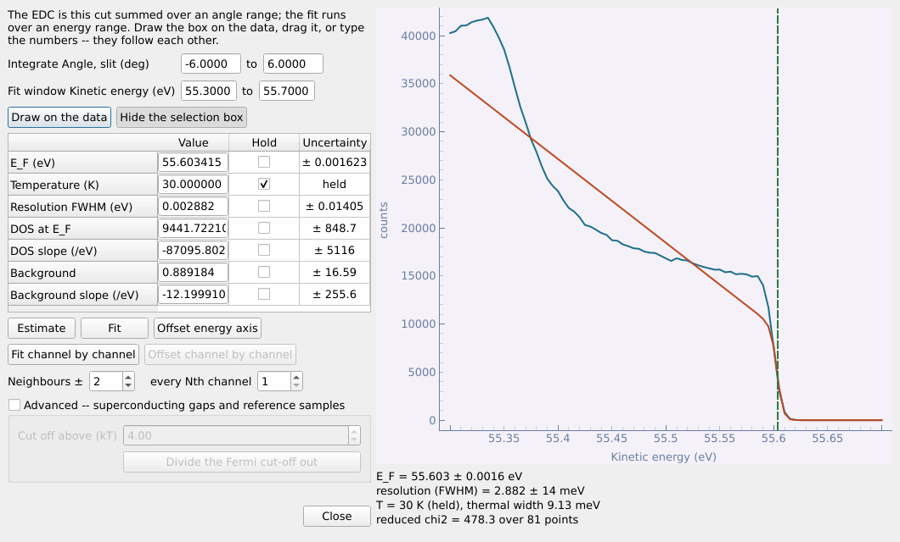

1. Fixez la région : appuyez sur **Draw on the data** et tracez un cadre
   sur la coupe — sa largeur est l'intervalle d'angle sommé, sa hauteur la
   fenêtre d'énergie ajustée — ou **Show the selection box** et faites-le
   glisser, ou saisissez les intervalles. Les trois se suivent.

   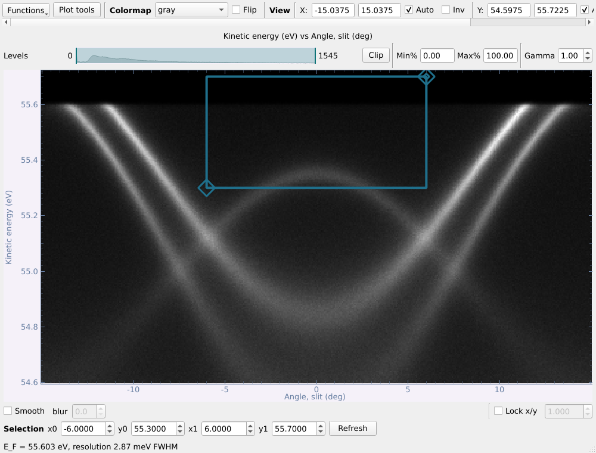

2. **Estimate**, puis **Fit**. Cochez **Hold** pour fixer un paramètre (la
   température est fixée par défaut à la valeur enregistrée). Chaque
   paramètre est donné avec son incertitude.
3. **Offset energy axis** ajoute à la liste une copie de la coupe en
   **E − E_F**.

**Canal par canal.** Sur la ligne sous Fit, **Fit channel by channel**
ajuste le front dans chaque canal du détecteur, dans la fenêtre
d'ajustement (**Neighbours ±** ajoute d'abord des canaux de part et
d'autre, **every Nth channel** échantillonne le détecteur), et trace E_F en
fonction de l'angle sur la coupe — la courbure du front de Fermi, mesurée.
Les canaux vides aux deux bouts de la coupe (sans coups, ou NaN, comme en
laissent certains détecteurs) sont coupés, pas ajustés. **Offset channel by
channel**, à côté, ajoute une copie où chaque canal est sur son propre
**E − E_F** (sur la coupe selon la fente d'une carte : toute la carte, le
long de la fente), les bords vides coupés.

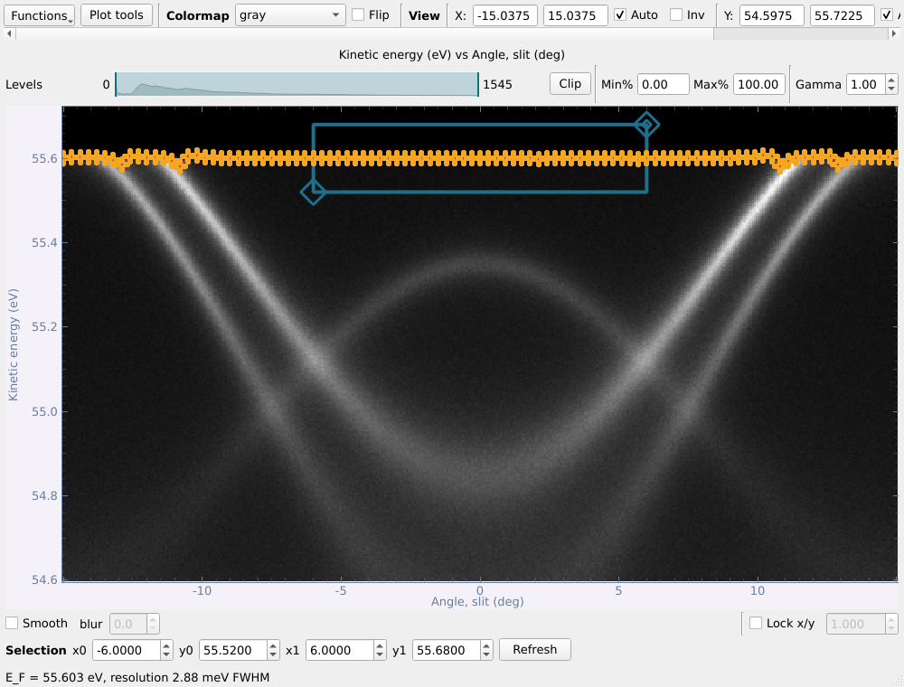

Les deux ajustements sont gardés avec la ligne du jeu de données : elle
devient une **référence** pour la correction de la surface de Fermi
([§4.3](#43-correction-de-la-surface-de-fermi)).

Le coin *Advanced* divise par la coupure de Fermi (pour les gaps et les
échantillons de référence).

**Sur une carte.** Sélectionnez une carte (en angle ou en k) et appuyez sur
le même bouton : la **coupe selon la fente** de la carte s'ouvre avec la
fenêtre d'ajustement, et son curseur choisit la coupe ajustée. Après un
ajustement, **Offset energy axis** demande s'il faut décaler **toute la carte
par l'E_F de cette coupe** (*Yes*) ou ajuster **un E_F par coupe** (*No*).
Dans ce second cas, la liste **Fitted cuts** à droite se remplit au fur et à
mesure : déplacez le curseur, **Fit**, recommencez. Un second ajustement au
même endroit remplace le premier, et chaque E_F de la liste se modifie à la
main. Les coupes entre deux coupes ajustées sont décalées selon une droite
entre leurs voisines (au-delà de la première et de la dernière, selon
l'ajustement le plus proche), tracée sous la liste. **Offset energy axis by
these fits** ajoute la carte corrigée à la liste.

## 4.3 Correction de la surface de Fermi

L'analyseur courbe le front de Fermi : aux extrémités de la fente, il se
trouve quelques dizaines de meV plus bas qu'au milieu, si bien qu'une bande
qui devrait être plate paraît courbée. Panneau → Basic → **Fermi surface
correction...** le redresse : la courbe du front de Fermi est ajustée par un
polynôme, et chaque colonne d'angle est décalée en énergie pour qu'elle
devienne plate. À faire avant une conversion en k.

Sélectionnez une **coupe**, ou une **carte** (ou carte kz) encore en angle,
et appuyez sur le bouton. Une coupe s'ouvre dans sa fenêtre ; une carte
s'ouvre sur sa **coupe selon la fente**, et la correction est appliquée à
tout le cube. La fenêtre de données et celle de la correction vont
ensemble : fermer l'une ferme l'autre. La fenêtre guide pas à pas
(**Back** et **Next** pour passer d'une étape à l'autre).

**Étape 1 — comment trouver le front de Fermi.** Au choix :

- **By hand** (à la main) : cliquer le front de Fermi sur la fenêtre de
  données (trois étapes) ;
- **From a reference** (référence) : appliquer l'ajustement du front de
  Fermi d'une autre coupe ou carte de la liste principale (deux étapes).
  Seules les lignes dont le front de Fermi a été ajusté avec l'ajustement du
  front de Fermi ([§4.2](#42-ajustement-du-front-de-fermi)) sont proposées ;
  sans elles, ce choix est grisé.

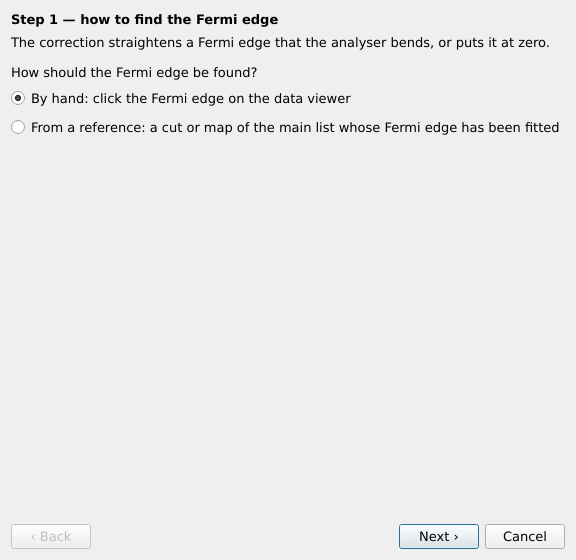

**Étape 2, à la main — cliquer le front de Fermi sur la fenêtre de
données.** Cliquez sur l'image de la fenêtre de données là où se trouve le
front de Fermi, à plusieurs angles répartis sur tout le front, extrémités
comprises. Chaque clic place une croix orange sur l'image et une ligne dans
le tableau des points ; la courbe ajustée est tracée en tirets au fur et à
mesure. Un point mal placé se corrige dans le tableau, ou se supprime
(**Remove selected**, **Clear**). Les clics ne comptent que pendant la
saisie à la main. **Back** vers l'étape 1 efface les points saisis.

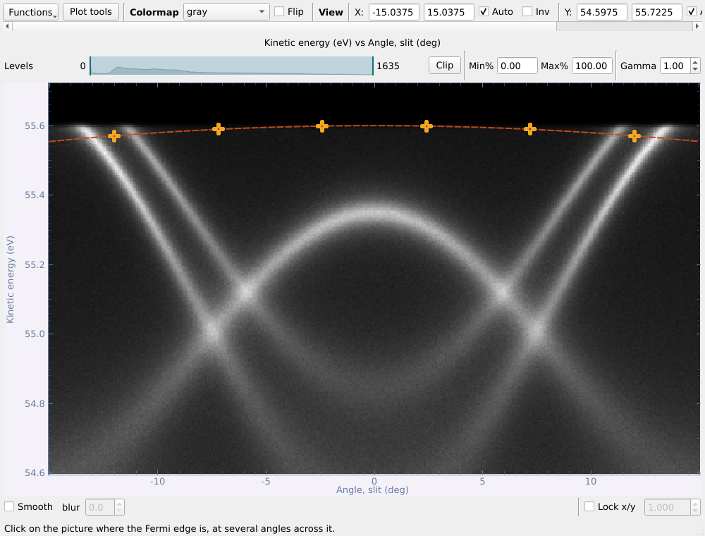

**Étape 3, à la main — vérifier l'ajustement et corriger.** La courbe
ajustée est tracée en tirets sur les données ; vérifiez qu'elle suit le
front de Fermi et supprimez un point égaré sinon. **Fit order** fixe le
polynôme (2, une parabole, est la forme habituelle de la courbure de
l'analyseur ; un ajustement d'ordre n demande n+1 points), **Name** le nom
du résultat. **Correct** décale chaque colonne d'angle pour aplatir la
courbe et ajoute le résultat à la liste (`[FS corr]`) ; l'axe en énergie
s'allonge de l'amplitude de la courbe, et les cases qu'aucune colonne
n'atteint restent vides.

**Étape 2 sur 2, par une référence — la référence, et comment
l'appliquer.** **Reference** liste les autres lignes dont le front de Fermi
a été ajusté (jamais les données elles-mêmes). Leurs paramètres
d'ajustement sont lus sur elles et affichés — rien n'est ajusté ici.
Choisissez ensuite comment l'appliquer, selon les deux façons de
l'ajustement du front de Fermi :

- **One offset** (un décalage) : toutes les données sont décalées de l'E_F
  de la référence (son *Fit*, le front entier). Le résultat est en E − E_F,
  tous les canaux de même.
- **Channel by channel** (canal par canal) : chaque canal est décalé de
  l'E_F de la référence dans ce canal (son *Fit channel by channel*). Les
  canaux hors de ceux que la référence a ajustés — ses bords vides compris
  — sont coupés, comme les bords vides des données elles-mêmes.

Le front de la référence est tracé en tirets sur les données, pour le
comparer au front qu'on y voit. **Correct** ajoute le résultat à la liste
(`[E-E_F]`, ou `[E-E_F ch]` canal par canal).

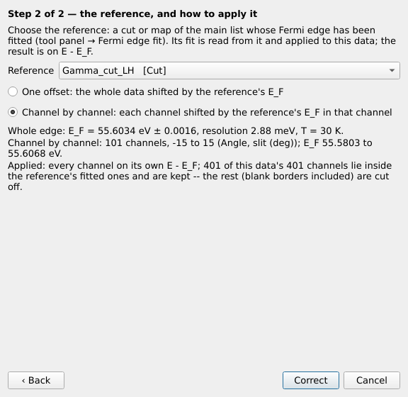

## 4.4 Supprimer la grille du détecteur

Les motifs du MCP (hexagonal) et de la grille (carré) s'impriment sur chaque
image. **À faire en premier** : seules les données encore sur les pixels du
détecteur peuvent être dégrillées ; le bouton refuse donc tout ce qui a déjà
été converti, corrigé ou lissé, et dit pourquoi.

Sélectionnez une carte (ou une carte kz) ou une coupe et appuyez sur panneau
→ Basic → **Remove detector grid...**. Pour une carte, aucune référence n'est
nécessaire — la grille reste sur les mêmes pixels dans chaque tranche, alors
que la photoémission se déplace. **Find and remove the grid** :

- **Before / After** pour une tranche choisie, sur une même échelle de
  couleurs (cochez **Show −∂²I/∂E²** pour rendre toute grille évidente).
- **La grille trouvée**, ses **régions dans l'espace réciproque** (en rouge),
  et le **contraste et le décalage** ajustés pour chaque tranche.
- La puissance restant dans les régions de la grille (1 = plus de grille).
- **Also list the grid pattern** conserve un jeu de données `[grid]`, qu'une
  coupe prise plus tard avec le même mode de lentille et la même énergie de
  passage retrouvera et utilisera.

## 4.5 Corrections du détecteur

Sur une coupe, une carte ou une carte kz telle que mesurée :

1. **Trapèze** -- cochez *Correct a trapezoidal image* et placez les quatre
   coins jaunes sur ceux de la zone éclairée ; l'image de droite la montre
   rendue rectangulaire, le nombre de coups de chaque ligne conservé.
2. **Zones défectueuses** -- **Add a region** et déplacez-la sur un point
   mort ou chaud, ou **Find bad pixels** ; remplissage *smooth* (pour un
   point) ou *linear along* un axe (pour une bande).
3. **Appliquer** -- **Apply to list**. Faites ensuite la suppression de la
   grille, le niveau de Fermi et la conversion en k sur le résultat.

## 4.6 Soustraction du fond

Panneau → Basic → **Background subtraction...** (coupes) retire l'intensité
qui n'appartient pas aux bandes : un fond inélastique de **Shirley** ou de
**Tougaard**, un plancher commun à tous les angles (un percentile de chaque
ligne d'énergie), un **polynôme** lisse — ou divise par la **coupure de
Fermi** (Fermi–Dirac à la température et la résolution enregistrées dans le
fichier, à partir de l'E_F enregistré ou, à défaut, de la chute la plus
raide de l'EDC intégrée en angle). La fenêtre est celle des fenêtres de
traitement de l'onglet Advanced — source et résultat côte à côte, aperçu en
direct, **Apply** ajoute le résultat à la liste — décrite au
[§5.1](#51-lissage-dérivées-courbure-et-symétrisation).

## 4.7 Conversion en k d'une coupe

Panneau → Basic → **k conversion (cut)...** convertit l'axe angulaire en k∥
(Å⁻¹). Une **ligne verticale** est tracée sur la coupe : faites-la glisser
sur l'angle de fente de Γ. La coupe est alors supposée passer par Γ — ce
n'est pas exact si elle le manque, mais c'est le seul choix quand seule cette
coupe a été mesurée.

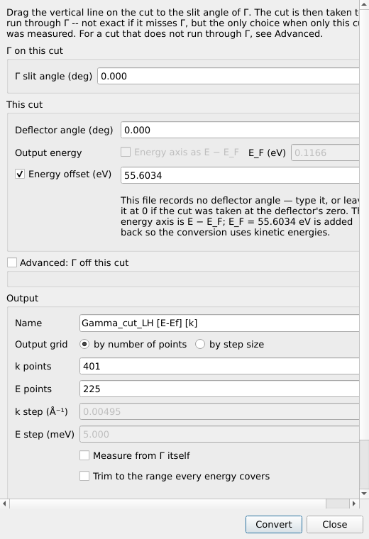

- **Advanced: Γ off this cut** est pour une coupe qui ne passe pas par Γ :
  saisissez les angles déflecteur et fente de Γ, ou **From a converted
  map...** pour les reprendre d'une carte du même échantillon déjà convertie.
- **Output energy — Energy axis as E − E_F** (décochée par défaut) :
  cochez-la et donnez la position de E_F sur l'axe en énergie de la coupe
  elle-même ; l'axe en énergie du résultat est alors E − E_F. Les moments
  ne changent pas : la conversion utilise toujours les énergies cinétiques.
- **Energy offset** (une case, décochée par défaut) n'est *pas* le niveau
  de Fermi : cochée, sa valeur est ajoutée à l'axe en énergie avant la
  conversion, pour un axe qui n'est pas une vraie énergie cinétique. Si la
  coupe est déjà en E − E_F, elle est cochée et remplie avec le E_F
  soustrait (la note en dessous le signale) : la conversion utilise les
  vraies énergies cinétiques, et le résultat reste en E − E_F.
- **Réglages mémorisés.** La fenêtre part de la dernière conversion d'une
  coupe de même taille (même nombre de points sur chaque axe) — le cas
  habituel pour une série de coupes d'un même échantillon. Les conversions
  de cartes et kz font de même.

## 4.8 Vérification des niveaux de cœur

Un balayage large des niveaux de cœur est lui aussi listé comme une coupe.
Sélectionnez-le et appuyez sur panneau → Basic → **Core-level check...** pour
savoir d'où viennent ses pics.

1. Saisir les éléments de l'échantillon — `NbSCl` ou `Nb, S, Cl` — puis
   **Next**. *Match within* (0,5 eV) est l'écart maximal entre un pic et
   l'énergie de liaison tabulée pour l'attribuer à l'échantillon.

   

2. Vérifier la référence en énergie. E_F est ajusté si la fenêtre contient
   le front de Fermi, sinon placé à hν − W. Corriger l'énergie de photon,
   le travail de sortie ou E_F s'ils sont faux (la ligne verte se déplace à
   la souris) ; un hν − E_F loin de 4–5 eV signale une énergie de photon
   erronée. **Analyse**.

   

3. Les résultats : l'EDC en énergie de liaison, chaque pic marqué — vert
   *sample* (orbitale nommée), orange *uncertain* (un niveau de
   l'échantillon à moins de 2 eV : déplacement chimique ou charge — à vous
   de juger), rouge *not the sample* (éléments courants qui pourraient
   l'expliquer : contamination, lumière d'ordre supérieur, raies Auger).
   Cliquer une ligne affiche tous les candidats ; la colonne *Assignment*
   accepte votre propre attribution.

   

**Raies faibles et pics à la main.** Cochez **Log counts** pour voir les raies
faibles à côté d'une raie forte ; **Min height** (0,2 % de la plus forte par
défaut) fixe la hauteur minimale d'un pic trouvé. Pour ajouter un pic que la
recherche a manqué, appuyez sur **Click to add peak** puis cliquez sur le
graphe (un double-clic fonctionne toujours), ou saisissez son énergie de
liaison après *or at* et cliquez sur **Add** : sa position est affinée par un
ajustement local, il est marqué ◆ et nommé avec tous les niveaux tabulés à
±2 eV. **Remove selected** retire des pics ; **Reset peaks** rétablit les pics
trouvés et oublie ceux ajoutés à la main. Les attributions saisies survivent
à **Re-analyse**.

**Peak table...** liste tous les niveaux tabulés, filtrés par élément et par
plage d'énergie de liaison : chercher un pic, afficher un niveau sur le
graphe, ou l'ajouter comme pic avec ce niveau pour attribution. **Select
range** affiche une bande à faire glisser sur une région ; **Zoom window...**
l'ouvre (ou la vue courante) dans une fenêtre à part, avec un curseur, un
ajustement gaussien au curseur et la dérivée seconde négative divisée par
l'intensité — un épaulement ou une raie faible à côté d'une raie forte y est
aussi visible que la raie forte.

Si tous les pics sont décalés de la même quantité, les notes le disent et
**Apply suggested shift** corrige (échantillon chargé, ou E_F faux).
**Add EDC to list** ajoute l'EDC en énergie de liaison à la liste ;
**Copy report** copie le résultat en texte. Une mesure à une seconde
énergie de photon tranche ce qui reste douteux : les niveaux de cœur
restent fixes en énergie de liaison, les raies Auger et la lumière d'ordre
supérieur se déplacent.

## 4.9 Conversion en k d'une carte

Sélectionnez une carte en angle et appuyez sur panneau → Basic → **k
conversion (map)...**. La carte s'ouvre sur un contour nu — sans coupes ni
autres fonctions, juste l'image — à côté de la fenêtre de conversion ; les
deux se ferment ensemble. Faites glisser le curseur de lecture sur le point
qui doit devenir **k = (0, 0)** — la fenêtre le suit — puis **Convert**. Le
résultat est une nouvelle ligne `k-map` dans la liste.

| Le contour pour choisir Γ | La conversion |
|---|---|
|  | 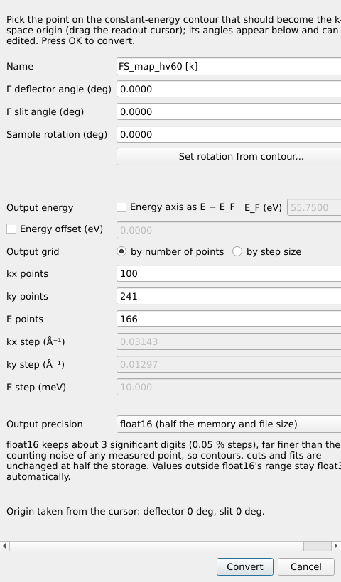 |

- **Γ deflector angle / Γ slit angle** : les angles du point qui devient
  k = (0, 0), remplis depuis le curseur.
- **Sample rotation** fait tourner la carte autour de la normale à la
  surface ; **Set rotation from contour...** la déduit d'une direction
  cliquée sur le contour (deux points le long d'une ligne de symétrie, par
  exemple).
- **Output grid** : nombre de points, ou résolution (Å⁻¹, meV). Les nombres
  de points partent de ceux de la mesure — autant de points kx que d'angles
  déflecteur, de points ky que d'angles de fente, de points E que d'énergies.
- **Output energy — Energy axis as E − E_F** (décochée par défaut) :
  cochez-la et donnez E_F tel qu'il est sur l'axe en énergie de la carte ;
  la carte k sort alors en E − E_F. Les moments sont les mêmes dans les deux
  cas.
- **Energy offset** (une case, décochée par défaut) n'est pas le niveau de
  Fermi : cochée, elle est ajoutée à l'axe en énergie avant la conversion,
  pour un axe qui n'est pas une vraie énergie cinétique (cochée et remplie
  automatiquement pour une carte en E − E_F).
- Les réglages partent de la dernière conversion d'une carte de même
  taille : une deuxième carte d'une série n'a rien à ressaisir.

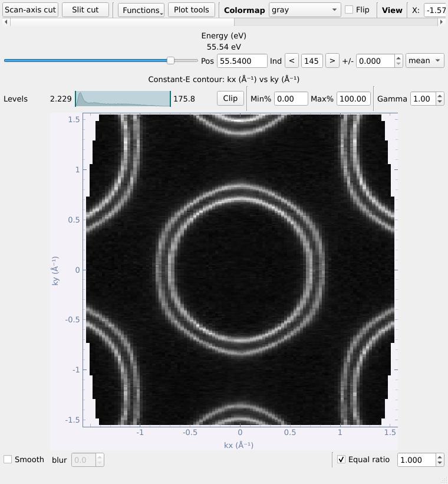

## 4.10 Aligner les niveaux de Fermi d'une carte kz

Un balayage en énergie de photon est listé comme `kz map` ; son contour est
l'énergie de photon en fonction de l'angle, à une énergie donnée.

Rien dans les fichiers n'indique où se trouve réellement le niveau de Fermi
de chaque spectre. Panneau → Basic → **Align Fermi levels (kz)...** le mesure
sur les spectres eux-mêmes ; la coupe selon la fente de la carte kz s'ouvre
avec lui, et les deux se ferment ensemble.

1. La coupe selon la fente s'ouvre avec un cadre. Faites glisser le cadre sur
   un front de Fermi — l'intervalle d'angle fixe les canaux sommés,
   l'intervalle d'énergie la fenêtre d'ajustement.

   

2. **Fit and assemble** : le même cadre (en indices du détecteur) est utilisé
   pour chaque spectre ; chacun est décalé pour placer son propre front à
   zéro ; le cube est rogné à l'intervalle couvert par tous ; et, par défaut,
   chaque spectre est **normalisé par son intensité totale**, ce qui élimine
   les variations du flux de photons.

E_F en fonction de l'énergie de photon est tracé. Une courbe régulière
signifie des ajustements fiables ; les points dont l'ajustement n'est pas
crédible sont signalés et remplacés par interpolation de leurs voisins.

## 4.11 Convertir une carte kz en impulsion

Panneau → Basic → **kz conversion...** convertit le balayage en (k_z, k∥). Il
part de la dernière conversion d'un balayage de même taille.

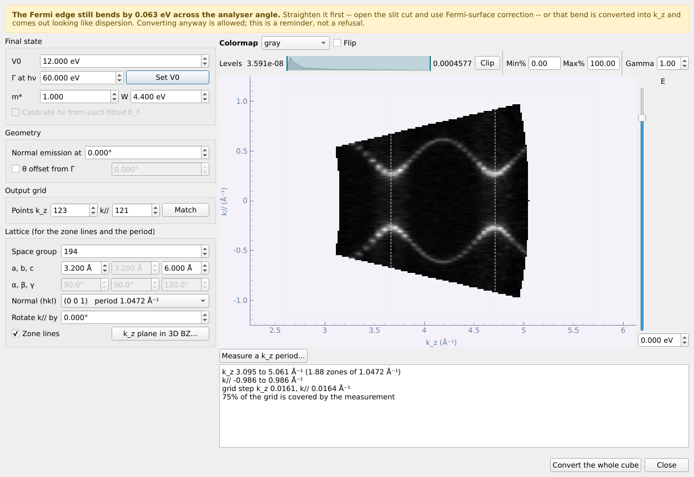

- Le **potentiel interne V0** est l'inconnue : l'aperçu reconvertit une
  tranche en énergie à chaque modification, en quelques millisecondes. Il
  peut être négatif ; **Γ at hν → Set V0** donne le V0 qui place Γ en
  émission normale à l'énergie de photon choisie.
- Le **θ du manipulateur** est désactivé par défaut ; cochez *θ offset from
  Γ* seulement pour corriger un écart, saisi par rapport à l'émission
  normale (pas la lecture absolue du moteur).
- Avec le **réseau** (groupe d'espace, a, b, c), la **normale à la surface**
  et **Rotate k// by** (la direction de la fente, en rotation autour de la
  normale ; tout angle, la fente ne suit pas forcément une direction de
  haute symétrie), les limites de zone sont tracées sur l'aperçu ;
  **k_z plane in 3D BZ...** montre ce plan dans la zone en 3D.
- L'énergie de l'aperçu se choisit avec le **curseur** à côté ; au-dessus,
  les commandes de couleur des fenêtres de données : carte de couleurs,
  *Flip*, barre de niveaux (*Clip*, pourcentages, *Gamma*).
- *Calibrate hν from each fitted E_F* (facultatif, désactivé par défaut)
  utilise hν − E_kin(E_F) mesuré à chaque énergie de photon.
- **Measure a k_z period...** : cliquez deux points correspondant à la même
  structure, distants d'une zone ; les plans du réseau réciproque compatibles
  sont listés.
- Le bandeau jaune avertit quand le front de Fermi est encore courbé en
  fonction de l'angle de l'analyseur — corrigez-le d'abord (correction de la surface de Fermi,
  [§4.3](#43-correction-de-la-surface-de-fermi)).
- **Convert the whole cube** ajoute une `kz map (k)` à la liste.

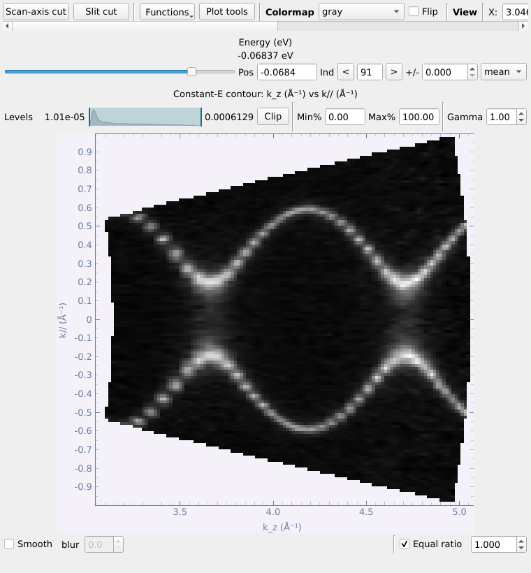

## 4.12 Zone de Brillouin

Sélectionnez une carte k (ou une carte kz convertie) et appuyez sur panneau
→ Basic → **BZ overlap...**.
Comme la conversion de carte, il ouvre un
contour à lui avec la fenêtre de la zone, et les deux se ferment ensemble.

1. D'abord le **groupe d'espace** (1–230) ; les paramètres de maille qu'il
   impose sont grisés et suivent les paramètres libres. Ou passez en **2D
   layer** pour un réseau de surface.
2. **Cut plane** : la normale à la surface (hkl) et un décalage le long de
   celle-ci — on trace la section de la zone 3D par ce plan, pour n'importe
   quelle surface et pas seulement (001). **Through point** donne les
   décalages pour lesquels le plan passe par un point de haute symétrie (Γ,
   Z, L, F ... pour un cristal rhomboédrique) : choisissez-en un plutôt que
   de calculer la valeur. **Show cut plane in 3D...** la prévisualise, avec
   les points nommés et, entourés, ceux que contient le plan ; **Label
   high-symmetry points** les écrit sur le contour, ce qui aide à régler
   l'azimut. La fenêtre s'ouvre sur le dernier cristal utilisé.
3. Zone **Conventional** ou **Irreducible** ; **Azimuth** (ou **Pick
   direction from contour...**) ; **Repeat across the field of view**.
4. **Moiré** ajoute une seconde couche, tournée ou désaccordée, et sa zone de
   moiré.
5. **Plot**.

La fenêtre est haute : son contenu défile, et elle se redimensionne comme
toutes les autres.

**La zone reste avec le jeu de données.** Une fois tracée, elle est une
propriété de la carte k : elle est enregistrée avec elle dans un fichier
`.nxs`, et sa fenêtre l'affiche avec la case **Brillouin zone** de la ligne
du haut. **Clear overlay** la retire.

Les exportations peuvent aussi la tracer : **Export → Image...** propose
**Include the Brillouin zone**, et **Axes only (.eps)...** propose **Draw the
Brillouin zone in the box**, pour obtenir la zone en traits vectoriels sur
l'image dans Illustrator.

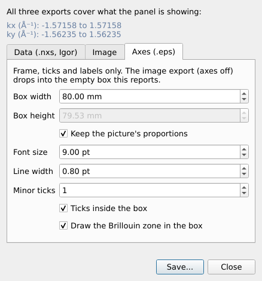
