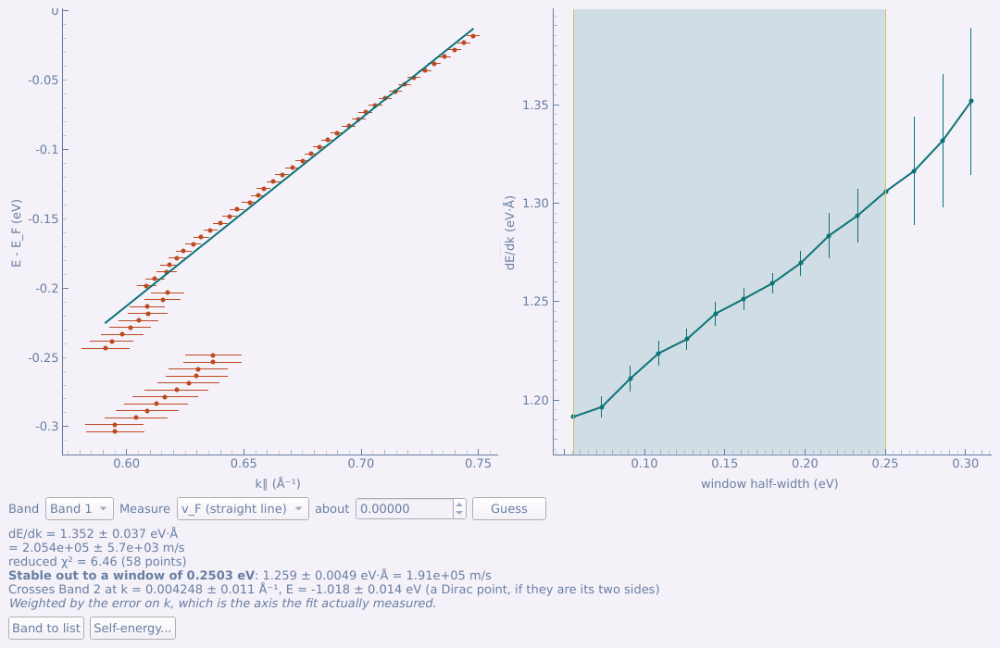
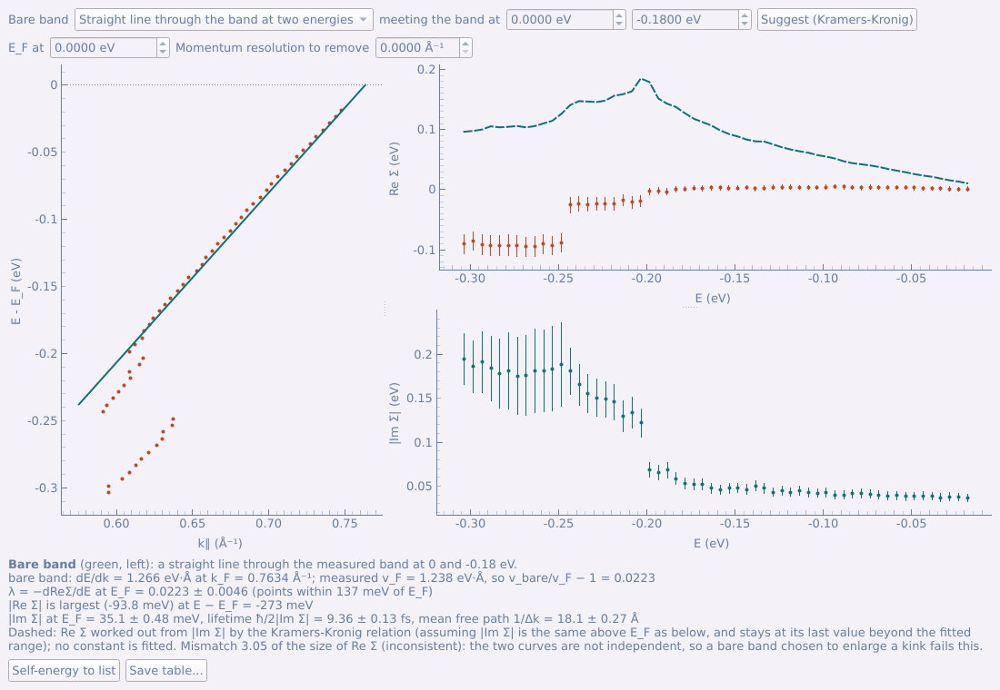
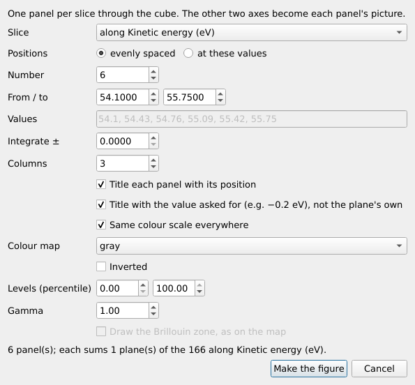
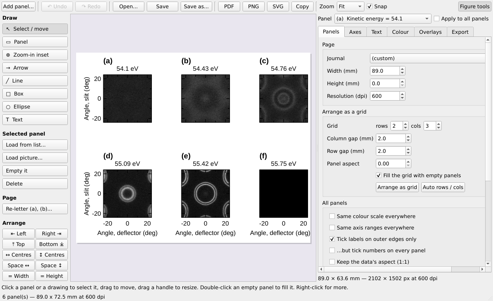
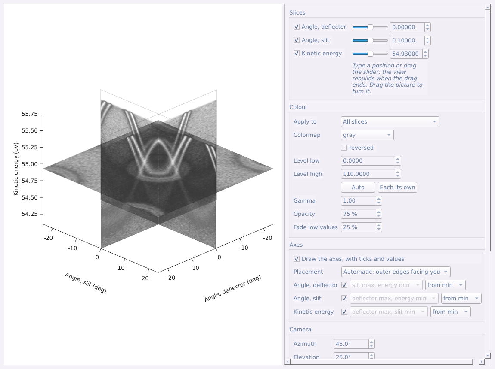
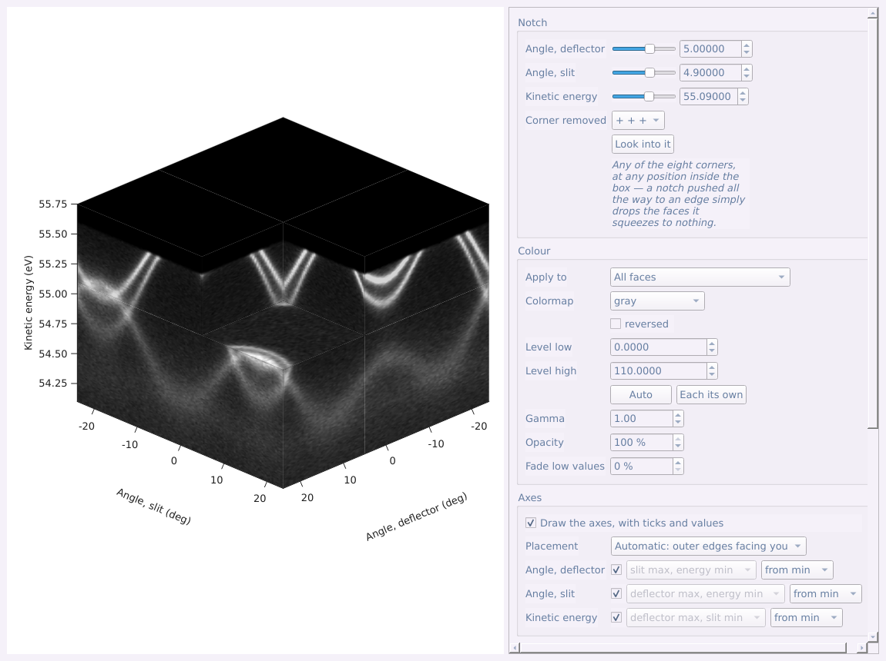
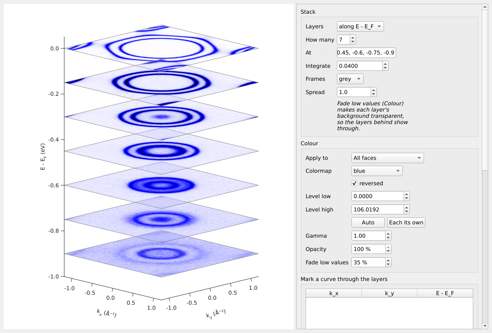
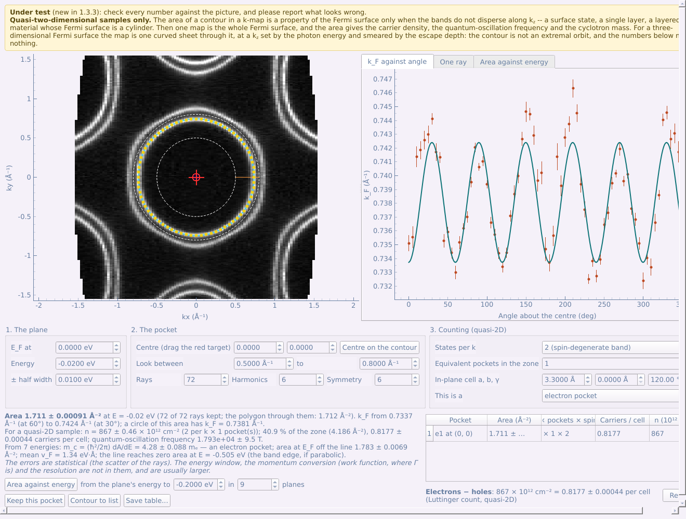

# Partie 5 — Le panneau d'outils : onglet Advanced

L'onglet **Advanced** regroupe l'analyse qui suit : filtres d'affinement des bandes et symétrisation, détection de crêtes, empilements, ajustements MDC et EDC avec la self-énergie, arithmétique de coupes, figure en série de tranches, vues 3D, et l'analyse des poches de Fermi pour les échantillons quasi bidimensionnels (en test).

## 5.1 Lissage, dérivées, courbure et symétrisation

Chaque filtre a sa propre fenêtre, ouverte depuis le panneau d'outils avec
une ou plusieurs coupes (ou cartes) sélectionnées :

| Onglet | Bouton | Ce que cela fait |
|---|---|---|
| Basic | **Background subtraction...** | retire l'intensité qui n'est pas celle des bandes : fond inélastique de Shirley ou de Tougaard, un plancher commun à tous les angles, un polynôme lisse — ou divise par la coupure de Fermi |
| Advanced | **Smooth...** | lissage gaussien, Savitzky–Golay ou moyenne glissante, avec suppression des pics facultative |
| Advanced | **Second derivative...** | −d²I/dE² ou −d²I/dk² après un pré-lissage, pour affiner les bandes |
| Advanced | **Curvature...** | courbure 1D ou 2D (Zhang et al.), qui suit la bande mieux qu'une dérivée seconde |
| Advanced | **Minimum gradient...** | I/\|∇I\| : les bandes comme vallées du gradient de l'intensité — dérivées premières seulement, donc moins de bruit ; les épaulements apparaissent |
| Advanced | **Symmetrise...** | miroir d'une coupe par rapport à une droite ; pour une carte, miroir ou rotation de ses plans à énergie constante |

Chaque résultat est un nouveau jeu de données qui garde la trace des étapes
qui l'ont produit.

**Gradient minimum (Minimum gradient).** Le long de la crête d'une bande
l'intensité est plate, donc le module de son gradient |∇I| y est minimal
(He, Wang et Shen, Rev. Sci. Instrum. 88, 073903 (2017)). La fenêtre montre
cette vallée de trois façons : **I / |∇I|** (à utiliser : une intensité qui
varie lentement le long de la bande se compense, et les régions vides
restent sombres), **1 / |∇I|**, ou **|∇I|** lui-même (les bandes en lignes
sombres ; rien n'est divisé, c'est donc le contrôle des deux autres). Il ne
demande que des dérivées premières, donc moins de bruit qu'une dérivée
seconde ou la courbure ; il ne privilégie aucun axe, donc une bande est
suivie à travers son extremum ; et un épaulement apparaît. **Floor** limite
la brillance d'une zone parfaitement plate (à baisser sur des données
lissées pour une ligne plus fine). Il marque *tout* endroit plat — y
compris le creux entre deux bandes — à lire donc à côté des données, les
nombres venant d'un ajustement.

- **Source** et **Result** sont affichés côte à côte, sur la même échelle,
  pour voir quand un réglage a « mangé » la bande. Ils se déplacent et
  zooment ensemble.
- **Lisser d'abord.** Les fenêtres de dérivée seconde et de courbure
  s'ouvrent avec un conseil : toutes deux amplifient le bruit, et marchent
  donc mieux sur des données déjà lissées — lancez **Smooth...**,
  sélectionnez son résultat dans la liste et ouvrez le filtre sur celui-ci,
  ou augmentez les largeurs de pré-lissage dans la fenêtre même. Un résultat
  lissé porte l'étiquette **‹smoothed›** dans la liste (tout ce qui en est
  tiré aussi) ; sur ces données le conseil laisse place à une ligne « déjà
  lissé » et les largeurs de pré-lissage partent de 0.
- **Shape** : *Square pixels* (un point de données est carré — sans
  distorsion pour une coupe angle-énergie), *Equal axes* (une unité a la même
  longueur sur les deux axes — adapté à angle-angle ou k-k ; choisi
  automatiquement quand les deux axes ont la même unité), ou *Fill the box*.
- **Live preview** recalcule à chaque changement de valeur ; **Apply** ajoute
  le résultat à la liste.
- Valeurs de départ : **Symmetrise** fait un miroir par rapport à une droite
  verticale passant par angle (ou k) = 0, c.-à-d. k → −k ; la **Fermi
  cut-off** de *Background subtraction* part de l'E_F enregistré dans le
  fichier, sinon de la chute la plus raide de l'EDC intégrée en angle, avec
  la température et la résolution du fichier.

Pour une carte, la fenêtre travaille plan par plan et demande d'abord **sur
quels plans** — contours à énergie constante ou dispersions — car la courbure
d'un contour et celle d'une coupe sont des grandeurs différentes. **Preview
at** choisit le plan affiché ; **Apply to the whole cube** traite tous les
plans. Les opérations et les largeurs portent le nom des axes du plan choisi
(*Second derivative along Kinetic energy*…), et les largeurs de lissage
partent de 1/100 de chaque axe.

**Truncate...**, **Compress...** et **Self-normalise...** (sous la liste)
changent la grille ou l'échelle d'un ou plusieurs jeux de données à la fois
— à condition qu'ils soient du même type et aient le même nombre de points
sur chaque axe : **Truncate** rogne à un intervalle, **Compress** regroupe
des points, **Self-normalise** divise chaque spectre par son propre total.

**Self-normalise** divise chaque morceau des données par son propre total (ou
son maximum) :

- **Normalise** choisit le morceau en termes d'ARPES et part du choix
  habituel : *each EDC* pour une coupe, *each cut (slit × energy at one scan
  step)* pour une carte, une carte k ou une carte kz — ce qui retire une
  dérive du flux ou du courant faisceau le long du balayage. Autres choix :
  chaque MDC, chaque EDC d'une carte, chaque carte à énergie constante, ou
  *custom*.
- **Summed over** montre les axes sur lesquels on somme ; les cases peuvent
  être changées à la main, et la phrase en dessous dit ce qu'elles font
  (« Each plane over Angle, slit × Kinetic energy is divided by its own
  total — one factor for every Angle, deflector »).
- **Sum only over** restreint la somme à une fenêtre sur l'un des axes
  sommés — l'énergie par défaut — par exemple les énergies d'un niveau de
  cœur.

## 5.2 Détection de crêtes

Panneau → Advanced → **Ridge detection...** (coupes ou cartes) suit les
bandes comme des crêtes de l'intensité, chaque point à une fraction de pixel
près : plus net qu'une dérivée seconde, et sans fausses lignes doubles.

- **Smoothing** selon chaque axe, dans son unité — à peu près la largeur de
  la bande.
- **Threshold** : l'augmenter jusqu'à ce qu'il ne reste que les bandes (points
  jaunes sur la source).
- **Result to list** — l'image des crêtes (une carte plan par plan, sur les
  plans choisis) ; **Save ridge points...** — un CSV que l'ajustement de
  liaisons fortes ([§6.4](#64-ajustement-de-liaisons-fortes)) sait lire.

## 5.3 Empilements de courbes

**Stack plot (EDC / MDC)...** (panneau → Advanced, une coupe sélectionnée) :
une cascade d'EDC ou de MDC, avec le nombre de courbes, le regroupement, la
normalisation, le décalage, le cisaillement et la coloration ; **Send to
figure composer** en fait un panneau de figure.

## 5.4 Ajustement MDC et ajustement EDC

Deux outils de l'onglet Advanced ajustent des pics ligne par ligne :

- **MDC fit (k-cut only)...** ajuste les courbes de distribution en impulsion
  et en déduit la bande à partir des centres ajustés : vitesse de Fermi,
  masse effective, self-énergie. N'accepte qu'une coupe dont l'axe est déjà
  en Å⁻¹ — une vitesse en eV·deg n'aurait aucun sens — et son bouton est grisé
  sinon.
- **EDC fit...** ajuste les courbes de distribution en énergie, sur
  n'importe quelle coupe, éventuellement avec la coupure de Fermi dans le
  modèle. v_F et m\* de la bande ajustée demandent une coupe en impulsion.

**Guided fit (step by step)**, en haut du panneau, guide tout l'ajustement
pas à pas à côté des réglages, en disant à quoi sert chaque étape et en
encadrant la partie du panneau qu'elle utilise : ce que fait un ajustement
MDC (EDC), la forme de pic, l'intervalle (*Start here* / *End here* à la
ligne bleue), les bandes, les points de départ (le guide place la ligne en
cinq endroits de l'intervalle — cliquez à chaque fois le pic de la bande sur
la courbe), une ligne d'essai, la série et le résultat. *Next* attend que
l'étape ait ce qu'il faut à l'ajustement.

Les images et les réglages se partagent la fenêtre avec une poignée entre
eux : les réglages restent visibles ; la molette sur une image fait défiler
la fenêtre quand elle est trop courte (Ctrl + molette zoome l'image).

À la main :

1. Onglet **Bands** : **Add band** pour chaque branche ; sélectionnez une
   bande, appuyez sur **Place a seed** et cliquez sur le pic, sur la courbe (à
   droite). Quatre ou cinq points de départ le long d'une bande suffisent ;
   **Line at** change la ligne examinée.
2. **Try this line** montre l'ajustement de la ligne courante (en tirets :
   l'estimation initiale).
3. Onglet **Fit settings** : forme de pic (lorentzienne, gaussienne, Voigt),
   fond, pas, puis **Fit the series**. Les positions ajustées sont tracées
   sur l'image, avec une taille proportionnelle à l'amplitude.
4. **Dispersion...** ajuste la bande : **v_F** (droite), **m\*** (parabole) —
   et vérifie jusqu'où l'ajustement reste stable. **Self-energy...** ouvre
   la fenêtre décrite plus bas.

**Save table...** écrit toutes les lignes ajustées ; **Band to list** ajoute
une bande à la liste principale.

**Là où deux branches droites se croisent.** Dans la fenêtre
**Dispersion...**, avec *v_F* (une droite) choisi, chaque autre bande ajustée
l'est de la même façon et le point où les deux droites se rencontrent est
donné avec son incertitude (propagée des deux ajustements) : le point de
Dirac d'un cône ajusté par ses deux flancs, ou tout croisement de deux
bandes. Un point ajusté dont l'erreur s'est effondrée (un pic ajusté à
largeur nulle) ne prend plus tout le poids de l'ajustement de la
dispersion : aucun point ne compte plus que dix points typiques.

### Self-énergie

**Self-energy...** (fenêtre Dispersion, ajustements MDC seulement) fait
d'une bande ajustée **Re Σ** et **|Im Σ|** en fonction de l'énergie : Re Σ
est la distance de la bande mesurée à une *bande nue*, et |Im Σ| la moitié
de la largeur ajustée multipliée par la pente de la bande nue.

- **Bare band** — la seule hypothèse sur laquelle tout repose ; elle se
  choisit donc ici et est écrite dans le résultat : une **droite passant
  par la bande à deux énergies** (E_F et l'énergie ajustée la plus profonde
  au départ), une **droite de vitesse donnée** passant par le k_F mesuré
  (issue d'un calcul, par exemple), ou **l'ajustement de la fenêtre
  Dispersion**.
- **Suggest (Kramers-Kronig)** trouve la vitesse nue pour laquelle Re Σ et
  la transformée de Kramers-Kronig de |Im Σ| s'accordent le mieux. Les deux
  dépendent de ce seul nombre : exiger qu'elles forment une paire le fixe
  sans calcul. À ne croire que si la plage ajustée va bien au-delà du
  kink, là où |Im Σ| s'est stabilisé.
- **E_F at** et **Momentum resolution to remove** (retirée des largeurs en
  quadrature ; laisser 0 si l'ajustement avait la résolution dans sa forme
  de raie).
- **Ligne en tirets** : Re Σ déduite de |Im Σ| par la relation de
  Kramers-Kronig, en prenant |Im Σ| identique au-dessus et au-dessous de
  E_F et constante au-delà de la plage ajustée. Aucune constante n'est
  ajustée : la comparaison teste donc la bande nue, et une bande nue
  choisie pour grossir un kink y échoue.
- **Sous les graphes** : k_F et v_F mesurés, v_bare/v_F − 1, le couplage
  λ = −dRe Σ/dE à E_F, l'énergie où |Re Σ| est maximale (le kink), |Im Σ| à
  E_F avec la durée de vie et le libre parcours moyen.
- **Self-energy to list** ajoute les courbes à la liste principale ; **Save
  table...** les écrit en CSV avec la bande nue dans l'en-tête.

## 5.5 Arithmétique de coupes : dichroïsme et division par une référence

Deux coupes en donnent une troisième : dichroïsme linéaire (LH − LV),
dichroïsme circulaire, division par une référence d'or, ou simples
différences, rapports et sommes. Sélectionnez deux coupes dans la liste et
appuyez sur panneau → Advanced → **Cut arithmetic (two cuts)...** (la
première sélectionnée est A ; la fenêtre permet de les échanger). Le bouton
reste grisé tant qu'exactement deux coupes ne sont pas sélectionnées.

- **Le tableau du haut** compare ce que les deux mesures ont enregistré
  (polarisation, énergie de photon, angles, position de l'échantillon,
  température, énergie de passage, mode de lentille). Les lignes en orange
  diffèrent au-delà d'une tolérance — une carte de dichroïsme entre deux
  points de l'échantillon est une carte de *cette* différence-là.
- Préréglages **Purpose** : *Linear dichroism* (A − B, B mis à la même
  intensité totale), *Circular dichroism* ((A − B)/(A + B)), *Divide by a
  reference*, *Custom*. Un avertissement apparaît si les polarisations
  semblent inversées (**Swap A ↔ B**).
- **Scale B to A** par l'intensité totale ou celle d'une région ; **Hide
  where A+B below** masque le fond.
- A et B sont tracés sur une seule échelle de couleurs ; le résultat sur une
  échelle rouge-blanc-bleu symétrique autour de zéro. Avec des comptages
  bruts des deux côtés, l'incertitude de Poisson est propagée et résumée sous
  le graphique.
- **Result to list**, **Uncertainty to list**, **All three as a figure**.

## 5.6 Figure en série de tranches

Sélectionnez une carte → panneau → Advanced → **Slice series figure...**
dispose une page de tranches 2D planes du cube en une figure pour un
article — contours à énergie constante à une série d'énergies, ou coupes à
une série d'angles ou d'impulsions — régulièrement espacées ou à des valeurs
choisies, avec intégration, une échelle de couleurs commune et des
étiquettes seulement sur les bords extérieurs. (À ne pas confondre avec
**3D slices**, qui trace trois plans dans une vue 3D.)

| Réglages | Résultat |
|---|---|
|  |  |

## 5.7 Les vues 3D

Quatre outils de l'onglet Advanced montrent une carte en 3D, chacun dans sa
propre fenêtre — faites glisser l'image pour la faire tourner :

- **3D slices...** — les trois plans orthogonaux du cube, chacun placé où
  vous voulez (case, curseur ou position saisie pour chaque axe).
- **Notched cube...** — le cube avec un coin retiré : une carte à énergie
  constante et deux dispersions dans une seule image.
- **Volume projection...** — tout le volume projeté selon la direction de
  vue : intensité maximale, somme, composition alpha, ou isosurface ombrée.
- **Stacked slices...** — des tranches parallèles empilées en 3D (ci-dessous).
- Pour une **carte k**, les vues 3D commencent aux premiers plans k_x et k_y
  remplis de données : le cube converti est la boîte autour d'un cône de
  lumière qui se resserre loin de E_F, et ses plans extérieurs se
  dessinaient en faces vides. *Change sampling... → Whole range* montre tout.

| 3D slices | Notched cube |
|---|---|
|  |  |

- **Échantillonnage.** Chaque image rééchantillonne le cube ; chaque fenêtre
  s'ouvre donc en échantillonnage *Balanced*, qui suit la souris.
  L'échantillonnage courant est indiqué sous **Save the view...** ; **Change
  sampling...** choisit la région et *Fast*, *Balanced* ou *Fine*, puis
  redessine depuis le cube complet.

  

- **Couleurs.** *Apply to* règle les couleurs de **toutes les tranches** à
  la fois ou d'une seule orientation (le plan en énergie dans une palette,
  les dispersions dans une autre) : palette (et *reversed*), niveaux
  (**Auto**, ou **Each its own** pour une échelle par tranche), gamma,
  **Opacity** et **Fade low values**, qui rend transparente l'intensité
  faible pour laisser voir les plans de derrière.
- **Axes.** **Draw the axes, with ticks and values**. *Placement* est
  automatique — sur les arêtes extérieures face à vous, qui suivent la vue
  quand elle tourne — ou choisi : pour chaque axe, l'arête du cube qu'il
  longe et s'il compte **from min** ou **from max**.
- **Camera** : azimut, élévation, rapport de profondeur ; **Look into it**
  fait face à un plan choisi. **Outline the faces** et un **Orientation
  tripod** sont facultatifs.
- **Save the view...** exporte l'image par la même fenêtre d'exportation que
  tout panneau (PNG, TIFF, JPEG à la taille et à la résolution choisies).
  **To figure composer...** ajoute la vue comme panneau d'une figure.

### Tranches empilées

**Stacked slices...** (panneau → Advanced → 3D only) dessine des tranches
parallèles du cube empilées en 3D : des cartes à énergie constante les unes
au-dessus des autres le long de l'axe d'énergie, ou des coupes les unes
derrière les autres selon k_z (ou l'énergie de photon) — l'image habituelle
de l'évolution d'une bande.

- **Layers** — l'axe d'empilement ; **How many** les répartit régulièrement,
  ou tapez les positions dans **At** (séparées par des virgules, dans les
  unités de l'axe) ; **Integrate** moyenne chaque tranche sur cette largeur.
- **Frames** — un contour autour de chaque tranche (gris, noir ou aucun).
- **Spread** étire la boîte selon l'axe d'empilement, pour que les tranches
  vues en oblique se séparent au lieu de se couvrir : pour quelques coupes
  empilées selon k_z, *Spread* 3 avec un azimut d'environ 40° montre chaque
  coupe presque entière.
- **Fade low values** (*Colour*) part ici de 35 % : le fond de chaque tranche
  est transparent, on voit donc les tranches de derrière.
- **Mark a curve through the layers** — des points dans les unités des
  données (un par tranche, par exemple le croisement de deux bandes), reliés
  par une courbe rouge, noire, bleue… tracée par-dessus l'empilement, avec
  une étiquette facultative au premier point.
- Les axes de toutes les vues 3D ajustent désormais l'image *et* ses
  étiquettes à la fenêtre ou au panneau de figure (sans marge fixe),
  espacent leurs graduations selon la place de chaque axe, et écrivent
  indices et exposants dans les titres d'axe (`E - E_F`, `k_x`).

## 5.8 Poche de Fermi (quasi-2D, en test)

> **En test** (nouveau dans la 1.3.3) : vérifiez chaque nombre sur l'image,
> et signalez ce qui paraît faux.
>
> **Échantillons quasi bidimensionnels seulement.** L'aire d'un contour
> dans une carte en k n'est une propriété de la surface de Fermi que si les
> bandes ne dispersent pas selon k_z — un état de surface, une monocouche,
> un matériau lamellaire dont la surface de Fermi est un cylindre. Une
> carte est alors toute la surface de Fermi. Pour une surface de Fermi
> tridimensionnelle, la carte est une nappe courbe qui la traverse, à un
> k_z fixé par l'énergie de photon et élargi par la profondeur
> d'échappement : le contour n'est pas une orbite extrémale, et les nombres
> ci-dessous ne signifient rien. Le programme ne peut pas distinguer les
> deux cas.

Sélectionnez une carte convertie en moment (une carte en k, en E − E_F) et
appuyez sur panneau d'outils → Advanced → **Fermi pocket (quasi-2D)...**.

1. **The plane.** L'énergie à laquelle le contour est tracé (E_F au départ)
   et la demi-largeur sur laquelle on moyenne.
2. **The pocket.** Faites glisser la cible rouge sur un point à l'intérieur
   de la poche (ou tapez-le), et réglez **Look between** pour que les deux
   cercles en tirets contiennent la bande de cette poche et aucune autre.
   Un rayon part du centre à chacun des **Rays** angles, et un pic ajusté
   le long de ce rayon y donne k_F (points jaunes ; les croix rouges sont
   les rayons écartés, et l'onglet **One ray** montre n'importe quel rayon
   avec son ajustement). Le contour (bleu) est une série de Fourier du
   rayon en fonction de l'angle, jusqu'à **Harmonics** ; **Symmetry** ne
   garde que les harmoniques permises par un axe d'ordre n passant par le
   centre, ce qui comble aussi les lacunes des données. **Centre on the
   contour** déplace le centre au milieu du contour ; l'aire ne dépend pas
   du centre.
3. **Counting.** *States per k* (2 pour une bande dégénérée en spin, 1
   quand chaque spin a son propre contour), le nombre de *poches
   équivalentes dans la zone*, la *maille dans le plan* a, b, γ (pour les
   porteurs par maille), et s'il s'agit d'une poche d'électrons ou de
   trous.

Ce qui en sort, sous les images :

- l'**aire** avec son erreur, l'étendue de k_F le long du contour et le
  nombre de rayons gardés ;
- pour un échantillon quasi-2D : la **densité de porteurs**
  n = g N A/(2π)², la fraction de la zone de Brillouin et les **porteurs
  par maille** (ce que compte le théorème de Luttinger), et la **fréquence
  des oscillations quantiques** F = (ħ/2πe) A ;
- **Area against energy** trace la même poche à une série d'énergies et
  ajuste une droite : la **masse cyclotron** m_c = (ħ²/2π) dA/dE — positive
  pour une poche d'électrons, qui grandit avec l'énergie, négative pour une
  poche de trous —, l'aire à E_F lue sur la droite (sans le biais que la
  coupure de Fermi donne à un plan pris à E_F même), la vitesse de Fermi
  moyenne, et l'énergie à laquelle la droite atteint une aire nulle.

**Keep this pocket** l'ajoute à un tableau qui compte plusieurs poches
ensemble, électrons moins trous. **Contour to list** ajoute k_F en fonction
de l'angle (et l'aire en fonction de l'énergie) à la liste principale ;
**Save table...** écrit le tout en CSV.

Les erreurs données sont statistiques (la dispersion des rayons). La
fenêtre en énergie, la conversion en moment (travail de sortie, position de
Γ) et la résolution n'y sont pas, et sont en général plus grandes.
