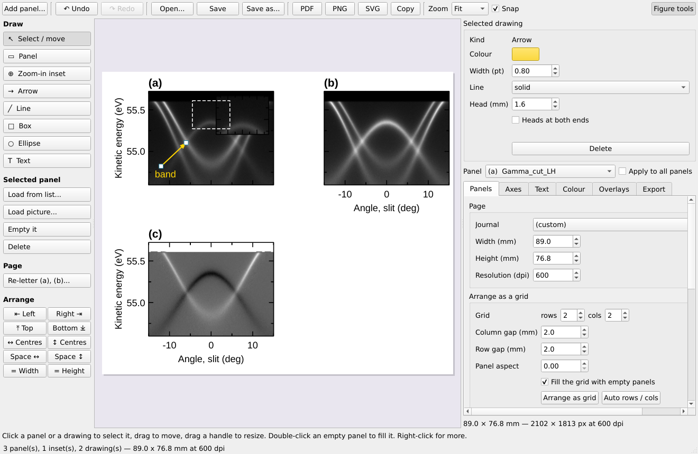
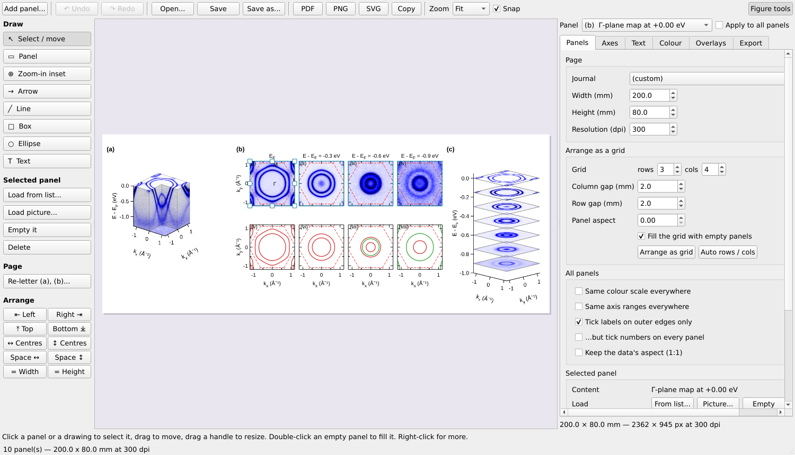
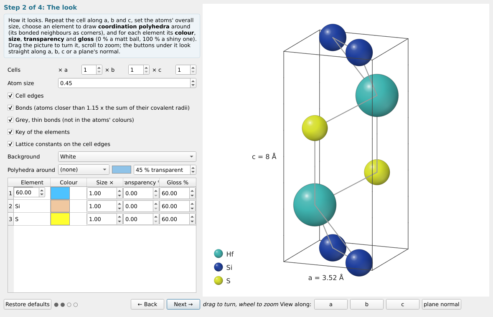
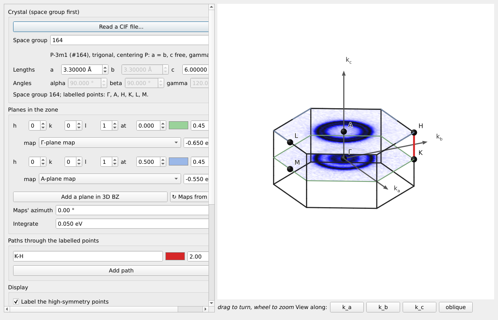
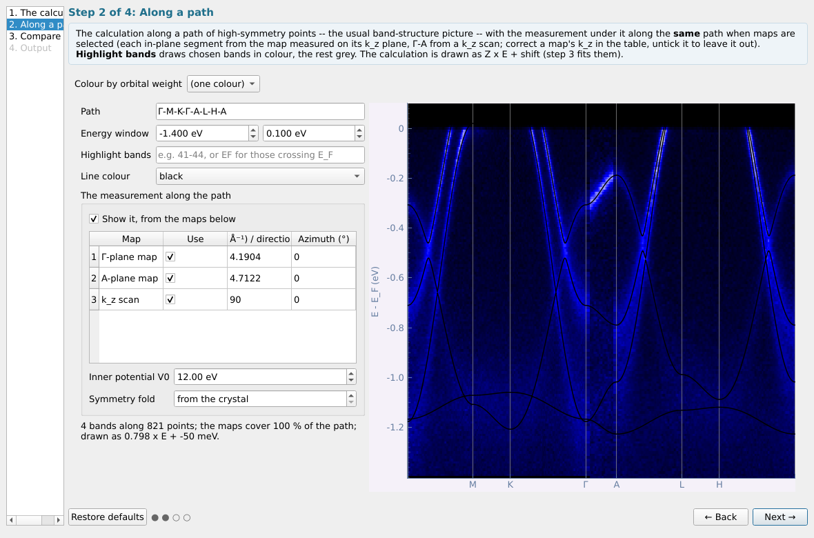
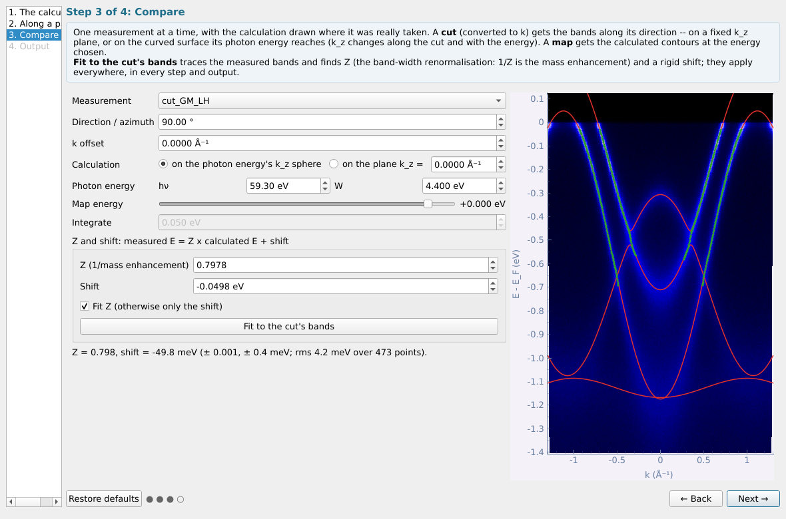
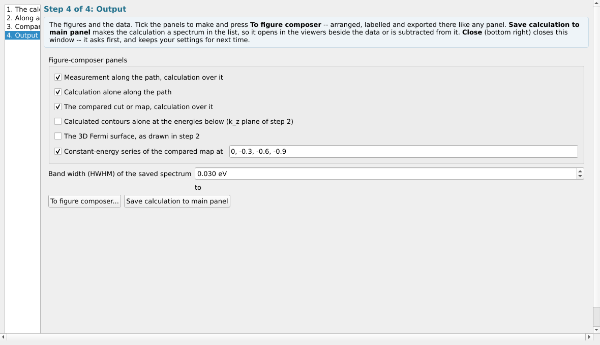
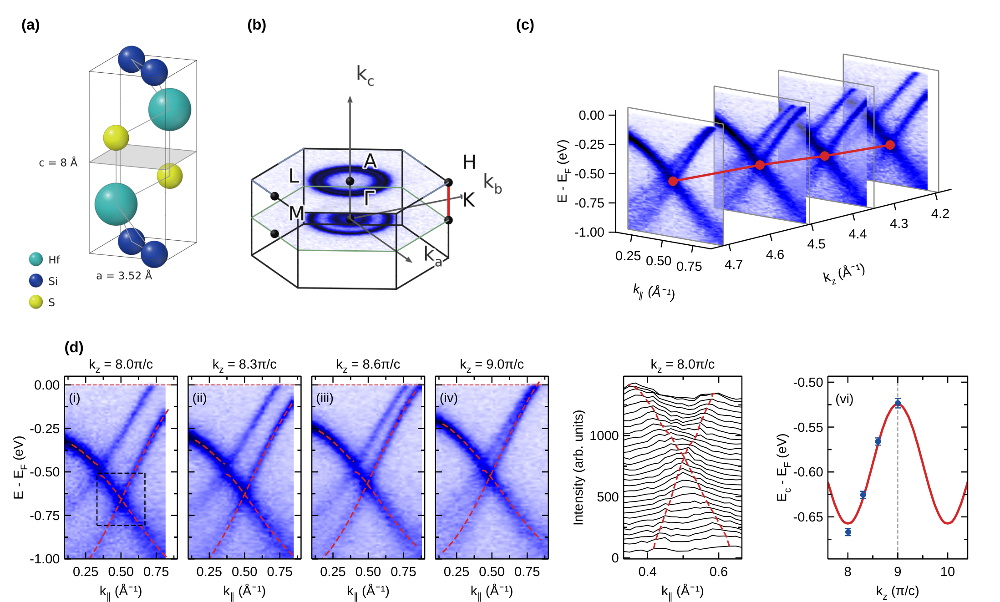

# Partie 6 — Le panneau d'outils : onglet Figure

L'onglet **Figure** regroupe le composeur de figures et ce qui est calculé plutôt que mesuré : la structure cristalline, la zone de Brillouin en 3D, les ajustements de liaisons fortes et les bandes calculées. Il se termine par un exemple allant du chargement des données à la figure finie.

## 6.1 Le composeur de figures

Panneau → Figure → **Figure composer...** (en haut de l'onglet) **sans rien
sélectionner** ouvre
une page vierge, comme une figure d'article : quatre panneaux vides (a),
(b), (c), (d) à la largeur de colonne d'une revue. Avec des coupes (ou des
courbes) sélectionnées, chacune devient un panneau (de même pour le bouton
**Figure composer...** d'une tranche figée ; un empilement de courbes ou une
vue 3D a son propre bouton **To figure composer**).



- **Mise en page.** Cliquez un panneau pour le sélectionner ; faites-le
  glisser pour le déplacer, tirez ses poignées pour le redimensionner (Maj
  sur un coin garde ses proportions). Les panneaux s'alignent sur les bords
  des autres et sur une grille de 0,5 mm (**Snap**) ; les flèches du clavier
  le décalent de 0,5 mm (Maj : 5 mm). *Arrange as grid* (onglet Panels à
  droite) les remet en lignes × colonnes. **Re-letter** les nomme (a), (b)…
  dans l'ordre de lecture.
- **Remplir un panneau.** Double-cliquez un panneau vide, ou **Load from
  list...** / **Load picture...** à gauche : un jeu de la liste principale,
  ou une image d'un fichier (PNG, JPEG, TIFF… — un schéma ou une figure
  faite ailleurs ; elle garde ses proportions et n'a pas d'axes).
- **Encarts.** **Zoom-in inset** : tracez une région d'un panneau — un
  petit panneau qui l'agrandit apparaît dans le coin, et la région est
  encadrée. Un **Panel** tracé dans un autre panneau est un encart à remplir
  avec un autre jeu. Les encarts n'ont pas de lettre et suivent leur panneau.
- **Dessiner.** **Arrow**, **Line**, **Box**, **Ellipse**, **Text** :
  faites glisser (ou cliquez, pour le texte) sur la page. Un dessin
  sélectionné se déplace, ses extrémités ou coins se tirent, et sa couleur,
  son épaisseur, son trait, son remplissage et son texte se règlent au-dessus
  des outils. Double-cliquez un texte pour le modifier ; Suppr efface la
  sélection ; clic droit pour le reste.
- **Axes et polices.** Les outils à côté de la page agissent sur le panneau
  sélectionné (ou sur tous) : bornes, graduations, étiquettes, bords
  numérotés, taille de police propre au panneau, carte de couleurs, barre de
  couleurs, lignes de référence.
- **Undo / Redo** (Ctrl+Z / Ctrl+Y) couvrent tout. **PDF**, **PNG**, **SVG**
  exportent, **Copy** copie dans le presse-papiers ; les panneaux vides ne
  sont jamais écrits. Les **Figure tools** du composeur ne sont pas les
  **Plot tools** d'une fenêtre, qui dessinent des guides sur le graphique
  affiché.

### Disposer les panneaux

Cliquez un panneau, puis **Ctrl+clic** (ou Maj+clic) sur les autres pour en
sélectionner plusieurs. Les boutons **Arrange** à gauche alors :

| Bouton | Effet |
|---|---|
| ⇤ Left, Right ⇥, ⤒ Top, Bottom ⤓ | alignent leurs bords gauche / droit / haut / bas (sur le plus extérieur) |
| ↔ Centres, ↕ Centres | mettent leurs centres sur une même verticale / horizontale (celle du premier panneau sélectionné) |
| Space ↔, Space ↕ | espaces égaux entre eux, de gauche à droite / de haut en bas (trois ou plus) |
| = Width, = Height | la largeur / hauteur du premier panneau sélectionné pour tous |



### Lettres et barres de couleur

- **Letters in line** (onglet *Text*, activé par défaut) : les lettres des
  panneaux côte à côte sont à la même hauteur, celles des panneaux l'un
  au-dessus de l'autre au même bord gauche, quels que soient les titres ou
  les axes de chacun. **Nudge (mm)** déplace la lettre d'un panneau (pour
  dégager un long titre d'axe, par exemple) ; **Re-letter** les renomme (a),
  (b)… dans l'ordre de lecture.
- **Colour bar** (onglet *Colour*) : **Ends** écrit les valeurs, les mots
  *High* / *Low*, ou rien ; **Length (%)** de la hauteur ou de la largeur du
  panneau ; **Position** *right* (debout à côté du panneau) ou *below*
  (couchée dessous, centrée). La barre d'une vue 3D est dimensionnée sur le
  cube tel qu'il est dessiné, non sur tout le cadre qui l'entoure.


### Courbes : lignes, symboles et barres d'erreur

Onglet *Overlays*, **Curves drawn on the panel** : sélectionnez des courbes
dans la liste (ou aucune, pour toutes), puis réglez leur **couleur**, leur
**épaisseur**, leur **style** (plein, tirets, pointillés…), leurs
**symboles** (cercle, carré, triangles, losange, avec une taille) et si elles
sont **reliées par une ligne** ; **± σ as error bars** change les deux courbes
pointillées ±σ d'une courbe en barres d'erreur à ses points. **Apply to the
curves**. Une courbe avec des trous (NaN) est tracée en morceaux.

### Enregistrer une figure pour la modifier plus tard, avec ses données

**Save** / **Save as...** écrivent la figure dans le format propre au
programme, `fig1.afig` : la page, ses dessins et chaque panneau avec ses
données et ses réglages — rouvrez-la avec **Open...** (ou choisissez-la dans
**Load data...** de la fenêtre principale) et reprenez la modification là où
vous l'aviez laissée. Une vue 3D est conservée comme l'image qu'elle montre.

À côté, **`data for fig1/`** reçoit un dossier par panneau (`a`, `b`, …) :

```
data for fig1/
  a/  processed/  ce que montre le panneau : l'image en coupe .nxs (qui se
                  rouvre dans la fenêtre de visualisation), ses lignes
                  (bandes calculées, contours, courbes) en lines.csv, une
                  image en .png
      original/   ce dont il a été fait : le premier fichier de mesure (un
                  plan converti en k, symétrisé, découpé remonte au fichier
                  d'où il a d'abord été lu), le calcul avec les fichiers lus
                  avec lui (.win, POSCAR...), le fichier image ou le CIF
      sources.txt quelle entrée du fichier, et les traitements entre les deux
  b/  ...
```

Le fichier d'origine est copié même quand le panneau montre un résultat
calculé à partir de lui bien des étapes plus tard : chaque jeu de données se
souvient du fichier dont il est parti. Une figure rouverte dont les fichiers
d'origine ont été déplacés réutilise les copies de son propre dossier de
données précédent.

## 6.2 Structure cristalline

Panneau → Figure → **Crystal structure...** (rien à sélectionner). Quatre
étapes (la zone de Brillouin est l'outil à part **3D BZ...**,
[§6.2](#63-3d-bz--la-zone-de-brillouin-en-trois-dimensions)) :



1. **La structure** — **Read a CIF file...** (le bouton du haut) remplit le
   groupe d'espace, la maille et les atomes depuis un fichier, applique ses
   opérations de symétrie et redessine aussitôt le cristal ; tout reste
   modifiable. Un CIF à plusieurs blocs (celui de FullProf, qui commence par
   un bloc de champs de revue) est lu dans le bloc qui contient la
   structure. Ou la saisir, comme la maille de BZ overlap : **d'abord le
   groupe d'espace** (les paramètres de maille qu'il fixe sont grisés et
   suivent les libres), puis la maille et les atomes de la base (les copies
   du mode de réseau sont ajoutées).
2. **L'aspect**
   - nombre de mailles selon a, b, c, taille globale des atomes, arêtes de
     la maille et liaisons (aux couleurs des atomes, ou *grey, thin*) ;
   - pour chaque élément sa **couleur**, sa **taille**, sa **transparence**
     et son **brillant** (0 % : une boule mate, 100 % : une boule brillante
     au reflet net) ;
   - **Polyhedra around** un élément : ses polyèdres de coordination (ses
     voisins liés pour sommets), avec leur propre couleur et transparence —
     les octaèdres TiSe₆, les tétraèdres CuS₄ ;
   - **Key of the elements** (une boule et son nom pour chacun), **Lattice
     constants on the cell edges** (`a = 3.52 Å`, `c = 8 Å`).

   Faites glisser l'image pour la tourner, molette pour zoomer ; *View
   along* a, b, c ou la normale au plan.
3. **Plan de clivage** — cochez *Draw a plane*, donnez (hkl), faites-le
   glisser, ou double-cliquez une **couche atomique** de la liste pour l'y
   placer ; *Hide the atoms above* montre la terminaison ; les atomes du plan
   sont cerclés de rouge.
4. **Export** — le cristal : **Save picture...** (PNG à toute
   taille, redessiné à cette taille) ou **To figure composer...**. Une image
   issue d'un CIF a ce CIF pour source, et le dossier de données de la figure
   le conserve ([§6.1](#61-le-composeur-de-figures)).

## 6.3 3D BZ : la zone de Brillouin en trois dimensions

Panneau → Figure → **3D BZ...** (rien à sélectionner). C'était l'étape 4 de
la fenêtre de la structure cristalline.



- **Cristal** : **d'abord le groupe d'espace**, puis la maille — les
  paramètres que le groupe fixe sont grisés et suivent les libres, comme
  dans BZ overlap. **Read a CIF file...** les remplit depuis un fichier. La
  fenêtre part du dernier cristal 3D de BZ overlap.
- **Plans dans la zone** : **Add a plane in 3D BZ** autant de fois que
  voulu. Chacun a sa normale (h k l), sa hauteur le long de celle-ci (en
  unités de G(hkl) : 0 par Γ, 0,5 au sommet de la zone), sa couleur et son
  opacité, et ✕ pour le retirer.
- **Cartes mesurées sur les plans** : *n'importe quel* plan peut porter la
  carte à énergie constante d'une carte k — choisissez-la dans la liste
  *map* du plan et donnez l'énergie (E − E_F). La liste propose les cartes k
  sélectionnées à l'ouverture et toutes celles de la liste principale
  (**↻ Maps from the list** ajoute celles venues depuis) ; une carte n'est
  lue que lorsqu'elle est choisie. Ses kx, ky suivent les axes propres du
  plan — k_x, k_y pour un plan normal à k_z —, tournés de *Maps' azimuth*,
  moyennés sur *Integrate*, et découpés à la zone.
- **Chemins** : **Add path** autant de fois que voulu, chacun par les points
  nommés (`Γ-M-K-Γ`, `A-L-H-A` ; `|` pour un saut), avec sa couleur et son
  épaisseur.
- **Affichage** : noms des points de haute symétrie, axes k_x, k_y, k_z, et
  *Label on the left* (ces points nommés à leur équivalent le plus à
  gauche, à l'écart des chemins et des axes).
- **Export** : **Save picture...** à toute taille, ou **To figure
  composer...**.

## 6.4 Ajustement de liaisons fortes

> **Une bande, ou deux bandes hybridées — au choix à l'étape 1 (*Bands*).**
> **Une bande** : une bande unique sur un réseau de Bravais (une orbitale
> par site) : E(k) = e0 + Σ t_n Σ cos(k·R). Elle ne peut décrire ni deux
> bandes, ni leur croisement, ni un gap d'hybridation ; ajustez chaque
> bande à part et lisez les sauts comme ses paramètres effectifs, non comme
> des sauts microscopiques entre orbitales.
>
> **Deux bandes hybridées** : ajuste à la fois deux telles bandes, ε_a(k)
> et ε_b(k), et leur couplage V(k) = v0 + Σ v_n S_n(k) ; les bandes
> mesurées sont E± = (ε_a+ε_b)/2 ± √(((ε_a−ε_b)/2)² + V²). Pour un
> anticroisement, un gap d'hybridation ou un dédoublement de bicouche
> (t_⊥). V a toute la symétrie du réseau (deux orbitales de même parité) ;
> un couplage impair, s–p par exemple, n'est pas de cette forme.

**Deux bandes, pas à pas.** À l'étape 1, fixez les couches de la bande a
(*Shells of neighbours*), de la bande b (*Shells, band b*) et du couplage
au-delà de v0 (*Coupling shells*, 0 pour un V constant). À l'étape 2,
tracez les deux bandes à deux énergies ou plus avec *New points on* sur
*either band*, puis cliquez quelques points de chaque bande avec *the
lower band* ou *the upper band* (bleu / rose) ; un fichier de points peut
porter une colonne `branch` (`lower` / `upper` / vide). À l'étape 3,
l'ajustement — non linéaire, lancé depuis de nombreux modèles puis affiné —
donne la bande a, la bande b et v0, v1… avec leurs erreurs, trace les deux
bandes (rouge, orange), indique à quelle bande va chaque point, et donne le
**plus petit gap** entre elles et où il se trouve : 2|V| là où les bandes
nues se croisent. *Model to list* contient les deux bandes ; *Save
parameters* écrit les trois jeux de paramètres, leurs couches et le gap.

**Les couches sont des orbites de symétrie.** Chaque saut t_n correspond à
un ensemble de voisins que la symétrie rend équivalents : le groupe ponctuel
du groupe d'espace (avec l'inversion) pour un cristal 3D, la symétrie propre
du réseau pour une couche 2D. Deux voisins non équivalents à la même
distance — l'un dans le plan, l'autre hors du plan — ont chacun leur saut.
L'étape 1 liste chaque couche avec son nombre de voisins, sa distance et un
vecteur représentatif en coordonnées du réseau (⟨1 0 0⟩) ; **Save
parameters...** écrit tous les vecteurs de chaque couche.

Avec une k-map sélectionnée (ou rien, pour lire des points dans un fichier) :

1. **Le réseau** -- une couche 2D (a, b, γ) ou un cristal 3D (**d'abord le
   groupe d'espace**, puis les paramètres de maille qu'il laisse libres --
   les autres sont grisés et suivent), ou **Take the crystal from the
   Brillouin-zone tool** ; l'azimut de a par rapport à kx ;
   le nombre de couches de voisins.
2. **Points de bande** -- sur **une seule bande** (quelques points
   égarés sont écartés comme aberrants ; trop gâchent l'ajustement).
   Placez-vous à une énergie et cliquez sur **Trace
   this energy** (détection de crêtes), ou cochez *Click* et cliquez sur la
   bande, ou **Read points from a file**. Deux ou trois énergies valent mieux
   qu'une : un seul contour fixe la forme de la bande, pas son échelle
   d'énergie.
3. **Ajuster** -- les intégrales de saut avec leurs erreurs et l'écart
   quadratique moyen ; le contour du modèle est tracé en rouge sur le plan de
   l'étape 2. Avec une seule énergie, fixez t1 ; *Refine the azimuth* si
   l'orientation n'est connue qu'approximativement. Une note orange signifie
   que les points ne distinguent pas les couches : prenez-en moins.
4. **Utiliser le modèle** -- **Model to list** (sa fonction spectrale, comme
   une carte à côté des données), **Save parameters...**, **Copy results**.

## 6.5 Bandes calculées

Panneau → Figure → **Calculated bands...** met un calcul de structure
de bandes à côté de la mesure. Sélectionnez ce avec quoi le comparer —
k-maps, cartes kz en impulsion et coupes en impulsion — ou rien, pour
regarder le calcul seul. Quatre étapes.

**Nouveautés de la v1.2.1** (le guide anglais les détaille) :

- L'étape 1 commence par **ce que vous voulez voir** : dispersion E–k,
  contours à énergie constante, ou surface de Fermi 3D. Le choix trie la
  liste des fichiers, refuse un calcul le long d'un chemin pour les contours
  (en disant pourquoi) et règle les étapes suivantes. **Which file?** lit tout
  un dossier et dit, pour chaque fichier, ce qu'il est, ce qu'il peut montrer,
  ce qui lui manque, s'il s'agit d'un fichier standard renommé ou découpé en
  morceaux (qu'il recolle). Les fichiers sont reconnus par leur contenu ; les
  fichiers des outils FPLO + Wannier (`band.dat`, `Eigenvalue.dat`,
  `KPOINTS`) et les grilles MATLAB `Ek_3D` (`.mat`) sont lus. Les lectures
  longues ont une barre de progression.
- La maille lue dans le calcul est **verrouillée** (groupe d'espace et
  *From the Brillouin-zone tool* compris) tant que **Change the lattice
  parameters** n'est pas coché.
- Étape 2, **contours** : sur n'importe quel plan, réglé comme dans l'outil
  de zone de Brillouin — normale (hkl), k⊥ le long de cette normale
  (*Through point*), **rotation dans le plan**, et une **fenêtre
  d'intégration en k⊥** le long de la normale (hkl), pas du k_z absolu.
  **Show the plane in the Brillouin zone...** montre où se trouve la coupe.
  **Surface de Fermi 3D** : à tourner à la souris, aussi dans sa propre
  fenêtre. Couleur (la même pour plusieurs bandes, pour grouper les poches),
  opacité et visibilité se règlent **bande par bande**. *Highlight bands*
  (`41-44` ou `EF`) colore les bandes choisies le long du chemin.
- Pour la surface de Fermi 3D, l'étape *Compare* est sautée. **Save … to
  main panel** suit le choix de l'étape 1 : une coupe (qui garde les noms des
  points de haute symétrie, affichés par la visionneuse de coupe — case
  **High-symmetry points**), une carte k calculée pour les contours, et
  grisé pour la surface 3D.
- Toutes les fenêtres pas à pas **demandent avant de se fermer** et
  **gardent leurs réglages** (**Restore defaults** pour repartir de zéro) ;
  **Entrée dans un champ valide la valeur** sans jamais appuyer sur Next,
  Close ni un autre bouton.

**Nouveautés de la v1.2.1** (le guide anglais les détaille) :

- L'étape 1 commence par **ce que vous voulez voir** : dispersion E–k,
  contours à énergie constante, ou surface de Fermi 3D. Le choix trie la
  liste des fichiers, refuse un calcul le long d'un chemin pour les contours
  (en disant pourquoi) et règle les étapes suivantes. **Which file?** lit tout
  un dossier et dit, pour chaque fichier, ce qu'il est, ce qu'il peut montrer,
  ce qui lui manque, s'il s'agit d'un fichier standard renommé ou découpé en
  morceaux (qu'il recolle). Les fichiers sont reconnus par leur contenu ; les
  fichiers des outils FPLO + Wannier (`band.dat`, `Eigenvalue.dat`,
  `KPOINTS`) et les grilles MATLAB `Ek_3D` (`.mat`) sont lus. Les lectures
  longues ont une barre de progression.
- La maille lue dans le calcul est **verrouillée** (groupe d'espace et
  *From the Brillouin-zone tool* compris) tant que **Change the lattice
  parameters** n'est pas coché.
- Étape 2, **contours** : sur n'importe quel plan, réglé comme dans l'outil
  de zone de Brillouin — normale (hkl), k⊥ le long de cette normale
  (*Through point*), rotation dans le plan, et une **fenêtre d'intégration
  en k⊥** le long de la normale (hkl), pas du k_z absolu. **Show the plane in
  the Brillouin zone...** montre où se trouve la coupe. **Surface de Fermi
  3D** : à tourner à la souris, aussi dans sa propre fenêtre. Couleur (la
  même pour plusieurs bandes, pour grouper les poches), opacité et
  visibilité se règlent **bande par bande**. *Highlight bands* (`41-44` ou
  `EF`) colore les bandes choisies le long du chemin.
- Pour la surface de Fermi 3D, l'étape *Compare* est sautée. **Save … to
  main panel** suit le choix de l'étape 1 : une coupe (qui garde les noms des
  points de haute symétrie, affichés par la visionneuse de coupe — case
  **High-symmetry points**), une carte k calculée pour les contours, et
  grisé pour la surface 3D.
- Toutes les fenêtres pas à pas **demandent avant de se fermer** et
  **gardent leurs réglages** (**Restore defaults** pour repartir de zéro) ;
  **Entrée dans un champ valide la valeur** sans jamais appuyer sur Next,
  Close ni un autre bouton.

**1. Le calcul.** **Open calculation...** lit, quel que soit le programme
qui l'a écrit :

| Fichier | Écrit par | Contenu |
|---|---|---|
| `.bxsf` (grille de bandes XCrySDen) | Wien2k, Quantum ESPRESSO, VASP, Wannier90 | les bandes partout dans la zone, interpolées |
| `_hr.dat` (+ `.win` à côté) | Wannier90, tout modèle de liaisons fortes | un hamiltonien, diagonalisé exactement en chaque k ; poids orbitaux |
| `_band.dat` (+ `labelinfo`) | Wannier90 | bandes le long d'un chemin |
| `.spaghetti_ene` (+ `.klist_band`) | Wien2k | bandes le long d'un chemin |
| `EIGENVAL` (+ `POSCAR`, `PROCAR`) | VASP | bandes le long d'un chemin ou sur une grille ; poids atomiques et orbitaux |

Un calcul « partout » se coupe n'importe où : le long de toute coupe
mesurée, sur le k_z qu'atteint une énergie de photon, à toute énergie en
contours. Un calcul « le long d'un chemin » ne se trace que le long de ce
chemin. *Set E_F myself* remplace le niveau de Fermi du fichier ; *bxsf k
units* sert pour une grille écrite sans 2π. Le **groupe d'espace** nomme les
points de la zone ; il est deviné d'après la forme de la maille — indiquez
celui du cristal (ou prenez-le dans l'outil zone de Brillouin).

**2. Le long d'un chemin.** Le calcul par les points de haute symétrie
(`Γ-M-K-Γ-A-L-H-A` ; `G` pour Γ, `|` pour un saut), par-dessus la **mesure
le long du même chemin**, assemblée à partir des cartes sélectionnées :
chaque segment dans le plan pris dans la carte mesurée sur son plan k_z
(Γ-M-K-Γ dans la carte du plan Γ, A-L-H-A dans celle du haut de la zone),
Γ-A dans une carte kz. Le k_z de chaque carte vient de son énergie de photon
et du potentiel interne V0 ; corrigez-le dans le tableau si besoin, décochez
une carte pour l'écarter, et donnez l'azimut de l'axe a du cristal sur la
carte. Là où une carte n'atteint pas un point, son équivalent par symétrie
est utilisé. **Weight** trace des bandes épaisses : l'épaisseur est le poids
de l'orbitale choisie.



**3. Comparer.** Une mesure à la fois, avec le calcul tracé là où elle a
réellement été prise : une **coupe** reçoit les bandes selon sa direction —
sur un plan k_z fixe, ou sur la surface courbe qu'atteint son énergie de
photon (k_z varie le long de la coupe et avec l'énergie) ; une **carte**
reçoit les contours calculés à l'énergie choisie. **Fit to the cut's bands**
suit les bandes mesurées (détection de crêtes) et trouve **Z** — la
renormalisation de la largeur de bande, E mesurée = Z × E calculée +
décalage — et le **décalage**, chaque point associé à la bande la plus
proche, de façon robuste. Z et le décalage s'appliquent à chaque étape et à
chaque sortie. Sur la coupe de démonstration il trouve Z = 0,798 et un
décalage de −49,8 meV, les valeurs avec lesquelles la démonstration a été
faite (0,8 et −50 meV).



**4. Sorties.**

- **To figure composer...** crée les panneaux cochés : la mesure le long du
  chemin avec le calcul par-dessus, le calcul seul (les noms des points sur
  son axe), la coupe ou la carte comparée avec son calcul, et — avec
  **Constant-energy series at** — pour une k-map comparée, les cartes
  mesurées à chaque énergie avec les zones en pointillés (rangée du haut) et
  les contours calculés seuls (rangée du bas), colorés selon le poids choisi
  à l'étape 2 (en vert là où il dépasse la moitié).
- **Save calculation to main panel** fait du calcul un spectre (des lorentziennes de la
  largeur choisie), le long de la coupe comparée ou du chemin, qui s'ouvre
  donc dans les fenêtres de visualisation à côté des données ou s'en
  soustrait.



## 6.6 Exemple : du chargement des données à la figure

Des données de démonstration ([§1.3](#13-essayer-avec-des-données-de-démonstration)) à une figure de cartes à énergie
constante avec la zone de Brillouin. C'est le même chemin que l'exemple de
l'agent au [§7.7](#77-exemple--un-agent-de-la-configuration-à-la-figure), fait à la main.

1. **Charger.** **Quick add...** → `demo_bulk_bands.nxs`. La liste montre la
   carte du plan Γ `FS_map_hv59.3_Gamma_plane`, les coupes `cut_GM_LH`,
   `cut_GM_LV`, `cut_GK_LH` et le balayage en énergie de photon.
2. **Niveau de Fermi.** Sélectionnez la carte → Basic → **Fermi edge
   fit...**. Ajustez sur les données brutes, dans une fenêtre autour du
   front ; notez E_F ([§4.2](#42-ajustement-du-front-de-fermi)).
3. **En impulsion.** Basic → **k conversion (map)** : Γ en émission normale,
   E_F ajusté comme référence d'énergie. Une nouvelle ligne `… [k]` apparaît
   ([§4.8](#48-conversion-en-k-dune-carte)).
4. **La zone.** Sélectionnez la carte k → Basic → **BZ overlap...** : groupe
   d'espace 164 (P-3m1), a = 3,3 Å, c = 6 Å, plan (001) passant par Γ
   ([§4.11](#411-zone-de-brillouin)).
5. **Tranches.** Advanced → **Slice series figure...** : énergies 0, −0,2,
   −0,4 eV, ±20 meV, trois colonnes, la zone en tirets ([§5.6](#56-figure-en-série-de-tranches)). La
   figure s'ouvre dans le composeur.
6. **Mise en page et export.** Dans le composeur, réglez la largeur de la
   page, la palette et les niveaux, les lettres (a), (b), (c), puis
   **Export** en PNG et PDF et **Save** en `.afig` pour la modifier plus tard
   ([§6.1](#61-le-composeur-de-figures)).


La section suivante construit de la même façon deux figures de publication
complètes.

## 6.7 Exemple complet : deux figures dans le composeur

Les deux figures ci-dessous ont été faites à partir des données de
démonstration ([§1.3](#13-essayer-avec-des-données-de-démonstration)) avec les
fenêtres du programme, puis assemblées dans le composeur de figures.
`devtools/figure_tests.py` exécute exactement ces étapes : c'est aussi un
script à lire en parallèle de cette section.

### Figure 1 : contours à énergie constante


**(a) Le cube entaillé.** Convertissez la carte du plan Γ en impulsion
([§4.8](#48-conversion-en-k-dune-carte)) ; sélectionnez la k-map → Advanced →
**Notched cube...**. *Change sampling...* : k_x, k_y dans ±1,25 Å⁻¹ et E
jusqu'à E_F ; placez l'entaille en k_x = k_y = 0 jusqu'à l'énergie la plus
basse, coin **+ − +** ; palette *blue*, inversée ; azimut −52°, élévation
24°. **To figure composer...** : une nouvelle figure. Dans le composeur,
onglet *Colour* : **Colour bar** activée, Ends *high-low*, Position *below*,
Length 60 %.

**(b) Contours mesurés et calculés.** Sélectionnez la k-map du plan Γ →
Figure → **Calculated bands...** ; ouvrez `demo_calc_hr.dat` ; à
l'étape 2 choisissez le **Weight** `Se-pxy` ; à l'étape 3 choisissez la
k-map, *Integrate* 0,050 eV, puis une coupe pour **Fit to the cut's bands**
(Z et le décalage s'appliquent aussi aux contours) ; à l'étape 4 cochez
**Constant-energy series at** `0, -0.3, -0.6, -0.9`, décochez le reste,
**To figure composer...** → la figure de (a). Huit panneaux arrivent : les
cartes mesurées avec les zones en pointillés, et les contours calculés
seuls, en rouge là où le poids est inférieur à la moitié et en vert au-delà.
Dans chacun, réglez la palette (*blue*, inversée), les plages ±1,2 et
supprimez les titres de la rangée du bas (onglet *Text*) ; ajoutez les
notes (i)…(viii) et Γ, M, K avec l'outil **Text**.

**(c) Contours empilés.** Sélectionnez la k-map → Advanced → **Stacked
slices...** ; *Layers* selon E − E_F en `0, -0.15, -0.3, -0.45, -0.6, -0.75,
-0.9`, *Integrate* 0,04, *Fade low values* 45 %, aspect z 2,2, azimut −45°,
élévation 14°. **To figure composer...** → la même figure.

**Disposition.** Faites glisser les panneaux à peu près en place (les 2 × 4
contours en deux rangées, (a) à gauche, (c) à droite), puis sélectionnez
(a), la rangée du haut de (b) et (c) et appuyez sur **⤒ Top** ;
sélectionnez une rangée de contours et **Space ↔**, et **= Height** pour
chaque rangée. Les lettres s'alignent d'elles-mêmes ; **Nudge** a déplacé
celle de (b) de 6 mm vers la gauche, à l'écart de son titre k_y. Seuls (a),
(b) et (c) portent une lettre : videz la case *Letter* des autres. **Save
as...** `example_figure_1.afig` (son dossier de données est écrit à côté),
et **PNG** / **PDF** pour l'article.


### Figure 2 : un croisement de bandes suivi selon k_z



**(a) La structure cristalline.** Figure → **Crystal structure...** →
*Read a CIF file* `demo_tetragonal_crystal.cif`. Étape 2 : Hf bleu-vert, Si
bleu foncé, S jaune, brillant 85 % chacun, taille des atomes 0,52 ; *Grey,
thin bonds* ; *Lattice constants on the cell edges* (sans légende des
éléments). Étape 3 : *Draw a plane* (001) au milieu de la maille, entre les
couches de S, en gris. Tournez-la à l'azimut −68°, élévation 14°. Étape 5 :
**To figure composer...** → une nouvelle figure.

**(b) La zone avec les cartes mesurées.** Figure → **3D BZ...** → *Read a
CIF file* `demo_crystal.cif`. **Add a plane in 3D BZ** une fois (le premier
plan passe par Γ, le second au sommet de la zone) ; *map* du premier →
*Γ-plane map* à −0,65 eV, du second → *A-plane map* à −0,55 eV
(sélectionnez d'abord les deux k-maps, ou cliquez sur **↻ Maps from the
list**). *Path* `K-H` (la ligne où les deux bandes se croisent) ; *Label on
the left* `L, M`. **To figure composer...** → la figure de (a).

**(c) Les coupes empilées selon k_z.** Convertissez le balayage en énergie
de photon en impulsion ([§4.9](#49-aligner-les-niveaux-de-fermi-dune-carte-kz)),
sélectionnez-le → Advanced → **Stacked slices...** : *Layers* selon k_z aux
quatre k_z des coupes (8,0, 8,3, 8,6 et 9,0 π/c), *Fade* 30 %, **Spread** 3,
azimut 40°, élévation 12°. Dans **Mark a curve through the layers**, ajoutez
le croisement sur chaque coupe (k_z, k_∥, E) — tiré de (d) — en rouge.
**To figure composer...**.

**(d) Les coupes, leurs MDC et le croisement en fonction de k_z.**

- (i)–(iv) : dans la fenêtre de la carte k_z, **Functions → Slice → Save
  slice to the main list** à chaque k_z ; ouvrez chaque coupe dans le
  composeur (**Add panel...**). Les guides en tirets le long des deux bandes
  qui se croisent sont le calcul (Calculated bands, étape 3, sur le plan
  k_z = …), décalé par le Z et le décalage ajustés : à l'étape 4, **To figure
  composer...** avec seulement *The compared cut* coché donne la coupe avec
  eux ; réglez leur style sur *dashed* dans l'onglet *Overlays*. Tracez le
  cadre en tirets avec l'outil **Box**.
- (v) : sélectionnez la première coupe → Advanced → **Stack plot (EDC /
  MDC)...** → MDC, 40 courbes de 3 lignes chacune, sur les énergies du
  cadre ; **Send to figure composer** → cette figure. Les guides à travers
  les MDC sont les mêmes bandes calculées, à l'énergie de chaque MDC.
- (vi) : l'énergie du croisement à chaque k_z — tirée de **MDC fit** sur
  chaque coupe et de **Dispersion...**, où *Crosses band … at k = …,
  E = … ± …* la donne avec son erreur — en points avec barres d'erreur
  (*Overlays* : symboles *circle*, non reliés, **± σ as error bars**), et le
  croisement calculé en fonction de k_z en ligne rouge.

**Disposition.** (a), (b), (c) sur la première rangée : sélectionnez les
trois, **⤒ Top** et **= Height** ; les six panneaux de (d) sur la deuxième
rangée, **⤒ Top** et **= Height**. Lettres : (a), (b), (c), (d) seulement.
**Save as...** `example_figure_2.afig`.

Chaque panneau de l'une ou l'autre figure peut être modifié ensuite —
ouvrez le `.afig`, sélectionnez le panneau et utilisez les outils de
figure ; le dossier de données conserve à la fois les données telles
qu'affichées et la mesure dont elles proviennent.
