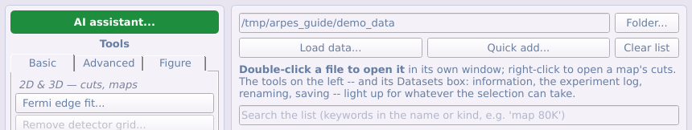
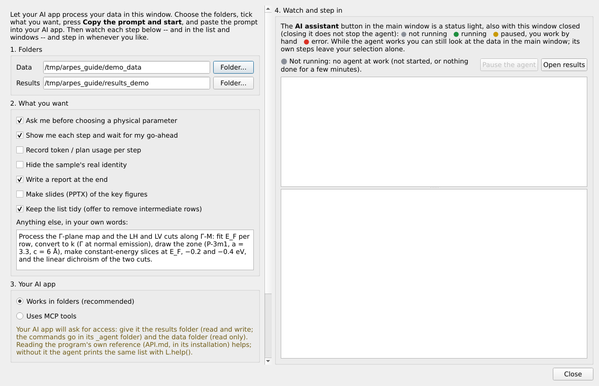
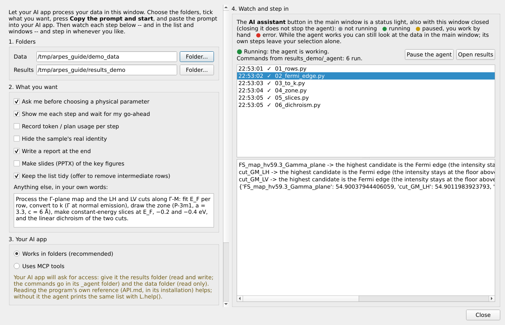
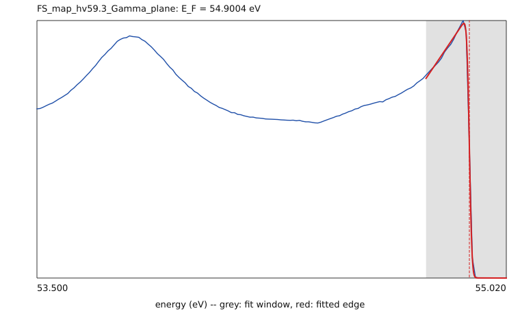

# Partie 7 — Agents IA

Un agent IA (Claude, ou toute application capable de lire et d'écrire des fichiers ou d'appeler des outils MCP) peut piloter le programme sur votre écran, étape par étape, pendant que vous suivez et pouvez reprendre la main. Cette partie explique le principe, comment démarrer et suivre un agent, et donne un exemple de la configuration à la figure.

## 7.1 Principe, et ce qui quitte votre ordinateur

Le programme n'a pas de conversation à lui. Vous parlez à votre application
IA (l'application de bureau Claude, Claude Code ou un autre agent) en langage
courant, et le programme est l'outil de cet agent. L'agent envoie au programme
de petites étapes : lister les données, ajuster un front de Fermi, convertir
en impulsion, faire une figure. Le programme exécute chaque étape sur votre
écran ; chaque résultat apparaît comme une nouvelle ligne de la liste ou une
nouvelle fenêtre, et vous pouvez mettre l'agent en pause et travailler à la
main à tout moment.

**Ce qui reste sur votre ordinateur, et ce qui n'y reste pas :**

- Vos fichiers de données brutes restent où ils sont et sont lus et traités
  par le programme, localement. Le programme n'envoie rien.
- Ce que **l'agent lit** est envoyé au fournisseur d'IA dans la conversation :
  le texte qu'affiche une étape (noms des lignes, valeurs ajustées, étendues
  des axes) et toute image que l'agent ouvre pour juger un résultat. Avec des
  sorties compactes, la conversation contient des nombres et quelques images,
  pas vos tableaux de données.
- Que le fournisseur puisse utiliser le contenu des conversations pour
  l'entraînement dépend du fournisseur et des réglages de votre compte.
  Vérifiez-les avant de commencer.
- Gardez le code privé, les manuscrits non publiés et tout ce que vous ne
  voulez pas faire lire hors des dossiers que l'agent peut atteindre. Donnez-lui
  seulement le dossier des données (en lecture) et celui des résultats.

Comme pour toute analyse, vérifiez ce qu'un agent a produit avant de
l'utiliser.

## 7.2 Architecture : opérations, référence, voies

```
 vous ⇄ application IA (conversation)       ARPES viewer (sur votre écran)
            │                                 ┌──────────────────────────┐
            │  écrit <results>/_agent/         │  exécute chaque fichier  │
            ├──── viewer_cmd/01_….py  ───────▶ │  de commandes, ou chaque │
            │                                 │  appel MCP, avec L       │
            │  lit out/cmd_01_….log  ◀──────── │  nouvelles lignes,       │
            │  (ou les résultats MCP)          │  fenêtres, fichiers      │
            │                                 └──────────────────────────┘
```

- **Les opérations `L`.** Une cinquantaine d'opérations documentées sur les
  lignes nommées de la liste principale (`arpes_viewer/ui/common/live.py`) :
  `L.rows()`, `L.add_files(...)`, `L.fermi_edge_search(...)`,
  `L.fermi_edge(...)`, `L.map_to_k(...)`, `L.kz_to_k(...)`,
  `L.bz_overlay(...)`, `L.cut_arithmetic(...)`, `L.slice_series(...)`,
  `L.figure_render(...)` … Chacune ajoute de nouvelles lignes au lieu de
  modifier les anciennes, n'écrase jamais un fichier et n'attend jamais un
  clic. Une ligne se désigne par son nom, son numéro dans `L.rows()` ou le
  chemin de son fichier.
- **La référence `API.md`** (`arpes_viewer/agent/API.md`, dans le programme
  installé) liste toutes les opérations, les boutons du panneau d'outils, les
  outils MCP et les calculs de `tools/`, avec leurs paramètres. Elle est
  générée à partir du programme, donc toujours à jour ; l'agent la lit au
  lieu du code source. `L.help()` affiche la même liste.
- **Trois voies** vers les mêmes opérations :
  1. **Dossier de commandes** (recommandé) : l'agent écrit un petit fichier
     Python par étape dans `<results>/_agent/viewer_cmd/` ; le programme
     l'exécute et écrit ce qu'il a affiché dans `<results>/_agent/out/`. Toute
     application IA qui lit et écrit des fichiers convient, et chaque étape
     est conservée comme fichier.
  2. **MCP** : l'application IA appelle le programme par son serveur MCP
     (`arpes-viewer-mcp`) ; quand le programme est lancé avec le pont agent,
     `viewer_api` appelle les mêmes opérations.
  3. **Scripts sans écran** : les calculs de `arpes_viewer/tools/` et
     l'espace de travail sans fenêtre, pour un script à conserver.
- **Fenêtres.** Une fenêtre qu'une opération n'ouvre que pour la piloter (un
  dialogue de conversion, une figure provisoire) n'apparaît jamais à l'écran ;
  les fenêtres encore ouvertes à la fin d'une étape (une figure, une
  visualisation, un outil qui attend votre saisie) apparaissent sur l'écran du
  panneau principal, pas sur celui où vous travaillez.

## 7.3 Démarrer depuis le panneau AI assistant



Cliquez sur **AI assistant...** en haut du panneau d'outils.



1. **Dossiers.** Le dossier des **données** (l'agent ne fait que le lire) et
   un dossier de **résultats** (tout ce que l'agent écrit y va ; ses commandes
   vont dans `<résultats>/_agent`).
2. **Ce que vous voulez.** Cochez ce qui convient :
   - *Ask me before choosing a physical parameter* : Γ, une fenêtre en
     énergie, le potentiel interne, un seuil ;
   - *Show me each step and wait for my go-ahead* ;
   - *Record token / plan usage per step* : un journal d'usage, une ligne par
     étape ;
   - *Hide the sample's real identity* dans tout ce qui est écrit ;
   - *Write a report*, *Make slides* ;
   - *Keep the list tidy* : proposer à la fin de retirer les lignes
     intermédiaires.

   Puis écrivez votre demande avec vos mots : quelles données, quelles étapes,
   quelles figures.
3. **Votre application IA.** *Works in folders* (recommandé ; rien à
   configurer) ou *Uses MCP tools* (le prompt explique comment connecter
   l'application une fois).
4. Cliquez sur **Copy the prompt and start**. Le programme se met à l'écoute
   et le prompt est dans le presse-papiers. **Show the prompt** l'affiche : les
   dossiers, l'emplacement d'`API.md`, la façon d'envoyer les étapes et les
   règles de travail ([§7.6](#76-les-règles-de-travail-de-lagent)).
5. Collez le prompt dans votre application IA et envoyez-le. Quand elle le
   demande, autorisez-la à lire le dossier des données et à lire et écrire
   celui des résultats.

## 7.4 Suivre et intervenir



- **La liste des étapes** (à droite) : chaque étape exécutée par l'agent, avec
  son heure et ✓, ou ✗ en rouge en cas d'échec. Cliquez sur une étape pour voir
  ce qu'elle a affiché.
- **Le voyant d'état** sur le bouton **AI assistant**, même fenêtre fermée :
  gris à l'arrêt, vert en cours, jaune en pause, rouge une étape échouée ou des
  commandes qui ne sont plus exécutées. Fermer la fenêtre n'arrête pas l'agent.
- **Pause the agent** retient ses commandes suivantes (le voyant passe au
  jaune) pour que vous travailliez à la main ; **Resume** les laisse passer.
  L'agent a pour consigne d'attendre et de vous demander quand ses commandes
  sont retenues.
- **Votre travail continue.** Les étapes de l'agent laissent votre sélection
  dans la liste telle quelle, vous pouvez donc regarder des données pendant
  qu'il travaille, et les fenêtres qu'il n'ouvre que pour les piloter
  n'apparaissent jamais sur vos écrans.
- **Open results** ouvre le dossier des résultats : les fichiers de commandes
  et journaux de l'agent dans `_agent`, les images et figures qu'il a écrites.

## 7.5 Autres façons de démarrer

- **Claude Code ou une autre application MCP.** Dans l'AI assistant,
  choisissez *Uses MCP tools* : le programme active son pont agent et le prompt
  contient la commande pour ajouter le serveur, pour Claude Code
  `claude mcp add arpes-viewer -- python -m arpes_viewer.agent`. Si votre
  application charge les définitions d'outils à la demande, faites-lui charger
  tous les outils arpes-viewer en une fois.
- **À la main.** Lancez le programme avec le pont activé
  (`arpes-viewer --agent-bridge`), ajoutez `arpes-viewer-mcp` aux serveurs MCP
  de l'application et indiquez `API.md` à l'agent.
- **Le dossier de commandes sans le panneau.** `agentic/launch_viewer.py`
  lance le programme à l'écoute d'un dossier de votre choix ;
  `agentic/README.md` est le guide pas à pas, avec des demandes à copier dans
  `agentic/PROMPTS.md` et des exemples exécutables dans `agentic/examples/`.
- **Un script à conserver.** Les calculs de `arpes_viewer/tools/` n'ont besoin
  d'aucune fenêtre ; `devtools/figure_tests.py` construit ainsi deux figures
  complètes à partir des données de démonstration.

Le détail du serveur MCP, pour référence :

ARPES viewer est aussi un **serveur MCP** (Model Context Protocol) : un
agent IA de n'importe quel modèle — Claude, GPT, Gemini, ou un modèle local
dans un client compatible MCP (Claude Desktop / Claude Code, Cursor,
VS Code, Cline, LM Studio…) — peut l'appeler comme un ensemble d'outils.
Tout reste sur votre machine : les fichiers sont lus et écrits localement ;
seul ce qu'un outil renvoie (nombres, texte, images) va au client.

**Mise en place.** L'installation du programme installe la commande
`arpes-viewer-mcp` (depuis une copie du dépôt : `python -m
arpes_viewer.agent`). Ajoutez-la aux serveurs MCP du client, p. ex. dans
`claude_desktop_config.json`, `.mcp.json` ou les réglages du client :

```json
{
  "mcpServers": {
    "arpes-viewer": {"command": "arpes-viewer-mcp"}
  }
}
```

(Avec une copie du dépôt plutôt que `pip install` : `"command": "python",
"args": ["-m", "arpes_viewer.agent"], "cwd": "<le dossier ARPES-viewer>"`.)
Le serveur parle MCP sur stdin/stdout et ne demande rien de plus que les
dépendances du programme.

**Outils sans fenêtre** — ils utilisent les lecteurs et les algorithmes du
programme :

| Outil | Ce qu'il fait |
|---|---|
| `find_files`, `list_loaders` | les fichiers d'un dossier qu'un lecteur reconnaît, et les lecteurs |
| `open_dataset`, `list_datasets`, `describe`, `metadata`, `close_dataset` | ouvrir un jeu de données (un identifiant, p. ex. `d1`), ses axes et ses métadonnées |
| `get_profile` | une EDC ou une MDC : les valeurs le long d'un axe, moyennées sur des plages des autres (option : CSV) |
| `get_image` | une image (PNG) d'une coupe, d'une carte à énergie constante ou d'une dispersion, avec palette et niveaux (option : PNG / CSV) |
| `fit_fermi_edge` | E_F et la résolution, avec leurs erreurs |
| `shift_energy`, `crop` | une copie en E − E_F, une copie rognée |
| `convert_cut_to_k`, `convert_map_to_k` | les conversions en k, avec les mêmes choix que leurs fenêtres (Γ, rotation ; *energy offset* seulement pour un axe non cinétique ; *output_fermi_level_eV* pour un résultat en E − E_F) |
| `save_datasets` | `.nxs` (s'ouvre dans le programme), `.itx` / `.ibw` (Igor Pro) |
| `brillouin_zone`, `read_cif` | les points de haute symétrie pour un groupe d'espace et une maille ; la maille et les sites d'un CIF |

Les axes se désignent par numéro, par nom (`x`, `y`, `k`, `z`) ou par un mot
de leur étiquette (`energy`, `slit`, `deflector`, `kx`) ; une plage s'écrit
`[lo, hi]` dans les unités de l'axe, ou un nombre pour le plan le plus
proche.

**Le programme à l'écran** — lancez-le avec le pont :

```bash
arpes-viewer --agent-bridge
```

(ou `python -m arpes_viewer --agent-bridge`, ou la variable
`ARPES_VIEWER_AGENT_BRIDGE=1`). La barre d'état indique *Agent bridge on
127.0.0.1:…*. Les outils `viewer_*` pilotent alors cette fenêtre :
`viewer_status`, `viewer_rows`, `viewer_add_files`, `viewer_select`,
`viewer_run_tool` (n'importe quel bouton du panneau d'outils pour la
sélection — `fermi`, `kcut`, `kmap`, `bz3d`, `figure`, `notch3d`,
`combine`…), `viewer_windows`, `viewer_screenshot` (une image de n'importe
laquelle de ses fenêtres, pour que l'agent vérifie ce qu'il a fait),
`viewer_figure` et `viewer_render_figure` (une figure en chiffres — page,
cadres, titres, niveaux, tailles de texte — et écrite en PNG telle qu'elle
sera imprimée), `viewer_close_window` et `viewer_python` (du Python exécuté dans le
programme, avec `A` = son module principal — pour remplir les champs d'une
fenêtre et cliquer ses boutons). Un résultat sans fenêtre rejoint la liste
par `save_datasets` vers un `.nxs` puis `viewer_add_files`.

**Sécurité.** Le pont est éteint sauf demande ; il n'écoute que sur
127.0.0.1 (pas sur le réseau) et ne répond qu'aux requêtes portant le jeton
aléatoire qu'il écrit au démarrage dans `~/.arpes_viewer/agent_bridge.json`
(lisible par vous seul) ; le fichier est effacé à la fermeture.
`viewer_python` exécute du code dans le programme — accordez-le à un agent
comme vous le laisseriez taper dans une console Python de votre ordinateur.

La voie du dossier de commandes est détaillée dans
[docs/AGENTIC_WORKFLOW_en.md](../../AGENTIC_WORKFLOW_en.md) ; le serveur MCP est
la même idée sans le dossier.

## 7.6 Les règles de travail de l'agent

Le prompt donne à l'agent des règles tirées de sessions réelles ; `API.md` les
répète. Vous pouvez en ajouter, ou en remplacer une, dans votre demande.

| Règle | Pourquoi |
|---|---|
| Après l'ajout des données, comparer les lignes au dossier et signaler ce qui a été laissé de côté, non reconnu ou signalé | des spectres seuls dans le dossier d'une carte, ou des fichiers qu'aucun lecteur ne prend, ne doivent pas passer inaperçus |
| Dire quelle partie d'un nom de ligne vient du nom de fichier et laquelle des métadonnées enregistrées ; marquer ce qui est deviné | tout le monde lit ces noms ensuite |
| Chercher une opération (`L.help()`, `L.tools()`, `L.functions()`) avant tout calcul propre ; ne jamais modifier les tables internes du programme ; s'il manque une opération, dire laquelle et demander | des résultats reproductibles, avec leur historique |
| Niveau de Fermi : ajuster les données brutes, ligne par ligne, sur l'axe propre de la ligne (`L.fermi_edge_search`), dessiner chaque ajustement ; les lignes de même énergie de photon et de passage doivent concorder ; quand les données ne tranchent pas, demander une fois | la chute la plus raide n'est pas toujours le front ; une seule fenêtre ne convient pas à tous les axes |
| Enchaîner les étapes en un appel (`L.map_to_k(row, ef=…, normalise_axes=(1, 2))`) pour que seules les lignes finales soient listées ; ne retirer des lignes qu'avec votre accord | une liste qui reste lisible |
| Essayer les figures dans `check/`, publier une version par figure dans `figures/FigureN/`, mettre de côté les versions remplacées | un seul fichier final par figure |
| Les grandeurs signées (dichroïsme, différences) ont une palette divergente aux niveaux symétriques | le signe doit se lire |
| Sorties compactes : `L.rows(compact=True)`, `L.profile(..., summary=True)`, tableaux dans des fichiers | moins de jetons, moins d'envoi au fournisseur |
| Ne jamais supprimer ni écraser ; demander avant chaque paramètre physique (si coché) | vos données et vos décisions restent les vôtres |

## 7.7 Exemple : un agent, de la configuration à la figure

Cet exemple suit une vraie journée de traitement de données CASSIOPEE par un
agent (cartes de surface de Fermi et coupes en plusieurs polarisations,
jusqu'aux figures de dichroïsme), refaite ici sur les données de
démonstration pour que vous puissiez la reproduire. Les changements du
programme que cette session a demandés sont dans le
[CHANGELOG](../../../CHANGELOG.md) (1.3.2).

**1. Configuration.** AI assistant : données `demo_data`, résultats
`results_demo` ; *ask before a physical parameter*, *step by step*, *report*
et *tidy list* cochés ; la demande : *« Process the Γ-plane map and the LH and
LV cuts along Γ-M: fit E_F per row, convert to k (Γ at normal emission), draw
the zone (P-3m1, a = 3.3, c = 6 Å), make constant-energy slices at E_F, −0.2
and −0.4 eV, and the linear dichroism of the two cuts. »* → **Copy the prompt
and start**, coller dans l'application IA.

**2. D'abord regarder.** Le premier fichier de commandes de l'agent :

```python
print(L.add_files(DATA))           # added, left_out, unrecognised, warnings
print(L.rows(compact=True))        # une ligne par jeu de données
```

Il indique ce que contient le dossier et propose un plan ; avec *step by step*,
il attend votre feu vert.

**3. Le niveau de Fermi, ligne par ligne**, chacune sur son propre axe en
énergie :

```python
found = L.fermi_edge_search(row, temperature=20)   # les fronts candidats
fit = L.fermi_edge(row, found["candidates"][0]["window"], temperature=20,
                   picture=os.path.join(HERE, "ef_" + row + ".png"))
```



`fermi_edge_search` liste toutes les chutes de l'EDC qui dépassent le bruit,
de la plus haute énergie à la plus basse, ajuste chacune et dit laquelle est
le front de Fermi. Quand deux s'ajustent bien (une queue faible au-dessus
d'une forte chute, comme sur les vraies données à énergie de passage 20), il
le dit et l'agent vous demande une fois. Chaque ajustement est dessiné : en
gris la fenêtre, en rouge le front ajusté.

**4. En impulsion, une ligne chacune.**

```python
k = L.map_to_k(MAP, ef=EF[MAP], normalise_axes=(1, 2), new_name="map Gamma plane k")
L.cut_to_k("cut_GM_LH", ef=EF["cut_GM_LH"], new_name="cut GM LH k")
```

Le passage à E − E_F, la normalisation de chaque coupe de la carte et la
conversion se font en un appel : seule la ligne finale est listée, et son
historique enregistre les trois étapes.

**5. La zone et la figure.**

```python
L.bz_overlay("map Gamma plane k", space_group=164, a=3.3, c=6.0, hkl=(0, 0, 1), offset=0.0)
L.slice_series("map Gamma plane k", values=[0, -0.2, -0.4], half_width=0.02, cols=3,
               colormap="blue", flip=True, shared=False, percentiles=(3, 99.7),
               high_factor=1.4, zone_style="dashed", zone_color="#B8D62020",
               title="Figure 1")
L.figure_render("Figure 1", os.path.join(HERE, "..", "figures", "Figure1.png"), dpi=150)
```


**6. Dichroïsme.**

```python
L.cut_arithmetic("cut GM LH k", "cut GM LV k", operation="asymmetry", normalise="total")
```

L'arithmétique de coupes du programme, la même que la fenêtre Cut arithmetic
([§5.5](#55-arithmétique-de-coupes--dichroïsme-et-division-par-une-référence)) : LV mise à l'échelle du total de LH, (LH − LV)/(LH + LV), les
points de faible intensité masqués.

**7. Suivre.** Pendant ce temps, l'AI assistant liste chaque étape
([§7.4](#74-suivre-et-intervenir)) ; vous pouvez cliquer sur une étape pour lire sa sortie, mettre
en pause pour regarder vous-même une ligne, puis reprendre. À la fin, l'agent
écrit le rapport et, si vous êtes d'accord, retire les lignes intermédiaires ;
le dossier des résultats contient les figures, les images des ajustements et
chaque fichier de commandes, qui gardent ensemble la trace exacte de ce qui a
été fait.

## 7.8 Limites et bonnes pratiques

- **Vérifiez la physique.** Un agent peut choisir un front de Fermi, une
  position de Γ ou un potentiel interne plausibles mais faux. Cochez *Ask me
  before choosing a physical parameter* et regardez chaque image
  d'ajustement.
- **Gardez la trace.** Les fichiers de commandes de `<résultats>/_agent/` et
  l'historique des lignes montrent ce qui a été fait ; conservez-les avec les
  résultats.
- **Usage.** L'agent ne voit pas sa propre consommation de jetons ; si vous
  voulez des chiffres dans le journal d'usage, donnez-les-lui.
- **Confidentialité.** Seul ce que lit l'agent quitte votre ordinateur
  ([§7.1](#71-principe-et-ce-qui-quitte-votre-ordinateur)) ; gardez ce qui est privé hors des dossiers qu'il peut
  atteindre.
- **Encodage.** Les fichiers de commandes sont en UTF-8 ; le programme
  avertit quand le code d'une étape contient des caractères abîmés par un
  mauvais encodage (« − » pour « − »).
