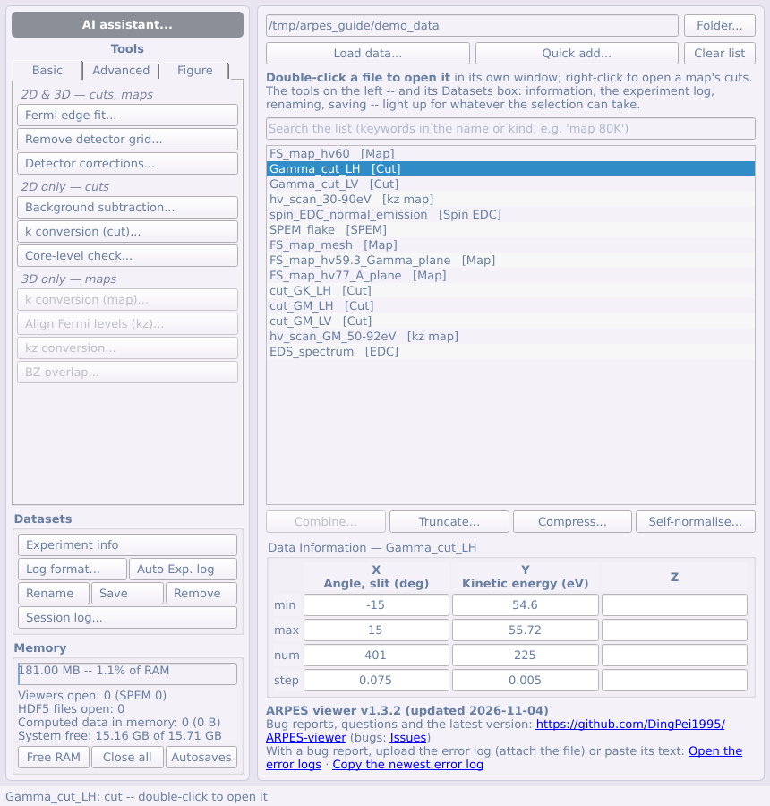
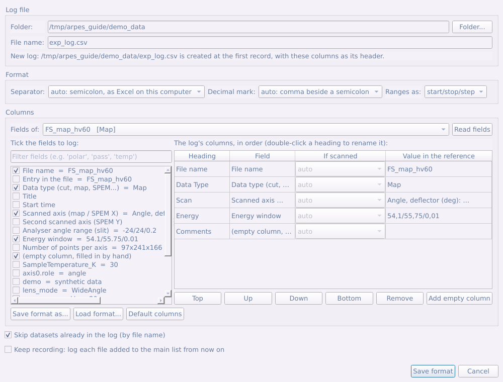

# 第二部分 主面板

主窗口是数据集的浏览器。本部分介绍数据列表及其周围的一切，工具面板（第四至第六部分）和 AI assistant（第七部分）除外。

## 2.1 主窗口概览

主窗口是一个**数据浏览器**：每行对应一个*数据集*，而不是一个文件（一个 `.nxs`
文件常常包含多个测量，每个测量单独一行）。名字后面标明数据类型：`[Cut]`、
`[Map]`、`[kz map]`、`[k-map]`、`[SPEM]`、`[EDC]`、`[Spin EDC]` 等。

主窗口分为三部分：

- **工具面板**（左侧）：顶部是 **AI assistant...** 按钮（[第七部分](#第七部分-ai-智能体)），其下是所有分析与
  处理工具的按钮，分为 **Basic**、**Advanced**、**Figure** 三个标签页（[第四至第六部分](#第四部分-工具面板basic-标签页)）。
  标签页下方是 **Datasets** 区。
- **列表**（右侧）及其下方的按钮。
- **Memory 区**（左下）和版本信息（右下）。

| 操作 | 方法 |
|---|---|
| 在独立窗口中打开数据集 | **双击**该行（或右键 → **Open**） |
| 对选中的行运行某个工具 | **工具面板**中对应的按钮 |
| 把多张 cut 叠成一个 map、把分段采集的 map / kz map 拼接起来，或叠加重复测量 | 列表下方的 **Combine...** |
| 在列表中查找、排序 | 列表上方的**搜索框**；右键 → **Sort by name** / **Sort by data type** |
| 裁剪范围、合并像素、每张谱自归一 | 列表下方的 **Truncate...**、**Compress...**、**Self-normalise...** |
| 打开 map 的 slit cut 或 scan-axis cut | **右键**该行（或选中的多行） |
| 查看元数据、生成实验记录、重命名、保存、移除 | 工具面板中 Memory 上方的 **Datasets** 区 |
| 查看并释放内存、关闭所有查看窗口、打开自动保存文件夹 | 左下的 **Memory** 区 |
| 查看当前版本、报告 bug、获取最新版本 | 标题栏，以及窗口最后一行（GitHub 链接） |

列表下方的四个按钮都作用于上方选中的行，结果都作为新行加入列表——原数据不会被修改。

**右键菜单**保留三种打开方式：**Open**、**Open slit cut**、
**Open scan-axis cut**（map），以及对整个列表排序的 **Sort by name**（按名称，`Cut_9` 排在
`Cut_10` 前）和 **Sort by data type**（按名称中最后一个处理标签 `[norm]`、`[E-E_F]`、`[k]`……分组，组的先后按处理顺序，组内按数据类型和名称，见 [§1.5](#15-数据类型)）。不适用于当前选择的条目
显示为灰色，悬停提示会说明原因。

**搜索框**（列表上方）：只显示名称或类型中包含所输入的每个关键词的行（不区分大小写，
如 `map 80K`）；清空即恢复全部。被隐藏的行会取消选中，因此不会对看不见的数据进行操作。

**Datasets 区**（工具面板中，位于工具和 Memory 之间）包含其余对行本身的操作：
**Experiment info**、并排的 **Log format...** 与 **Auto Exp. log**（见[实验记录](#23-实验记录)）、
同一行的 **Rename**、**Save**、**Remove**，以及 **Session log...**。不适用于当前选择时，
这些按钮会变灰。

## 2.2 载入数据

**Load data...** 打开载入窗口；**Quick add...** 跳过该窗口，直接以自动识别的
设置加入所选文件。

1. **Files**——选择一个或多个文件（*Select file(s)...*）。文件类型过滤器由已安装的
   读取器自动生成。
2. **Reader**——自动识别，并显示识别结果（如 *Detected: 3 × This program's own
   format*）。只有在文件被误读时才需要手动指定。
3. **Datasets found**——每个文件里有哪些数据集。这里只读取文件*结构*，即使是几 GB
   的扫描也是瞬间完成；在真正打开某一行之前不会读取数据本身。
4. **Axes**——*Axis order* 在载入时一次性调整数组维度顺序；*First axis of a map
   is* 说明扫描的是什么：偏转器角度（默认）、**光子能量**、温度、栅压、延时……
   这样后续每一步都使用正确的单位，也不会对非角度轴提供 k 转换。

**CASSIOPEE 文件夹**：选中编号序列（`name_1_ROI1_.txt`、`name_2_ROI1_.txt`……）
中的任意一个文件，整个文件夹会作为一个拼好的数据立方体列出一次。它是角度 map
还是 kz map，由谱旁边的 `_i` 参数文件自动判断。列表中的名称带有从这些文件读出的
光子能量和偏振——如 `FineMap 117eV LH`，光子能量扫描则为 `KzScan 40-120eV LH`——
因此同一扫描在不同能量或偏振下的重复测量可以区分开。

**ANTARES 光子能量（PhD）文件**：PhD `.nxs` 文件（每个光子能量一个 `Phd_NNNN`
条目）作为一个 `kz map` 列出：各帧按光子能量排序，每帧的动能轴用其自身的 hν
换算到 E_F（功函数取 4.5 eV，k_z 转换也会用到）。每一帧仍可单独作为 cut 打开。

## 2.3 实验记录

**Datasets** 区里并排的两个按钮根据数据文件自身的元数据生成实验记录——一个 CSV
文件，每次测量一行：左边的 **Log format...** 只需设置一次，右边的
**Auto Exp. log** 单击即可把选中的数据加入记录。

**Log format...**

1. **Log file（记录文件）。** 选择文件夹并输入文件名。如果该文件已存在，窗口显示的
   就是**这个文件自己的格式**，可以在此基础上调整。
2. **Format（格式）。** *Separator*（分隔符）和 *Decimal mark*（小数点）默认采用
   本机 Excel 的设置。Excel 按系统的列表分隔符拆分 CSV——凡是小数点为逗号的地区
   （法语、德语、意大利语等设置）都是**分号**——所以逗号分隔的文件在那里打开时所有
   内容都挤在第一列。除非记录要给设置不同的电脑使用，保持 *auto* 即可。
   *Ranges as:* 选择范围写成 `start/stop/step` 还是 `start:step:stop`。
3. **Columns（列）。** *Fields of:* 从主列表中选一个数据集（选最常记录的那种），
   **Read fields** 列出它的全部字段及取值：由数据推出的文件名、数据类型、开始时间、
   扫描范围，然后是所有元数据字段和电机位置。**勾选**字段即加为一列。在右侧表格中
   双击标题可改名（`hν/Δ`、`Polar/Δ`、`Epass`……），用 **Top / Up / Down /
   Bottom** 任意排序。**Add empty column** 加一列留空、手工填写（备注）。
   **Save format as...** / **Load format...** 可为每个线站各存一套格式。
4. **If scanned（扫描时）。** 位置或角度列写什么，取决于测量类型：
   - **cut**：样品位置固定——写电机的值；
   - **SPEM** 扫描：扫描的样品台轴写成 `start/stop/step`（对样品台的列选
     *SPEM: scanned X* / *Y*）；
   - 用机械手而非 deflector 转角采集的 **map**：角度写成 `start/stop/step`
     （*map: scanned angle*），而随角度修正的样品位置写成 `起点..终点`；
   - **kz map**：光子能量范围（*kz map: photon energy*）。

   默认的 *auto* 会按名字识别被扫描的电机，并按取值识别移动过的位置；其他测量
   写该字段本身的值。
5. **Save format（保存格式）。** 如果记录文件里已有记录而你改了格式，文件会
   **按新表头整体重写**：每条记录随所在列移动（改名或移动过的列都能跟上），新列
   对旧记录留空；被去掉的列会先列出来确认，因为其中的内容会被删除。表头始终只有
   第一行。

*Skip datasets already in the log* 会跳过文件名已在记录中的数据。勾选
**Keep recording** 后，此后加入列表的每个文件都会自动写入记录，直到关闭程序：
束线实验时每测完一个文件就把它加入列表，记录会自动更新。

**Auto Exp. log** 把选中的行加到记录最后一条之后，不弹出任何窗口；状态栏会显示
加入了几条。第一次使用（还没有保存过格式）时会先打开 *Log format...*。

如果记录文件正在 Excel 中打开，Windows 不允许写入：先在 Excel 中关闭再点一次。

## 2.4 合并数据集：叠加、拼接与求和

**Combine...**（列表下方）可以做三件不同的事，并会让你选择：

- **Stack（叠加）**——*仅限 cut*。每张 cut 成为新 map 的一个切片，沿一个由你命名的
  轴：温度序列、门电压序列、每个光子能量一张的 cut。结果可以像普通 map 一样查看——
  在固定能量处切片，或沿新轴切片。
- **Join（拼接）**——*cut、map、kz map 或 k-map，但须同一类型*。把一次分段采集的
  测量按其自身的某个轴首尾拼接起来：偏转角范围分两次扫描的 map、光子能量范围分几次
  采集的 kz map、能量窗口分两半采集的 cut。
- **Sum repeated scans（叠加重复测量）**——同一测量多次采集的扫描：点 **Combine** 后打开
  重复扫描窗口（见下文[叠加重复测量](#叠加重复测量)）。

**叠加 cut**

1. 在列表中选中这些 cut（Ctrl/Shift 多选），点 **Combine...**。叠加要求
   有一个轴逐点一致（点数、数值、单位都相同）。若**另一个**轴不同——通常是各 cut 的能量
   窗口略有差异——仍然可以叠加：该轴先**截取**到所有 cut 共同覆盖的范围，各 cut 再重采样
   到第一张 cut 在该范围内的点上（对话框会说明范围）。共同范围少于某张 cut 自身范围的一半时，
   它们更像是同一测量的分段，请用 *Join*。两个轴都不同或范围不重叠时，*Stack* 变灰并说明
   原因，此时可改用 *Join*。
2. 程序会询问是否**按列表中的顺序**合并。选 *Yes* 保持该顺序；选 *No* 则可自行
   调整顺序。
3. 选择 **Stack**，然后设置新轴：**New axis is**（温度、门电压、光子能量、延迟、
   位置、其他——会自动填入 *Name* 和 *Unit*，均可修改）、**Start**（起始值）和
   **Step**（间隔）。每张 cut 旁边会显示它对应的数值。如果选择了调整顺序，可
   **拖动**各行（或用 **Move up** / **Move down** / **Reverse**）。点 **Combine**。

由角度 cut 组成的光子能量序列会成为 `kz map`，可直接使用 *Align Fermi levels (kz
map)* 和 *Convert to momentum (kz, k∥)*（见[第 14 节](#410-对齐-kz-map-的费米能级)）；
其他轴得到的是 `map`，其第一个轴被标记为非角度，因此不会提供 k 转换。

**拼接分段采集的数据**

1. 选中各段（全是 map，或全是 kz map，或全是 cut……），点 **Combine...**。
   map 和 kz map 直接进入 *Join*。
2. **Join along**：测量被分段的那个轴。默认选中各段之间范围不同的那个轴——map 的
   偏转角轴、kz map 的光子能量，或分两个能量窗口采集的 cut 的能量轴——通常无需改动。
3. **Where pieces overlap**（重叠部分）：*Average them*（取平均），或按下方列表的
   顺序保留较早 / 较晚的一段（拖动各行可改变顺序）。
4. 对话框列出每一段的范围，并给出 **Result**（拼接后的范围和点数），以及处理过程中
   所做的说明。点 **Combine**。

坐标轴的处理方式：

- 各段在同一网格上（步长相同，范围相接或按整点重叠——通常情况）时，数据**按原样
  复制**，不做插值。
- 某段步长不同或有半步偏移时，会被**插值**到公共轴上（采用第一段的步长），对话框
  会说明。
- 若**其他轴**不同——几次采集的能量窗口相差几 meV、slit 通道数不同——所有段都会
  重采样到它们**共同覆盖**的范围，对话框会说明。
- 没有任何一段覆盖的区间是**空缺**，填为零并给出提示。
- 拼接后的 kz map 仍是 `kz map`：请在拼接结果上运行 *Align Fermi levels (kz
  map)*，而不是在各段上（各段按光子能量的拟合结果不会被带入）。

### 叠加重复测量

用于分多次短扫描采集的精细 cut 或 map，以便发现样品老化。选中这些扫描（同一类型的两个或
更多）→ **Combine...** → **Sum repeated scans** → **Combine**，打开重复扫描窗口：

1. **是否为重复测量？** 列出每个扫描的网格和记录条件（光子能量、偏振、角度、位置、温度、
   通能、透镜模式）；与第一个扫描不同的值标为橙色。
2. **样品是否发生变化？** 点击 **Compare the scans**。每个扫描与其余扫描之和比较：
   *χ² / point* 对只差计数噪声的扫描基本相同，谱本身变化时会增大；明显高于其余的扫描标为
   **changed**。同时列出每个扫描 EDC 的能量漂移和计数率；点击某行可查看其 EDC 与其余的对比。
3. **叠加。** 勾选要保留的扫描（标为 changed 的默认不勾选），选择是否消除能量漂移、
   **Sum** 或 **Mean**，然后 **Sum to list**。

## 2.5 分步窗口

需要做几步决定的工具以**编号步骤**的形式打开（叠加重复测量、探测器校正、紧束缚
拟合、晶体结构、计算能带）：标题显示 *Step 2 of 4: …*，蓝色提示框说明这一步的
用途和操作，这一步完成之前 **Next →** 保持灰色（旁边写明原因），用 **← Back** 或
左侧的步骤列表可以返回。
