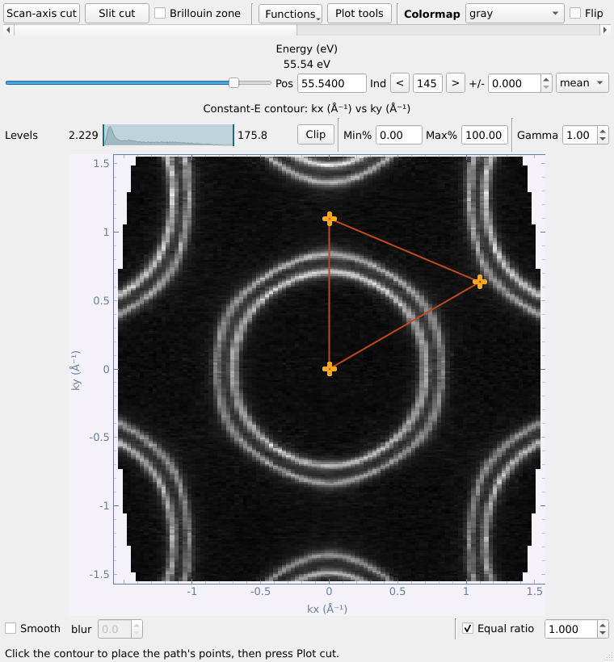
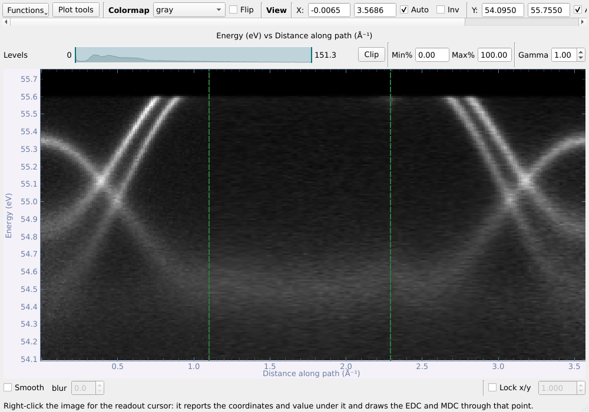
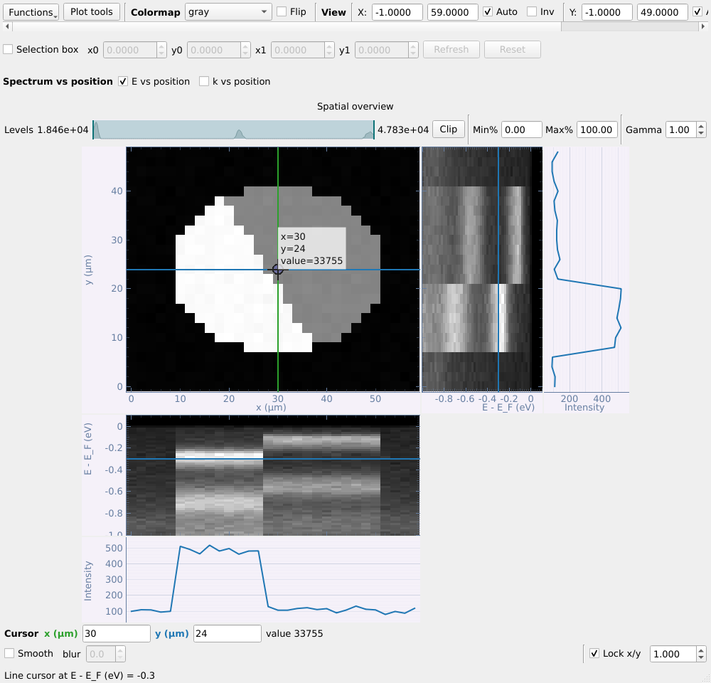
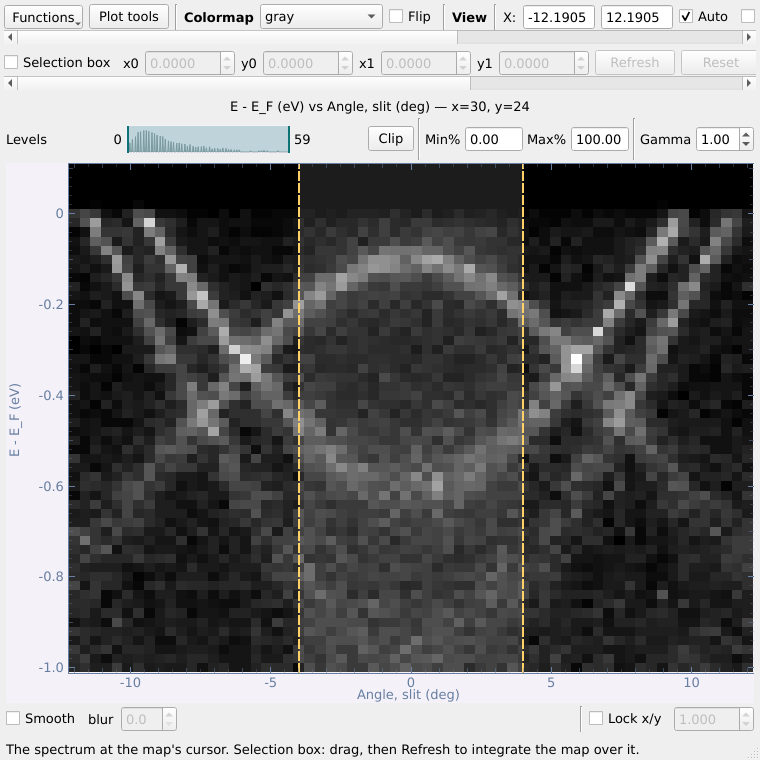
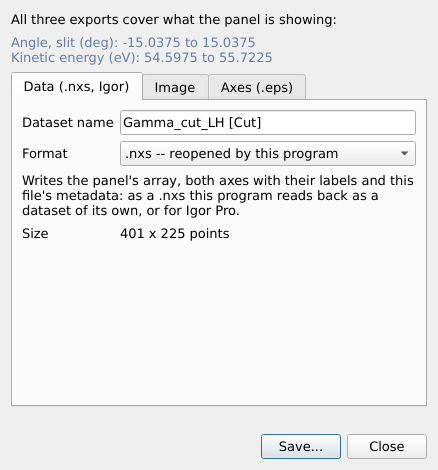

# 第三部分 数据查看窗口

每个数据集都在自己的查看窗口中打开。本部分先介绍所有查看窗口的共同操作，再逐一介绍各类数据。

## 3.1 各查看窗口的共同操作

每个数据集在自己的窗口中打开，因此可以把 map、它的切面以及另一个文件并排摆放。

- **顶部一行**：**Functions** 菜单（本窗口能做的所有事）、**Plot tools**（在本图上
  画辅助线和文字，见下文）、色表（每个窗口独立）及 **Flip**（反转），以及视图控制——坐标范围、**Auto**、**Inv**（反向）、
  **Reset**、**Grid**。
- **图像上方**：**Levels** 色阶条（拖动两个滑块，或输入 **Min%/Max%** 百分位，
  **Clip** 应用）以及 **Gamma**。您设置的最小/最大值在移动切片位置时（contour 的
  能量、cut 的角度、空间 map 的光标）会保持不变，使各位置处于同一色标；把滑块拖回
  两端，或设为 0%–100%，即恢复为跟随每一帧自身的范围。
- **图像下方**：**Smooth**（仅影响显示，不改变数据）和 **Lock x/y**（锁定纵横比）。
- **读数光标**——在图像上右键 → *Readout cursor*。它显示光标处的数值；在 cut 上
  还会画出经过该点的 **EDC**（右侧）和 **MDC**（下方）。**EDC ±** / **MDC ±**
  设置积分窗口，并在图上以半透明带显示。在 **Cursor** 行输入坐标并回车，可把
  光标精确放到该位置。
- **EDC → list** / **MDC → list** 把当前显示的曲线作为独立数据集加入主列表
  （见[第 23 节](#35-曲线edcmdc-与曲线拟合)）。
- **图像右键 → Export** 导出该面板当前显示的内容——数据（`.nxs`）、图片，或
  矢量坐标轴（`.eps`），见[第 28 节](#61-作图器figure-composer)。
- **Functions → Slice → Save slice to the main list / Freeze slice in a new
  window** 保存当前切片的副本。冻结窗口（以及空间 map 上的 *Open this position in
  a new window*）会沿用原面板的最小/最大值和 gamma，便于直接对比。它有自己的
  **Plot tools**，以及用来制作论文图的 **Figure composer...** 按钮
  （见[第 28 节](#61-作图器figure-composer)）。

**Functions** 菜单现在只包含作用于该窗口本身的操作——以数据集为对象的工具都在
主窗口的工具面板中（见[第 3 节](#21-主窗口概览)）：

| 窗口 | Functions |
|---|---|
| map / kz map / k-map（等能面） | Arbitrary cut；Slice：保存 / 冻结切片 |
| cut | Straighten bands (FS correction)；Slice：保存 / 冻结 |
| map 的 slit cut | 对整个数据立方的 Straighten bands (FS correction)；Show the map |
| 曲线 | Curve fit、Spin analysis；Crop、Bin、Normalise、Background、Shift axis、Add √N errors |

适用但暂时无法运行的条目显示为灰色，悬停提示会说明原因。

**布里渊区勾选框。** 画过布里渊区（见[第 15 节](#411-布里渊区)）的 k-map 或已转换的
kz map 会保留它：其查看窗口顶部一行有 **Brillouin zone** 勾选框，用于显示或隐藏。

### Plot tools：在图上画辅助线和文字

每个查看窗口（cut、map、空间扫描、曲线、冻结切片）顶部一行都有 **Plot tools**
按钮，打开一个小窗口，**直接在眼前这幅图上**作画：

|  | |
|---|---|

- **Type**（类型）：*Vertical line*（竖线）、*Horizontal line*（横线）、*Line at an
  angle*（过某点的斜线；角度按图本身的单位计，即斜率为 tan(角度) 个 y 单位 / x 单位）、
  *Text label*（文字）。
- **Position**（x, y）、**Angle**（角度）、可选的 **Label**（显示在线上，如 `E_F`、
  `Γ`）、**Colour**（九种一键颜色，或 **More...** 自选）、**Width**（线宽）、
  **Style**（实线、虚线、点线、点划线）和 **Text size**（字号）。
- **Add** 在输入的位置画出（**Centre of view** 可填入当前视图中心）；**Place by
  clicking** 则在图上点击处画出。
- 在图上**拖动**线条即可移动，窗口中的数值同步更新。在列表中选中某条可**编辑**
  （修改立即生效）或 **Remove**（删除）；**New guide** 结束编辑；**Remove all**
  清空。
- 窗口中有多个面板时，用 **Draw on** 选择画在哪一个上。
- 移动切片时辅助线保持不变（浏览 map 时 E_F 线始终在 E_F 处），关闭 Plot tools
  窗口后也保留。面板的 **Export → Image** 也会画出它们（*Include the Plot tools
  guides*）。

*Plot tools* 用于看数据；要制作论文图，请使用**作图器（Figure composer）**及其
**Figure tools**（见[第 28 节](#61-作图器figure-composer)）。

## 3.2 Map：等能面及其两个切面

map 打开时显示**等能面（constant-energy contour）**。顶部滑块选择能量（**Pos**
以 eV 为单位，**Ind** 为序号；**±** 设置积分范围，可选 **mean** 或 **sum**）。
**Scan-axis cut** 和 **Slit cut** 分别在新窗口中打开两个正交切面。（扫描轴是采集
map 时扫描的那个量——通常是偏转器角，也可能是样品转角，kz map 则是光子能量——
按钮因此以它命名。）

| Slit cut（狭缝角 vs 能量） | Scan-axis cut（偏转器角 vs 能量） |
|---|---|
|  |  |

**三个窗口共用一个光标。** 在任一窗口中打开读数光标，其余窗口同时打开；在任一
窗口中移动光标，其余窗口会沿新位置重新切片。每个轴在所有窗口中都用同一种颜色：
**偏转器为红色、狭缝为绿色、能量为蓝色**。光标线的颜色是它保持不变的那个轴的
颜色，它所对应的 EDC 或 MDC 也用同一颜色绘制。积分宽度（± 框）属于各自窗口，
不会在窗口之间共享。

也可以直接从列表中打开 map 的切面（右键 → **Open slit cut** / **Open scan-axis
cut**），此时等能面窗口保持隐藏，需要时用 *Functions → Show the map* 调出。

## 3.3 任意路径切面与费米面校正

### 任意路径切面

在任意等能面上 *Functions → Arbitrary cut...*：点击（或输入）最多六个点，切面
按顺序经过这些点——这里是 k-map 上的 Γ → M → K → Γ。勾选 **One dataset per
segment** 可让每一段分别成为一个数据集。

| 等能面上的路径 | 路径点 |
|---|---|
|  |  |

结果是以沿路径距离为横轴的 cut；路径的拐点用绿色虚线标出，避免把拐点处的折线
误认为物理特征。

### 费米面（FS）校正

在 cut（或 map 的 slit cut）上 *Functions → Straighten bands (FS correction)...*，把本应平直的特征
拉直——通常是随分析器角度弯曲的费米边。沿该特征点击若干点，程序拟合多项式
（默认 2 阶），并把每一列在能量方向上平移。**From a reference (Au)...** 改用列表
中的金参考谱确定曲线。在 map 的 slit cut 上操作时，同样的平移会应用到整个数据
立方体。

## 3.4 kz map 与 k-map

**kz map**（光子能量扫描）的打开方式与角度 map 相同：等能面显示滑块所选能量处光子能量对分析器
角度的强度，两个切面分别是某一光子能量下的谱和某一角度下随光子能量的色散。在 Basic 标签页中
对齐其费米能级并转换到 (k_z, k∥)（[§4.9](#49-对齐-kz-map-的费米能级)、[§4.10](#410-把-kz-map-转换到动量空间)）。

**k-map**（转换到动量空间的 map，[§4.8](#48-map-的-k-转换)）和**转换后的 kz map** 在同一个等能面查看窗口中、
以动量为坐标打开。画过布里渊区（[§4.11](#411-布里渊区)）的数据会保留它，顶栏的 **Brillouin zone** 复选框
可显示或隐藏。切片序列图（[§5.6](#56-切片序列图slice-series-figure)）和导出也会画出它。

## 3.5 曲线：EDC、MDC 与曲线拟合

任意图像下方的 **EDC → list** / **MDC → list**，或自旋分辨文件，都会得到曲线
数据集，在**曲线窗口**中打开：

可以隐藏通道、用 **Offset** 做成瀑布图、显示 **Error bars**（来自 σ 通道）；
**Range** 标记一个 x 范围供各操作使用。*Functions → Transform* 提供
**Crop**（裁剪）、**Bin**（合并）、**Normalise**（归一）、**Subtract a
background**（扣背景：常数、线性、Shirley）、**Shift the axis**（平移横轴）和
**Add counting errors (√N)**（添加计数误差）；每个操作都生成新数据集，并正确
传播 σ。

### 曲线拟合

*Functions → Curve fit...*：**Peaks on a background**（Lorentzian、Gaussian 或
Voigt 峰，点击放置或 **Find peaks** 自动寻峰；无 / 常数 / 线性 / Shirley 背景；
仪器分辨率；可选 **× Fermi edge** 费米截断），或者直接拟合 **Fermi edge**（费米边）。
权重可取通道自身的 σ、√N 或均匀权重。每个参数都给出误差，残差以 σ 为单位显示。

**Fit to list** 保存数据、拟合、残差及各分量；**Copy results** 复制制表符分隔的
结果表。费米边拟合可用 **List a copy with E_F = 0** 生成平移后的副本。

## 3.6 自旋分辨数据

自旋 EDC 打开时每个自旋通道一条曲线：

*Functions → Spin analysis...*：

- 表格读取每个通道的标签（样品台设置、靶磁化方向、计为"上"的轴和符号）；
  **Axis** 与 **Counts as** 可手动修改。
- **Cross ratio**（交叉比，通道齐全时为默认）可精确消除透过率和靶反射率；也可用
  **单对通道**，但它带有仪器不对称性，程序会测量并报告该不对称性（ε）。
- **S_eff**（Sherman 函数，默认 0.2）、**Bin**、可选的 **Zero reference** 窗口。
- 图：原始通道、带误差棒的极化率 P，以及带误差的 I↑ / I↓。
- **P to list**、**I↑ / I↓ to list**、**As a figure**（打开作图器）。

## 3.7 空间分辨扫描（nano-ARPES）

实空间扫描在**两个窗口**中打开：**空间分布图**（每个位置的总强度），以及旁边
cut 查看器中的**光标处 E-k 谱**——它带有 cut 查看器自己的工具（Functions、带
EDC/MDC 的读数光标、Export）。空间图上的**读数光标**（readout cursor，打开时
默认开启）用来选点：拖动它，或在空间图下方的 **Cursor** 行中输入位置。关闭其中
任何一个窗口，另一个也会一起关闭。

**Selection box**——位于每张图上方的一行。勾选后拖动选框（或输入角点
**x0 y0 x1 y1**），再点击 **Refresh**（或按回车）；在此之前不做任何计算，大的
扫描只在需要时才读取。取消勾选只隐藏选框、保留其角点（再次勾选时选框回到原来的
位置），并且保留**积分结果**：结果一直显示，直到点击 Refresh 旁边的 **Reset**。

- 在空间图上，谱窗口显示**选框内求和的谱**。无论选框是否勾选，谱都保持为该求和，
  直到点击 **Reset**，之后重新跟随光标；
- 在谱上，空间图显示所选 **(k, E) 窗口**内的强度在样品上的分布——用于寻找
  畴区或样品边缘。点击 **Reset** 即恢复完整的空间图。

**E vs position / k vs position**——位于 Selection box 下面一行的两个勾选框
（同时只能选一个）。
勾选后在**空间图的右侧和下方**画出经过光标的谱随各空间坐标的变化：能量（或 k）
对位置，与空间图共用坐标轴。谱上会出现两条**平行虚线**：E vs position 时为 k
（角度）的积分范围，k vs position 时为能量的积分范围。可以拖动两条虚线（虚线之间
的阴影区域不响应鼠标，因此位于其下的选框仍可拖动），或在谱上方的 **Band** 框中
输入 **from / to**。打开空间图右侧和下方的谱图时窗口会相应变大，空间图保持原有
大小；关闭时窗口恢复。

**Line cursor**——在空间图右侧或下方的谱图上右键 → *Line cursor*。该谱图上会出现
一条固定能量（或 k）的线，沿这条线的强度随位置的变化画在**更右边**（右侧谱图）或
**更下面**（下方谱图）。拖动这条线即可移动它；取消勾选该菜单项即可移除。

## 3.8 导出单个面板与保存数据

在任意图像上右键 → **Export** → **Data (.nxs, Igor)...**、**Image...** 或 **Axes only
(.eps)...**。导出的总是该面板当前显示的内容（包括显示范围）：数据导出为本程序
可重新读取的数据集，或导出给 Igor Pro（`.itx` 文本或 `.ibw` 二进制 wave，带坐标标度、
单位，元数据写在 wave note 中）；图片应用当前色表（PNG、TIFF 或 JPEG，可设定尺寸和 dpi，
可带或不带坐标轴，如有 Plot tools 辅助线或布里渊区也可一并画出）；或者把边框、刻度
和标签导出为矢量 PostScript，便于在 Illustrator 中放入图片（可在框内画出布里渊区，
见[第 15 节](#411-布里渊区)）。

**Save**（工具面板 Datasets 区）把选中的数据集写入你自己的 `.nxs` 文件（选中多行时
写入同一个文件）；也可在文件类型中选择 Igor Pro 格式：一个包含全部数据的 `.itx`，或每个
数据集一个 `.ibw`。Igor 文件只是副本，列表中的行保持不变。
