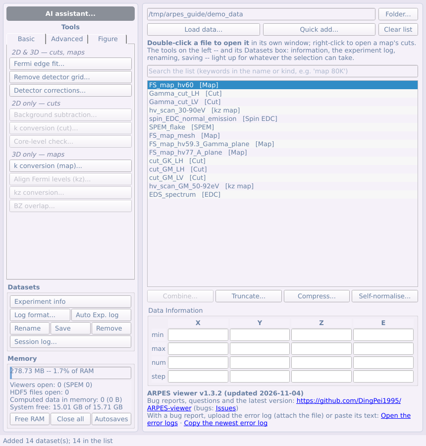
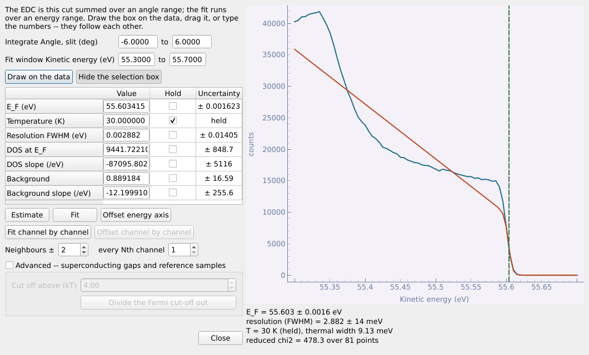
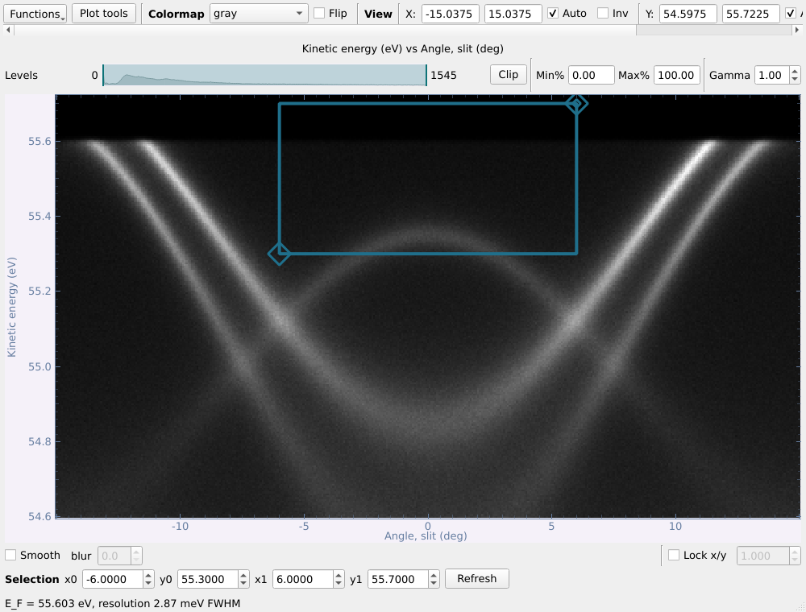
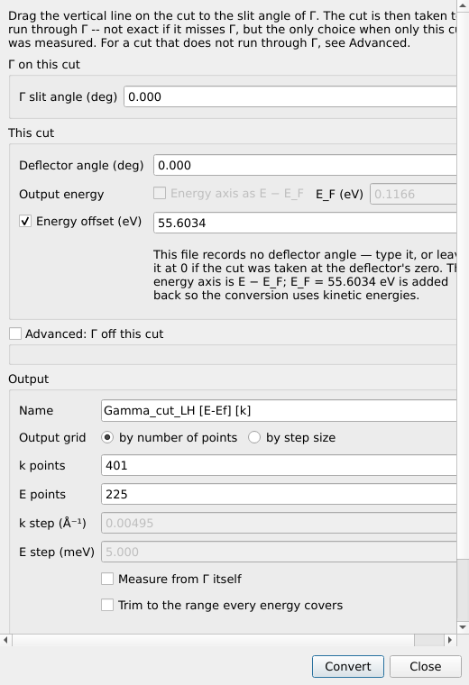
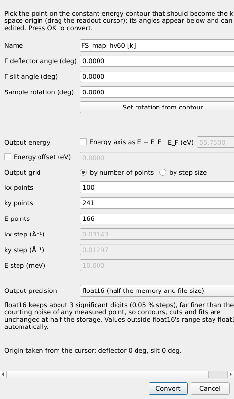
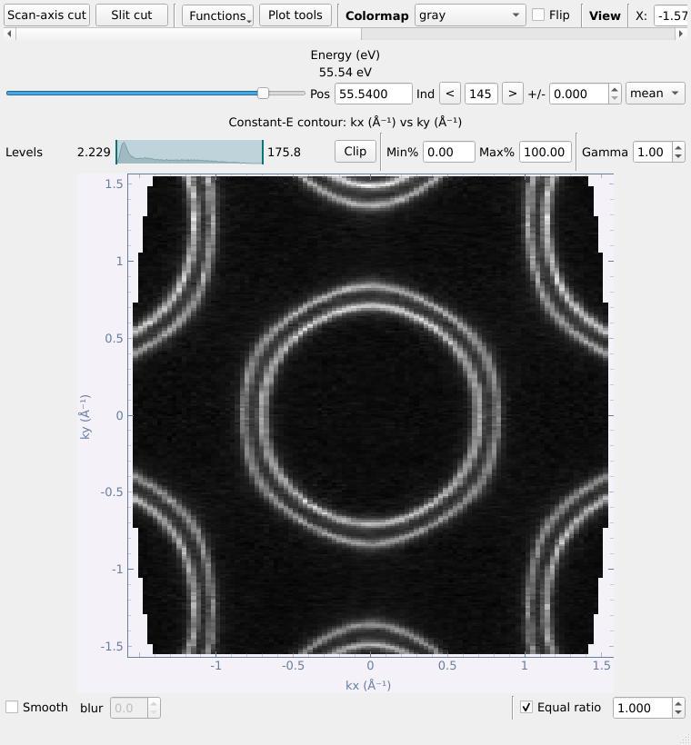
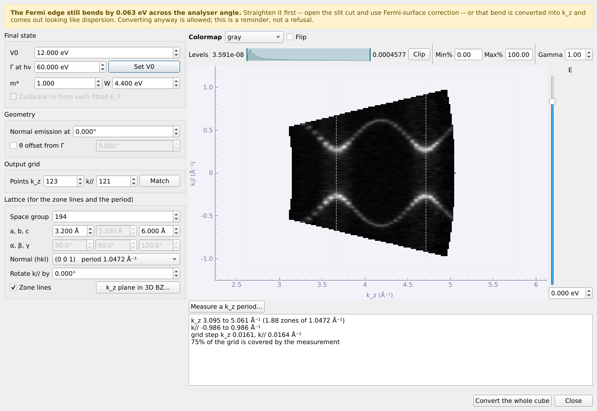
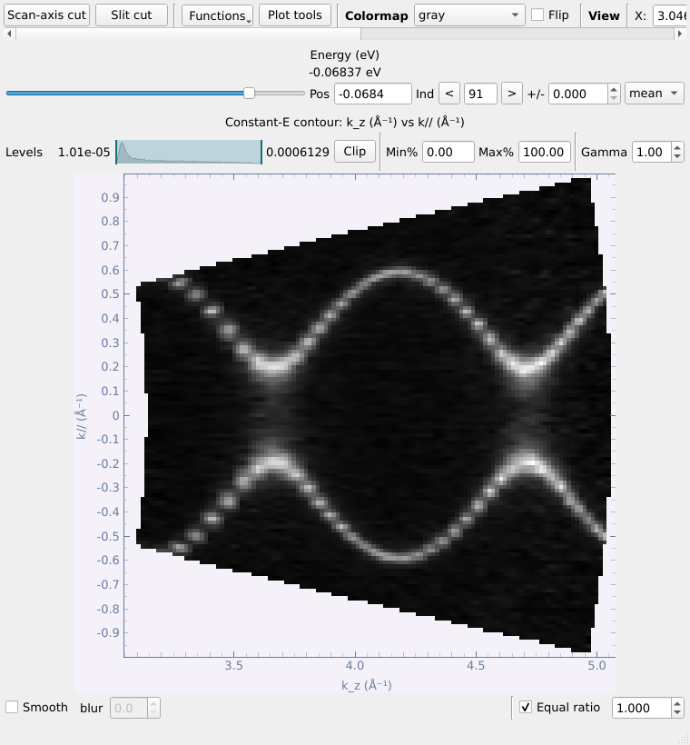
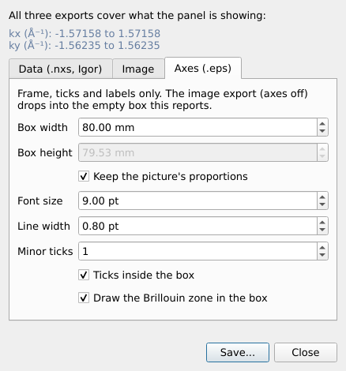

# 第四部分 工具面板：Basic 标签页

**Basic** 标签页包含几乎每个数据集都要经过的步骤：费米能级、探测器、背底、动量转换、芯能级检查和布里渊区。

## 4.1 工具按钮如何工作

每个标签页把工具按所接受的数据分组：*2D & 3D — cuts, maps*、*2D only — cuts*、*3D only — maps*。
**只有列表中选中的行符合要求时，按钮才会亮起**：cut 的 k 转换需要一个角度 cut，cut 运算需要恰好两个
cut，三维视图需要一个 map。把鼠标停在灰色按钮上可以看到原因。

工具从不修改输入的行：结果是列表中的新行，以原名加上所做操作命名（`cut1 [k]`），其历史记录了这一步
及其参数（*Experiment info* 可查看）。需要多个决定的工具以编号步骤的形式打开（[§2.5](#25-分步窗口)）。

## 4.2 费米边拟合

单张 cut 的常规流程：**费米边拟合 → 平移能量轴 → 转换到动量 → MDC/EDC 拟合**。
每一步都是工具面板中的一个按钮：在列表中选中 cut，点击对应按钮即可。

工具面板 → Basic → **Fermi edge fit...** 对选框内求和得到的 EDC 拟合费米边
（费米-狄拉克分布 × 线性态密度，再与高斯分辨率卷积）。它会同时打开该 cut 的查看
窗口和拟合窗口；两者绑定，关闭任一个，另一个也随之关闭。

1. 点击 **Show the selection box**，在 cut 上把选框拖到费米边处（或直接输入角度
   与能量范围）。角度范围决定哪些通道被求和，能量范围就是拟合窗口。

   

2. 先 **Estimate**，再 **Fit**。勾选 **Hold** 可固定某个参数（温度默认固定为
   文件记录值）。每个参数都给出不确定度。
3. **Offset energy axis** 生成一份能量轴为 **E − E_F** 的副本并加入列表。

*Advanced* 区域可以除去费米截断（用于能隙与参考样品），或逐通道拟合 E_F。

**对 map 拟合。** 选中一个 map（角度 map 或 k-map）后点同一个按钮：会打开该 map 的
**slit cut** 和拟合窗口，用 slit cut 的滑块选择要拟合的那张 cut。拟合后点
**Offset energy axis**，程序询问是**用这张 cut 的 E_F 平移整个 map**（*Yes*），还是
**每张 cut 各用一个 E_F**（*No*）。选后者时，右侧的 **Fitted cuts** 列表会逐步填充：
移动滑块、点 **Fit**、重复即可。同一位置再次拟合会替换之前的结果，列表中每个 E_F
都可以手动修改。两张已拟合 cut 之间的 cut 按相邻两点线性插值平移（第一张之前和
最后一张之后用最近的拟合值），插值曲线画在列表下方。点 **Offset energy axis by
these fits** 把校正后的 map 加入列表。

## 4.3 去除探测器网格

MCP（六角）和网栅（方形）图案会印在每一幅图像上。**请最先做这一步**：只有仍在
探测器原始像素上的数据才能去网格，因此对已转换、校正或平滑过的数据，该按钮会
拒绝并说明原因。

选中 map（或 kz map）或 cut，点工具面板 → Basic → **Remove detector grid...**。
对 map 不需要参考测量——网格在每个切片中都位于同样的像素上，而光电子信号会移动。
点击 **Find and remove the grid**：

- 所选切片的 **Before / After**，使用同一色阶（勾选 **Show −∂²I/∂E²** 可让残余
  网格一目了然）。
- 找到的**网格图案**、其在 **k 空间的区域**（红色），以及每个切片拟合的**对比度
  与平移**。
- 网格区域中剩余的功率（1 表示网格已完全去除）。
- **Also list the grid pattern** 会保留一个 `[grid]` 数据集；之后用相同透镜模式和
  通能测得的 cut 会自动找到并使用它。

## 4.4 探测器校正

作用于原始测量的 cut、map 或 kz map：

1. **梯形畸变** —— 勾选 *Correct a trapezoidal image*，把四个黄色角点拖到受光区的四个角上；
   右图显示校正为矩形后的结果，每行总计数保持不变。
2. **坏区** —— **Add a region** 并拖到坏点或热点上，或点击 **Find bad pixels** 自动查找；
   填补方式 *smooth*（适合点状坏区）或 *linear along* 某个轴（适合条状坏区）。
3. **应用** —— **Apply to list**。之后再对结果做去网格、费米能级和 k 转换。

## 4.5 扣除背底

工具面板 → Basic → **Background subtraction...**（cut）去除不属于能带的强度：
**Shirley** 或 **Tougaard** 非弹性背底、所有角度共有的底（每一能量行的某个百分位数）、
平滑的**多项式**——或者除去**费米截断**（按文件记录的温度和分辨率计算的
Fermi–Dirac 函数，起点为文件记录的 E_F，没有记录时取角度积分 EDC 下降最陡处）。
窗口与 Advanced 页的处理窗口相同——源数据与结果并排、实时预览、**Apply** 把结果
加入列表——见[第 16 节](#51-平滑求导曲率与对称化)。

## 4.6 把 cut 转换到动量空间

工具面板 → Basic → **k conversion (cut)...** 把角度轴转换为 k∥（Å⁻¹）。cut 上会画出
一条**竖直线**：把它拖到 Γ 点的狭缝角处。此时认为该 cut 经过 Γ——若 cut 并不经过 Γ
则不严格，但在只测了这一张 cut 时这是唯一的选择。

- **Advanced: Γ off this cut** 用于不经过 Γ 的 cut：输入 Γ 的偏转器角与狭缝角，
  或用 **From a converted map...** 从同一样品已转换的 map 继承。
- **Output energy — Energy axis as E − E_F**（默认关闭）：勾选并填入 E_F 在该 cut 自身能量轴
  上的位置，结果的能量轴即为 E − E_F。动量不受影响——转换仍使用动能。
- **Energy offset**（勾选框，默认关闭）**不是**费米能级：勾选后，其数值在转换前加到能量轴上，
  仅用于能量轴不是真实动能的情况。如果该 cut 已经平移到 E − E_F，它会自动勾选并填入扣除的
  E_F（下方的提示会说明）：转换时使用真实的动能，而结果的能量轴仍保持 E − E_F。
- **记住参数。** 对话框从上一次转换同样大小（各轴点数相同）的 cut 时的参数开始——
  这正是同一样品一系列 cut 的常见情形。map 和 kz 转换也是如此。

## 4.7 芯能级检查（Core-level check）

宽范围的芯能级扫描也以 cut 的形式列出。选中它，点工具面板 → Basic →
**Core-level check...**，即可判断各个峰的来源。

1. 输入样品所含元素——`NbSCl` 或 `Nb, S, Cl`——然后按 **Next**。
   *Match within*（0.5 eV）是峰与手册中结合能的最大偏差，在此范围内即认为是样品信号。

   

2. 检查能量参考。若窗口内包含费米边，则拟合得到 E_F；否则取 hν − W。
   如光子能量、功函数或 E_F 有误可直接修改（绿色竖线可拖动）；若 hν − E_F
   明显偏离 4–5 eV，说明光子能量不准。按 **Analyse**。

   

3. 结果：以结合能为横轴的积分 EDC，每个峰都有标注——绿色 *sample*
   （标出轨道），橙色 *uncertain*（2 eV 内有样品能级：化学位移或荷电，由您判断），
   红色 *not the sample*（列出可能的常见元素：污染、高次光、俄歇峰）。
   点击表格某行可查看全部候选；在 *Assignment* 列可填写您自己的判读。

   

**弱峰与手动添加峰**：勾选 **Log counts** 可在强峰旁看清弱峰；**Min height**
（默认为最强峰的 0.2%）设定可被找到的峰的最小高度。要添加搜索遗漏的峰，按下
**Click to add peak** 后在图上点击（双击始终有效），或在 *or at* 后输入结合能并点
**Add**：其位置由局部拟合精修，标记为 ◆，并列出 ±2 eV 内所有表列能级。
**Remove selected** 删除选中的峰；**Reset peaks** 恢复自动找到的峰并清除手动添加的
峰。您手动填写的判读在 **Re-analyse** 后仍会保留。

**Peak table...** 列出所有表列能级，可按元素和结合能范围筛选：查找某个峰、在图上
显示某能级，或以该能级为判读将其添加为峰。**Select range** 在图上显示一个可拖动的
区间；**Zoom window...** 把该区间（或当前视图）在独立窗口中打开，窗口带光标、光标处
的高斯拟合，以及除以强度的负二阶导数——强峰旁的肩峰或弱峰也能和强峰一样清楚。

若所有峰整体偏移相同的量，备注中会给出提示，**Apply suggested shift**
可一键修正（样品荷电或 E_F 有误）。**Add EDC to list** 将结合能标度下的 EDC
加入列表；**Copy report** 复制全部结果文本。仍有疑问时，换一个光子能量再测：
芯能级的结合能不变，俄歇峰和高次光会移动。

## 4.8 Map 的 k 转换

选中角度 map，点工具面板 → Basic → **k conversion (map)...**。map 会以一个只有图像的
等能面窗口打开——没有切面按钮和其他功能——旁边是转换窗口，两者一起关闭。把读数
光标拖到应成为 **k = (0, 0)** 的点（对话框会跟随光标），然后点 **Convert**，结果
作为新的 `k-map` 行加入列表。

| 用于选取 Γ 的等能面 | 转换窗口 |
|---|---|
|  |  |

- **Γ deflector angle / Γ slit angle**：将成为 k = (0, 0) 的那一点的两个角度，
  由读数光标自动填入。
- **Sample rotation** 绕表面法线旋转 map；**Set rotation from contour...** 通过在
  等能面上点击一个方向（例如沿镜面线的两点）读出旋转角。
- **Output grid**：按点数或按分辨率（Å⁻¹、meV）设置输出网格。点数默认等于实测
  点数——kx 点数 = 偏转角数，ky 点数 = 狭缝角数，E 点数 = 能量点数。
- **Output energy — Energy axis as E − E_F**（默认关闭）：勾选并填入 E_F 在该 map 能量轴上的
  位置，得到的 k-map 即位于 E − E_F。两种情况下动量相同。
- **Energy offset**（勾选框，默认关闭）不是费米能级：勾选后在转换前加到能量轴上，用于能量轴
  不是真实动能的情况（对 E − E_F 的 map 会自动勾选并填好）。
- 参数从上一次转换同样大小的 map 时开始，同一系列的第二个 map 无需重新输入。

## 4.9 对齐 kz map 的费米能级

光子能量扫描在列表中显示为 `kz map`；其"等能面"是某一能量下光子能量对角度的图。

文件中并没有记录每张谱真正的费米能级位置。工具面板 → Basic → **Align Fermi levels
(kz)...** 直接从谱本身测量它；kz map 的 slit cut 随之打开，两者一起关闭。

1. slit cut 随之打开，上面有一个选框。把选框拖到费米边处——角度范围决定求和的
   通道，能量范围是拟合窗口。

   

2. **Fit and assemble**：对每张谱使用同一个选框（按探测器像素序号），把每张谱
   平移使其自身的费米边位于零点，把数据立方体裁剪到所有谱共有的能量范围，并
   （默认）**按每张谱的总强度归一**，以消除光通量的变化。

图中给出 E_F 随光子能量的变化。曲线平滑说明拟合可靠；拟合不可信的点会被标记，
并用相邻点插值补上。

## 4.10 把 kz map 转换到动量空间

工具面板 → Basic → **kz conversion...** 把扫描转换为 (k_z, k∥)。参数从上一次转换同样
大小的扫描时开始。

- **内势 V0** 是未知量：修改它时预览会在毫秒内重新转换一个能量切片。V0 可以取负值
  （最低 −30 eV，报告中会提示）。**Γ at hν → Set V0**：给出在指定光子能量处法向发射
  正好经过 Γ 的 V0（采用最接近当前 V0 的布里渊区级次，并显示该级次）。
- **Manipulator theta** 默认不启用：kz map 通常在狭缝经过 Γ 时测量。只有需要修正
  偏离 Γ 的角度时才勾选 *Correct a manipulator theta offset from Γ*，并输入**相对于
  法向发射**的角度；文件里记录的马达绝对读数只在提示中显示，不参与计算。
- **输出网格**：默认 k∥ 的点数等于分析器角度通道数，k_z 的点数使其步长与 k∥ 相同
  （*Match the measurement* 可重新设置）；步长写在报告中。
- 预览的能量由预览右侧的**滑条**选择；预览上方是与数据查看窗口相同的色彩控件：色图、
  *Flip*，以及色阶条（色阶、*Clip*、百分比、*Gamma*）。
- **Calibrate hν from each fitted E_F**（可选，默认关闭）：在按光子能量逐张拟合费米能级
  （kz map → 对齐 E_F）之后，用每个光子能量处实测的 hν − E_kin(E_F) 代替单一功函数，
  用于单色器 hν 有偏差的情形。默认使用单一功函数，E_F 已拉平。
- 给定**晶格**（空间群、a、b、c）、**表面法线**和 **Rotate k// by**（狭缝方向：绕法线从 a*
  ——或第一个不沿法线的倒格矢——转过的角度；任意角度均可，因为狭缝不一定沿高对称方向）后，
  预览上会画出布里渊区边界。
- **Measure a k_z period...**：点击相隔一个布里渊区的同一特征上的两点，程序列出
  与之匹配的倒格子晶面。
- **Show the k_z plane in the 3D BZ...**：打开 BZ overlap 中可旋转的切面三维视图，显示该
  map 测量的平面（表面法线与 k∥ 方向，经过 Γ）、平面上的高对称点，以及以布里渊区周期
  表示的实测 k_z 范围；随参数修改实时更新。
- 黄色横幅提示费米边仍随分析器角度弯曲——应先在 slit cut 上做 Straighten bands (FS correction)。
  弯曲量由相邻通道分组后的费米边位置拟合抛物线得到，并剔除狭缝两端的弱通道，因此单个
  噪声通道或穿过 E_F 的能带不会决定这个数。
- **Convert the whole cube** 生成 `kz map (k)`。

## 4.11 布里渊区

选中 k-map（或已转换的 kz map），点工具面板 → Basic → **BZ overlap...**。与 map
转换一样，它会打开一个专用的等能面窗口和布里渊区窗口，两者一起关闭。

1. 先选**空间群**（1–230）；被空间群约束的晶格参数显示为灰色并自动跟随。也可
   切换到 **2D layer** 使用二维表面晶格。
2. **Cut plane**：表面法线 (hkl) 及沿法线的偏移——画出的是三维布里渊区被该平面
   截出的截面，适用于任意晶面，而不只是 (001)。**Through point** 列出平面经过高对称点
   （菱方晶体为 Γ、Z、L、F……）时的偏移量，直接选择即可，无需自己计算。
   **Show cut plane in 3D...** 可预览，图中标出高对称点，并圈出该平面经过的点；
   **Label high-symmetry points** 会把这些点标在等能面图上，方便设置方位角。
   对话框会自动沿用上一次使用的晶体参数。
3. 选择 **Conventional**（常规）或 **Irreducible**（不可约）区；设置 **Azimuth**
   （或 **Pick direction from contour...**）；**Repeat across the field of view**
   在视野内重复绘制。
4. **Moiré** 加入第二层（扭转或晶格失配）及其莫尔布里渊区。
5. **Plot**。

窗口较高时可以滚动，并且和其他所有窗口一样可以调整大小。

**布里渊区成为数据集的属性。** 画过之后，它就属于该 k-map：保存 `.nxs` 文件时一并
写入，查看窗口顶部的 **Brillouin zone** 勾选框可显示或隐藏它。**Clear overlay**
将其移除。

导出时也可以画出它：**Export → Image...** 中有 **Include the Brillouin zone**，
**Axes only (.eps)...** 中有 **Draw the Brillouin zone in the box**，布里渊区会以矢量
线条叠在 Illustrator 中的图像上。

