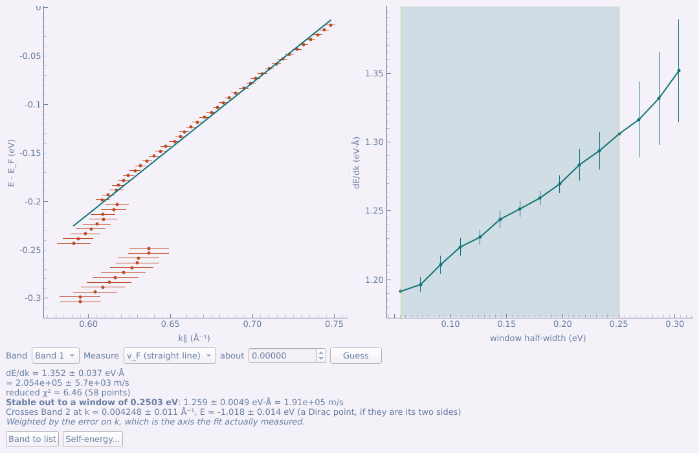
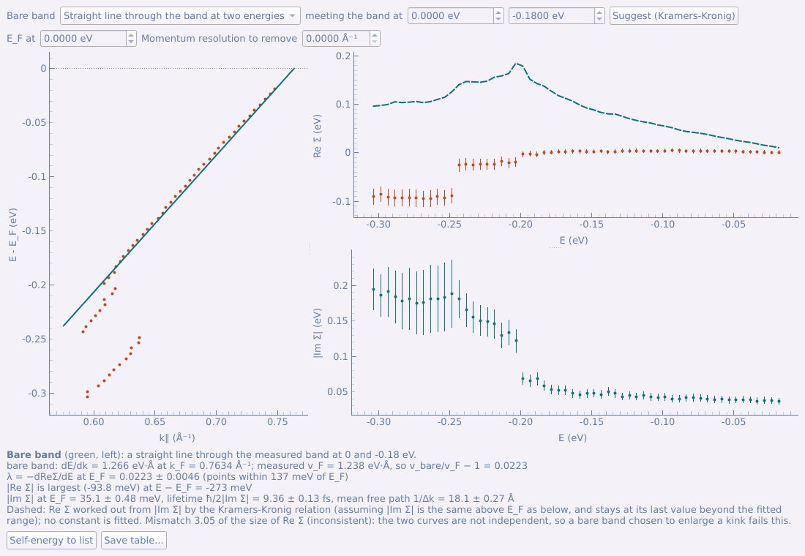
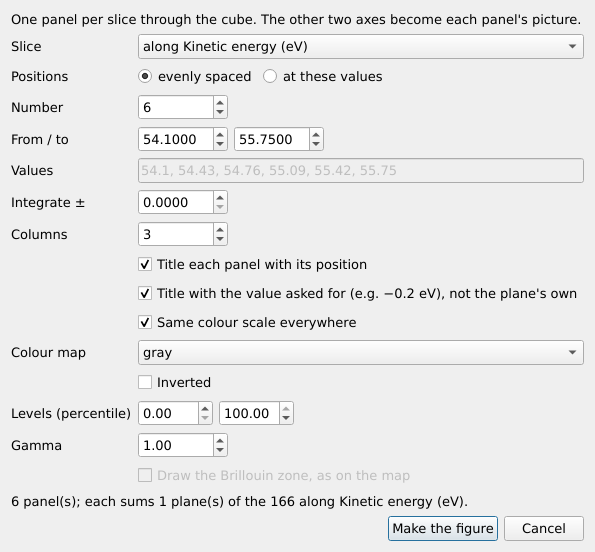
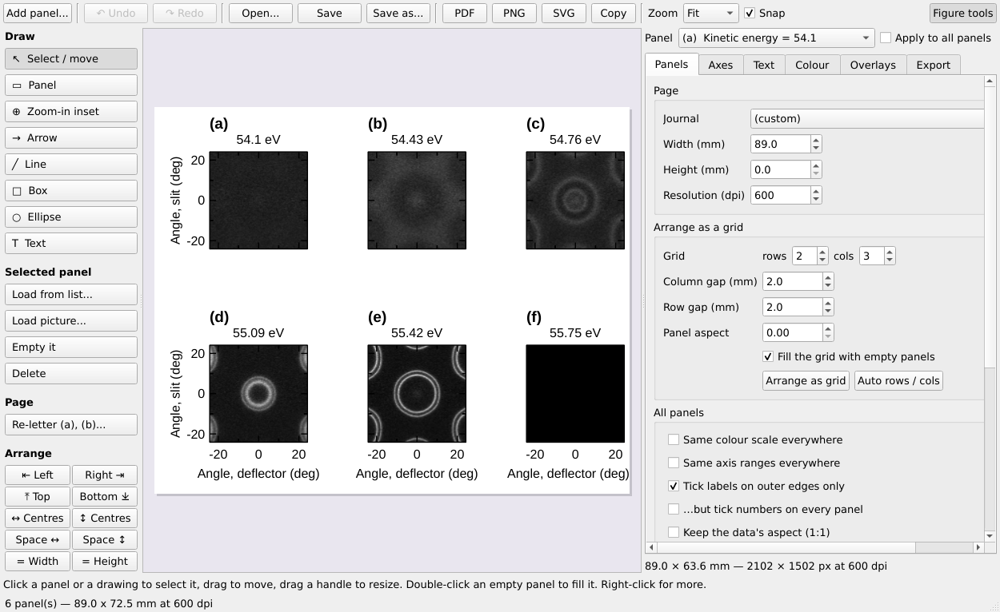
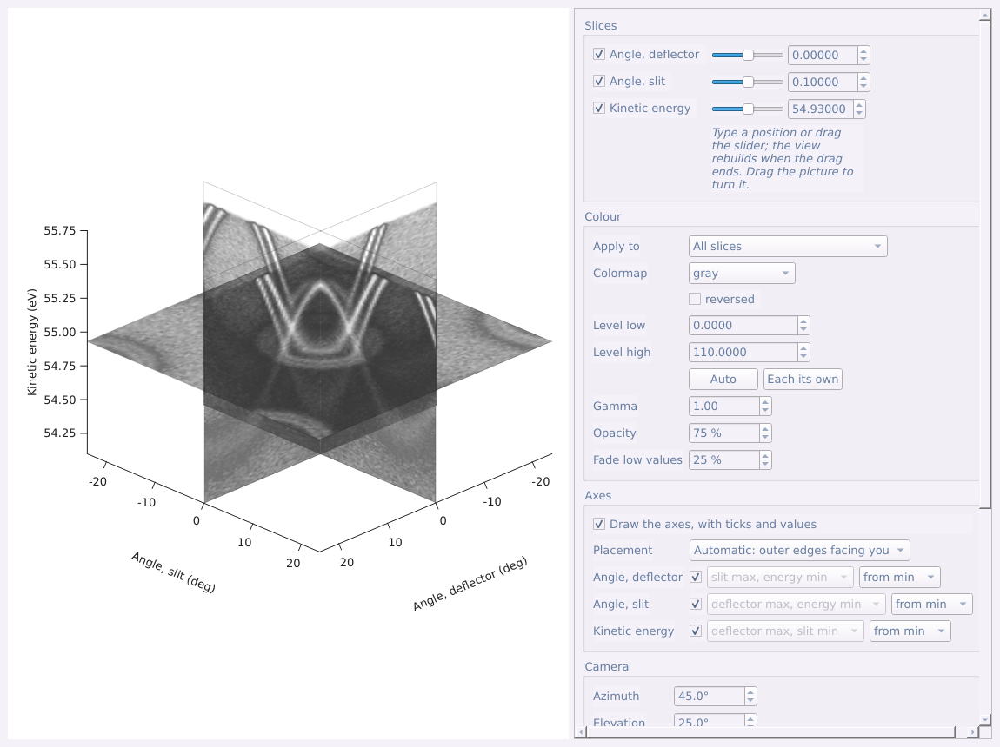
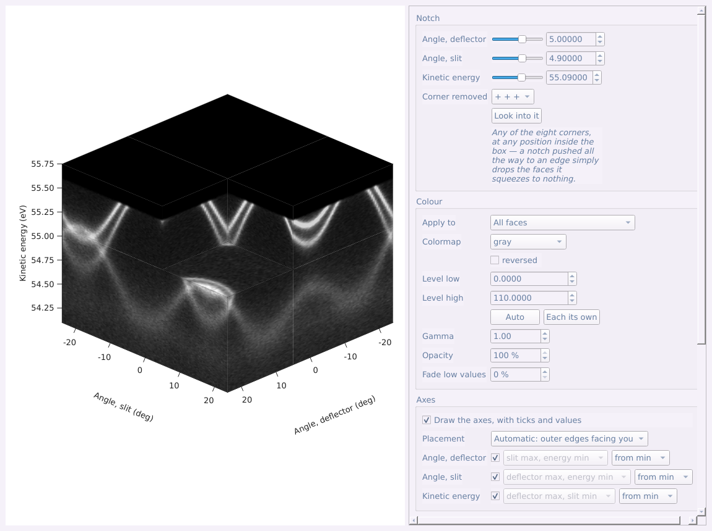
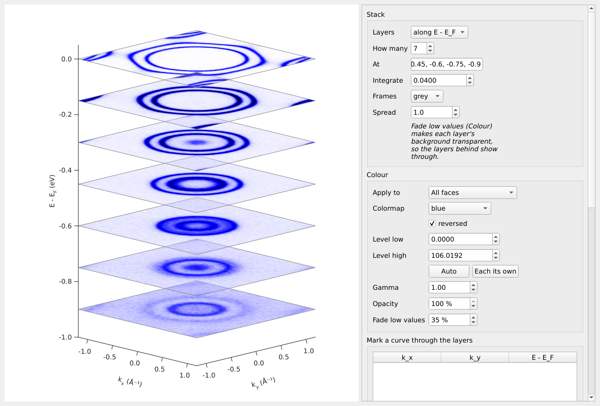
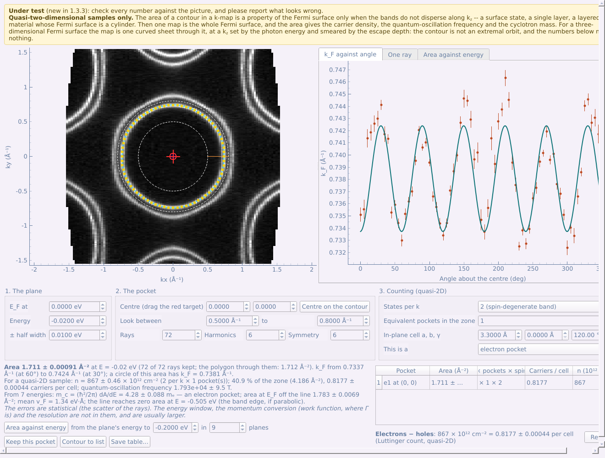

# 第五部分 工具面板：Advanced 标签页

**Advanced** 标签页包含后续的分析：能带锐化滤波与对称化、脊线提取、堆叠图、MDC 与 EDC 拟合及自能、cut 运算、切片序列图、三维视图，以及面向准二维样品的费米口袋分析（测试中）。

## 5.1 平滑、求导、曲率与对称化

每种滤波都有自己的窗口，在列表中选中一个或多个 cut（或 map）后从工具面板打开：

| 标签页 | 按钮 | 作用 |
|---|---|---|
| Basic | **Background subtraction...** | 扣除不属于能带的强度：Shirley 或 Tougaard 非弹性背景、所有角度共有的本底、平滑多项式——或除去费米截断 |
| Advanced | **Smooth...** | 高斯、Savitzky–Golay 或滑动平均平滑，可先去尖峰 |
| Advanced | **Second derivative...** | 预平滑后求 −d²I/dE² 或 −d²I/dk²，使能带更锐利 |
| Advanced | **Curvature...** | 一维或二维曲率（Zhang 等人），比二阶导数更贴合能带 |
| Advanced | **Minimum gradient...** | I/\|∇I\|：能带是强度梯度的谷——只用一阶导数，噪声更小；肩峰也能显现 |
| Advanced | **Symmetrise...** | 以一条线为镜面对称化 cut；对 map，镜像或旋转其等能面 |

每个结果都是新的数据集，并记录生成它的处理步骤。

**最小梯度法（Minimum gradient）。** 沿能带的脊，强度是平的，因此强度梯度的模 |∇I| 在那里最小
（He、Wang、Shen，Rev. Sci. Instrum. 88, 073903 (2017)）。窗口以三种方式之一显示这条“谷”：
**I / |∇I|**（推荐：沿能带缓慢变化的强度被抵消，空白区域保持暗）、**1 / |∇I|**，或 **|∇I|** 本身
（能带是暗线；没有做除法，用来核对另外两种）。它只需要一阶导数，噪声比二阶导数和曲率小；不偏向任何
一个轴，能带可以一直跟到带底或带顶；肩峰也能显现。**Floor** 限制完全平坦的区域能有多亮（对已平滑的
数据可以调低，线条更锐）。它标出*所有*平坦的地方——包括两条能带之间的谷底——所以要对照原始数据来看，
数值请从拟合中取。

- **Source**（原图）与 **Result**（结果）并排显示、色阶一致，便于看出参数是否把
  能带"吃掉"了；两者同步平移和缩放。
- **先平滑。** 二阶导数和曲率窗口打开时会给出提示：两者都会放大噪声，通常对先平滑
  过的数据效果更好——先运行 **Smooth...**，在列表中选中其结果，再对它打开滤波；
  或者在窗口中加大预平滑宽度。平滑过的结果在列表中带有 **‹smoothed›** 标签（由它
  生成的数据也带此标签）；对这样的数据，窗口不再给出提示，只显示一行"已平滑"，
  预平滑宽度默认为 0。
- **Shape**：*Square pixels*（每个数据点为正方形——对角度-能量 cut 不失真）、
  *Equal axes*（两轴单位长度相同——适合角度-角度或 k-k 图，两轴单位相同时自动
  选用）、*Fill the box*（填满窗口）。
- **Live preview** 在修改参数时实时重算；**Apply** 把结果加入列表。
- 初始值：**Symmetrise** 默认以过角度（或 k）= 0 的竖直线为镜面，即 k → −k；
  *Background subtraction* 中的 **Fermi cut-off** 的 E_F 取文件记录的值，若没有则取
  角积分 EDC 下降最陡处，温度和分辨率也从文件读取。

对 map，处理按平面进行，并首先询问**作用于哪组平面**——等能面还是色散切面，
因为等能面的曲率与 cut 的曲率是不同的物理量。**Preview at** 选择预览的平面；
**Apply to the whole cube** 对所有平面执行。各操作和宽度以所选平面的真实轴名标注
（如 *Second derivative along Kinetic energy*），平滑宽度默认取各轴范围的 1/100。

列表下方的 **Truncate...**、**Compress...** 和 **Self-normalise...** 可同时改变一个
或多个数据集的网格或标度——前提是它们类型相同，且各轴点数一致：**Truncate** 裁剪
到某一范围，**Compress** 合并像素，**Self-normalise** 每张谱除以自身总强度。

**Self-normalise** 把数据的每一部分除以它自身的总强度（或峰值）：

- **Normalise** 下拉框用 ARPES 的说法选择“每一部分”是什么，并默认选常规做法：
  cut 默认 *each EDC*（每条 EDC），map、k-map、kz map 默认 *each cut (slit ×
  energy at one scan step)*（每张 cut 各自归一，可去除扫描过程中光通量或束流的
  漂移）。其他选项：每条 MDC、map 的每条 EDC、每张等能面，或 *custom*（自定义）。
- **Summed over** 显示求和所沿的轴，可以手动勾选；下方的一句话说明当前勾选的
  效果（例如 “Each plane over Angle, slit × Kinetic energy is divided by its own
  total — one factor for every Angle, deflector”）。
- **Sum only over** 把求和限制在某个求和轴上的一个窗口内——默认是能量轴——例如
  只用某个芯能级的能量范围。

## 5.2 脊线提取（Ridge detection）

工具面板 → Advanced → **Ridge detection...**（cut 或 map）把能带当作强度的脊线
来追踪，每个点精确到亚像素，比二阶导数更锐利，也不会画出虚假的双线。

- **Smoothing**：每个轴的平滑宽度，以该轴的单位计——约为能带宽度。
- **Threshold**：逐渐提高，直到只剩下能带（源数据上的黄色点）。
- **Result to list**——脊线图像（map 逐平面处理，可选平面）；**Save ridge
  points...**——一个 CSV，紧束缚拟合（[第 26 节](#64-紧束缚拟合)）可以读取。

## 5.3 堆叠图

**Stack plot (EDC / MDC)...**（工具面板 → Advanced，选中一张 cut）：EDC 或 MDC 的
瀑布图，可设置曲线条数、合并、归一化、偏移、错切与配色；**Send to figure
composer** 把它作为一个图面板送入作图器。

## 5.4 MDC 拟合与 EDC 拟合

工具面板的 Advanced 页中有两个逐行拟合峰的工具：

- **MDC fit (k-cut only)...** 拟合动量分布曲线，再从拟合峰位读出能带：费米速度、
  有效质量、自能。它只接受横轴已经是 Å⁻¹ 的 cut——以 eV·deg 为单位的费米速度没有
  意义——否则按钮显示为灰色。
- **EDC fit...** 拟合能量分布曲线，适用于任何 cut，可在模型中包含费米截断。由拟合
  能带得到 v_F 和 m\* 需要 cut 已在动量空间。

面板顶部的 **Guided fit (step by step)** 会在控件旁逐步引导完成整个拟合，每一步
简要说明这一步的意义，并用橙色框标出要用到的部分：MDC（EDC）拟合在做什么、峰形、
拟合范围（把蓝线拖到能带起点 / 终点，按 *Start here* / *End here*）、能带、种子点
（引导会把蓝线依次移到范围内的五个位置——在每个位置点击右侧曲线上该能带的峰）、
试拟合一行、拟合整个序列、读取结果。每一步具备拟合所需的条件后 *Next* 才可点击。

图像和控件之间有可拖动的分隔条，控件始终可见；窗口放不下时，鼠标滚轮在图像上滚动的是
窗口本身（Ctrl + 滚轮缩放图像）。

手动操作：

1. **Bands** 页：每条能带分支点一次 **Add band**；选中一条能带，按 **Place a
   seed**，再在右侧曲线上点击峰的位置。沿能带放四五个种子点就够了；**Line at**
   切换当前查看的行。
2. **Try this line** 显示当前行的拟合结果（虚线为初始猜测）。
3. **Fit settings** 页：峰形（Lorentzian、Gaussian、Voigt）、背景、步长，然后
   **Fit the series**。拟合出的峰位画在图上，点的大小代表振幅。
4. **Dispersion...** 拟合能带：**v_F**（直线）、**m\***（抛物线），并检查拟合
   在多大范围内稳定。**Self-energy...** 打开下文介绍的自能窗口。

**Save table...** 保存所有行的拟合结果；**Band to list** 把一条能带加入主列表。

**两条直线分支的交点。** 在 **Dispersion...** 窗口中选择 *v_F*（直线）时，其他
每条已拟合的能带也以同样方式拟合，并给出两条直线的交点及其不确定度（由两次拟合
传递而来）：把狄拉克锥的两侧分别拟合得到的狄拉克点，或任意两条能带的交叉点。
若某个拟合点的误差坍缩（峰宽拟合到零），它不再独占色散拟合的全部权重：任何一点的
权重都不超过十个典型点。

### 自能（Self-energy）

**Self-energy...**（色散窗口，仅限 MDC 拟合）把一条拟合出的能带变成随能量变化的 **Re Σ** 和
**|Im Σ|**：Re Σ 是实测能带与*裸带*的距离，|Im Σ| 是拟合峰宽的一半乘以裸带的斜率。

- **Bare band（裸带）**——一切结果都建立在这一个假设上，所以在这里选择，并写入结果：
  **过能带上两个能量点的直线**（初始为 E_F 和拟合的最深能量）、**给定速度、过实测 k_F 的直线**
  （例如取自计算），或 **Dispersion 窗口的拟合**。
- **Suggest (Kramers-Kronig)** 找出使 Re Σ 与 |Im Σ| 的 Kramers-Kronig 变换最一致的裸带速度。
  两条曲线都只依赖这一个数，要求它们互为 KK 变换就能定出它，不需要计算。只有当拟合范围明显超过
  kink、到达 |Im Σ| 已经变平的地方时才可信。
- **E_F at** 和 **Momentum resolution to remove**（从峰宽中按平方差扣除的动量分辨率；
  如果拟合的线型里已经包含分辨率，保持 0）。
- **虚线**：由 |Im Σ| 经 Kramers-Kronig 关系算出的 Re Σ，假设 |Im Σ| 在 E_F 上下相同、
  在拟合范围之外保持常数。不拟合任何常数，所以这个比较检验的是裸带：为放大 kink 而选的裸带通不过。
- **图下方**：实测的 k_F 和 v_F、v_bare/v_F − 1、耦合强度 λ = −dRe Σ/dE（在 E_F 处）、
  |Re Σ| 最大处的能量（kink）、E_F 处的 |Im Σ| 及对应的寿命和平均自由程。
- **Self-energy to list** 把这些曲线加入主列表；**Save table...** 存为 CSV，表头记录裸带。

## 5.5 Cut 运算：二色性与参考谱归一

把两张 cut 组合成第三张：线二色性（LH − LV）、圆二色性、除以金参考谱，或普通的
差、比、和。在列表中选中两张 cut，点工具面板 → Advanced → **Cut arithmetic (two
cuts)...**（先选的为 A；窗口中可交换）。只有恰好选中两张 cut 时该按钮才可用。

- **顶部表格**对比两次测量记录的条件（偏振、光子能量、角度、样品位置、温度、
  通能、透镜模式）。橙色行表示差异超过容差——在样品上两个不同位置之间做的
  二色性图，反映的其实是*位置*差异。
- **Purpose** 预设：*Linear dichroism*（A − B，B 按总强度缩放）、*Circular
  dichroism*（(A − B)/(A + B)）、*Divide by a reference*（除以参考谱）、*Custom*。
  若偏振看起来颠倒了会给出警告（可用 **Swap A ↔ B** 交换）。
- **Scale B to A** 按总强度或某一区域的强度缩放；**Hide where A+B below** 屏蔽
  背景区域。
- A、B 使用同一色阶；结果用以零为中心对称的红-白-蓝色阶。若两者都是原始计数，
  会传播泊松误差，并在图下方给出统计。
- **Result to list**、**Uncertainty to list**、**All three as a figure**。

## 5.6 切片序列图（Slice series figure）

选中 map → 工具面板 → Advanced → **Slice series figure...**：把数据立方的一系列二维
平面切片排成一页论文图——一系列能量处的等能面，或一系列角度 / 动量处的 cut——可等
间距或指定位置，可积分，共用一个色阶，只在外侧边缘标注坐标。（注意与 **3D slices**
区分，后者是在三维视图中画三个平面。）

- 面板标题使用所要求的名义值（−0.2 eV），而不是实际平面的值（−0.2022 eV）；实际使用的
  平面和积分窗口记录在面板信息中。
- 色图、反转、色阶（百分位）和 gamma 在对话框中一次设好，作用于所有面板。
- **Draw the Brillouin zone, as on the map**：把 BZ overlap 画在 map 上的布里渊区画到每个
  等能面面板上，每条边只画一次。
- 脚本或智能体可直接调用 `contour.slice_figure(values=[0, -0.1, -0.2], half_width=0.02)`
  （或对选中行调用 `A.open_slice_series(values=...)`），不弹出对话框。

| 设置 | 结果 |
|---|---|
|  |  |

## 5.7 三维视图

Advanced 页中有四个以三维方式显示 map 的工具，各自在独立窗口中打开——拖动图像即可
旋转：

- **3D slices...**——穿过数据立方的三个正交平面，每个平面的位置可自行设定（每个轴
  有勾选框、滑块和输入框）。
- **Notched cube...**——切掉一个角的立方体：一张等能面和两张色散图合在一幅图中。
- **Volume projection...**——整个体数据沿视线方向投影：最大强度、求和、alpha 合成，
  或带光照的等值面。
- **Stacked slices...**——平行切片在三维中层叠排列（见下文）。
- 对 **k-map**，三维视图从第一个充满数据的 k_x、k_y 平面开始显示：转换后的数据立方是远离
  E_F 时逐渐收窄的光锥的外包盒，最外侧的平面原本会画成空白面。*Change sampling... →
  Whole range* 可显示全部范围。

| 3D slices | Notched cube |
|---|---|
|  |  |

- **采样。** 每一帧都要对数据立方重新采样，因此窗口默认以 *Balanced* 采样打开，
  能跟上鼠标操作。当前采样写在 **Save the view...** 下方；**Change sampling...**
  可选择区域以及 *Fast*、*Balanced* 或 *Fine*，并从完整数据重新绘制。

  

- **颜色。** *Apply to* 可一次设置**所有切片**的颜色，或只设置某一方向（例如等能面
  用一种色表，色散面用另一种）：色表（及 *reversed*）、色阶（**Auto**，或 **Each its
  own** 每个切片各用自己的色阶）、gamma、**Opacity**（不透明度）和 **Fade low
  values**（让弱强度部分变透明，从而看到后面的平面）。
- **坐标轴。** 勾选 **Draw the axes, with ticks and values**。*Placement* 可以是自动的
  ——放在朝向你的外侧棱上，随视角转动而变化——也可以手动指定：每个轴沿立方体的
  哪条棱，以及从 **from min** 还是 **from max** 开始计数。
- **Camera**：方位角、仰角、深度比例；**Look into it** 正对所选平面。
  **Outline the faces** 和 **Orientation tripod** 为可选项。
- **Save the view...** 通过与所有面板相同的导出窗口导出图像（PNG、TIFF、JPEG，可设
  尺寸和 dpi）。**To figure composer...** 把当前视图作为一个面板加入论文图。

### 层叠切片（Stacked slices）

**Stacked slices...**（工具面板 → Advanced → 3D only）把数据立方的平行切片在三维
中层叠画出：等能面沿能量轴一张叠一张，或 cut 沿 k_z（或光子能量）一张排在另一张
后面——这是展示能带演化的常见画法。

- **Layers**——层叠所沿的轴；**How many** 均匀分布各层，或在 **At** 中输入位置
  （逗号分隔，以该轴的单位计）；**Integrate** 把每层在该宽度内平均。
- **Frames**——每层的外框（灰色、黑色或无）。
- **Spread** 沿层叠轴拉伸盒子，使斜视时各层彼此分开而不互相遮挡：沿 k_z 层叠几张
  cut 时，*Spread* 取 3、方位角约 40°，每张 cut 几乎都能完整看到。
- **Fade low values**（*Colour*）在这里从 35 % 起：每层的背景透明，后面的层可以
  透过来。
- **Mark a curve through the layers**——以数据自身单位给出的点（每层一个，例如两条
  能带的交点），用红、黑、蓝……曲线连接并画在层叠图上方，可在第一个点处加标注。
- 所有三维视图的坐标轴现在都会让图像*及其标签*适应窗口或图面板（不再是固定边距），
  按每个轴的空间稀疏刻度，并在轴标题中写出上下标（`E - E_F`、`k_x`）。

## 5.8 费米口袋（准二维，测试中）

> **测试中**（1.3.3 新增）：请对照图像核对每一个数值，发现不对的地方请反馈。
>
> **仅适用于准二维样品。** 只有当能带沿 k_z 没有色散时——表面态、单层、费米面为柱面的层状材料——
> k-map 中一条轮廓所围的面积才是费米面的性质，此时一张 map 就是完整的费米面。对三维费米面，
> 一张 map 只是穿过它的一个弯曲的面，k_z 由光子能量决定，并被逃逸深度展宽：轮廓不是极值轨道，
> 下面的数值没有意义。程序无法区分这两种情况。

选中一张已转换到动量空间的 map（k-map，能量轴为 E − E_F），点击工具面板 → Advanced →
**Fermi pocket (quasi-2D)...**。

1. **The plane（等能面）。** 描轮廓所用的能量（初始为 E_F）及取平均的半宽。
2. **The pocket（口袋）。** 把红色靶标拖到口袋内部的一点（或直接输入），并设置 **Look between**，
   使两个虚线圆之间只包含这个口袋的能带。从中心向 **Rays** 个角度各发出一条射线，沿射线拟合的峰位
   给出该方向的 k_F（黄点；红叉是被舍弃的射线，**One ray** 页可查看任意一条射线及其拟合）。
   轮廓（蓝线）是半径随角度的傅里叶级数，最高到 **Harmonics** 阶；**Symmetry** 只保留过中心的
   n 重轴所允许的谐波，也能跨过数据缺失的部分。**Centre on the contour** 把中心移到轮廓的形心；
   面积与中心的选取无关。
3. **Counting（计数）。** *States per k*（自旋简并的能带为 2，每个自旋各有一条轮廓时为 1）、
   布里渊区内*等价口袋的个数*、*面内晶胞* a、b、γ（用于每晶胞载流子数），以及这是电子口袋还是空穴口袋。

图下方给出的结果：

- **面积**及其误差、轮廓上 k_F 的范围、保留的射线数；
- 对准二维样品：**载流子浓度** n = g N A/(2π)²、占布里渊区的比例和**每晶胞载流子数**
  （Luttinger 定理所数的量），以及**量子振荡频率** F = (ħ/2πe) A；
- **Area against energy** 在一系列能量上追踪同一个口袋并拟合直线：**回旋质量**
  m_c = (ħ²/2π) dA/dE——电子口袋随能量增大，为正；空穴口袋为负——由直线读出的 E_F 处面积
  （不受费米截止对 E_F 处等能面造成的偏差影响）、平均费米速度，以及直线外推到面积为零的能量。

**Keep this pocket** 把它加入一个表格，把多个口袋合起来计数（电子减空穴）。**Contour to list** 把
k_F 随角度的曲线（以及面积随能量的曲线）加入主列表；**Save table...** 把全部结果存为 CSV。

给出的误差是统计误差（射线之间的离散）。能量窗口、动量转换（功函数、Γ 的位置）和分辨率带来的误差
不在其中，而且通常更大。
