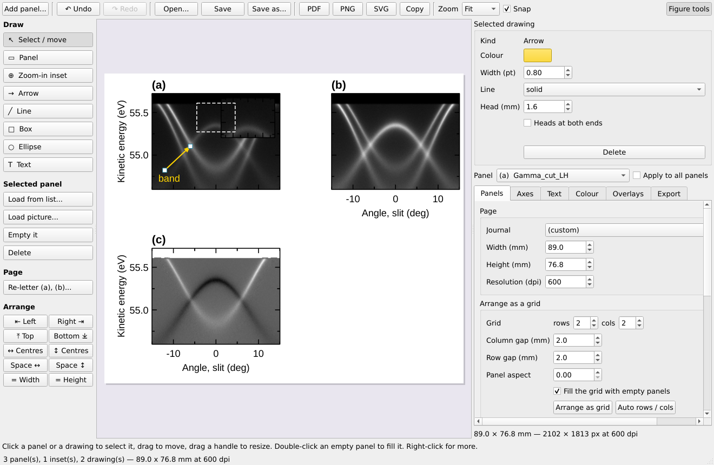
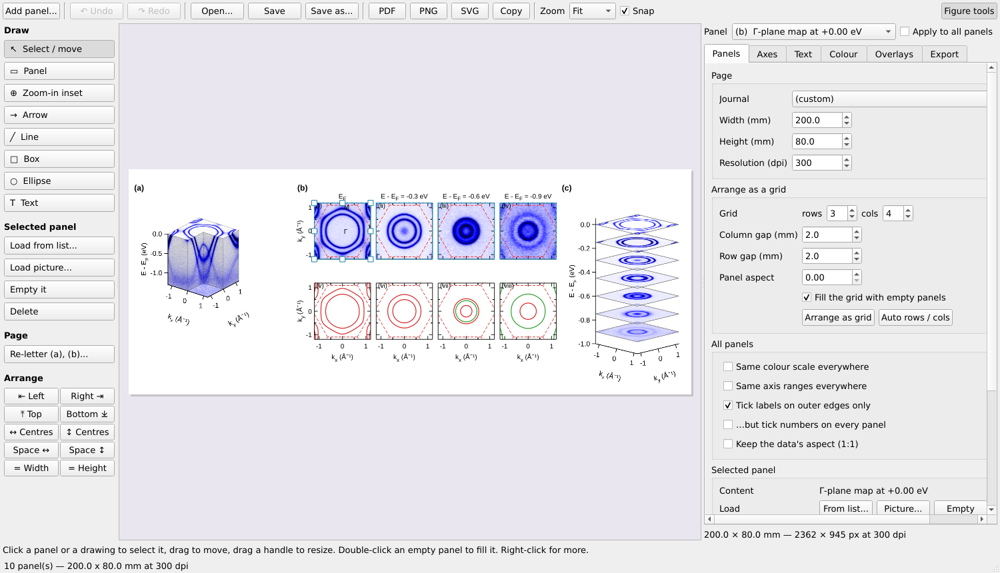
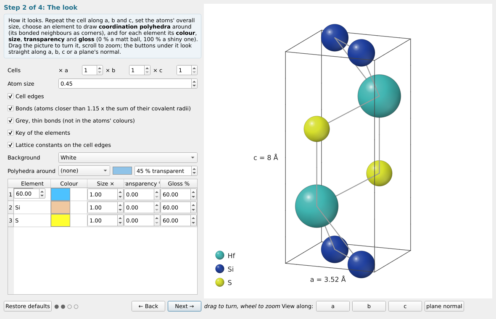
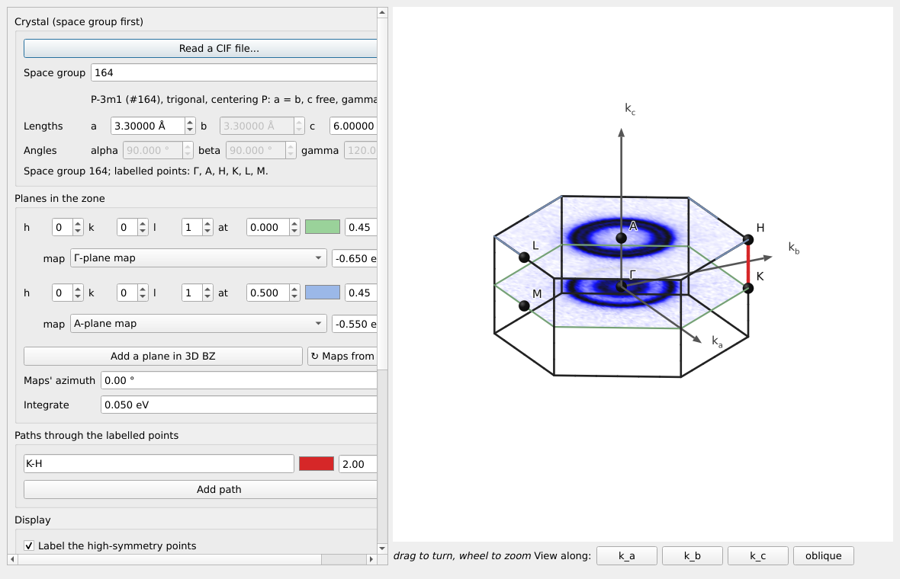
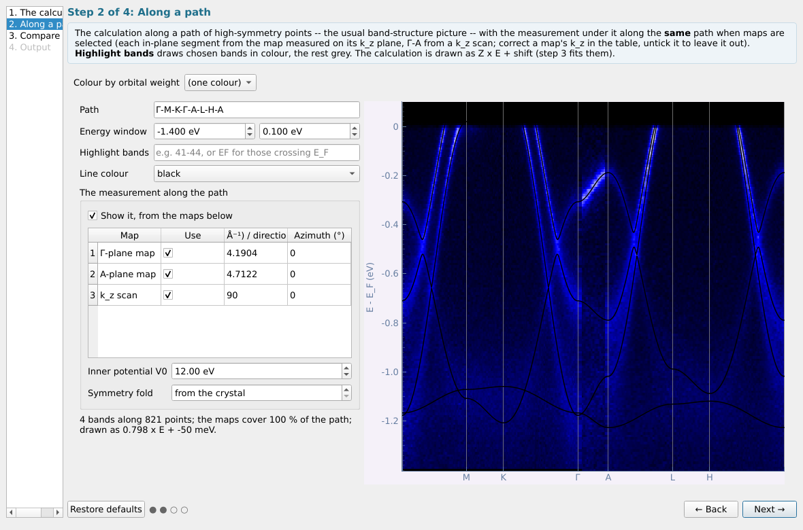
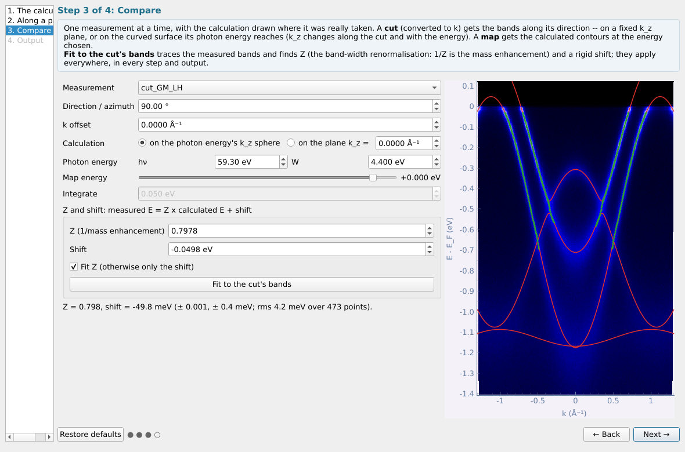
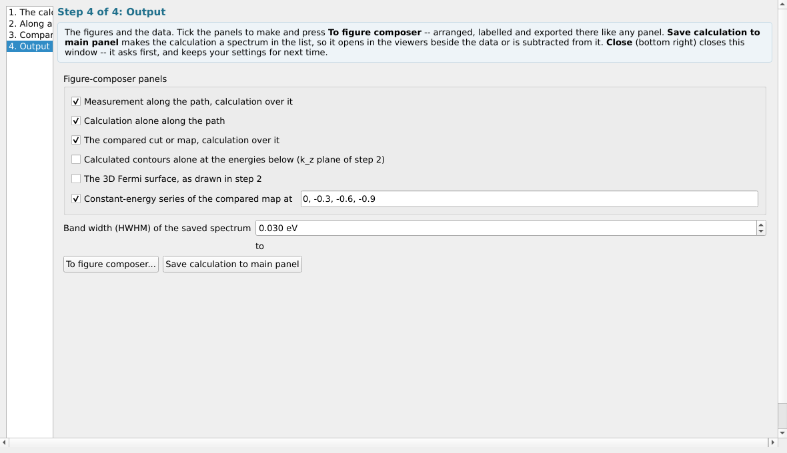
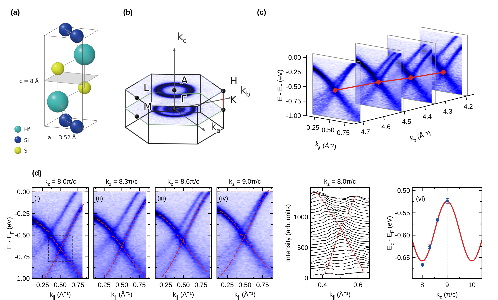

# 第六部分 工具面板：Figure 标签页

**Figure** 标签页包含作图器，以及计算得到（而非测量得到）的内容：晶体结构、三维布里渊区、紧束缚拟合和计算能带。最后给出一个从载入数据到成图的实例。

## 6.1 作图器（Figure composer）

**不选中任何数据**时，工具面板 → Figure → **Figure composer...**（该页最上方） 打开一张空白画板，
就像论文中的一张图：按期刊栏宽排好四个空面板 (a)、(b)、(c)、(d)。选中若干 cut（或
曲线）时，每个数据集成为一个面板（冻结切片窗口的 **Figure composer...** 按钮同理；
堆叠图和三维视图各有自己的 **To figure composer** 按钮）。



- **排版。** 单击面板选中它；拖动面板移动位置，拖动其控制点调整大小（在角点按住
  Shift 保持比例）。面板会吸附到其他面板的边缘和 0.5 mm 网格（**Snap**）；方向键
  微调 0.5 mm（Shift：5 mm）。*Arrange as grid*（右侧 Panels 页）按行 × 列重新
  排列；一个面板可以占多个格子（选中面板的 *Grid cells (rows / cols)*，例如一排数据面板
  旁的示意图），图片在其中保持自身比例。手动移动面板时，页面高度随面板变化。
  **Re-letter** 按阅读顺序重新标注 (a)、(b)……
- **填入内容。** 双击空面板，或用左侧 **Load from list...** / **Load picture...**：
  从主列表载入数据集，或从文件载入图片（PNG、JPEG、TIFF……——示意图或别处做的图；
  保持原比例，没有坐标轴）。
- **插图。** **Zoom-in inset**：在面板上拖出一个区域——角落里出现放大该区域的小图，
  原图上用虚线框标出区域。在另一个面板内部画 **Panel** 则得到一个插图，可填入其他
  数据。插图没有标号，随所在面板一起移动。
- **绘图。** **Arrow**（箭头）、**Line**（辅助线）、**Box**（方框）、**Ellipse**、
  **Text**（文字）：在画板上拖动（文字为单击）。选中的图形可以移动、拖动端点或角点，
  并在右侧上方设置颜色、线宽、线型、填充和文字。双击文字可编辑；Del 删除选中项；
  右键有更多选项（置于顶层、删除……）。
- **坐标轴与字体。** 画板旁的 figure tools 作用于选中的面板（或全部面板）：范围、
  刻度、标签、哪些边显示数字、该面板自己的字号、色图、色标、参考线。勾选
  *Tick labels on outer edges only* 时，再勾选 *…but tick numbers on every panel* 可让内侧面板
  保留刻度数字，只把坐标轴名称留在外侧边缘。
- **Undo / Redo**（Ctrl+Z / Ctrl+Y）可撤销任何改动。**PDF**、**PNG**、**SVG**
  导出，**Copy** 复制到剪贴板；空面板不会写入文件。注意作图器的 **Figure tools**
  不是查看窗口的 **Plot tools**（后者在实时图上画辅助线）。

### 排列面板

单击一个面板，再 **Ctrl+单击**（或 Shift+单击）其他面板即可选中多个。然后左侧的
**Arrange** 按钮：

| 按钮 | 作用 |
|---|---|
| ⇤ Left、Right ⇥、⤒ Top、Bottom ⤓ | 对齐它们的左 / 右 / 上 / 下边（对齐到最外侧那条） |
| ↔ Centres、↕ Centres | 把它们的中心放在同一条竖线 / 横线上（第一个选中面板的） |
| Space ↔、Space ↕ | 从左到右 / 从上到下等间距（三个或以上） |
| = Width、= Height | 都取第一个选中面板的宽度 / 高度 |



### 面板字母与色标

- **Letters in line**（*Text* 页，默认开启）：并排面板的字母位于同一高度，上下排列
  面板的字母位于同一左边缘，不论每个面板有怎样的标题或坐标轴。**Nudge (mm)** 移动
  单个面板的字母（例如避开较长的轴标题）；**Re-letter** 按阅读顺序重新命名为
  (a)、(b)……
- **Colour bar**（*Colour* 页）：**Ends** 在两端写数值、*High* / *Low* 字样或不写；
  **Length (%)** 为面板高度或宽度的百分比；**Position** 为 *right*（竖立在面板旁）
  或 *below*（横躺在面板下方，居中）。三维视图的色标按实际画出的立方体确定大小，
  而不是按其外框。


### 曲线：线、符号与误差棒

*Overlays* 页，**Curves drawn on the panel**：在列表中选中曲线（不选则为全部），然后
设置其**颜色**、**线宽**、**线型**（实线、虚线、点线……）、**符号**（圆、方、三角、
菱形，可设大小）以及是否**用线连接**；**± σ as error bars** 把曲线的两条 ±σ 点线
变成各点上的误差棒。点 **Apply to the curves** 应用。含空缺（NaN）的曲线分段画出。

### 保存图以便再次编辑，连同数据

**Save** / **Save as...** 以程序自己的格式 `fig1.afig` 保存：页面、其上的绘图，以及
每个面板连同数据和设置——用 **Open...**（或在主窗口的 **Load data...** 中选中它）
再次打开，就能从停下的地方继续编辑。三维视图保存为它所显示的图片。

在它旁边，**`data for fig1/`** 中每个面板一个文件夹（`a`、`b`……）：

```
data for fig1/
  a/  processed/  面板所显示的内容：图像存为 .nxs cut（可在查看窗口中
                  再次打开），其中的线（计算能带、等能线、曲线）存为
                  lines.csv，图片存为 .png
      original/   它的来源：最初的测量文件（经 k 转换、对称化、切出的
                  平面会追溯到最初读入的文件）、计算结果及与之一起读入的
                  文件（.win、POSCAR……）、图片文件或 CIF
      sources.txt 文件中的哪个条目，以及中间经过的处理
  b/  ...
```

即使面板显示的是经过许多步计算的结果，原始文件也会被复制：每个数据集都记得它
最初来自哪个文件。再次打开的图如果其原始文件已经移动，会使用它自己之前的数据
文件夹中的副本。

## 6.2 晶体结构

工具面板 → Figure → **Crystal structure...**（无需选中数据）。共四步（布里渊区现在是独立的
**3D BZ...** 工具，见[第 25.1 节](#63-3d-bz三维布里渊区)）：



1. **结构**——**Read a CIF file...**（最上方的按钮）从文件填入空间群、晶胞和原子，应用其
   对称操作并立即重画晶体，之后仍可编辑。含多个 data block 的 CIF（如 FullProf 输出，开头是
   期刊信息块）会从含结构的那个 block 读取。也可以手动输入，方式与 BZ overlap 相同：**先输入
   空间群**（被空间群约束的晶格参数显示为灰色并跟随自由参数），再输入晶胞和基元原子（会自动
   加上心型平移的副本）。
2. **外观**
   - 沿 a、b、c 的晶胞数、原子整体大小、晶胞棱和化学键（使用原子颜色，或
     *grey, thin*）；
   - 每种元素的**颜色**、**大小**、**透明度**和**光泽**（0 %：哑光球，100 %：带
     锐利高光的亮球）；
   - **Polyhedra around** 某元素：其配位多面体（以成键近邻为顶点），颜色和透明度
     单独设置——如 TiSe₆ 八面体、CuS₄ 四面体；
   - **Key of the elements**（每种元素一个球加名称）、**Lattice constants on the
     cell edges**（`a = 3.52 Å`、`c = 8 Å`）。

   拖动图像旋转，滚轮缩放；*View along* a、b、c 或晶面法向。
3. **解理面**——勾选 *Draw a plane*，给出 (hkl)，滑动它，或在列表中双击某个
   **原子层**把平面放在那里；*Hide the atoms above* 显示终止面；位于平面内的原子用
   红圈标出。
4. **导出**——晶体：**Save picture...**（任意尺寸的 PNG，按该尺寸重新
   绘制）或 **To figure composer...**。由 CIF 生成的图片以该 CIF 为来源，因此图的
   数据文件夹会保存它（[第 28 节](#61-作图器figure-composer)）。

## 6.3 3D BZ：三维布里渊区

工具面板 → Figure → **3D BZ...**（无需选中数据）。原为晶体结构窗口的第 4 步。



- **晶体**：**先输入空间群**，再输入晶胞——被空间群约束的参数显示为灰色并跟随自由参数，
  与 BZ overlap 相同。**Read a CIF file...** 从文件填入。启动时沿用 BZ overlap 上次的三维晶体。
- **布里渊区中的平面**：**Add a plane in 3D BZ** 可添加任意多个平面。每个平面有自己的法向
  (h k l)、沿法向的高度（以 G(hkl) 为单位：0 过 Γ，0.5 在布里渊区顶面）、颜色和不透明度，
  ✕ 删除。
- **平面上的实测 map**：**任意**平面都可以贴上 k-map 的等能面——在该平面的 *map* 列表中选择，
  并给出能量（E − E_F）。列表包括打开窗口时选中的 k-map 以及主列表中的所有 k-map（之后新加的
  点 **↻ Maps from the list** 更新）；只在被选中时才读取数据。map 的 kx、ky 沿平面自身的面内
  轴放置——对垂直于 k_c 的平面就是 k_a、k_b——按 *Maps' azimuth* 旋转、在 *Integrate* 范围内
  平均，并裁剪到布里渊区。
- **路径**：**Add path** 可添加任意多条，各自穿过标注的点（`Γ-M-K-Γ`、`A-L-H-A`；`|` 表示跳断），
  颜色和线宽各自设置。
- **显示**：高对称点标注、坐标轴，以及 *Label on the left*（这些点标注在最左侧的
  等价点上，避开路径和坐标轴）。
- **坐标轴**：默认是晶体自身的 **k_a、k_b、k_c**（晶胞的笛卡尔轴：k_a 沿 a，k_c 垂直于
  a–b 面）；也可切换为**与数据一致的样品坐标 k_x、k_y、k_z**：k_z 沿 *Cleavage plane (hkl)*
  的法线，k_x 沿 map 的 k_x（按 *Maps' azimuth* 旋转）。同一个符号不会指两个方向。
  *View along* 按钮随所选坐标系变化。
- **导出**：任意尺寸的 **Save picture...**，或 **To figure composer...**。*Labels: panel
  width / text* 按图片在最终图中的宽度设定标注字号（例如 30 mm 面板中 8 pt），与像素尺寸
  无关；关闭时字号随图片缩放，与屏幕上一致。

## 6.4 紧束缚拟合

> **单带，或两条杂化能带——在第 1 步（*Bands*）中选择。**
> **单带（One band）**：Bravais 晶格上的单条能带（每个格点一个轨道）：
> E(k) = e0 + Σ t_n Σ cos(k·R)。它不能描述两条能带、能带交叉或杂化能隙；
> 有多条能带时请逐条分别拟合，所得跃迁参数是该能带的有效参数，而不是轨道之间的微观跃迁。
>
> **两带杂化（Two bands, hybridised）**：同时拟合两条这样的能带 ε_a(k)、ε_b(k)
> 以及它们之间的耦合 V(k) = v0 + Σ v_n S_n(k)；测得的能带是
> E± = (ε_a+ε_b)/2 ± √(((ε_a−ε_b)/2)² + V²)。适用于反交叉、杂化能隙或双层劈裂（t_⊥）。
> V 具有晶格的全部对称性（两个宇称相同的轨道）；s–p 这类奇宇称耦合不属于此形式。

**两带拟合的步骤。** 第 1 步设置能带 a 的壳层数（*Shells of neighbours*）、能带 b 的
壳层数（*Shells, band b*）以及 v0 之外耦合的壳层数（*Coupling shells*，0 表示 V 为常数）。
第 2 步在两个或更多能量上追踪两条能带，*New points on* 保持 *either band*；再把它设为
*the lower band* 或 *the upper band*（蓝 / 粉），在每条能带上各点几个点作为标记；点文件也可以带
`branch` 列（`lower` / `upper` / 留空）。第 3 步的拟合是非线性的（从多个初始模型出发再精修），
给出能带 a、能带 b 以及 v0、v1… 及其误差，画出两条能带（红、橙），说明每个点归属哪条能带，
并给出两带之间的**最小能隙**及其位置——在裸能带交叉处为 2|V|。*Model to list* 包含两条能带；
*Save parameters* 写出三组参数、它们的壳层和能隙。

**壳层按对称轨道划分。** 每个跃迁 t_n 对应一组由对称性联系起来的等价近邻：
三维晶体用空间群的点群（加上空间反演），二维层用晶格自身的对称性。距离相同但不等价的近邻
（例如面内近邻与层间近邻）各自有独立的跃迁参数。第 1 步列出每个壳层的近邻数、距离和
一个以晶格坐标表示的代表矢量（⟨1 0 0⟩）；**Save parameters...** 会写出每个壳层的全部矢量。

选中一个 k-map（或不选，使用点文件）：

1. **晶格** —— 二维层（a、b、γ）或三维晶体（**先输入空间群**，再输入它允许的晶格参数——
   其余的显示为灰色并跟随），或 **Take the crystal from the Brillouin-zone tool**；a 轴相对 kx 的方位角；近邻壳层数。
2. **能带点** —— 只取**同一条能带**上的点（少量偏离的点会作为离群点剔除，
   太多则会破坏拟合）。移到某个能量后点击 **Trace this energy**（脊线提取），或勾选 *Click* 在能带
   上点击，或 **Read points from a file**。两三个能量比一个好：单一等能线只确定能带形状，不确定
   能量尺度。
3. **拟合** —— 得到各跃迁积分及其误差和均方根偏差；模型的等能线以红色画在第 2 步的平面上。
   只有一个能量时固定 t1；方位角只大致已知时勾选 *Refine the azimuth*。出现橙色提示表示这些
   点无法区分各壳层：请减少壳层数。
4. **使用模型** —— **Model to list**（模型的谱函数，作为 map 与数据并排查看）、
   **Save parameters...**、**Copy results**。

## 6.5 计算能带（Calculated bands）

工具面板 → Figure → **Calculated bands...** 把能带计算结果与测量放在一起。
选中要比较的数据——k-map、动量空间的 kz map 和动量空间的 cut——或者什么都不选，
只看计算结果。共四步。

与所有分步窗口（Crystal structure、Tight-binding fit、Sum repeated scans、Detector
corrections）一样，它**关闭前会先确认**——最后一步的 Close 正好在原来 Next 的位置，
手快多点一下也不会丢掉工作；标题栏的关闭按钮和 Esc 同样会确认。**在输入框中按回车
只是确认该数值**（并更新相应的图）——在本程序的所有窗口中都不会触发 Next、Close 或
其他按钮——即使该数值启动了带进度条的计算也一样；只有获得焦点的按钮才响应回车。
对于只在按下某个按钮时才重画的窗口——布里渊区工具的 **Plot**、查看窗口选区的
**Refresh**、core-level 放大窗口的 **Show**——在其输入框中按回车就执行这一重画，
不做别的。所设的参数会**保留**：下次打开时窗口恢复
原样（左下角 **Restore defaults** 可恢复默认）。

**1. 计算结果。** 先选**想看什么**：

- **E–k dispersion**（色散）——沿路径的能带，或沿实测 cut 的能带。任何计算结果都行。
- **Constant-energy contours**（等能线）——与 k-map（费米面 map）比较。
- **3D Fermi surface**（三维费米面）。

后两者需要**整个布里渊区内**的能带（能带网格或哈密顿量）；只沿路径的能带给不出，
窗口会直接说明而不是继续往下走。这一选择也决定 **Open calculation...** 文件列表的
排序：第一个过滤器只显示能给出所需结果的文件类型。若选中了 k-map，默认选等能线；
选中了 cut，默认选色散。文件也可以直接拖进窗口；**Reopen …** 重新打开上次的文件。

| 文件 | 写出程序 | 内容 | 能显示 |
|---|---|---|---|
| `.bxsf`（XCrySDen 能带网格） | Wien2k、Quantum ESPRESSO、VASP、Wannier90 | 整个布里渊区内的能带，插值 | 三者都可 |
| `_hr.dat`（及旁边的 `.win`） | Wannier90、任何紧束缚模型 | 哈密顿量，在每个 k 点精确对角化；轨道权重 | 三者都可 |
| `wannier90_hr_fplo.dat`（及 `KPOINTS`、`wannier_name_center.txt`） | FPLO 的 Wannier 哈密顿量 | 同 `_hr.dat`；按 Wannier 函数、壳层（"Cr 3d"）和自旋的权重 | 三者都可 |
| 每行 `k1 k2 k3 E1 E2 …` 的 `band.dat`（及 `KPOINTS`） | FPLO + Wannier 工具 | 三维能带网格 | 三者都可 |
| 含 `Ek_3D` 的 MATLAB `.mat`（及 `KPOINTS`） | 理论方的 MATLAB，由上述三维 `band.dat` 生成 | 三维能带网格 | 三者都可 |
| `EIGENVAL`（及 `POSCAR`、`PROCAR`） | VASP | 沿路径或网格上的能带；原子与轨道权重 | 网格时三者都可 |
| `_band.dat`（及 `labelinfo`） | Wannier90 | 沿路径的能带 | 色散 |
| `.spaghetti_ene`（及 `.klist_band`） | Wien2k | 沿路径的能带 | 色散 |
| `band.dat`、`Eigenvalue.dat`（及 `KPOINTS`、`orbital.dat`） | FPLO + Wannier 工具（`k_path.exe`、`H.exe`、`plot.exe`） | 沿路径的能带（第三列为权重） | 色散 |

文件按**内容**而不是文件名识别：途中被改了名的标准文件（例如其实是 `_hr.dat` 的
`hamiltonian.txt`）照样能打开。FPLO 工具的 `KPOINTS`（第一行为"段数 每段点数"，然后
是正、倒格矢，再是每段两端点及 `! 标签`）给出晶胞和标签——请放在能带文件旁边；没有
时晶胞取自布里渊区工具的晶体。长时间读取（101³ 网格、136 条能带的三维 `band.dat`
约 2 GB；大的 `_hr.dat`）会显示带 Cancel 的**进度条**；大网格只保留 E_F 附近的能带
（*Reading options ▸ Big grids*）。

**Which file? ...**：不知道一堆文件里哪个是计算结果时，选择理论方发来的文件夹，
其中每个文件都会被读取并用通俗的话说明——它是什么、能显示什么、读取还缺什么（晶胞、
标签）、是否是改了名的标准文件，或是被**拆成几段**的同一个文件（`band.dat.1、
band.dat.2`，`band_part1.dat …`，`xaa、xab`——为通过上传大小限制而拆分）。绿色行
可以直接打开得到所需结果；**Join the pieces, then open** 把各段在旁边合并回一个文件
再打开。

*Reading options ▸*（通常不用改）：*Set E_F myself* 覆盖文件中的费米能级；
*bxsf k units* 用于不含 2π 写出的网格；*Big grids: keep bands from … to …*（相对
E_F）。

**晶体。** 晶胞（a、b、c、α、β、γ）从计算结果中读出，决定各点名称的**空间群**由晶胞
形状猜测。读入后两者都被**锁定**（*From the Brillouin-zone tool* 也一样），避免误改
计算的晶格。需要有意修改时勾选 **Change the lattice parameters**：输入新的晶胞（或取
布里渊区工具的晶胞）会把计算缩放到该晶胞——能带以分数坐标保存，随布里渊区一起伸缩。

**其他格式的计算结果。** 理论方给的文件不属于以上任何一种时，最稳妥的做法是请对方
提供（或自己转换为）标准格式之一：整个布里渊区用 `.bxsf`，哈密顿量用 `_hr.dat` +
`.win`，路径用两列的 `_band.dat`（距离、能量；能带之间空一行）加
`_band.labelinfo.dat`。需要向对方确认：哪几列、k 的排列顺序、k 的单位（含不含 2π、
分数坐标还是笛卡尔坐标）、能量是否已减去 E_F。

**2. 计算结果的样子**——取决于第 1 步的选择：

- **Along a path**（色散）。计算能带穿过高对称点（`Γ-M-K-Γ-A-L-H-A`；`G` 代表 Γ，
  `|` 表示跳跃），画在**沿同一路径的测量数据**上，后者由选中的 map 拼成：每段面内
  路径取自在其 k_z 平面上测量的 map（Γ-M-K-Γ 取自 Γ 平面 map，A-L-H-A 取自布里渊区
  顶面的 map），Γ-A 取自 kz map。每张 map 的 k_z 由光子能量和内势 V0 算出；必要时在
  表格中修改，取消勾选可排除某张 map，并给出晶体 a 轴在 map 上的方位角。
  **Highlight bands** 把所选能带画粗并着色、其余为灰色——填文件中的能带编号
  （`41-44`），或填 `EF` 表示所有穿过 E_F 的能带（第 1 步会列出它们）。
- **Constant-energy contours**（等能线）。某一能量下、k 空间任意平面上的计算等能线，
  平面的设置与布里渊区工具相同：**法向 (hkl)**（相对惯用倒格矢；(001) 即 k_x-k_y），
  **k⊥** 为平面沿该法向离 Γ 的距离——**Through point** 让平面穿过某个高对称点
  （(001) 时 Γ K M 在 0，A H L 在 π/c）；**In-plane rotation** 让图中两个面内坐标轴
  绕法向旋转（例如与实测 map 的方位角对齐）。**k⊥ integration window** 在平面两侧一定
  k⊥ 范围内对能带求和——沿 (hkl) 法向，而不是绝对 k_z——模拟有限 k⊥ 分辨率的 map；
  积分强度以灰度画在中间平面的等能线下面。**Show the plane in the Brillouin zone...**
  打开可旋转的三维布里渊区，显示该平面（红色）、k⊥ 窗口的两个面（浅红）以及平面上的
  高对称点，并随平面的修改实时更新。平面上的布里渊区轮廓以灰色虚线画出。
- **3D Fermi surface**（三维费米面）。能带穿过该能量的曲面，限制在第一布里渊区内，
  并画出布里渊区棱边和高对称点。拖动旋转，滚轮缩放；在 *Energy* 中按回车即重画；
  *Detail* 在速度与平滑之间取舍（哈密顿量先在网格上对角化，有进度条）。**Open in its own
  window** 在单独的大窗口中显示（可 *Save picture*）；能量、精细度和能带仍在这里设置。
  这一目标没有可比较的东西，因此跳过 Compare 步骤。

每条能带的**颜色**（从列表选择，或 *Other colour...*）、曲面的**透明度**以及是否**显示**，
都在能带表中设置。多条能带可以用同一种颜色——例如把电子口袋设为一种颜色、空穴口袋
设为另一种——并且一条能带在等能线和三维视图中保持同一颜色。

**Colour by orbital weight** 沿路径画"胖能带"，或在所选轨道权重超过一半处把等能线
分段着色。



**3. 比较。** 一次比较一个测量，计算能带画在真正测量的位置上：**cut** 得到沿其方向
的能带——在固定的 k_z 平面上，或在其光子能量所到达的曲面上（k_z 沿 cut 并随能量
变化）；**map** 得到所选能量的计算等能线。**Fit to the cut's bands** 追踪实测能带
（脊线提取），求出 **Z**——能带宽度重整化，实测 E = Z × 计算 E + 平移——以及
**平移**，每个点与最近的能带匹配，稳健拟合。Z 和平移在之后每一步、每个输出中都
生效。在演示 cut 上得到 Z = 0.798、平移 −49.8 meV，正是生成演示数据时所用的值
（0.8 和 −50 meV）。



**4. 输出。** 没有选中任何测量时，第 3 步会说明这一点：直接按 Next。

- **To figure composer...** 生成所勾选的面板——默认按第 1 步的选择勾选：沿路径的
  测量及其上的计算能带、单独的计算能带（坐标轴上标出各点名称）、所比较的 cut 或 map
  及其计算结果、在所列能量处单独的计算等能线（不需要 map）、第 2 步画出的三维费米面，
  以及——勾选 **Constant-energy series of the compared map** 时——各能量的实测 map
  并以虚线画出布里渊区（上排）和计算等能线（下排）。
- **Save … to main panel**（与上一个按钮同一行）把计算结果作为主面板查看窗口能打开的
  数据放进列表，保存的内容取决于第 1 步的选择：
  - *色散*——一张 cut：把能带做成谱（指定宽度的洛伦兹线型），沿所比较的 cut 或沿
    路径。沿路径的 cut 会保留高对称点：cut 查看窗口在顶部显示各点名称并在每点画虚线
    （**High-symmetry points**，默认勾选；k 数值仍在底部坐标轴），作图器则把它们标在
    k 轴上。
  - *等能线*——**Save calculated map to main panel**：第 2 步平面上（其 (hkl)、k⊥、
    面内旋转和 k⊥ 窗口）在 *Energies of the saved map* 范围内各能量的计算强度，作为一个
    k-map，可以像实测 map 一样切片、比较。
  - *三维费米面*——按钮变灰：查看窗口只能打开 cut 和 map，不能打开曲面；请用作图器
    （或 *Save picture*）。



## 6.6 实例：从载入数据到成图

从演示数据（[§1.3](#13-用演示数据试用)）到一张带布里渊区的等能面图。这与 [§7.7](#77-实例智能体从配置到成图) 中智能体的实例是同一条
路径，这里手动完成。

1. **载入。** **Quick add...** → `demo_bulk_bands.nxs`。列表中出现 Γ 平面 map
   `FS_map_hv59.3_Gamma_plane`、cut `cut_GM_LH`、`cut_GM_LV`、`cut_GK_LH` 和光子能量扫描。
2. **费米能级。** 选中 map → Basic → **Fermi edge fit...**。在原始数据上、在费米边附近的窗口内拟合，
   记下 E_F（[§4.2](#42-费米边拟合)）。
3. **转换到动量空间。** Basic → **k conversion (map)**：Γ 在法向出射，以拟合的 E_F 为能量参考。
   出现新行 `… [k]`（[§4.9](#49-map-的-k-转换)）。
4. **布里渊区。** 选中 k-map → Basic → **BZ overlap...**：空间群 164（P-3m1），a = 3.3 Å，
   c = 6 Å，过 Γ 的 (001) 面（[§4.12](#412-布里渊区)）。
5. **切片。** Advanced → **Slice series figure...**：能量 0、−0.2、−0.4 eV，±20 meV，三列，
   布里渊区用虚线（[§5.6](#56-切片序列图slice-series-figure)）。图在作图器中打开。
6. **排版与导出。** 在作图器中设置页面宽度、色图和色阶、面板字母 (a)(b)(c)，然后 **Export** 为 PNG
   和 PDF，并 **Save** 为 `.afig` 以便日后编辑（[§6.1](#61-作图器figure-composer)）。


下一节用同样的方法完成两张完整的论文图。

## 6.7 实例：用作图器完成两张图

下面两张图由演示数据（[第 2 节](#13-用演示数据试用)）用程序的窗口生成，并在作图器
中拼合。`devtools/figure_tests.py` 执行的正是这些步骤，可以与本节对照阅读。

### 图 1：等能面


**(a) 切角立方体。** 把 Γ 平面 map 转换到动量空间（[第 13 节](#49-map-的-k-转换)）；
选中 k-map → Advanced → **Notched cube...**。用 *Change sampling...* 把 k_x、k_y
限制在 ±1.25 Å⁻¹ 内、E 到 E_F 为止；切口放在 k_x = k_y = 0、一直到最低能量，角为
**+ − +**；色图 *blue*，反转；方位角 −52°，仰角 24°。**To figure composer...**：
新建一张图。在作图器的 *Colour* 页：打开 **Colour bar**，Ends 为 *high-low*，
Position 为 *below*，Length 60 %。

**(b) 实测与计算的等能面。** 选中 Γ 平面 k-map → Figure → **Calculated
bands...**；打开 `demo_calc_hr.dat`；第 2 步 **Weight** 选 `Se-pxy`；第 3 步选择
k-map，*Integrate* 0.050 eV，然后选一张 cut 做 **Fit to the cut's bands**（Z 和平移
同样作用于等能线）；第 4 步勾选 **Constant-energy series at** `0, -0.3, -0.6, -0.9`，
取消其他勾选，**To figure composer...** → (a) 所在的图。得到八个面板：以虚线画出
布里渊区的实测 map，以及单独的计算等能线，权重低于一半处为红色、高于一半处为绿色。
在每个面板中设置色图（*blue*，反转）、范围 ±1.2，去掉下排的标题（*Text* 页）；用
**Text** 工具加上 (i)…(viii) 以及 Γ、M、K 标注。

**(c) 层叠等能面。** 选中 k-map → Advanced → **Stacked slices...**；*Layers* 沿
E − E_F，位于 `0, -0.15, -0.3, -0.45, -0.6, -0.75, -0.9`，*Integrate* 0.04，
*Fade low values* 45 %，z 方向比例 2.2，方位角 −45°，仰角 14°。**To figure
composer...** → 同一张图。

**排列。** 先把面板大致拖到位（2 × 4 张等能面排成两行，(a) 在左，(c) 在右），然后
选中 (a)、(b) 的上排和 (c)，按 **⤒ Top**；选中一行等能面按 **Space ↔**，每行再按
**= Height**。字母会自动对齐；用 **Nudge** 把 (b) 的字母左移 6 mm，避开其 k_y 标题。
只有 (a)、(b)、(c) 带字母：清空其他面板的 *Letter* 框。**Save as...**
`example_figure_1.afig`（数据文件夹会写在旁边），再用 **PNG** / **PDF** 导出用于
论文。


### 图 2：沿 k_z 追踪的能带交叉



**(a) 晶体结构。** Figure → **Crystal structure...** → *Read a CIF file*
`demo_tetragonal_crystal.cif`。第 2 步：Hf 青绿、Si 深蓝、S 黄色，光泽均为 85 %，
原子大小 0.52；*Grey, thin bonds*；*Lattice constants on the cell edges*（不显示
元素图例）。第 3 步：*Draw a plane* (001)，放在晶胞中部、两层 S 之间，灰色。旋转
到方位角 −68°、仰角 14°。第 5 步：**To figure composer...** → 新建一张图。

**(b) 画有实测 map 的布里渊区。** Figure → **3D BZ...** → *Read a CIF file*
`demo_crystal.cif`。点一次 **Add a plane in 3D BZ**（第一个平面过 Γ，第二个在布里渊区顶面）；
第一个平面的 *map* 选 *Γ-plane map*，−0.65 eV，第二个选 *A-plane map*，−0.55 eV（先选中这两个
k-map，或点 **↻ Maps from the list**）。*Path* 填 `K-H`（两条能带交叉的那条线）；*Label on the
left* 填 `L, M`。**To figure composer...** → (a) 所在的图。

**(c) 沿 k_z 层叠的 cut。** 把光子能量扫描转换到动量空间
（[第 14 节](#410-对齐-kz-map-的费米能级)），选中它 → Advanced → **Stacked slices...**：
*Layers* 沿 k_z，位于各 cut 的四个 k_z（8.0、8.3、8.6 和 9.0 π/c），*Fade* 30 %，
**Spread** 3，方位角 40°，仰角 12°。在 **Mark a curve through the layers** 中加入
每张 cut 上的交叉点（k_z, k_∥, E）——取自 (d)——红色。**To figure composer...**。

**(d) cut、其 MDC 以及交叉点随 k_z 的变化。**

- (i)–(iv)：在 k_z map 的查看窗口中，在每个 k_z 处 **Functions → Slice → Save slice
  to the main list**；把每张 cut 放入作图器（**Add panel...**）。沿两条交叉能带的
  虚线是计算结果（Calculated bands 第 3 步，在 k_z = … 平面上），已按拟合得到的 Z
  和平移移动：第 4 步只勾选 *The compared cut* 后按 **To figure composer...**，就
  得到带有这些线的 cut；在 *Overlays* 页把线型设为 *dashed*。用 **Box** 工具画出
  虚线框。
- (v)：选中第一张 cut → Advanced → **Stack plot (EDC / MDC)...** → MDC，40 条曲线，
  每条合并 3 行，覆盖虚线框的能量范围；**Send to figure composer** → 这张图。穿过
  MDC 的辅助线是同样的计算能带，取每条 MDC 的能量。
- (vi)：每个 k_z 的交叉能量——由每张 cut 上的 **MDC fit** 和 **Dispersion...** 得到，
  其中 *Crosses band … at k = …, E = … ± …* 给出数值及误差——画成带误差棒的点
  （*Overlays*：符号 *circle*，不连线，**± σ as error bars**），计算得到的交叉线随
  k_z 的变化画成红线。

**排列。** (a)、(b)、(c) 放在第一行：选中这三个，按 **⤒ Top** 和 **= Height**；(d) 的
六个面板放在第二行，同样 **⤒ Top** 和 **= Height**。字母只保留 (a)、(b)、(c)、(d)。
**Save as...** `example_figure_2.afig`。

两张图的每个面板之后都可以修改——打开 `.afig`，选中面板，使用图工具即可；数据
文件夹既保存了图中显示的数据，也保存了它所来自的测量。
