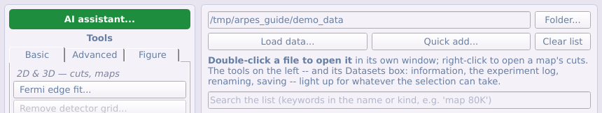
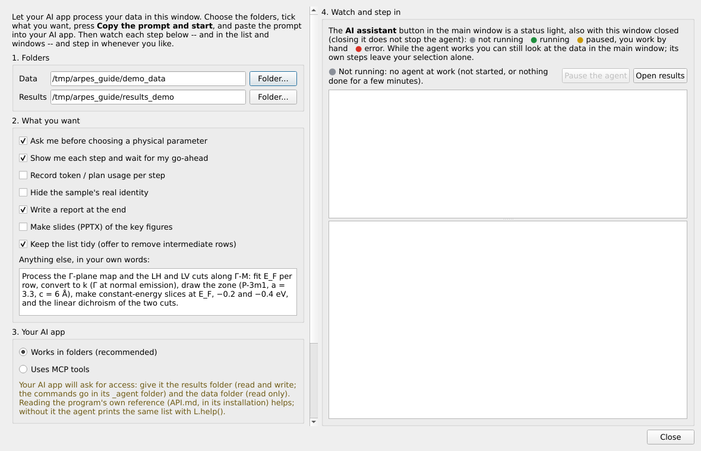
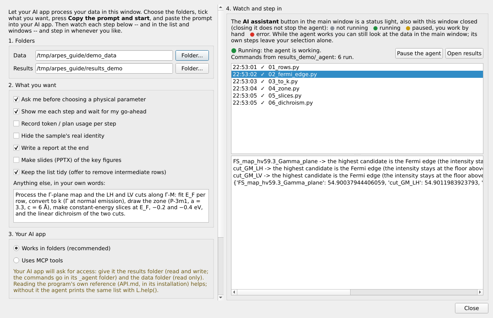
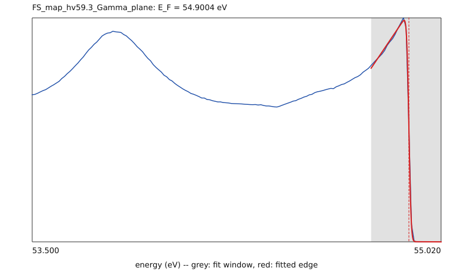

# 第七部分 AI 智能体

AI 智能体（Claude，或任何能读写文件、能调用 MCP 工具的应用）可以在你的屏幕上一步步操作本程序，你在一旁观看并可随时接手。本部分介绍其工作原理、如何启动和监控智能体，并给出一个从配置到成图的实例。

## 7.1 工作原理，以及哪些内容会离开你的电脑

本程序没有自己的聊天界面。你用自然语言与 AI 应用（Claude 桌面版、Claude Code 或其他智能体）对话，
本程序是这个智能体的工具。智能体给程序发送一个个小步骤：列出数据、拟合费米边、转换到动量空间、
作图。程序在你的屏幕上执行每一步，每个结果都以列表中的新行或新窗口出现，你可以随时暂停智能体、
手动操作。

**哪些内容留在你的电脑上，哪些不是：**

- 原始数据文件留在原处，由程序在本地读取和处理。程序本身不上传任何东西。
- **智能体读到的内容**会作为对话的一部分发送给 AI 服务商：每一步打印的文字（行名、拟合值、轴范围），
  以及智能体为判断结果而查看的图片。要求精简输出时，对话中只有数字和少量图片，没有你的数据数组。
- 服务商能否把对话内容用于训练，取决于服务商和你的账户设置。开始前请先确认。
- 私有代码、未发表的稿件以及任何不想被读取的内容，请不要放在智能体能访问的文件夹中。只给它数据文件夹
  （只读）和结果文件夹。

和任何分析一样，使用智能体的结果之前请先检查。

## 7.2 架构：操作、参考文档与连接方式

```
 你  ⇄  AI 应用（对话）                      ARPES viewer（在你的屏幕上）
            │                                 ┌──────────────────────────┐
            │  写入 <results>/_agent/          │  逐个运行命令文件，或     │
            ├──── viewer_cmd/01_….py  ───────▶ │  逐个 MCP 调用，          │
            │                                 │  L = 程序的操作           │
            │  读取 out/cmd_01_….log  ◀─────── │  新行、新窗口、新文件     │
            │  （或 MCP 工具的返回）            └──────────────────────────┘
```

- **操作 `L`。** 约五十个有文档说明的操作，作用于主列表中按名称指定的行
  （`arpes_viewer/ui/common/live.py`）：`L.rows()`、`L.add_files(...)`、`L.fermi_edge_search(...)`、
  `L.fermi_edge(...)`、`L.map_to_k(...)`、`L.kz_to_k(...)`、`L.bz_overlay(...)`、
  `L.cut_arithmetic(...)`、`L.slice_series(...)`、`L.figure_render(...)` …… 每个操作都添加新行而不修改
  旧行，从不覆盖文件，也从不等待点击。行可以用名称、在 `L.rows()` 中的序号或其文件路径指定。
- **参考文档 `API.md`**（`arpes_viewer/agent/API.md`，在已安装的程序内）列出全部操作、工具面板按钮、
  MCP 工具和 `tools/` 中的计算函数及其参数。它由程序自动生成，因此始终是最新的；智能体读它而不读
  源代码。`L.help()` 打印同样的列表。
- **三种连接方式**，调用同一套操作：
  1. **命令文件夹**（推荐）：智能体每一步写一个小 Python 文件到 `<results>/_agent/viewer_cmd/`，
     程序运行它并把输出写到 `<results>/_agent/out/`。任何能读写文件的 AI 应用都可以，每一步都以文件
     形式保留。
  2. **MCP**：AI 应用通过本程序的 MCP 服务器（`arpes-viewer-mcp`）调用；程序以 agent bridge 启动时，
     `viewer_api` 调用的就是同一套操作。
  3. **无界面脚本**：`arpes_viewer/tools/` 中的计算和无界面工作区，适合留存的脚本。
- **窗口。** 操作中仅为驱动而打开的窗口（转换对话框、临时图）不会出现在屏幕上；一步结束时仍打开的窗口
  （图、查看窗口、等你输入的工具）出现在主面板所在的屏幕上，不会打扰你正在使用的另一块屏幕。

## 7.3 从 AI assistant 面板启动



点击工具面板顶部的 **AI assistant...**。



1. **文件夹。** **数据**文件夹（智能体只读）和**结果**文件夹（智能体写的一切都在这里；命令在
   `<结果文件夹>/_agent` 中）。
2. **需求。** 勾选适用的选项：
   - *Ask me before choosing a physical parameter*：选择 Γ 位置、能量窗口、内势、阈值之前先问你；
   - *Show me each step and wait for my go-ahead*：每一步等你确认；
   - *Record token / plan usage per step*：每一步一行的使用记录；
   - *Hide the sample's real identity*：在所有输出中隐藏样品真实身份；
   - *Write a report*、*Make slides*：写报告、做幻灯片；
   - *Keep the list tidy*：最后建议移除中间结果行。

   然后用自己的话写下需求：哪些数据、哪些步骤、哪些图。
3. **AI 应用。** *Works in folders*（推荐，无需配置）或 *Uses MCP tools*（提示词会说明如何连接一次）。
4. 点击 **Copy the prompt and start**。程序开始监听，提示词已在剪贴板中。**Show the prompt** 可查看
   全文：文件夹、`API.md` 的位置、如何发送步骤，以及工作规则（[§7.6](#76-智能体遵循的工作规则)）。
5. 把提示词粘贴进 AI 应用并发送。应用请求权限时，允许它读取数据文件夹、读写结果文件夹。

## 7.4 监控与介入



- **步骤列表**（右侧）：智能体运行的每一步，带时间和 ✓，失败则显示红色 ✗。点击某一步可查看它的输出。
- **状态灯**在 **AI assistant** 按钮上，关闭窗口后依然有效：灰色未运行，绿色运行中，黄色已暂停，
  红色某步失败或命令不再被执行。关闭窗口不会停止智能体。
- **Pause the agent** 暂缓执行智能体后续的命令（灯变黄），你可以手动操作；**Resume** 恢复执行。
  智能体被告知：命令被暂缓时要等待并询问你。
- **你的工作不受影响。** 智能体的步骤不会改变你在列表中的选择，你可以在它工作时查看数据；它仅为驱动而
  打开的窗口不会出现在你的屏幕上。
- **Open results** 打开结果文件夹：`_agent` 中有智能体的命令文件和日志，以及它写出的图片和图。

## 7.5 其他启动方式

- **Claude Code 或其他 MCP 应用。** 在 AI assistant 中选择 *Uses MCP tools*：程序打开 agent bridge，
  提示词中包含添加服务器的命令，对 Claude Code 是
  `claude mcp add arpes-viewer -- python -m arpes_viewer.agent`。如果你的应用按需加载工具定义，
  让它一次性加载全部 arpes-viewer 工具。
- **手动。** 以 agent bridge 启动程序（`arpes-viewer --agent-bridge`），把 `arpes-viewer-mcp`
  加入应用的 MCP 服务器，并告诉智能体 `API.md` 的位置。
- **不用面板的命令文件夹。** `agentic/launch_viewer.py` 让程序监听你指定的文件夹；
  `agentic/README.md` 是分步指南，`agentic/PROMPTS.md` 中有可复制的请求，`agentic/examples/` 中有可运行的示例。
- **需要留存的脚本。** `arpes_viewer/tools/` 中的计算不需要窗口；`devtools/figure_tests.py`
  就是这样从演示数据生成两张完整的图。

以下是 MCP 服务器的详细说明，供参考：

ARPES viewer 同时是一个 **MCP 服务器**（Model Context Protocol，模型上下文协议），因此任何模型的
AI 智能体——Claude、GPT、Gemini，或在支持 MCP 的客户端（Claude Desktop / Claude Code、Cursor、
VS Code、Cline、LM Studio 等）中运行的本地模型——都可以把它当作一组工具来调用。所有操作都在本机
进行：文件在本地读写，只有工具返回的内容（数字、文本、图片）会交给客户端。

**设置。** 安装本程序时会同时安装命令 `arpes-viewer-mcp`（在源码目录中则为
`python -m arpes_viewer.agent`）。把它加入客户端的 MCP 服务器配置，例如
`claude_desktop_config.json`、`.mcp.json` 或客户端的设置：

```json
{
  "mcpServers": {
    "arpes-viewer": {"command": "arpes-viewer-mcp"}
  }
}
```

（不经 `pip install` 而直接用源码目录时：`"command": "python", "args": ["-m",
"arpes_viewer.agent"], "cwd": "<ARPES-viewer 文件夹>"`。）服务器通过 stdin/stdout 使用 MCP 协议，
除程序本身的依赖外不需要其他软件包。

**无界面工具**——不需要打开窗口，使用程序自身的读取器和算法：

| 工具 | 作用 |
|---|---|
| `find_files`、`list_loaders` | 文件夹中可被识别的数据文件，以及可用的读取器 |
| `open_dataset`、`list_datasets`、`describe`、`metadata`、`close_dataset` | 打开数据集（得到编号，如 `d1`），查看其坐标轴与元数据 |
| `get_profile` | EDC 或 MDC：沿一个轴的数值，对其他轴的指定范围取平均（可另存为 CSV） |
| `get_image` | cut、等能面或色散图的 PNG 图片，可设色表与色阶（可另存为 PNG / CSV） |
| `fit_fermi_edge` | 拟合 E_F 与分辨率，并给出误差 |
| `shift_energy`、`crop` | 平移到 E − E_F 的副本、裁剪后的副本 |
| `convert_cut_to_k`、`convert_map_to_k` | k 转换，选项与对应窗口相同（Γ、旋转；*energy offset* 仅用于非动能的能量轴；*output_fermi_level_eV* 得到 E − E_F 的结果） |
| `save_datasets` | 保存为 `.nxs`（本程序可打开）或 `.itx` / `.ibw`（Igor Pro） |
| `brillouin_zone`、`read_cif` | 给定空间群与晶胞时布里渊区的高对称点；CIF 文件的晶胞和原子位置 |

坐标轴可以用序号、轴名（`x`、`y`、`k`、`z`）或标签中的一个词（`energy`、`slit`、`deflector`、
`kx`）指定；范围写成 `[lo, hi]`（该轴的单位），或一个数（取最近的平面）。

**屏幕上的程序**——用 bridge 模式启动：

```bash
arpes-viewer --agent-bridge
```

（或 `python -m arpes_viewer --agent-bridge`，或设置环境变量 `ARPES_VIEWER_AGENT_BRIDGE=1`）。
状态栏会显示 *Agent bridge on 127.0.0.1:…*。之后 `viewer_*` 工具即可操作该窗口：`viewer_status`、
`viewer_rows`、`viewer_add_files`、`viewer_select`、`viewer_run_tool`（对所选行按下任意工具面板
按钮——`fermi`、`kcut`、`kmap`、`bz3d`、`figure`、`notch3d`、`combine` 等）、`viewer_windows`、
`viewer_screenshot`（任意窗口的截图，便于智能体检查结果）、`viewer_figure` 与
`viewer_render_figure`（以数字给出作图窗口的页面、面板位置、标题、色阶和字号，并按打印效果写出
PNG）、`viewer_close_window` 和
`viewer_python`（在程序内运行 Python，`A` 为程序主模块——用于设置对话框字段、按下按钮）。
无界面得到的结果可以用 `save_datasets` 存为 `.nxs`，再用 `viewer_add_files` 加入列表。

**安全。** bridge 默认关闭；开启后只监听 127.0.0.1（不对网络开放），并只接受带有随机令牌的请求——
令牌在启动时写入 `~/.arpes_viewer/agent_bridge.json`（仅本用户可读），程序关闭时删除该文件。
`viewer_python` 会在程序中执行代码——请像允许智能体在你电脑的 Python 控制台中输入命令那样
谨慎授权。

命令文件夹方式的详细说明见 [docs/AGENTIC_WORKFLOW_en.md](../../AGENTIC_WORKFLOW_en.md)；MCP
服务器是同样的思路，只是不需要文件夹。

## 7.6 智能体遵循的工作规则

提示词给智能体的规则来自真实的数据处理会话；`API.md` 中也写有这些规则。你可以在需求中添加自己的规则，
或覆盖其中某一条。

| 规则 | 原因 |
|---|---|
| 添加数据后，把行与文件夹对照，报告漏加、未识别或有警告的文件 | map 文件夹里混入的单张谱、读取器不认识的文件不能悄悄漏过 |
| 说明行名中哪些部分来自文件名、哪些来自记录的元数据；标出推测的部分 | 之后所有人都读这些名称 |
| 自己计算之前先查找操作（`L.help()`、`L.tools()`、`L.functions()`）；绝不直接修改程序的内部数据表；缺少某个操作时说明是哪个，并先询问 | 结果可复现，并带有处理历史 |
| 费米能级：在原始数据上、逐行、在该行自己的能量轴上拟合（`L.fermi_edge_search`），每次拟合都出图；相同光子能量和通能的行必须一致；数据无法判断时询问一次 | 最陡的下降不一定是费米边；一个窗口不适用于所有能量轴 |
| 把多个步骤合并为一次调用（`L.map_to_k(row, ef=…, normalise_axes=(1, 2))`），列表中只保留最终结果；只有你同意时才移除行 | 列表保持可读 |
| 先在 `check/` 中试做图，每张图只在 `figures/FigureN/` 中发布一个版本，被替换的版本移到一旁 | 每张图只有一个最终文件 |
| 有正负号的量（二色性、差值）用发散色图和对称色阶 | 正负必须一目了然 |
| 精简输出：`L.rows(compact=True)`、`L.profile(..., summary=True)`，大数组写入文件 | 更少的 token，发送给服务商的内容更少 |
| 绝不删除或覆盖；（若勾选）选择任何物理参数前先询问 | 你的数据和你的决定始终属于你 |

## 7.7 实例：智能体从配置到成图

这个实例沿用了一次用智能体处理 CASSIOPEE 真实数据的过程（多种偏振下的费米面 map 和 cut，一直做到
二色性图），这里在演示数据上重做，方便你重复。那次会话促成的程序改进见
[CHANGELOG](../../../CHANGELOG.md)（1.3.2）。

**1. 配置。** AI assistant：数据 `demo_data`，结果 `results_demo`；勾选 *ask before a physical
parameter*、*step by step*、*report* 和 *tidy list*；需求：*"Process the Γ-plane map and the LH and
LV cuts along Γ-M: fit E_F per row, convert to k (Γ at normal emission), draw the zone (P-3m1,
a = 3.3, c = 6 Å), make constant-energy slices at E_F, −0.2 and −0.4 eV, and the linear dichroism
of the two cuts."* → **Copy the prompt and start**，粘贴进 AI 应用。

**2. 先看数据。** 智能体的第一个命令文件：

```python
print(L.add_files(DATA))           # added, left_out, unrecognised, warnings
print(L.rows(compact=True))        # 每行一句
```

它报告文件夹里有什么并提出计划；勾选了 *step by step* 时，它会等你确认。

**3. 逐行确定费米能级**，每行在自己的能量轴上：

```python
found = L.fermi_edge_search(row, temperature=20)   # 候选费米边
fit = L.fermi_edge(row, found["candidates"][0]["window"], temperature=20,
                   picture=os.path.join(HERE, "ef_" + row + ".png"))
```



`fermi_edge_search` 列出 EDC 中所有高于噪声的下降，按能量从高到低，逐个拟合并指出哪一个是费米边。
当两个都拟合得好时（例如真实的通能 20 数据中，强下降之上还有一段弱尾巴），它会明确说出来，智能体
就问你一次。每次拟合都会出图：灰色为拟合窗口，红色为拟合的费米边。

**4. 转换到动量空间，每个数据一行。**

```python
k = L.map_to_k(MAP, ef=EF[MAP], normalise_axes=(1, 2), new_name="map Gamma plane k")
L.cut_to_k("cut_GM_LH", ef=EF["cut_GM_LH"], new_name="cut GM LH k")
```

平移到 E − E_F、对 map 的每个 cut 归一化、动量转换在一次调用中完成：列表中只出现最终结果，其历史
记录了这三步。

**5. 布里渊区与作图。**

```python
L.bz_overlay("map Gamma plane k", space_group=164, a=3.3, c=6.0, hkl=(0, 0, 1), offset=0.0)
L.slice_series("map Gamma plane k", values=[0, -0.2, -0.4], half_width=0.02, cols=3,
               colormap="blue", flip=True, shared=False, percentiles=(3, 99.7),
               high_factor=1.4, zone_style="dashed", zone_color="#B8D62020",
               title="Figure 1")
L.figure_render("Figure 1", os.path.join(HERE, "..", "figures", "Figure1.png"), dpi=150)
```


**6. 二色性。**

```python
L.cut_arithmetic("cut GM LH k", "cut GM LV k", operation="asymmetry", normalise="total")
```

这是程序自己的 cut 运算，与 Cut arithmetic 窗口相同（[§5.5](#55-cut-运算二色性与参考谱归一)）：LV 按 LH 的总强度缩放，
计算 (LH − LV)/(LH + LV)，低强度的点被屏蔽。

**7. 监控。** 期间 AI assistant 列出每一步（[§7.4](#74-监控与介入)）；你可以点击某一步阅读输出，暂停后自己查看
某个数据，再恢复。最后智能体写出报告，并在你同意后移除中间结果行；结果文件夹中有图、拟合图片和每一个
命令文件，完整记录了做过的事。

## 7.8 局限与良好习惯

- **检查物理结果。** 智能体可能选出看似合理但错误的费米边、Γ 位置或内势。请勾选 *Ask me before
  choosing a physical parameter*，并查看每张拟合图。
- **保留记录。** `<结果文件夹>/_agent/` 中的命令文件和各行的历史说明了做过什么；请与结果一起保存。
- **用量。** 智能体看不到自己的 token 用量；如果想在使用记录中写入数字，请提供给它。
- **隐私。** 只有智能体读到的内容会离开你的电脑（[§7.1](#71-工作原理以及哪些内容会离开你的电脑)）；私密内容不要放在它能访问的文件夹中。
- **编码。** 命令文件使用 UTF-8；当某一步的代码中有因编码错误而乱码的字符（如把 "−" 写成 "−"）时，
  程序会给出警告。
